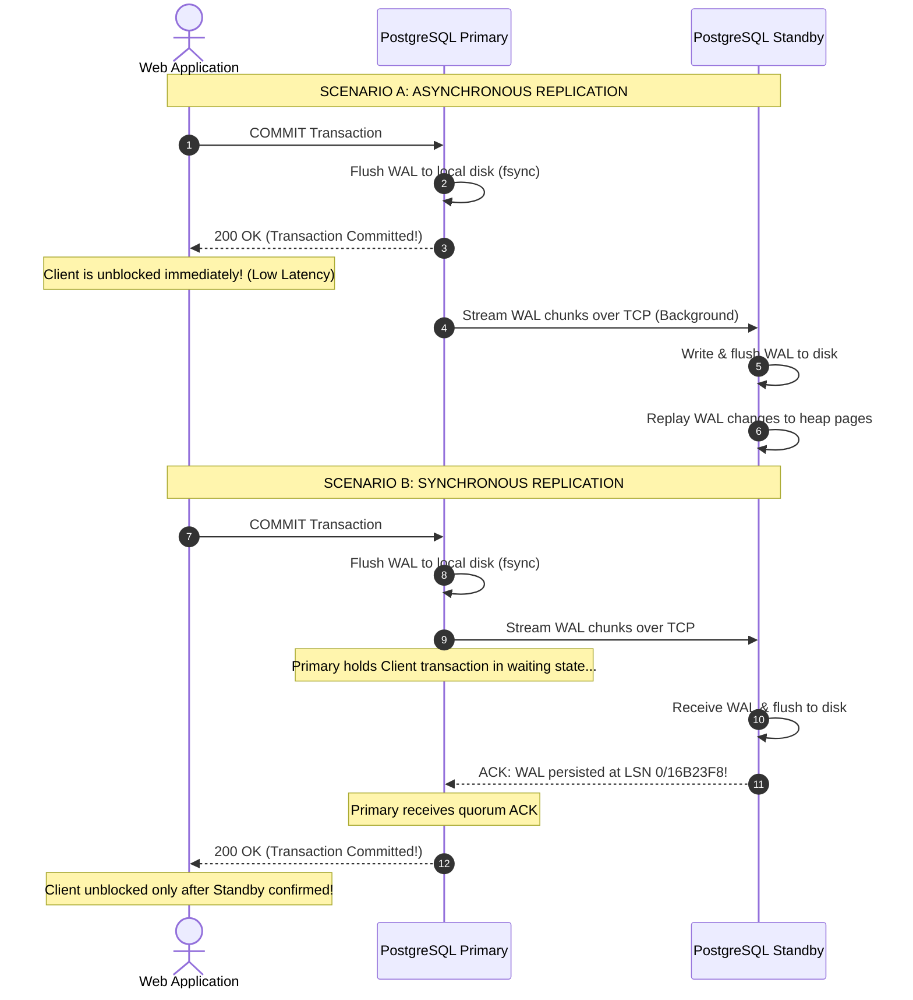
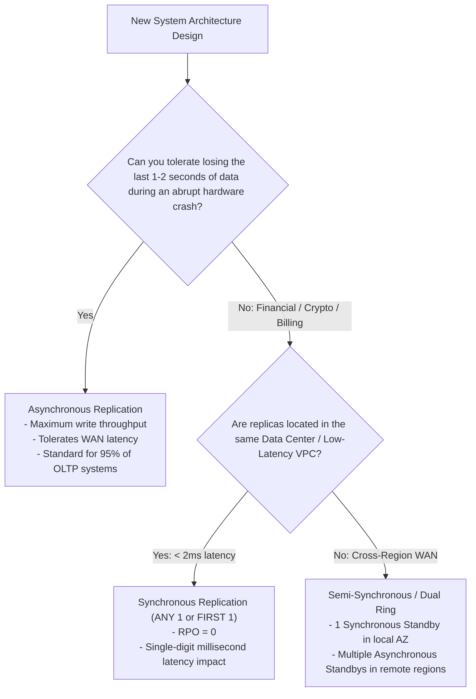

#Database #Replication #SynchronousReplication #AsynchronousReplication #PostgreSQL #Quorum #HighAvailability #RPO #RTO #SystemDesign #CoreConcept

> [!abstract] Executive Summary
> When data is written to a primary database node, the replication subsystem must decide **when to return success to the client application**. This decision establishes the fundamental trade-off between **write latency** and **durability/consistency**:
> 
> 1. **Asynchronous Replication (Default):** The primary writes to its local Write-Ahead Log (WAL), commits the transaction, and returns success immediately. Standby replicas receive and replay the log asynchronously in the background. While write throughput is maximized, replication lag introduces **eventual consistency** and the risk of **data loss upon primary crash**.
> 2. **Synchronous Replication:** The primary writes to its local WAL, transmits the log to one or more standby replicas, and **suspends the client's transaction until the replicas acknowledge receipt and persistence**. This achieves a **Recovery Point Objective of zero (RPO = 0)**, but bounds write latency by the slowest replica's network round-trip time ($RTT$).
> 
> Modern enterprise engines (PostgreSQL, Cassandra, CockroachDB) resolve this tension using **Quorum Replication** and flexible priority configurations (`FIRST n`, `ANY n`).

---

## 1. The Write Propagation Timeline: Sync vs. Async

Understanding the exact physical sequence of events during a database `COMMIT` is essential for choosing between synchronous and asynchronous replication.



---

## 2. In-Depth Comparison: Asynchronous vs. Synchronous Replication

```
┌─────────────────────────────────────────────────────────────────────────────────────────────────┐
│                       SYNCHRONOUS vs. ASYNCHRONOUS REPLICATION MATRIX                           │
├─────────────────────────┬───────────────────────────────┬───────────────────────────────────────┤
│ Dimension               │ Asynchronous Replication      │ Synchronous Replication               │
├─────────────────────────┼───────────────────────────────┼───────────────────────────────────────┤
│ **Client Write Latency**│ **Minimal:** Bounded only by  │ **High:** Bounded by local disk fsync │
│                         │ local primary disk fsync.     │ + Network $RTT$ + remote replica fsync│
├─────────────────────────┼───────────────────────────────┼───────────────────────────────────────┤
│ **Recovery Point**      │ **RPO > 0:** Non-zero risk of │ **RPO = 0:** Zero data loss           │
│ **Objective (RPO)**     │ data loss if primary crashes. │ guaranteed upon failover.             │
├─────────────────────────┼───────────────────────────────┼───────────────────────────────────────┤
│ **Replica Availability**│ Standby downtime does **not** │ Standby failure can **freeze writes** │
│ **Impact on Primary**   │ affect primary write path.    │ on primary (unless quorum configured).│
├─────────────────────────┼───────────────────────────────┼───────────────────────────────────────┤
│ **Consistency Model**   │ **Eventual Consistency:**     │ **Strict / Read-Your-Own-Writes:**    │
│                         │ Replicas exhibit lag.         │ Replicas are completely caught up.    │
├─────────────────────────┼───────────────────────────────┼───────────────────────────────────────┤
│ **Geographic Spanning** │ ✅ Excellent for distant WAN  │ ❌ Painful over WAN (each commit incurs│
│                         │ (US to Europe / Asia).        │ 80ms - 150ms network round-trip).     │
└─────────────────────────┴───────────────────────────────┴───────────────────────────────────────┘
```

---

## 3. The Quorum Problem: Balancing Availability and Durability

Imagine a production database cluster with **seven standby replicas** serving read traffic across multiple regions.

If you configure **pure synchronous replication across all seven replicas**, the primary must wait for all seven machines to acknowledge every single `INSERT` or `UPDATE`.
- If a single replica experiences a network blip or maintenance restart, **all write operations on the entire primary database lock up and freeze**!
- Latency is governed by the **slowest, most degraded replica** in the cluster.

To solve this, modern distributed database engines implement **Flexible Quorums**.

```
┌─────────────────────────────────────────────────────────────────────────────────────────────────┐
│                              POSTGRESQL QUORUM CONFIGURATIONS                                   │
└─────────────────────────────────────────────────────────────────────────────────────────────────┘

 1. FIRST N (Priority-Based Replication):
    synchronous_standby_names = 'FIRST 2 (standby1, standby2, standby3, standby4)'
    - The primary checks the standbys in strict list order.
    - If standby1 and standby2 are healthy, it waits for their ACK.
    - If standby1 crashes, it automatically falls back to standby2 and standby3!

 2. ANY N (Quorum-Based Replication):
    synchronous_standby_names = 'ANY 2 (standby1, standby2, standby3, standby4)'
    - The primary waits for ACKs from ANY 2 healthy standbys out of the pool.
    - Unblocks as soon as the two fastest replicas reply. Eliminates the slow-node penalty!
```

### The Cassandra / Dynamo Quorum Formula
In distributed NoSQL systems like Apache Cassandra:

$$\text{Quorum} = \left\lfloor \frac{N}{2} \right\rfloor + 1$$

To guarantee **Strong Consistency** across concurrent reads and writes, the combined read and write quorums must overlap:

$$W + R > N$$

- Where $N$ is total replicas, $W$ is write quorum, and $R$ is read quorum.
- If $W + R > N$, at least one node in any read quorum is guaranteed to hold the latest committed write.

---

## 4. PostgreSQL Synchronous Commit Modes

PostgreSQL provides a granular setting named `synchronous_commit` that allows DBAs to tune the exact degree of synchronization per transaction or session:

```sql
SET synchronous_commit = 'on'; -- Default
```

```
┌─────────────────────────────────────────────────────────────────────────────────────────────────┐
│                         POSTGRESQL `synchronous_commit` SETTINGS                                │
├─────────────────────────┬───────────────────────────────────────────────────────────────────────┤
│ Setting Value           │ When Client `COMMIT` Returns OK                                       │
├─────────────────────────┼───────────────────────────────────────────────────────────────────────┤
│ `off`                   │ Immediately when WAL is in server memory buffer. Does not even wait   │
│                         │ for local disk `fsync`! (Asynchronous Commit: fastest, small loss risk)│
├─────────────────────────┼───────────────────────────────────────────────────────────────────────┤
│ `local`                 │ Waits for WAL to be flushed to **local primary disk**, but ignores    │
│                         │ standby replicas entirely.                                            │
├─────────────────────────┼───────────────────────────────────────────────────────────────────────┤
│ `remote_write`          │ Waits until standby receives WAL and passes it to the OS kernel cache │
│                         │ (survives PostgreSQL crash on standby, but not standby power loss).   │
├─────────────────────────┼───────────────────────────────────────────────────────────────────────┤
│ `on` *(Default Sync)*   │ Waits until standby flushes WAL to **physical disk** (`fsync`).       │
├─────────────────────────┼───────────────────────────────────────────────────────────────────────┤
│ `remote_apply`          │ Waits until standby flushes WAL to disk **AND finishes replaying it** │
│                         │ into table heap pages! (Guarantees zero replication lag for reads).   │
└─────────────────────────┴───────────────────────────────────────────────────────────────────────┘
```

> [!TIP] The `remote_apply` Superpower
> If your application requires absolute **Read-Your-Own-Writes** consistency across read replicas without sticky sessions, setting `synchronous_commit = 'remote_apply'` guarantees that the moment `COMMIT` returns to the client, the updated data is **instantly queryable on the standby replica**.

---

## 5. Architectural Trade-Off Analysis



### The Production Sweet Spot: The "Local Sync, Remote Async" Pattern
Enterprise architectures rarely choose 100% synchronous or 100% asynchronous replication across all nodes. Instead, they combine both:
- **Local Availability Zone (AZ):** Deploy 1 Primary in AZ-A and 1 Synchronous Standby in AZ-B (sub-millisecond latency link). If AZ-A catches fire, failover occurs with **zero data loss ($RPO = 0$)**.
- **Remote Regions (Cross-Continent):** Deploy Asynchronous Standbys in Europe and Asia. Transatlantic latency does not slow down primary writes, while local users enjoy low-latency read caches.

---

## 6. Senior Engineer Production Checklist

- [ ] **Avoid pure synchronous replication over WAN:** Never configure synchronous replication between data centers separated by more than 50km unless application write volume is negligible.
- [ ] **Always use `ANY N` or `FIRST N` with fallback replicas:** Never bind synchronous commit to a single named replica without configuring alternates; otherwise, one maintenance reboot halts all application writes.
- [ ] **Tune `synchronous_commit` per transaction:** For non-critical high-volume metrics or log ingestion, override the session: `SET LOCAL synchronous_commit = 'off';` to achieve $10\times$ write throughput.
- [ ] **Set alert thresholds on replication lag:** Alert immediately if `pg_wal_lsn_diff(pg_current_wal_lsn(), replay_lsn)` exceeds 100MB or if `replay_lag` exceeds 10 seconds.
- [ ] **Define clear RPO and RTO SLAs:** Document business tolerance for Recovery Point Objective (data freshness) and Recovery Time Objective (downtime duration) before selecting sync vs. async replication.

---

## 7. Related Notes & Conceptual Navigation

- [[01_Database Replication Fundamentals_ Master-Standby vs. Multi-Master Architectures|Database Replication Fundamentals: Master-Standby vs. Multi-Master]]
- [[03_Hands-On PostgreSQL Streaming Replication Demo_ Docker Cluster, WAL Streaming, and standby.signal|Hands-On PostgreSQL Streaming Replication Demo]]
- [[04_Database Replication Trade-Offs_ Pros, Cons, and Global Multi-Region Architecture|Database Replication Trade-Offs & Multi-Region Architecture]]
- [[05_Two-Phase Locking (2PL)_ Growing, Shrinking, and The Double Booking Problem|Two-Phase Locking (2PL)]]
- [[06_Database Partitioning Fundamentals_ Horizontal vs. Vertical Partitioning|Database Partitioning Fundamentals]]
