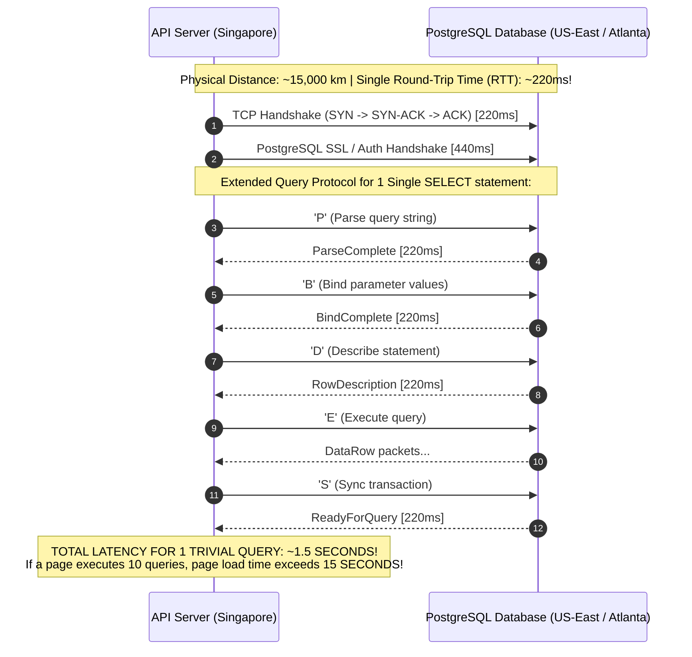
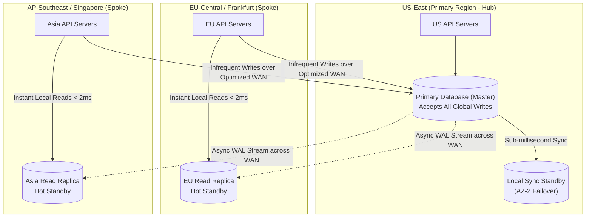
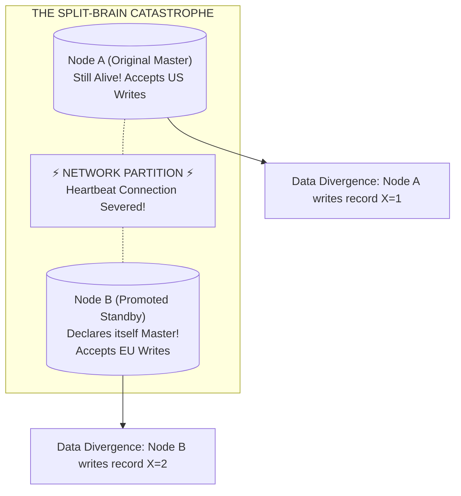

#Database #Replication #HighAvailability #MultiRegion #Architecture #Networking #Latency #SystemDesign #ProductionEngineering #CoreConcept

> [!abstract] Executive Summary
> Database replication is not a free lunch. While it delivers **horizontal read scalability, fault tolerance, and disaster recovery**, it introduces critical trade-offs: **eventual consistency lag, write latency penalties (under synchronous mode), and complex distributed failure modes (e.g., Split-Brain)**.
> 
> Furthermore, in global architectures, database wire protocols (PostgreSQL, MySQL, Oracle) are **notoriously chatty over TCP**. Attempting to connect an application server in Singapore directly to a database in North America results in devastating latency. 
> 
> The foundational rule of distributed data systems is: **"Keep your applications close and your databases closer."** This guide analyzes the architectural trade-offs of replication, the physics of database wire protocols, read/write splitting topologies, and high-availability automated failover patterns.

---

## 1. The Comprehensive Replication Trade-Off Matrix

```
┌─────────────────────────────────────────────────────────────────────────────────────────────────┐
│                             PROS AND CONS OF DATABASE REPLICATION                               │
├───────────────────────────────┬─────────────────────────────────────────────────────────────────┤
│ The Advantages (Pros)         │ Architectural Impact                                            │
├───────────────────────────────┼─────────────────────────────────────────────────────────────────┤
│ **1. Horizontal Read Scale**  │ Add read replicas dynamically to absorb traffic spikes without  │
│                               │ scaling up expensive primary CPU/RAM hardware.                  │
├───────────────────────────────┼─────────────────────────────────────────────────────────────────┤
│ **2. High Availability (HA)** │ If the primary hardware dies, a replica is promoted to become   │
│                               │ the new master in seconds, slashing Mean Time To Recovery (MTTR)│
├───────────────────────────────┼─────────────────────────────────────────────────────────────────┤
│ **3. Disaster Recovery (DR)** │ Standby copies stored across different continents survive       │
│                               │ catastrophic regional power grid or cloud provider outages.     │
├───────────────────────────────┼─────────────────────────────────────────────────────────────────┤
│ **4. Workload Isolation**     │ Heavy analytical queries, BI reporting, and nightly ETL jobs can│
│                               │ target dedicated replicas without degrading customer OLTP.     │
├───────────────────────────────┼─────────────────────────────────────────────────────────────────┤
│ **The Disadvantages (Cons)**  │ Operational Hazard & Mitigation                                 │
├───────────────────────────────┼─────────────────────────────────────────────────────────────────┤
│ **1. Eventual Consistency**   │ Asynchronous replication creates **Replication Lag**, producing │
│                               │ dirty or stale reads and violating Read-Your-Own-Writes.        │
├───────────────────────────────┼─────────────────────────────────────────────────────────────────┤
│ **2. Slowed Writes (Sync)**   │ Synchronous replication forces the primary to wait for network  │
│                               │ round-trips to replicas, increasing commit latency by 2x-5x.    │
├───────────────────────────────┼─────────────────────────────────────────────────────────────────┤
│ **3. Multi-Master Conflicts** │ Active-Active topologies suffer concurrent update conflicts     │
│                               │ requiring complex, error-prone conflict resolution strategies.   │
├───────────────────────────────┼─────────────────────────────────────────────────────────────────┤
│ **4. Split-Brain Risk**       │ Network partitions can cause two nodes to declare themselves    │
│                               │ primary simultaneously, creating permanent data divergence.     │
└───────────────────────────────┴─────────────────────────────────────────────────────────────────┘
```

---

## 2. The Chatty Wire Protocol: Why Distance Destroys Database Performance

Many engineering teams deploy their application servers in one continent (e.g., Singapore) and connect them to a centralized primary database in another continent (e.g., US-East / Atlanta). 

They assume that because fiber optic cables transmit data near the speed of light, latency will be acceptable. **This architecture invariably fails in production.**



### Why Database Protocols are Chatty:
1. **TCP Packet Fragmentation & ACKs:** Database result sets are split into multiple Maximum Transmission Unit (MTU) packets (~1500 bytes). Each packet must be acknowledged over high-latency WAN links.
2. **Multi-Step Protocol Exchanges:** Modern drivers use the **PostgreSQL Extended Query Protocol** (Parse, Bind, Describe, Execute, Sync). While pipelining helps, transactional boundaries (`BEGIN` -> queries -> `COMMIT`) require sequential round-trips.
3. **Connection Establishment Tax:** Opening a new database connection over transatlantic links takes **500ms to 800ms**.

> [!IMPORTANT] The Golden Rule of Database Topology
> **"Keep your applications close and your databases closer."**
> Never route database wire traffic across the public internet or transatlantic WAN. Application servers must always reside in the **same local cloud VPC / Availability Zone** as the database node they are querying.

---

## 3. Global Multi-Region Architecture Blueprint

To provide fast response times for users worldwide without crossing transatlantic links on every query, enterprise systems employ a **Hub-and-Spoke Regional Topology**:



### How This Solves the Performance Dilemma:
1. **95% of Traffic is Reads:** Users in Europe and Asia execute `SELECT` queries against their **local regional replica** with **< 2ms latency**.
2. **Writes are Asynchronously Replicated:** The primary streams WAL changes to Europe and Asia in the background without blocking local US writes.
3. **Cross-Region Writes Use Application HTTP Proxies:** Instead of letting European app servers talk chatty database wire protocol to the US master, the EU app sends a single, compact **REST/gRPC request** to a US backend service, which executes the transactional SQL locally.

---

## 4. Read/Write Splitting Topologies in Application Code

To leverage read replicas, the application architecture must intelligently route SQL statements:

```
┌─────────────────────────────────────────────────────────────────────────────────────────────────┐
│                                READ / WRITE SPLITTING ARCHITECTURE                              │
└─────────────────────────────────────────────────────────────────────────────────────────────────┘

                            Incoming HTTP Request
                                     │
                     ┌───────────────┴───────────────┐
                     │ API Gateway / Express Router  │
                     └───────────────┬───────────────┘
                                     │
             ┌───────────────────────┴───────────────────────┐
             │ Method === 'GET'?                             │
            YES                                              NO
             │                                               │
             ▼                                               ▼
   ┌────────────────────┐                          ┌────────────────────┐
   │    replicaPool     │                          │    primaryPool     │
   │  (Load Balanced)   │                          │  (Single Master)   │
   └─────────┬──────────┘                          └─────────┬──────────┘
             │                                               │
             ├───────────────┬───────────────┐               │
             ▼               ▼               ▼               ▼
        [Replica 1]     [Replica 2]     [Replica 3]      [Primary Master]
```

### The Middleware Proxy Pattern (HAProxy / PgBouncer / Envoy)
Rather than cluttering application code with multiple pools, deploy a database proxy that performs automatic routing:
- **Port 5432 (Write Endpoint):** Forwards to the active Primary.
- **Port 5433 (Read Endpoint):** Round-robins queries across all healthy Standby Replicas.

---

## 5. Automated Failover & The Split-Brain Catastrophe

When the primary database crashes, a standby replica must be promoted to become the new read-write master. However, automated failover introduces the most catastrophic failure mode in distributed systems: **Split-Brain**.



### Why Split-Brain Destroys Companies:
If a transient network partition cuts off communication between the primary and the standby:
- The standby assumes the primary is dead and promotes itself to Master.
- The original primary is actually still running and continues accepting writes from local clients.
- **Result:** You now have **two active masters accepting conflicting writes**. Reconnecting them is mathematically impossible without manual data forensics and permanent data loss!

### The Solution: Consensus-Backed Orchestration (Patroni + etcd)
Modern production clusters prevent split-brain using **Distributed Consensus Quorums**:

1. **Leader Key with TTL in etcd/Consul:** The primary must continuously refresh an ephemeral lease key in an odd-numbered consensus cluster (e.g., 3 or 5 etcd nodes).
2. **Quorum Requirement:** A standby cannot promote itself unless a **strict majority ($N/2 + 1$)** of consensus nodes agree that the primary lease has expired.
3. **Fencing / STONITH ("Shoot The Other Node In The Head"):** The orchestration software physically terminates power or cuts network access to the old primary before promoting the new master.

---

## 6. Senior Engineer Production Checklist

- [ ] **Co-locate compute and persistence:** Always deploy API application instances in the same cloud region and Availability Zone as their target database.
- [ ] **Implement Read/Write connection splitting:** Ensure read-only reporting queries never consume connections or CPU cycles on the primary write master.
- [ ] **Enforce Split-Brain fencing (Patroni / DCS):** Never implement custom home-grown failover bash scripts. Always use battle-tested consensus orchestrators like Patroni, etcd, or AWS Aurora Global Database.
- [ ] **Protect against cascading replica thundering herds:** Configure circuit breakers on read replica pools so that a single failing replica does not overwhelm remaining replicas.
- [ ] **Regularly drill Disaster Recovery failover:** Schedule automated quarterly game-day failovers in staging/production to verify that standby promotion succeeds seamlessly within RTO budgets.

---

## 7. Related Notes & Conceptual Navigation

- [[01_Database Replication Fundamentals_ Master-Standby vs. Multi-Master Architectures|Database Replication Fundamentals: Master-Standby vs. Multi-Master]]
- [[02_Synchronous vs. Asynchronous Replication_ Consistency, Quorums, and the Latency Trade-Off|Synchronous vs. Asynchronous Replication]]
- [[03_Hands-On PostgreSQL Streaming Replication Demo_ Docker Cluster, WAL Streaming, and standby.signal|Hands-On PostgreSQL Streaming Replication Demo]]
- [[05_Database Connection Pooling_ Mechanics, Node.js Benchmark, and Sizing Strategies|Database Connection Pooling]]
- [[01_Database Sharding Fundamentals_ Architecture, Routing, and Consistent Hashing|Database Sharding Fundamentals]]
