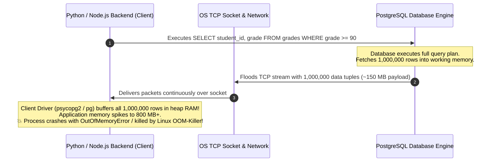

#Database #Cursors #ServerSideCursor #ClientSideCursor #PostgreSQL #Python #Psycopg #MemoryManagement #Performance #SystemDesign #CoreConcept

> [!abstract] Executive Summary
> When querying large datasets (e.g., retrieving 1,000,000 student grades from a 12-million-row table for reporting or data export), a naive `SELECT` query forces the database to compile the entire result set, push gigabytes of data across the network socket, and require the client application to allocate massive RAM to buffer the results. This pattern frequently triggers **Client Out-Of-Memory (OOM) crashes**, network buffer saturation, and application timeouts.
> 
> **Database Cursors** provide a pointer-based mechanism to traverse large result sets incrementally without loading the entire dataset into memory. Crucially, developers must distinguish between:
> 1. **Client-Side Cursors (Default):** The database executes the full query and delivers all rows across the wire; the client driver buffers everything in application RAM.
> 2. **Server-Side Cursors (Named Cursors):** The query execution plan is prepared on the database server, and rows are fetched in small, controlled batches over the network only when explicitly requested by the application.

---

## 1. The Large Result Set Crisis (The 12-Million Grades Problem)

Consider a university database containing a `grades` table with **12,000,000 records**:

```sql
SELECT student_id, course_id, grade 
FROM grades 
WHERE grade BETWEEN 90 AND 100;
```

Even with an efficient index filter, this query qualifies **1,000,000 matching rows**.



### The Three Bottlenecks of Unbounded Result Sets:
1. **Database Resource Spike:** The database engine must evaluate the query, serialize one million tuples into the wire protocol, and flush them through network socket buffers.
2. **Network Saturation:** Transferring hundreds of megabytes of raw tuples congests the local or cloud network link, introducing latency jitter for concurrent queries.
3. **Client Memory Exhaustion:** Client-side runtimes (Python, Node.js, Go, JVM) represent relational tuples as rich language objects (dictionaries, classes, allocations). A 100 MB database payload often inflates into **500 MB to 1 GB of application heap memory**, crashing microservices running in constrained Kubernetes containers (e.g., 512 MB memory limit).

---

## 2. Client-Side vs. Server-Side Cursors: Architectural Comparison

The term "cursor" is overloaded in software engineering. Database drivers (such as Python's `psycopg2` or Java's `JDBC`) provide cursor objects by default, but **most default cursors are client-side cursors**.

```
┌─────────────────────────────────────────────────────────────────────────────────────────────────┐
│                           CLIENT-SIDE vs. SERVER-SIDE CURSORS                                   │
├─────────────────────────┬───────────────────────────────┬───────────────────────────────────────┤
│ Dimension               │ Client-Side Cursor (Default)  │ Server-Side Cursor (Named Cursor)     │
├─────────────────────────┼───────────────────────────────┼───────────────────────────────────────┤
│ **Where Data Lives**    │ **Buffered in Client RAM**    │ **Buffered on Database Server Engine**│
├─────────────────────────┼───────────────────────────────┼───────────────────────────────────────┤
│ **Network Transmission**│ Transmits **ALL 1M rows** in  │ Transmits **only requested batch**    │
│                         │ one massive initial flood.    │ (e.g., 100 rows per `FETCH` call).    │
├─────────────────────────┼───────────────────────────────┼───────────────────────────────────────┤
│ **Client Memory Usage** │ High ($O(N)$ with total rows) │ Minimal ($O(\text{batch size})$)      │
├─────────────────────────┼───────────────────────────────┼───────────────────────────────────────┤
│ **Server Memory Usage** │ Released immediately after    │ Held in server memory for the duration│
│                         │ transfer completes.           │ of the active cursor/transaction.     │
├─────────────────────────┼───────────────────────────────┼───────────────────────────────────────┤
│ **Small Queries (<100)**│ ✅ Fastest (Single round-trip)│ ❌ Overkill (Incurs transaction &     │
│                         │                               │    cursor declaration overhead).      │
├─────────────────────────┼───────────────────────────────┼───────────────────────────────────────┤
│ **Large Exports (>10k)**│ ❌ Danger of OOM crashes      │ ✅ Optimal for streaming & batching   │
└─────────────────────────┴───────────────────────────────┴───────────────────────────────────────┘
```

---

## 3. Physical Data Flow Visualized

### Model A: Client-Side Cursor (The Default Illusion)
When you call `cursor.execute()` with a standard client-side cursor, the database executes the query and dumps every single row into the client application's memory. When you subsequently call `cursor.fetchone()`, **no database interaction takes place**—Python is simply popping an item from an in-memory array!

```
[ PostgreSQL Server ] ═════════ (1,000,000 Rows Transferred at Once) ════════► [ Python Memory ]
                                                                                   │
                                                     `cur.fetchone()` ─────────────┘
                                                     (Reads from local Python RAM array)
```

### Model B: Server-Side Cursor (True Database Pointer)
With a server-side cursor, the database holds the query execution state and returns a pointer token. The client requests a chunk of rows (e.g., 1,000 at a time). The server streams that specific chunk and pauses execution until the next `FETCH` command arrives.

```
[ PostgreSQL Server ]                                                      [ Python Memory ]
   (Cursor State)                                                              (Lean RAM)
         │                                                                         │
         │ ◄──────────────── 1. FETCH FORWARD 100 FROM c ─────────────────────────┤
         ├────────────────── 2. Streams 100 Rows ────────────────────────────────►┤
         │                                                                         │ (Processes 100)
         │                                                                         │ (Discards 100)
         │ ◄──────────────── 3. FETCH FORWARD 100 FROM c ─────────────────────────┤
         ├────────────────── 4. Streams next 100 Rows ───────────────────────────►┤
```

---

## 4. Python Implementation Benchmark: `psycopg2` in Action

Let us examine the concrete difference in Python using the standard PostgreSQL driver `psycopg2`.

### Anti-Pattern: Client-Side Cursor (Default)
```python
import psycopg2

conn = psycopg2.connect("dbname=university user=postgres password=postgres host=localhost")

# Default: Anonymous Client-Side Cursor
cur = conn.cursor()

# ❌ DANGER: Floods client RAM with 1,000,000 rows immediately!
cur.execute("SELECT student_id, grade FROM grades WHERE grade >= 90")

# Even though we call fetchone(), all 1,000,000 rows already reside in Python RAM!
while True:
    row = cur.fetchone()
    if row is None:
        break
    process_student(row)

cur.close()
conn.close()
```
*Memory Profile:* Process memory skyrockets to **450 MB** during the `cur.execute()` call before the first row is even processed.

---

### Production Pattern: Server-Side Cursor (Named Cursor)
In `psycopg2`, providing a **string name** to `conn.cursor(name='...')` automatically instructs the driver to declare a **Server-Side Cursor** on PostgreSQL!

```python
import psycopg2

conn = psycopg2.connect("dbname=university user=postgres password=postgres host=localhost")

# ✅ PRODUCTION PATTERN: Named Server-Side Cursor
# The name argument forces a server-side DECLARE cursor statement!
cur = conn.cursor(name='grades_cursor')

# Adjust batch size for chunked network delivery:
cur.itersize = 2000  # Fetches 2,000 rows per network round-trip

# Generates SQL: DECLARE "grades_cursor" CURSOR WITHOUT HOLD FOR SELECT ...
cur.execute("SELECT student_id, grade FROM grades WHERE grade >= 90")

# Only 2,000 rows reside in Python RAM at any given instant!
for row in cur:
    process_student(row)

cur.close()
conn.commit()  # Server-side cursors must close within transaction boundaries
conn.close()
```
*Memory Profile:* Process memory remains flat at **~18 MB** throughout the entire iteration over one million records!

---

## 5. Architectural Decision Matrix: When to Use Which?

```
┌─────────────────────────────────────────────────────────────────────────────────────────────────┐
│                                CURSOR SELECTION DECISION MATRIX                                 │
├─────────────────────────┬─────────────────────────────────┬─────────────────────────────────────┤
│ Scenario                │ Recommended Cursor Type         │ Rationale                           │
├─────────────────────────┼─────────────────────────────────┼─────────────────────────────────────┤
│ **Web API Requests**    │ Client-Side Cursor              │ Typical API queries return 1-50     │
│ *(OLTP Endpoints)*      │ (Standard `cur.execute()`)      │ rows. Server-side cursor overhead   │
│                         │                                 │ is completely unnecessary.          │
├─────────────────────────┼─────────────────────────────────┼─────────────────────────────────────┤
│ **ETL Data Pipelines**  │ Server-Side Cursor              │ Prevents worker container crashes   │
│ *(Extract-Transform)*   │ (Named cursor / chunked fetch)  │ when streaming millions of rows.    │
├─────────────────────────┼─────────────────────────────────┼─────────────────────────────────────┤
│ **CSV / Excel Exports** │ Server-Side Cursor              │ Allows HTTP chunked streaming       │
│ *(Reporting Downloads)* │                                 │ directly to the browser download.   │
├─────────────────────────┼─────────────────────────────────┼─────────────────────────────────────┤
│ **Real-Time Feeds**     │ Server-Side Cursor              │ Pipes records incrementally into    │
│ *(gRPC / WebSockets)*   │                                 │ streaming network buffers.          │
└─────────────────────────┴─────────────────────────────────┴─────────────────────────────────────┘
```

---

## 6. Senior Engineer Production Checklist

- [ ] **Distinguish Driver Cursors from Database Cursors:** Remember that calling `conn.cursor()` in Python, Node.js, or Java creates a *client-side handle*, not a database-level server-side cursor, unless explicitly configured with a cursor name or fetch size.
- [ ] **Tune `itersize` / `fetchSize`:** When using server-side cursors, do not fetch 1 row at a time (too many network round-trips) or 100,000 rows at a time (too much memory). The sweet spot is typically **1,000 to 5,000 rows**.
- [ ] **Enforce Transaction Boundaries:** Server-side cursors require an active transaction block (`BEGIN` to `COMMIT`). Always close cursors and commit or roll back the connection when finished.
- [ ] **Guard Against Container OOMs:** In Docker and Kubernetes environments with memory limits, mandate server-side cursors for any query that can return more than 10,000 records.

---

## 7. Related Notes & Conceptual Navigation

- [[02_PostgreSQL Server-Side Cursors in Practice_ SQL Syntax, Streaming, and Lifecycle|PostgreSQL Server-Side Cursors in Practice: SQL Syntax, Streaming, and Lifecycle]]
- [[03_Database Cursors Trade-Offs_ Statefulness, Long-Running Transactions, and Production Pitfalls|Database Cursors Trade-Offs: Statefulness & Production Pitfalls]]
- [[04_Hands-On Benchmark_ Client-Side vs. Server-Side Cursors in Python (1 Million Rows)|Hands-On Benchmark: Client-Side vs. Server-Side Cursors in Python (1 Million Rows)]]
- [[04_SQL Pagination at Scale_ Why OFFSET Kills Performance and How Keyset (Seek) Pagination Solves It|SQL Pagination at Scale: Keyset vs. Offset]]
- [[05_Database Connection Pooling_ Mechanics, Node.js Benchmark, and Sizing Strategies|Database Connection Pooling]]

