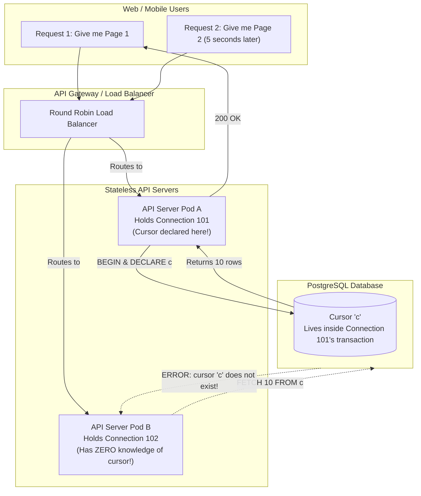

#Database #Cursors #ServerSideCursor #Performance #PostgreSQL #TableBloat #Vacuum #PgBouncer #SystemDesign #ProductionEngineering #CoreConcept

> [!abstract] Executive Summary
> Database cursors are powerful instruments for streaming large datasets while keeping client-side memory lean. However, in distributed production environments, **cursors introduce severe architectural liabilities**.
> 
> Cursors are fundamentally **stateful** objects bound to a **single physical database connection and a single transaction**. In modern cloud architectures characterized by stateless microservices and external connection poolers (e.g., PgBouncer), holding open cursors creates:
> 1. **Horizontal Scaling Friction:** Inability to load-balance paginated requests across stateless application instances.
> 2. **Autovacuum Blockade & Table Bloat:** Holding open an active transaction freezes PostgreSQL's `xmin` horizon, preventing `VACUUM` from cleaning dead tuples across the entire database.
> 3. **DDL Lock Cascades:** Long-lived shared locks block schema migrations (`ALTER TABLE`), queuing incoming queries and causing connection pool exhaustion.

---

## 1. The Comprehensive Cursors Trade-Off Scorecard

```
┌─────────────────────────────────────────────────────────────────────────────────────────────────┐
│                                 PROS AND CONS OF DATABASE CURSORS                               │
├───────────────────────────────┬─────────────────────────────────────────────────────────────────┤
│ The Advantages (Pros)         │ Architectural Impact                                            │
├───────────────────────────────┼─────────────────────────────────────────────────────────────────┤
│ **1. Client Memory Shield**   │ Backend applications only hold the active batch (e.g., 2,000    │
│                               │ rows in RAM) rather than buffering 10,000,000 rows.             │
├───────────────────────────────┼─────────────────────────────────────────────────────────────────┤
│ **2. Instant Streaming**      │ Tuples stream to consumers (WebSockets, gRPC, HTTP chunked)     │
│                               │ immediately without waiting for the full query to materialize.  │
├───────────────────────────────┼─────────────────────────────────────────────────────────────────┤
│ **3. Early Cancelability**    │ Terminating a download or stream immediately closes the cursor  │
│                               │ and rolls back, saving CPU cycles on unread records.           │
├───────────────────────────────┼─────────────────────────────────────────────────────────────────┤
│ **4. Single Query Plan**      │ The database formulates and optimizes the query execution plan  │
│                               │ once, rather than re-evaluating it on every paginated request.  │
├───────────────────────────────┼─────────────────────────────────────────────────────────────────┤
│ **The Disadvantages (Cons)**  │ Operational Hazard & Failure Mode                               │
├───────────────────────────────┼─────────────────────────────────────────────────────────────────┤
│ **1. Strict Statefulness**    │ The cursor exists only within a single connection and active    │
│                               │ transaction; cannot be shared across stateless API nodes.       │
├───────────────────────────────┼─────────────────────────────────────────────────────────────────┤
│ **2. Long Transaction Hazard**│ Keeping transactions open for minutes/hours prevents `VACUUM`   │
│                               │ from cleaning dead tuples, causing massive **Table Bloat**.     │
├───────────────────────────────┼─────────────────────────────────────────────────────────────────┤
│ **3. DDL Migration Freezes**  │ Shared read locks held by cursors block `ALTER TABLE` and schema │
│                               │ migrations, causing cascading lock queues and outages.          │
├───────────────────────────────┼─────────────────────────────────────────────────────────────────┤
│ **4. PgBouncer Incompatible** │ Breaks PgBouncer in **Transaction Pooling Mode** because the    │
│                               │ connection cannot be returned to the pool until cursor closes.  │
└───────────────────────────────┴─────────────────────────────────────────────────────────────────┘
```

---

## 2. The Statefulness Dilemma: Why Web APIs Struggle with Cursors

In modern web development, backend APIs are built to be **stateless**:



### Why Cursors Fail in Web Paging:
1. **Connection Pinning:** A cursor lives inside the memory space of a **specific database backend process** assigned to a specific TCP connection.
2. **Stateless Load Balancing:** When a mobile user requests Page 1, API Server A handles it and creates a cursor. When the user scrolls to Page 2 five seconds later, the load balancer routes the request to API Server B. Server B connects over a different database connection where the cursor does not exist!
3. **The Workaround Nightmare:** Forcing stateful web cursors requires sticky routing (session affinity) or holding open persistent WebSockets, severely inhibiting autoscaling and zero-downtime rolling deployments.

---

## 3. The Long-Running Transaction Hazard: Table Bloat & `VACUUM` Blockage

The most dangerous hidden operational risk of database cursors in production is their impact on PostgreSQL's **Multi-Version Concurrency Control (MVCC)** engine.

### How PostgreSQL MVCC Works:
When rows are updated or deleted, PostgreSQL does not physically overwrite them in place. It marks the old row version (tuple) as dead by setting its `t_xmax` header. A background daemon called **`autovacuum`** periodically scans table pages to clean up dead tuples and reclaim disk space.

```
┌─────────────────────────────────────────────────────────────────────────────────────────────────┐
│                            THE `xmin` HORIZON FREEZE DISASTER                                   │
└─────────────────────────────────────────────────────────────────────────────────────────────────┘

 Active Cursor Transaction: Started at XID 50,000 (Holding open for 45 minutes)

 Current Database XID: 75,000
 
 [ Tuple 1: Deleted at XID 52,000 ]  ──► CANNOT BE REMOVED BY VACUUM!
 [ Tuple 2: Deleted at XID 60,000 ]  ──► CANNOT BE REMOVED BY VACUUM!
 [ Tuple 3: Deleted at XID 71,000 ]  ──► CANNOT BE REMOVED BY VACUUM!

 Why? Because the Cursor transaction (XID 50,000) might theoretically read them!
 Result: Millions of dead tuples accumulate -> MASSIVE DISK & INDEX BLOAT!
```

### The Chain Reaction of a 30-Minute Cursor:
1. A developer starts an export script: `BEGIN; DECLARE export_cur CURSOR FOR SELECT * FROM orders;`.
2. The export script processes slowly over a 45-minute window.
3. While open, the cursor's transaction pins the database **`xmin` horizon**.
4. During these 45 minutes, hundreds of thousands of normal production updates occur across the *entire database*.
5. Autovacuum is **completely paralyzed** from purging dead tuples that were generated after XID 50,000!
6. Tables and indexes swell in disk size (Table Bloat), cache hit ratios plummet, and sequential scans slow to a crawl across the entire database.

---

## 4. DDL Lock Contention: The Schema Migration Blocker

Relational databases permit concurrent readers and writers, but **schema changes (DDL) require exclusive locks**:

```sql
-- Production deployment running in pipeline:
ALTER TABLE grades ADD COLUMN letter_grade VARCHAR(2);
```
- `ALTER TABLE` requires an **`ACCESS EXCLUSIVE`** lock on `grades`.
- If an open cursor transaction is currently reading from `grades`, it holds an **`ACCESS SHARE`** lock.
- **The Conflict:** `ACCESS EXCLUSIVE` conflicts with `ACCESS SHARE`. The migration script is blocked and enters a lock wait state.
- **The Catastrophe:** All subsequent incoming `SELECT` and `INSERT` queries against `grades` queue up *behind* the blocked `ALTER TABLE` request! 
- Within 60 seconds, PostgreSQL exhausts `max_connections`, connection pools starve, and the entire public web application goes down!

---

## 5. Cursors vs. Keyset (Seek) Pagination: When to Use Which?

```
┌─────────────────────────────────────────────────────────────────────────────────────────────────┐
│                               CURSORS vs. KEYSET PAGINATION                                     │
├─────────────────────────┬───────────────────────────────┬───────────────────────────────────────┤
│ Dimension               │ Server-Side Database Cursors  │ Keyset (Seek / Cursor-Based) Paging   │
├─────────────────────────┼───────────────────────────────┼───────────────────────────────────────┤
│ **Statelessness**       │ ❌ **Stateful:** Bound to one │ ✅ **100% Stateless:** Cursor token   │
│                         │ connection & transaction.     │ passed in HTTP request query param.   │
├─────────────────────────┼───────────────────────────────┼───────────────────────────────────────┤
│ **Best Used For**       │ Internal background jobs,     │ Public Web APIs, Mobile apps,         │
│                         │ batch ETL scripts, data dumps.│ infinite scroll social feeds.         │
├─────────────────────────┼───────────────────────────────┼───────────────────────────────────────┤
│ **Transaction Span**    │ Long-lived (Minutes to hours).│ Milliseconds (Closed immediately).    │
├─────────────────────────┼───────────────────────────────┼───────────────────────────────────────┤
│ **PgBouncer Friendly**  │ ❌ Requires Session Mode      │ ✅ Perfect for Transaction Mode       │
├─────────────────────────┼───────────────────────────────┼───────────────────────────────────────┤
│ **VACUUM / Bloat Risk** │ 🔴 High (Pins `xmin` horizon) │ 🟢 Zero impact on autovacuum          │
├─────────────────────────┼───────────────────────────────┼───────────────────────────────────────┤
│ **Query Complexity**    │ Simple (`SELECT * FROM table`)│ Requires compound indexed filters     │
│                         │                               │ (`WHERE (date, id) < (:d, :id)`).     │
└─────────────────────────┴───────────────────────────────┴───────────────────────────────────────┘
```

---

## 6. Senior Engineer Production Checklist

- [ ] **Never use database cursors for public web pagination:** Use **Keyset Pagination** (`WHERE id < :cursor LIMIT 10`) for stateless HTTP endpoints. Reserve server-side cursors strictly for background data workers and ETL scripts.
- [ ] **Configure `idle_in_transaction_session_timeout`:** Prevent orphaned cursors from freezing `autovacuum` indefinitely:
  ```sql
  ALTER DATABASE university SET idle_in_transaction_session_timeout = '60000ms';
  ```
- [ ] **Beware of PgBouncer Transaction Pooling:** If your application uses PgBouncer in transaction mode, standard server-side cursors will fail or pin connections. Either run your batch worker against a direct database port or use a dedicated session-mode pool.
- [ ] **Monitor long-running transactions:** Continuously inspect `pg_stat_activity` for transactions older than 5 minutes:
  ```sql
  SELECT pid, now() - xact_start AS duration, query, state 
  FROM pg_stat_activity 
  WHERE state != 'idle' AND (now() - xact_start) > interval '5 minutes';
  ```
- [ ] **Close cursors before executing expensive non-database work:** Never fetch a batch of rows, make slow external HTTP API calls (e.g., Stripe, Twilio) while keeping the cursor transaction open, and then fetch the next batch. Fetch into a local queue, close the transaction, and process the external work asynchronously!

---

## 7. Related Notes & Conceptual Navigation

- [[01_Database Cursors Fundamentals_ Server-Side vs. Client-Side Cursors|Database Cursors Fundamentals: Server-Side vs. Client-Side]]
- [[02_PostgreSQL Server-Side Cursors in Practice_ SQL Syntax, Streaming, and Lifecycle|PostgreSQL Server-Side Cursors in Practice: SQL Syntax, Streaming, and Lifecycle]]
- [[04_Hands-On Benchmark_ Client-Side vs. Server-Side Cursors in Python (1 Million Rows)|Hands-On Benchmark: Client-Side vs. Server-Side Cursors in Python (1 Million Rows)]]
- [[04_SQL Pagination at Scale_ Why OFFSET Kills Performance and How Keyset (Seek) Pagination Solves It|SQL Pagination at Scale: Keyset vs. Offset]]
- [[05_Database Connection Pooling_ Mechanics, Node.js Benchmark, and Sizing Strategies|Database Connection Pooling]]
- [[03_Exclusive Locks vs. Shared Locks_ Concurrency, Compatibility, and Banking Workflows|Exclusive Locks vs. Shared Locks]]

