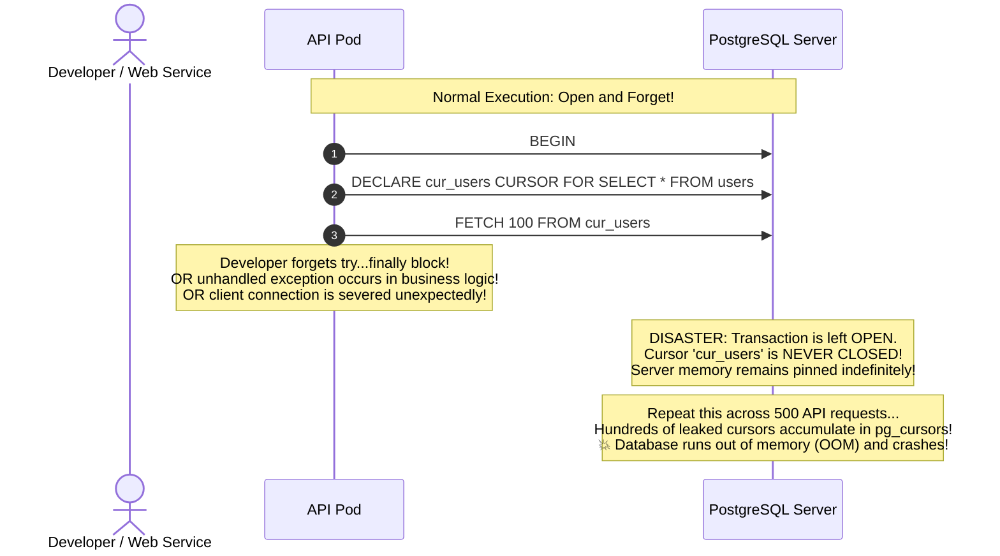

#Database #PostgreSQL #Cursors #Architecture #SystemDesign #MemoryManagement #StatelessArchitecture #Performance #BestPractices #CoreConcept

> [!abstract] Executive Summary
> In software architecture, there is rarely a universally superior solution—only trade-offs. The debate between **Client-Side** and **Server-Side Cursors** is not about which is "better," but rather **where you choose to place the computational and memory overhead**:
> 
> 1. **Client-Side Cursors (Relieve the Server):** Transfer all matching rows to the client runtime immediately. The network bandwidth and client process memory take the hit, but the **database server is completely relieved**—it executes the query, transmits the data, and immediately frees all transaction and memory resources.
> 2. **Server-Side Cursors (Relieve the Client):** Keep the client process lean by holding the query execution state on the database engine. However, this shifts heavy statefulness onto the shared database server, introducing the catastrophic risk of **Cursor Leaks** that can exhaust database memory and pin backend worker processes.
> 
> For modern, stateless, autoscaling web applications, **disciplined Client-Side querying (mandatory `WHERE` clauses, hard `LIMIT` bounds, and Keyset pagination) is overwhelmingly preferred**, while Server-Side cursors should be strictly quarantined to internal background ETL and batch-processing pipelines.

---

## 1. The Overhead Placement Principle

The fundamental architectural question when querying a database is: **Which component of your distributed system is easiest and cheapest to scale?**

```
┌─────────────────────────────────────────────────────────────────────────────────────────────────┐
│                                THE OVERHEAD PLACEMENT DUALITY                                   │
└─────────────────────────────────────────────────────────────────────────────────────────────────┘

                ┌─────────────────────────────────────────────────┐
                │             WHERE DOES THE WEIGHT SIT?          │
                └───────────────────────┬─────────────────────────┘
                                        │
             ┌──────────────────────────┴──────────────────────────┐
             ▼                                                     ▼
   [ CLIENT-SIDE CURSOR ]                                [ SERVER-SIDE CURSOR ]
   - Overhead sits on CLIENT                             - Overhead sits on DATABASE
   - Client RAM: Heavy (~450 MB)                         - Client RAM: Flat (~18 MB)
   - Network Bandwidth: Bursty spike                     - Network Bandwidth: Incremental trickle
   - Database Server: RELIEVED!                          - Database Server: BURDENED!
     (Zero cursor state, immediate cleanup)                (Stateful, holds connection & work_mem)
```

### The Microservice Scalability Argument:
- **Client Application Pods (Kubernetes):** Completely disposable, stateless, horizontally scalable, and cheap. If an API container consumes memory or crashes, Kubernetes spins up a new pod in seconds.
- **The Database Cluster:** Shared, stateful, single-source-of-truth, and expensive to scale. Any operational burden or memory leak on the primary database endangers the **entire enterprise ecosystem**.

By using client-side cursors with bounded queries, you protect the most precious, least expendable asset in your infrastructure: **the database server**.

---

## 2. The Nightmare of Server-Side Cursor Leaks

The most hazardous operational danger of server-side cursors in production is the **Cursor Leak**.

When an application declares a server-side cursor, PostgreSQL allocates internal state:
- An entry in the `pg_cursors` system view.
- A query execution context holding memory in `work_mem`.
- If the result set exceeds `work_mem`, it spills to disk as temporary files in `$PGDATA/base/pgsql_tmp`.
- A pinned database backend process holding open a transaction.



### How to Inspect Leaked Cursors in PostgreSQL:
DBAs can audit open server-side cursors using the system catalog:

```sql
SELECT 
    name, 
    statement, 
    is_holdable, 
    is_binary, 
    is_scrollable, 
    creation_time 
FROM pg_cursors;
```

If `pg_cursors` returns dozens of cursors with `creation_time` older than several minutes, your application is **leaking cursors** and degrading cluster health.

---

## 3. Why Disciplined Client-Side Querying Dominates Web Architectures

Hussein Nasser's pragmatic engineering conclusion:
> *"For web applications, I personally prefer client-side cursors. But you must be very, very diligent in what you are doing."*

Instead of complicating infrastructure with stateful server-side cursors across stateless web servers, follow the **Three Golden Disciplines of Client-Side Querying**:

### Discipline 1: Never Execute Unbounded Queries
```sql
-- ❌ CATASTROPHIC: Unbounded table scan dumping millions of rows
SELECT * FROM employees;

-- ✅ DISCIPLINED: Filtered by business partition and status
SELECT id, name, department 
FROM employees 
WHERE department = 'Engineering' AND status = 'ACTIVE';
```

### Discipline 2: Always Enforce a Mandatory Server-Side `LIMIT`
Never rely on frontend clients to specify reasonable limits. Always clamp query limits on the backend API:

```javascript
// Express.js Route Guardrail
app.get('/api/employees', async (req, res) => {
    // Clamp requested limit to a safe maximum of 100 rows:
    const limit = Math.min(parseInt(req.query.limit) || 20, 100);
    const cursor = req.query.cursor ? parseInt(req.query.cursor) : 0;

    const result = await pool.query(
        'SELECT id, name FROM employees WHERE id > $1 ORDER BY id ASC LIMIT $2',
        [cursor, limit]
    );

    return res.json({
        data: result.rows,
        nextCursor: result.rows.length > 0 ? result.rows[result.rows.length - 1].id : null
    });
});
```

### Discipline 3: Simulate Server Cursors with Keyset Pagination
Instead of holding open a stateful cursor on the database across HTTP requests, use **Keyset (Seek) Pagination**:
- The client holds the cursor token (e.g., `last_seen_id = 45012`).
- Each HTTP request executes a completely autonomous, stateless query:
  ```sql
  SELECT id, name FROM employees WHERE id > 45012 ORDER BY id ASC LIMIT 20;
  ```
- The query executes in **< 0.1 ms**, returns 20 rows, and **leaves zero state on the server**.

---

## 4. When SHOULD You Use Server-Side Cursors?

Server-side cursors are not evil; they are specialized instruments built for specific operational requirements:

```
┌─────────────────────────────────────────────────────────────────────────────────────────────────┐
│                          LEGITIMATE USE CASES FOR SERVER-SIDE CURSORS                           │
├───────────────────────────────┬─────────────────────────────────────────────────────────────────┤
│ Operational Scenario          │ Why Server-Side Cursors are Optimal                             │
├───────────────────────────────┼─────────────────────────────────────────────────────────────────┤
│ **1. Batch ETL & MapReduce**  │ Background workers processing millions of records sequentially. │
│                               │ Streams 2,000 rows at a time, transforms them, and writes to S3.│
├───────────────────────────────┼─────────────────────────────────────────────────────────────────┤
│ **2. Database-to-Database**   │ Migrating 50 million rows from PostgreSQL to Elasticsearch or   │
│ **Replication Pipelines**     │ Snowflake without spilling to local disk.                       │
├───────────────────────────────┼─────────────────────────────────────────────────────────────────┤
│ **3. Stored Procedures**      │ Native PL/pgSQL procedural code iterating over intermediate     │
│ **(PL/pgSQL Business Logic)** │ result sets inside database functions.                          │
├───────────────────────────────┼─────────────────────────────────────────────────────────────────┤
│ **4. Massive CSV Data Dumps** │ Admin reporting endpoints using HTTP Chunked Transfer to stream │
│                               │ a 500,000-row export directly to the browser.                   │
└───────────────────────────────┴─────────────────────────────────────────────────────────────────┘
```

---

## 5. Architectural Comparison Scorecard

```
┌─────────────────────────────────────────────────────────────────────────────────────────────────┐
│                               ARCHITECTURAL SUMMARY SCORECARD                                   │
├─────────────────────────┬───────────────────────────────┬───────────────────────────────────────┤
│ Dimension               │ Client-Side Cursor (Bounded)  │ Server-Side Cursor (Named)            │
├─────────────────────────┼───────────────────────────────┼───────────────────────────────────────┤
│ **Application Model**   │ **Stateless:** Ideal for web  │ **Stateful:** Bound to connection &   │
│                         │ APIs & microservices.         │ active transaction.                   │
├─────────────────────────┼───────────────────────────────┼───────────────────────────────────────┤
│ **Database Risk**       │ 🟢 Minimal (Zero leaked state)│ 🔴 High (Vulnerable to cursor leaks)  │
├─────────────────────────┼───────────────────────────────┼───────────────────────────────────────┤
│ **Network Profile**     │ Compact, fast, bounded bursts │ Incremental, chatty round-trips       │
├─────────────────────────┼───────────────────────────────┼───────────────────────────────────────┤
│ **Connection Poolers**  │ ✅ 100% PgBouncer friendly    │ ❌ Conflicts with Transaction Pooling │
├─────────────────────────┼───────────────────────────────┼───────────────────────────────────────┤
│ **Client Memory Cost**  │ Controlled via `LIMIT`        │ Flat ($O(\text{batch size})$)         │
├─────────────────────────┼───────────────────────────────┼───────────────────────────────────────┤
│ **Developer Discipline**│ Must enforce `LIMIT` & `WHERE`│ Must enforce `try...finally` cleanup  │
└─────────────────────────┴───────────────────────────────┴───────────────────────────────────────┘
```

---

## 6. Senior Engineer Production Checklist

- [ ] **Default to Client-Side with Strict Limits:** For 98% of web and mobile API endpoints, use client-side querying with mandatory backend limits (`LIMIT <= 100`).
- [ ] **Quarantine Server Cursors to Isolated Workers:** Never open server-side cursors in public-facing API threads. Restrict them to dedicated background worker processes (e.g., Celery, BullMQ, Temporal).
- [ ] **Enforce Auto-Cleanup on Leaks:** Configure `idle_in_transaction_session_timeout` to kill orphaned cursor connections after 30–60 seconds of inactivity:
  ```sql
  ALTER DATABASE company_db SET idle_in_transaction_session_timeout = '60000ms';
  ```
- [ ] **Alert on `pg_cursors` Accumulation:** Configure Prometheus / Datadog alerts if `count(pg_cursors) > 20` for more than 5 consecutive minutes.
- [ ] **Always Wrap Cursors in Context Managers:** In Python, always use `with conn.cursor(name='...') as cur:` to guarantee cursor destruction even during unhandled runtime exceptions.

---

## 7. Related Notes & Conceptual Navigation

- [[01_Database Cursors Fundamentals_ Server-Side vs. Client-Side Cursors|Database Cursors Fundamentals: Server-Side vs. Client-Side]]
- [[02_PostgreSQL Server-Side Cursors in Practice_ SQL Syntax, Streaming, and Lifecycle|PostgreSQL Server-Side Cursors in Practice: SQL Syntax, Streaming, and Lifecycle]]
- [[03_Database Cursors Trade-Offs_ Statefulness, Long-Running Transactions, and Production Pitfalls|Database Cursors Trade-Offs: Statefulness & Production Pitfalls]]
- [[04_Hands-On Benchmark_ Client-Side vs. Server-Side Cursors in Python (1 Million Rows)|Hands-On Benchmark: Client-Side vs. Server-Side Cursors in Python (1 Million Rows)]]
- [[04_SQL Pagination at Scale_ Why OFFSET Kills Performance and How Keyset (Seek) Pagination Solves It|SQL Pagination at Scale: Keyset vs. Offset]]
- [[05_Database Connection Pooling_ Mechanics, Node.js Benchmark, and Sizing Strategies|Database Connection Pooling]]
