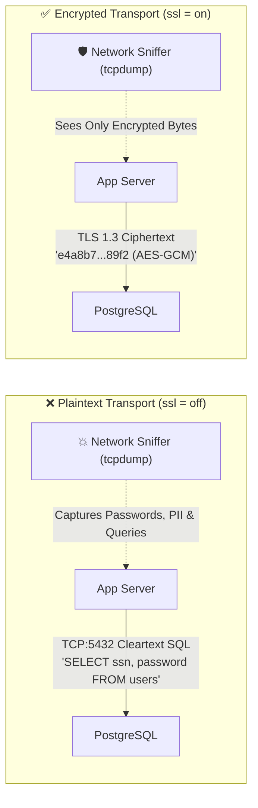
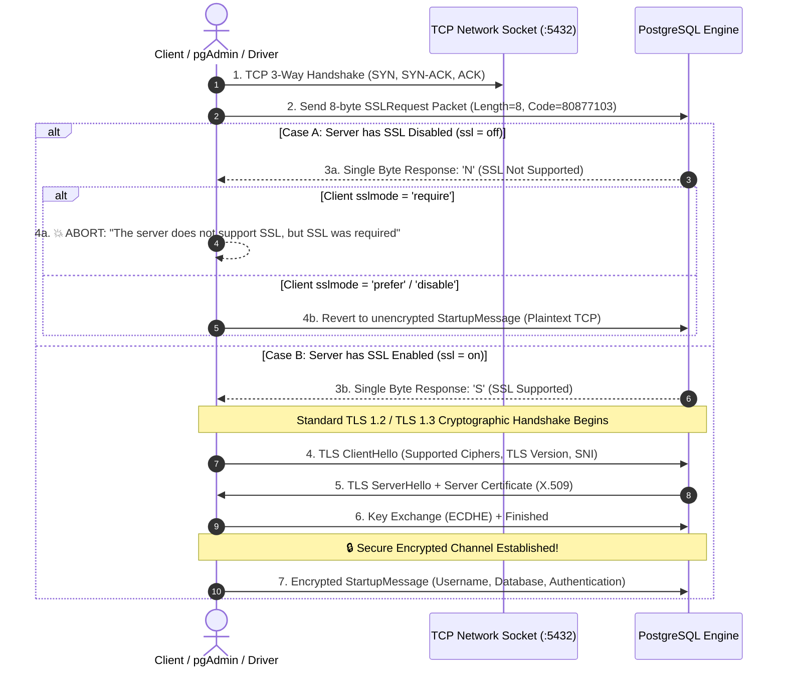
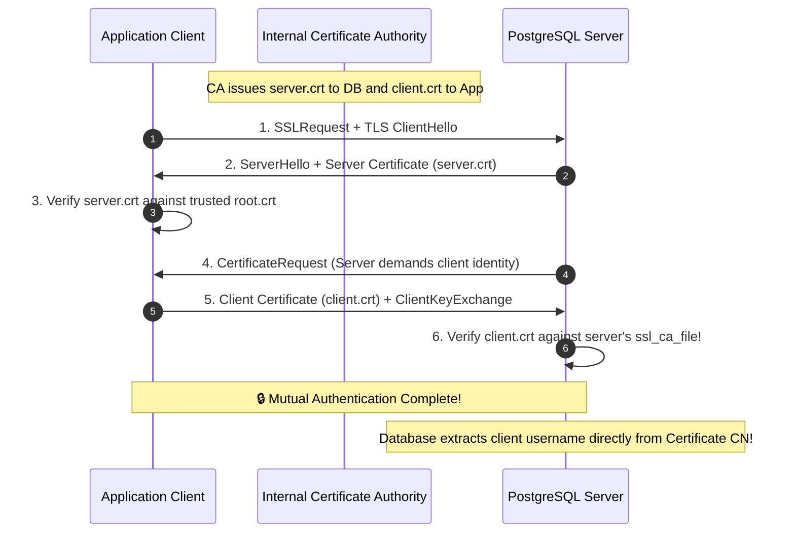

#Database #Security #TLS #SSL #EncryptionInTransit #PostgreSQL #OpenSSL #pg_hba #ZeroTrust #CloudArchitecture #SystemDesign #DevOps

> [!abstract] Executive Summary
> For decades, database connections between application servers and database engines were transmitted in **unencrypted plaintext**. The historical rationalization was straightforward: *"Keep your application servers close and your database closer"*—both machines were co-located within the same private physical rack or isolated on-premises LAN, leading engineers to assume physical perimeter security rendered network sniffing impossible.
> 
> In modern **cloud architectures, Kubernetes clusters, serverless platforms, and multi-tenant VPCs**, this assumption is fatally obsolete. Packets traverse software-defined overlay networks (VXLAN, Geneve), shared hypervisors, and cross-availability-zone links where unencrypted connections expose database passwords, session tokens, and sensitive business data (PII, financial records) to packet sniffing, ARP spoofing, and Man-in-the-Middle (MITM) attacks.
> 
> Implementing **Transport Layer Security (TLS/SSL)** on the database engine provides **Encryption In-Transit**, cryptographic server authentication, and tamper detection. This master guide dissects the mechanics of PostgreSQL's opportunistic `SSLRequest` protocol, walks through hands-on Docker provisioning with **PostgreSQL 12+** and **pgAdmin 4**, details **OpenSSL 4096-bit RSA certificate generation**, explains strict Linux permission hardening (`chmod 600`), breaks down the 6 client `sslmode` verification tiers, and demonstrates firewall enforcement via `pg_hba.conf` and Mutual TLS (mTLS).

---

## 1. The Death of the "Private Network" Fallacy

Historically, network security relied on the **Castle-and-Moat** perimeter model. Once traffic was inside the company's internal firewall, all internal network communication was deemed trustworthy.

```
Historical Architecture (On-Premises LAN):
[ Client / Web App ] ───( Plaintext TCP:5432 )───► [ PostgreSQL Server ]
       ▲
       └── Physical cables inside locked server cage (Low sniffing risk)

Modern Cloud / Container Architecture (Zero Trust Reality):
[ K8s Pod / Lambda ] ───( Plaintext TCP:5432 )───► [ Managed DB / Cloud Instance ]
                               │
               ┌───────────────┴───────────────┐
               ▼                               ▼
       [ Shared Hypervisor ]           [ Pod Sidecar / CNI ]
       [ Cross-AZ VPC Peering ]        [ Cloud Tap / Malicious Pod ]
       💥 Any node on the overlay network can capture cleartext SQL and credentials!
```

### Modern Threat Vectors:
1. **Container Overlay Networks:** In Kubernetes, containers share virtual interfaces (bridge, Calico, Flannel, Cilium). A compromised container running with elevated network capabilities (`CAP_NET_RAW`, `CAP_NET_ADMIN`) can sniff unencrypted traffic across pods on the same node using tools like `tcpdump` or `wireshark`.
2. **Cross-AZ and VPC Peering:** In cloud providers (AWS, Azure, GCP), traffic between an application cluster in Availability Zone A and a database replica in Availability Zone B traverses shared physical optical backbones. Cloud providers strongly advise or mandate in-transit TLS.
3. **Zero Trust Architecture (NIST SP 800-207):** Modern compliance frameworks (SOC 2, PCI-DSS 4.0, HIPAA, GDPR, ISO 27001) explicitly mandate:
   > *"All data in-transit, whether external or internal to the VPC perimeter, must be encrypted using approved cryptographic protocols (TLS 1.2+)."*

---

## 2. Plaintext vs. Encrypted Database Traffic

When PostgreSQL operates without TLS (`ssl = off`), all application communication is transmitted across the TCP stream as cleartext bytes.

### Anatomy of an Unencrypted Connection Sniff:
If an attacker taps the network interface between the application and PostgreSQL, running:
```bash
sudo tcpdump -i eth0 -A -s 0 'tcp port 5432'
```
Exposes raw database packets directly in ASCII:
```text
....Q...SELECT user_id, email, password_hash, ssn, credit_card 
FROM customers 
WHERE customer_id = 1042;
....D...1042..alice@example.com..$2b$12$K8y...4532-0192-8831-9012
```

Both the **query containing parameters** and the **result set containing confidential data** are laid completely bare.

### Encrypted Connection with TLS:
When TLS is established, the application and PostgreSQL exchange session symmetric keys (AES-256-GCM or ChaCha20-Poly1305). All SQL strings, row results, column metadata, and diagnostic errors become indistinguishable from high-entropy random noise.



---

## 3. The PostgreSQL TLS Protocol: The `SSLRequest` Handshake

Standard web servers run unencrypted HTTP on port `80` and encrypted HTTPS on port `443`. In contrast, PostgreSQL multiplexes **both plaintext and encrypted connections on the same port (`5432`)**.

To achieve this without breaking backwards compatibility with older clients, PostgreSQL implements an **opportunistic STARTTLS-style handshake** governed by the PostgreSQL Frontend/Backend Protocol 3.0.



### Deep-Dive into the `SSLRequest` Packet:
1. **The Request:** Immediately after establishing the TCP connection, the client sends exactly 8 bytes:
   - Bytes 1–4: Packet length (`00 00 00 08` = 8 bytes).
   - Bytes 5–8: Magic SSL Request Code (`04 d2 16 2f` in hex, which equals integer `80877103`).
2. **The Response:** The PostgreSQL server replies with a **single byte**:
   - `'S'` (`0x53`): SSL is supported and enabled. The client must proceed immediately with the TLS handshake (`ClientHello`).
   - `'N'` (`0x4E`): SSL is not supported.
3. **The Enforcement:** If the server replies `'N'`, a client configured with `sslmode=require` halts immediately and refuses to transmit credentials.

---

## 4. Hands-On Lab: Docker Setup (PostgreSQL & pgAdmin 4)

Let us recreate the exact lab environment demonstrated by Hussein Nasser to experience the handshake failure and subsequent TLS resolution.

### Step 1: Spin Up PostgreSQL in Docker
```bash
# Run PostgreSQL 12+ on default port 5432
docker run -d \
  --name pkg \
  -p 5432:5432 \
  -e POSTGRES_PASSWORD=postgres \
  postgres:12
```

### Step 2: Spin Up pgAdmin 4 Management Console
We deploy the official `dpage/pgadmin4` container, mapping web port `80` to host port `5555`:
```bash
docker run -d \
  --name pgadmin \
  -p 5555:80 \
  -e PGADMIN_DEFAULT_EMAIL="hussein@example.com" \
  -e PGADMIN_DEFAULT_PASSWORD="password" \
  dpage/pgadmin4
```

### Step 3: Access pgAdmin & Test Default Connection
1. Open your browser and navigate to `http://localhost:5555`.
2. Authenticate with `hussein@example.com` / `password`.
3. Create a new server connection:
   - **General Tab:** Name: `Unsecure PG`
   - **Connection Tab:**
     - Host name/address: `host.docker.internal` (or your local IP / Docker bridge gateway)
     - Port: `5432`
     - Maintenance database: `postgres`
     - Username: `postgres`
     - Password: `postgres`
   - **SSL Tab:** SSL Mode defaults to `Prefer`.
4. Click **Save**: The connection **succeeds immediately over plaintext**!

### Step 4: The Failure Demonstration (Enforcing SSL)
Now disconnect from the database:
1. Right-click the server in pgAdmin -> **Properties** -> **SSL Tab**.
2. Change **SSL Mode** from `Prefer` to **`Require`**.
3. Click **Save**.

```
💥 pgAdmin Connection Error:
===================================================================================
Unable to connect to server:
server does not support SSL, but SSL was required in the connection
===================================================================================
```

Because the vanilla PostgreSQL container defaults to `ssl = off`, it returned byte `'N'` to the `SSLRequest`. pgAdmin recognized that transmitting credentials would violate the `Require` policy and immediately severed the connection.

---

## 5. Server-Side TLS Configuration (`postgresql.conf`)

To enable TLS, we must configure PostgreSQL's core daemon settings.

### Bashing into the Container
```bash
# Open an interactive shell inside the PostgreSQL container
docker exec -it pkg bash

# Update package index and install vim for editing configuration
apt-get update && apt-get install -y vim
```

### Locating the Configuration File
Inside the standard PostgreSQL container, configuration and data files reside in:
```bash
cd /var/lib/postgresql/data
ls -la postgresql.conf
```

### Editing `postgresql.conf`
Open `/var/lib/postgresql/data/postgresql.conf` in your editor:
```bash
vim postgresql.conf
```

Search for the SSL configuration block (type `/SSL` in vim) and configure the following parameters:

```conf
# =============================================================================
# POSTGRESQL SSL CONFIGURATION
# =============================================================================
ssl = on                                 # Enables SSL/TLS support
ssl_cert_file = 'server.crt'             # Path to server public certificate
ssl_key_file = 'server.key'              # Path to server private key
# ssl_ca_file = 'root.crt'               # Optional: Root CA to verify client certs

# Cryptographic Hardening (Modern Security Best Practices)
ssl_min_protocol_version = 'TLSv1.2'     # Disallow insecure SSLv3, TLS 1.0, TLS 1.1
ssl_ciphers = 'HIGH:!aNULL:!kEDH'        # Enforce strong cipher suites only
ssl_prefer_server_ciphers = on           # Prioritize server's cipher preference
```

> [!NOTE] Relative Paths in PostgreSQL Configuration
> When `ssl_cert_file` and `ssl_key_file` are specified with relative paths (e.g. `'server.crt'`), PostgreSQL resolves them relative to the cluster data directory (`$PGDATA`, which is `/var/lib/postgresql/data`).

---

## 6. Cryptographic Certificate Generation with OpenSSL

PostgreSQL requires two cryptographic artifacts to initialize TLS:
1. **A Public X.509 Certificate (`server.crt`):** Sent to clients during the handshake to present the server's public key and identity.
2. **A Private Key (`server.key`):** Kept strictly confidential on the database server to decrypt key exchange messages or generate digital signatures.

### Generating a 4096-bit RSA Self-Signed Certificate
Run the following OpenSSL command inside `/var/lib/postgresql/data`:

```bash
openssl req -new -x509 -days 365 -nodes \
  -newkey rsa:4096 \
  -keyout /var/lib/postgresql/data/server.key \
  -out /var/lib/postgresql/data/server.crt
```

```
Generating a RSA private key
...................................................................................++++
........................................................................++++
writing new private key to '/var/lib/postgresql/data/server.key'
-----
You are about to be asked to enter information that will be incorporated
into your certificate request.
-----
Country Name (2 letter code) [AU]: US
State or Province Name (full name) [Some-State]: California
Locality Name (eg, city) []: Temecula
Organization Name (eg, company) [Internet Widgits Pty Ltd]: Hussein Corp
Organizational Unit Name (eg, section) []: Database Engineering
Common Name (e.g. server FQDN or YOUR name) []: localhost
Email Address []: hussein@example.com
```

### Detailed Breakdown of OpenSSL Flags:

| Flag | Technical Meaning | Architectural Rationale |
| :--- | :--- | :--- |
| **`req`** | PKCS#10 X.509 Request Management | Tells OpenSSL to create a certificate management object. |
| **`-new`** | Generate New Request | Generates a new key pair and request rather than reading an existing one. |
| **`-x509`** | Self-Signed Certificate Output | Emits a self-signed certificate directly instead of a Certificate Signing Request (CSR) waiting for a commercial CA. |
| **`-days 365`** | Certificate Validity Duration | Specifies that the certificate will remain valid for exactly 365 days. |
| **`-nodes`** | **No DES Encryption** | **CRITICAL:** Do NOT encrypt the private key with a passphrase. PostgreSQL runs as an unattended background daemon. If the key requires a passphrase, the database server will hang at boot waiting for stdin input. |
| **`-newkey rsa:4096`** | 4096-bit RSA Keypair | RSA 2048 is nearing end-of-life recommendation; 4096-bit offers robust resistance against brute-force cryptanalysis. (Modern alternative: `ed25519` or `prime256v1`). |
| **`-keyout`** | Output Private Key Path | Destination path for the generated private key (`server.key`). |
| **`-out`** | Output Certificate Path | Destination path for the generated public certificate (`server.crt`). |
| **`Common Name (CN)`** | Server FQDN / Hostname | Must match the domain/IP clients use to connect (e.g., `localhost` or `db.internal.company.com`) for strict hostname verification. |

---

## 7. The Critical Linux Permissions & Ownership Gotcha (`chmod 600`)

Generating the files is not enough. If you attempt to restart PostgreSQL immediately, **the server will crash and refuse to start**.

### PostgreSQL's Private Key Security Enforcement:
PostgreSQL incorporates an internal security assertion: **The database engine actively refuses to boot if the private key file is accessible by any user other than the database owner.**

```
FATAL: private key file "server.key" has group or world access
DETAIL: Permissions should be u=rw (0600) or less.
LOG: database system is shut down
```

### The Fix: Restrict Permissions & Assign Ownership
Inside `/var/lib/postgresql/data`, execute:

```bash
# 1. Restrict permissions so ONLY the file owner can read/write the private key
chmod 600 /var/lib/postgresql/data/server.key

# 2. Ensure the certificate is readable (0644 is standard for public certs)
chmod 644 /var/lib/postgresql/data/server.crt

# 3. Ensure the postgres daemon user owns both files
chown postgres:postgres /var/lib/postgresql/data/server.key /var/lib/postgresql/data/server.crt
```

```
Permission Audit:
-rw------- 1 postgres postgres 3272 Oct 18 14:00 server.key   (600: u=rw, g=---, o=---)
-rw-r--r-- 1 postgres postgres 2094 Oct 18 14:00 server.crt   (644: u=rw, g=r--, o=r--)
```

### Restarting the PostgreSQL Container:
Exit the container shell and restart the container from your host terminal:
```bash
docker restart pkg
```

Verify that PostgreSQL started cleanly:
```bash
docker logs pkg | tail -n 10
```
You should see:
```text
LOG: database system was shut down at ...
LOG: database system is ready to accept connections
```

---

## 8. Verifying the Encrypted Connection in pgAdmin & SQL

Return to pgAdmin 4 in your browser (`http://localhost:5555`):
1. Navigate back to the server connection properties -> **SSL Tab**.
2. Set **SSL Mode** to **`Require`**.
3. Click **Save**.

**Result:** The connection succeeds instantly! The red error has vanished.

### Inspecting Live Connection Encryption via SQL:
To prove conclusively from inside the database engine that your active connection is encrypted, open the pgAdmin **Query Tool** and execute:

```sql
SELECT 
    pid,
    usename,
    client_addr,
    ssl,
    version,
    cipher,
    bits
FROM pg_stat_ssl
JOIN pg_stat_activity USING (pid)
WHERE pid = pg_backend_pid();
```

**Query Result:**
```text
 pid  | usename  | client_addr | ssl | version |             cipher             | bits 
------+----------+-------------+-----+---------+--------------------------------+------
 1284 | postgres | 172.17.0.1  | t   | TLSv1.3 | TLS_AES_256_GCM_SHA384         | 256
```

- `ssl = t`: The connection is actively encrypted.
- `version = TLSv1.3`: Negotiated the latest, most secure TLS protocol.
- `cipher = TLS_AES_256_GCM_SHA384`: 256-bit Galois/Counter Mode symmetric encryption.

---

## 9. Client-Side Security: The 6 PostgreSQL `sslmode` Tiers

Configuring the server with SSL is only half the battle. If a client uses a weak `sslmode`, the connection remains vulnerable to Man-in-the-Middle attacks.

PostgreSQL client drivers (`libpq`, `psycopg2`, `pg`, `Npgsql`, Go `pgx`, Java JDBC) support **6 distinct `sslmode` options**:

```
Client Verification Escalation:
[ disable ] ──► [ allow ] ──► [ prefer ] ──► [ require ] ──► [ verify-ca ] ──► [ verify-full ]
    ❌               ❌             ⚠️             🛡️               🔒                 🏆
Plaintext       Opportunistic   Default        Encrypted       Validated CA       Gold Standard
Only            Plaintext       Downgradeable  Unchecked Host  Protected Chain    Zero Trust
```

### Detailed `sslmode` Comparison Matrix:

| Mode | Eavesdropping Protection | MITM Protection | CA Validated? | Hostname Validated? | Production Suitability |
| :--- | :---: | :---: | :---: | :---: | :--- |
| **`disable`** | ❌ No | ❌ No | No | No | Local scratch testing only. |
| **`allow`** | ⚠️ Partial | ❌ No | No | No | Insecure; tries plaintext first, only encrypts if server demands. |
| **`prefer`** *(Default)* | ⚠️ Partial | ❌ No | No | No | **Dangerous:** Tries SSL first, but **silently falls back to plaintext** if server returns `'N'`. Trivial to exploit via packet drop! |
| **`require`** | ✅ Yes | ❌ No | No | No | Guarantees encrypted stream, but client accepts *any* certificate (even self-signed or forged by an active attacker). |
| **`verify-ca`** | ✅ Yes | ⚠️ Partial | **Yes** (`root.crt`) | No | Ensures certificate was signed by a trusted Certificate Authority, but doesn't check if the server is the intended host. |
| **`verify-full`** | ✅ Yes | ✅ **Yes** | **Yes** (`root.crt`) | **Yes** (`CN / SAN`) | **Production Standard:** Validates the CA chain AND verifies the server's domain/IP matches the certificate. |

### Why `sslmode=prefer` is Dangerous (The Downgrade Attack):
Under `prefer`, an active attacker sitting between your application and PostgreSQL can simply intercept the 8-byte `SSLRequest` packet and forge a 1-byte `'N'` response. The client driver assumes the database lacks SSL capabilities, silently downgrades to plaintext, and transmits your database password in cleartext!

> [!CAUTION] Production Rule of Thumb
> Never allow `sslmode=prefer` in staging or production environments. Always configure your application connection strings with **`sslmode=require`** at minimum, and **`sslmode=verify-full`** for enterprise cloud systems.

```bash
# Example psql connection string with strict verification
psql "host=db.internal.company.com port=5432 dbname=production user=app_user sslmode=verify-full sslrootcert=/etc/ssl/certs/internal-ca.crt"
```

---

## 10. Server-Side Enforcement via `pg_hba.conf`

Enabling `ssl = on` in `postgresql.conf` allows PostgreSQL to accept TLS connections, but **it does not prevent unencrypted clients from connecting**.

To enforce a database-wide policy that **rejects unencrypted connections**, we configure PostgreSQL's Host-Based Authentication file: **`pg_hba.conf`**.

### `pg_hba.conf` Record Types:
In `pg_hba.conf`, the first column specifies the connection type:
- `local`: Unix-domain socket connections on the local machine.
- `host`: Matches **either** SSL or non-SSL TCP/IP connections.
- **`hostssl`**: Matches **ONLY** connections established over SSL/TLS.
- **`hostnossl`**: Matches **ONLY** connections established without SSL/TLS.

### Hardening Configuration:
Edit `/var/lib/postgresql/data/pg_hba.conf`:

```conf
# =============================================================================
# HARDENED pg_hba.conf (REJECT ALL PLAINTEXT TCP CONNECTIONS)
# =============================================================================
# TYPE  DATABASE        USER            ADDRESS                 METHOD

# Allow local Unix socket connections (admin maintenance)
local   all             postgres                                peer

# EXPLICIT RULE 1: Mandate SSL for all external application connections
hostssl all             all             0.0.0.0/0               scram-sha-256
hostssl all             all             ::0/0                   scram-sha-256

# EXPLICIT RULE 2: Instantly reject any non-SSL attempt
hostnossl all           all             0.0.0.0/0               reject
hostnossl all           all             ::0/0                   reject
```

Reload PostgreSQL configuration without restarting the engine:
```sql
SELECT pg_reload_conf();
```

Now, any client attempting to connect via plaintext TCP (`sslmode=disable`) receives an immediate fatal rejection from the database engine:
```text
FATAL: no pg_hba.conf entry for host "172.17.0.1", user "postgres", database "postgres", no encryption
```

---

## 11. Next-Level Security: Mutual TLS (mTLS / Client Certificates)

While standard TLS verifies the **server's identity** to the client, **Mutual TLS (mTLS)** forces the **client to present its own cryptographic certificate** to the database server.



### Benefits of mTLS for Databases:
1. **Passwordless Authentication:** The client does not transmit a password across the network. The private key never leaves the application server.
2. **Cryptographic Revocation:** Compromised application credentials can be revoked immediately via Certificate Revocation Lists (CRL) at the PKI layer without changing database user passwords.
3. **`pg_hba.conf` Rule for mTLS:**
   ```conf
   # Require client certificate verification against CA root
   hostssl all all 0.0.0.0/0 cert clientcert=verify-full
   ```

---

## 12. Architectural Trade-Offs & Performance Considerations

While TLS encryption is mandatory for modern security, architects must understand its operational costs:

```
Performance Impact of TLS Handshakes:
===================================================================================
Connection Type              Handshake Latency    CPU Overhead    Throughput (Conn/s)
-----------------------------------------------------------------------------------
Plaintext TCP                1 RTT (~0.5ms)       Near Zero       ~5,000 / sec
TLS 1.2 Handshake (RSA)      3 RTT (~3.5ms)       High (Asymmetric) ~600 / sec
TLS 1.3 Handshake (ECDHE)    2 RTT (~1.8ms)       Moderate        ~1,500 / sec
Pre-Established TLS Pool     0 RTT (Reused)       Near Zero (AES-NI) ~10,000 / sec
===================================================================================
```

### The Sizing & Architecture Rules:
1. **Asymmetric Key Exchange Cost:** Performing an RSA 4096-bit handshake on every single web request will saturate your database server CPU at modest query rates.
2. **Mitigation via Connection Pooling:** As established in our Connection Pooling module, always place a connection pooler (e.g., **PgBouncer**) in front of the database. PgBouncer maintains warm, pre-negotiated TLS connections with PostgreSQL, eliminating the repeated handshake overhead.
3. **Hardware AES Acceleration (AES-NI):** Once the TLS handshake completes, symmetric encryption (`AES-GCM`) is executed directly in CPU hardware instructions (`AES-NI`), consuming less than **1–2% total CPU overhead** during steady-state data streaming.
4. **Prefer TLS 1.3:** TLS 1.3 removes obsolete cipher suites and reduces the cryptographic handshake from 2 round-trips to **1 round-trip (1-RTT)**, cutting handshake latency in half.

---

## 13. Production Troubleshooting & Command Cheat Sheet

### Common Errors & Immediate Solutions:

| Error Message | Root Cause | Solution |
| :--- | :--- | :--- |
| `server does not support SSL, but SSL was required` | Server has `ssl = off` in `postgresql.conf` or is not running TLS. | Set `ssl = on`, verify `ssl_cert_file` paths, and restart PostgreSQL. |
| `private key file "server.key" has group or world access` | File permissions on `server.key` are too open (e.g. 0644 or 0755). | Run `chmod 600 server.key` and `chown postgres:postgres server.key`. |
| `certificate verify failed: self-signed certificate` | Client configured with `verify-ca` or `verify-full` does not trust self-signed cert. | Provide root CA cert to client via `sslrootcert=/path/to/ca.crt`. |
| `server certificate for "localhost" does not match host name "db.internal"` | Certificate `Common Name (CN)` does not match connection string hostname. | Re-generate certificate with proper CN or SAN matching the host. |
| `no pg_hba.conf entry for ... no encryption` | Client attempted unencrypted connection, but server enforces `hostssl`. | Update client connection string to enable SSL (`sslmode=require`). |

### Essential Shell & Docker Commands:
```bash
# 1. Generate RSA 4096 self-signed certificate
openssl req -new -x509 -days 365 -nodes -newkey rsa:4096 \
  -keyout server.key -out server.crt -subj "/CN=localhost"

# 2. Enforce strict permissions
chmod 600 server.key && chmod 644 server.crt
chown postgres:postgres server.key server.crt

# 3. Test TLS connection from CLI
psql "host=localhost port=5432 dbname=postgres user=postgres sslmode=require"

# 4. Check TLS status from SQL
SELECT ssl, version, cipher, bits FROM pg_stat_ssl WHERE pid = pg_backend_pid();
```
