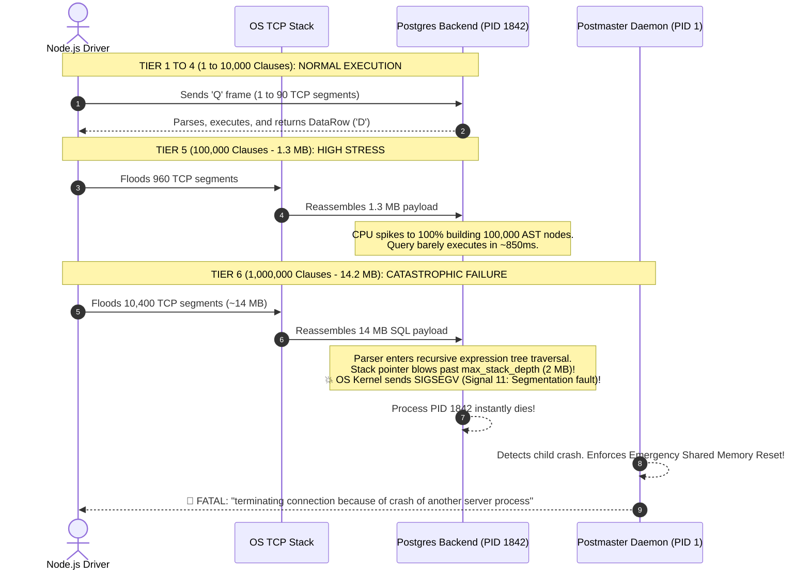

#Database #SQL #PostgreSQL #Security #Wireshark #NetworkProtocols #TCP #Segmentation #QueryOptimization #DoS #Architecture #DevOps

> [!abstract] Executive Summary
> A common question in backend engineering is: **"What is the largest SQL query text an application can transmit across the wire before the database server fails?"**
> 
> Developers often construct queries with dynamic `WHERE id = 1 OR id = 2 OR ...` or massive `WHERE id IN (...)` lists containing tens or hundreds of thousands of items. In production, this practice bridges network transport limits, memory bounds, and database engine parser internals:
> 1. **Network Layer (TCP Segmentation):** While a simple query fits in a single 1.5 KB TCP packet, a 1.3 MB query requires **960 TCP segments**, triggering significant packet assembly overhead, ACK latency, and network retransmissions.
> 2. **Theoretical Protocol Limits:** The PostgreSQL Frontend/Backend Protocol 3.0 uses a 32-bit signed integer for message lengths, providing a theoretical ceiling of **~1 GB** for a single `'Q'` (Query) frame. MySQL enforces `max_allowed_packet` (default 64 MB), while SQLite caps SQL text at 1 MB.
> 3. **The Fatal Crash (AST Parser Stack Overflow):** In practice, PostgreSQL dies long before reaching network or protocol limits. When query text exceeds ~14 MB (1,000,000 `OR` clauses), recursive traversal of the **Abstract Syntax Tree (AST)** inside the SQL parser (`gram.y`, `parse_expr.c`) overflows the process execution stack (`max_stack_depth`).
> 4. **The Postmaster Panic (DoS Vector):** Because a backend worker segmentation fault (`SIGSEGV`) threatens shared memory (`shared_buffers`) integrity, PostgreSQL's supervisor daemon (**Postmaster**) forcibly kills **all active server processes** and resets shared memory, creating an unauthenticated **Denial-of-Service (DoS)** event.

---

## 1. The Physics of Query Transmission: Layer 4 to Layer 7

When an application transmits a SQL statement across a network socket, the database protocol does not send one monolithic chunk; it is broken down by the OS kernel and network hardware.

```
Transport Breakdown for a 1.3 MB SQL Query:
┌────────────────────────────────────────────────────────────────────────┐
│ Layer 7: PostgreSQL Protocol 3.0 'Q' Frame (~1,300,000 Bytes)          │
└───────────────────────────────────┬────────────────────────────────────┘
                                    │ Kernel TCP Segmentation
                                    ▼
┌──────────────┬──────────────┬──────────────┬──────────────┬────────────┐
│ Segment 1    │ Segment 2    │ Segment 3    │ ...          │ Segment 960│
│ (1,460 bytes)│ (1,460 bytes)│ (1,460 bytes)│              │ (840 bytes)│
└──────────────┴──────────────┴──────────────┴──────────────┴────────────┘
        │              │              │                            │
        ▼              ▼              ▼                            ▼
   [ MSS=1460 ]   [ MSS=1460 ]   [ MSS=1460 ]                 [ MSS=840 ]
   [ IP Packet ]  [ IP Packet ]  [ IP Packet ]                [ IP Packet ]
   [ MTU=1500 ]   [ MTU=1500 ]   [ MTU=1500 ]                 [ MTU=1500 ]
```

### Key Networking Metrics:
- **MTU (Maximum Transmission Unit):** Standard Ethernet networks enforce a hard ceiling of **1,500 bytes** per physical frame.
- **MSS (Maximum Segment Size):** After subtracting 20 bytes for the IPv4 header and 20 bytes for the TCP header, the maximum usable TCP payload per packet is **1,460 bytes**.
- **Wireshark TCP PDU Reassembly:** On the receiving server, the operating system TCP stack buffers incoming segments, verifies checksums, re-orders out-of-order packets, and presents the reassembled stream to PostgreSQL's listening process.

---

## 2. The Step-by-Step Escalation Experiment

In Hussein Nasser's hands-on benchmark, a Node.js client connected to a cloud-hosted PostgreSQL instance (ElephantSQL) progressively scaled the number of `OR id = X` clauses:

```javascript
// Query Size Stress Test Script
const { Client } = require('pg');
const client = new Client({ connectionString: 'postgres://...' });

async function stressQuery(clauseCount) {
    let sql = 'SELECT * FROM employees WHERE id = 1';
    for (let i = 2; i <= clauseCount; i++) {
        sql += ` OR id = ${i}`;
    }

    const bytes = Buffer.byteLength(sql, 'utf8');
    console.log(`Sending ${clauseCount} clauses: ${(bytes / 1024).toFixed(2)} KB`);

    console.time('QueryTime');
    const res = await client.query(sql);
    console.timeEnd('QueryTime');
}
```

### Empirical Benchmark Progression:

```
===================================================================================
QUERY SIZE & TCP SEGMENTATION BENCHMARK (PostgreSQL)
===================================================================================
Clauses        SQL Payload Size   TCP Segments (Wireshark)   Engine Result
-----------------------------------------------------------------------------------
1 (Base)       ~45 Bytes          1 Segment                  Success (< 1ms)
100            ~1.1 KB            1 Segment                  Success (1.5ms)
1,000          ~12 KB             9 Segments                 Success (8ms)
10,000         ~125 KB            90 Segments                Success (65ms)
100,000        ~1.3 MB            960 Segments               Success (850ms)
1,000,000      ~14.2 MB           ~10,400 Segments           💥 ENGINE CRASH!
===================================================================================
```



---

## 3. Behind the Crash: Engine Parser Internals

Why did PostgreSQL die on a 14 MB query when modern machines possess tens of gigabytes of RAM?

The crash was **not caused by a network buffer overflow, nor by query execution**. It crashed during **Phase 2: Query Parsing & Semantic Analysis**.

```
PostgreSQL Query Execution Pipeline:
[ Raw SQL String ] 
       │
       ▼
1. Lexical Scanner (scan.l)  ──► Converts characters into tokens (SELECT, IDENT, OR, INT)
       │
       ▼
2. Grammar Parser (gram.y)   ──► Builds Abstract Syntax Tree (AST) via Bison
       │
       ▼
3. Expression Transformation ──► Recursively traverses AST (transformExpr) 💥 STACK OVERFLOW!
       │
       ▼
4. Query Optimizer / Planner ──► (Never reached)
       │
       ▼
5. Executor (Scan / Index)   ──► (Never reached)
```

### 1. The Recursive Abstract Syntax Tree (AST)
When the parser encounters `id = 1 OR id = 2 OR id = 3 ...`, it constructs an expression tree:

```
            [ OR ]
           /      \
      [ id = 1 ]  [ OR ]
                 /      \
            [ id = 2 ]  [ OR ]
                       /      \
                  [ id = 3 ]  ... (1,000,000 levels deep!)
```

Unlike flat array evaluations, binary operators (`OR`, `AND`) produce **deeply nested tree hierarchies**.

### 2. Stack Overflow via `max_stack_depth`
In PostgreSQL, the parser and semantic analyzer traverse AST trees using **recursive C functions** (`transformExprRecursively()`, `eval_const_expressions()`).
- Each nested function call pushes stack frames (local variables, return addresses) onto the thread's execution stack.
- PostgreSQL enforces a safety guardrail: **`max_stack_depth`** (default: `2MB`).
- A tree of 1,000,000 recursive nodes requires tens of megabytes of stack frames.
- When the stack pointer attempts to write beyond the allocated thread stack boundary, the CPU Memory Management Unit (MMU) catches a page fault on an unmapped guard page.
- The Linux kernel instantly terminates the worker process with **`SIGSEGV` (Signal 11: Segmentation Fault)**.

---

## 4. The Postmaster Supervisor Panic (Emergency Rollback)

When the worker process crashed, the client did not merely receive a query syntax error. It received a server-wide disconnect:

```text
FATAL: terminating connection because of crash of another server process
DETAIL: The postmaster has commanded this server process to roll back the current transaction 
        because another server process exited abnormally and possibly corrupted shared memory.
HINT: In a moment you should be able to reconnect to the database and repeat your command.
```

### Why Does One Worker Crash Kill All Connections?
PostgreSQL uses a multi-process architecture orchestrated by the **Postmaster** supervisor (PID 1 of the cluster):

```
PostgreSQL Architecture & Shared Memory Protection:
┌────────────────────────────────────────────────────────────────────────┐
│                        Postmaster Daemon (PID 1)                       │
└───────┬───────────────────────────────┬────────────────────────┬───────┘
        │ (Forks)                       │ (Forks)                │ (Forks)
        ▼                               ▼                        ▼
┌──────────────────┐            ┌──────────────────┐    ┌──────────────────┐
│ Backend Worker A │            │ Backend Worker B │    │ Backend Worker C │
│ (Client 1: Safe) │            │ (Malicious Query)│    │ (Client 3: Safe) │
└────────┬─────────┘            └────────┬─────────┘    └────────┬─────────┘
         │                               │                       │
         ▼                               ▼                       ▼
┌────────────────────────────────────────────────────────────────────────┐
│               SHARED MEMORY (shared_buffers, Locks, WAL)               │
│ 💥 A dying process could leave corrupted spinlocks or torn page latches! │
└────────────────────────────────────────────────────────────────────────┘
```

1. **Shared Memory Vulnerability:** All PostgreSQL backend processes map to the same contiguous shared memory segment containing `shared_buffers`, buffer locks, and transaction tables.
2. **The Crash State:** When Worker B crashes via `SIGSEGV`, it dies instantaneously without running cleanup code. If Worker B held a shared spinlock or was halfway through updating a shared buffer header, that lock is now permanently orphaned.
3. **The Conservative Safety Policy:** To prevent **silent data corruption**, PostgreSQL adopts a zero-tolerance policy:
   - The Postmaster sends `SIGQUIT` to **every other backend process in the entire cluster**.
   - All active transactions across all clients are aborted and rolled back.
   - The Postmaster resets the shared memory block, performs crash recovery via Write-Ahead Logging (WAL), and only then accepts new connections.

> [!CAUTION] Denial of Service (DoS) Vulnerability (CWE-400)
> Any client capable of executing a `SELECT` query can deliberately send a 15 MB recursive SQL payload to trigger a worker `SIGSEGV`. This forces the Postmaster into crash recovery, terminating sessions for all other application users on the database!

---

## 5. RDBMS Comparison: Maximum Query Limits Across the Industry

Different database engines enforce distinct ceilings on SQL query sizes:

| Database Engine | Maximum Query Size Ceiling | Enforcing Mechanism | Failure Behavior |
| :--- | :--- | :--- | :--- |
| **PostgreSQL** | ~1 GB (Theoretical) / ~10–30 MB (Practical) | Signed 32-bit protocol length / `max_stack_depth` | Crashes worker process via `SIGSEGV` when recursion overflows stack. |
| **MySQL / MariaDB** | **`max_allowed_packet`** (Default: 64 MB, Max: 1 GB) | Explicit buffer limit check | Clean rejection: `ER_NET_PACKET_TOO_LARGE` (No crash). |
| **Microsoft SQL Server** | **~256 MB** (or 2,100 parameters) | $65,536 \times \text{Network Packet Size}$ | Error: `The query processor ran out of internal resources during query optimization`. |
| **Oracle Database** | **64 KB** (PL/SQL) / **2 MB** (SQL) | Expression limit of 1,000 elements in `IN (...)` | Error: `ORA-01795: maximum number of expressions in a list is 1000`. |
| **SQLite** | **`SQLITE_MAX_SQL_LENGTH`** (Default: 1,000,000 Bytes) | Hardcoded compiler constant | Clean error: `statement too long`. |

---

## 6. Defensive Engineering: How to Fix Giant Query Anti-Patterns

Constructing massive `OR` chains or giant `IN (...)` lists is an architectural code smell. Production applications should employ the following hardened patterns:

### Pattern 1: Array Parameters with `ANY()` (PostgreSQL Standard)
Instead of generating a query string with 50,000 concatenated `OR` tokens, pass a native array parameter:

```sql
-- DANGEROUS: 50,000 AST OR nodes
SELECT * FROM employees WHERE id = 1 OR id = 2 OR id = 3 ...;

-- HARDENED: Single parameterized array token (O(1) parser depth)
SELECT * FROM employees WHERE id = ANY($1::int[]);
```
In Node.js:
```javascript
const ids = [1, 2, 3, /* ... 50,000 ids */];
const res = await client.query('SELECT * FROM employees WHERE id = ANY($1::int[])', [ids]);
```
- **Why this works:** The query string is only 52 bytes long. The array is parsed as a flat binary tuple list rather than a deeply nested recursive tree.

---

### Pattern 2: Temporary Staging Tables (`COPY` + `INNER JOIN`)
When matching against 100,000 to 1,000,000 keys, transmission via SQL string is fundamentally flawed. Use bulk streaming:

```sql
-- Step 1: Create a temporary unlogged table (in RAM)
CREATE TEMP TABLE target_ids (
    id INT PRIMARY KEY
) ON COMMIT DROP;

-- Step 2: Stream IDs via binary COPY protocol (Gigabytes/sec throughput)
-- COPY target_ids FROM STDIN ...

-- Step 3: Join via indexed hash/merge join
SELECT e.* 
FROM employees e
INNER JOIN target_ids t ON e.id = t.id;
```

---

### Pattern 3: Application-Level Batch Chunking
If queries must use standard `IN (...)` clauses, enforce chunking at the repository layer:

```javascript
// Chunking array into safe bounds of 500 items
async function fetchEmployeesInBatches(allIds, batchSize = 500) {
    const results = [];
    for (let i = 0; i < allIds.length; i += batchSize) {
        const batch = allIds.slice(i, i + batchSize);
        const res = await client.query(
            'SELECT * FROM employees WHERE id = ANY($1::int[])', 
            [batch]
        );
        results.push(...res.rows);
    }
    return results;
}
```

---

### Pattern 4: Server-Side Guardrails
Harden PostgreSQL's configuration (`postgresql.conf`) to mitigate malicious or unvetted giant queries:

```conf
# 1. Enforce a strict query execution timeout
statement_timeout = '10s'              # Aborts any query running > 10 seconds

# 2. Prevent infinite recursive stack dives
max_stack_depth = '2MB'                # Default safe limit for OS thread stacks

# 3. Restrict incoming connection packet sizes via Reverse Proxy (e.g. Nginx / Envoy)
client_max_body_size 2m;               # Rejects HTTP payloads carrying multi-megabyte queries
```

---

## 7. Key Architectural Takeaways

| Metric / Dimension | Small Query (1 KB) | Moderate Query (125 KB) | Giant Query (1.3 MB) | Extreme Query (14 MB) |
| :--- | :--- | :--- | :--- | :--- |
| **Clause Count** | $\le 100$ | 10,000 | 100,000 | 1,000,000 |
| **TCP Segments** | 1 | 90 | 960 | ~10,400 |
| **Network Overhead** | Negligible | Low | High (ACK/Retransmit risk) | Extreme (Socket saturation) |
| **Parser AST Depth** | Shallow | Moderate | Heavy (100% CPU spike) | **Stack Overflow (`SIGSEGV`)** |
| **Engine State** | Healthy | Healthy | Degraded | **Postmaster Cluster Reset** |
| **Architecture Verdict** | Standard | Acceptable with arrays | Refactor immediately | **Severe Security Flaw (DoS)** |
