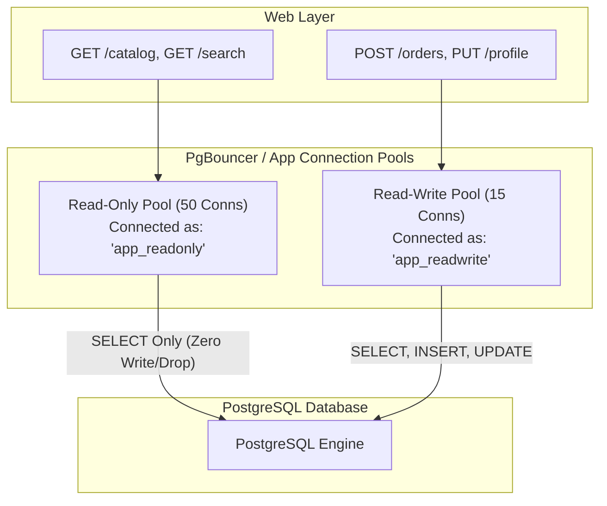

#Database #Security #PostgreSQL #SQLInjection #LeastPrivilege #RBAC #DDL #DML #ConnectionPooling #Kubernetes #SystemDesign #DevOps

> [!abstract] Executive Summary
> In tutorials and solo side projects, developers frequently initialize database tables by executing **`CREATE TABLE IF NOT EXISTS` directly inside the application startup script**. While convenient for local development, executing Data Definition Language (DDL) commands at application boot in production is a **critical anti-pattern and severe security vulnerability**.
> 
> The flaw lies in the **Database Ownership Model and the Principle of Least Privilege (PoLP)**:
> 1. **The Ownership Flaw:** The database user who creates a table automatically becomes its **Owner**. In SQL databases (PostgreSQL, MySQL, SQL Server, Oracle), the table owner possesses unrevokable administrative powers—including `ALTER TABLE`, `TRUNCATE`, and **`DROP TABLE`**.
> 2. **SQL Injection Blast Radius Amplification:** When untrusted web traffic interacts with an application running under the table owner's credentials, any SQL Injection vulnerability (or compromised ORM query) allows attackers to execute `; DROP TABLE employees;` or `; TRUNCATE users;`, destroying critical business state.
> 3. **The Deployment Race Condition:** In horizontally scaled cloud environments (Kubernetes, AWS ECS), spinning up 10 replica pods simultaneously running `CREATE TABLE IF NOT EXISTS` induces exclusive locks on system catalogs (`pg_class`, `pg_type`), triggering **Catalog Deadlocks** and pod crash-loops.
> 
> Production architectures enforce **strict role separation**: DDL migrations run via dedicated CI/CD deployment pipelines using an administrative `schema_owner`, while runtime applications connect using constrained `app_user` identities limited to DML (`SELECT`, `INSERT`, `UPDATE`), paired with route-specific read-only and read-write connection pools.

---

## 1. The Startup DDL Dilemma: Shark Beak's Question

The question submitted by community engineer *Shark Beak* represents a widespread architectural decision:

> *"On my side project, I have my Node.js application call `CREATE TABLE IF NOT EXISTS` on startup before accepting web requests. Is this a good idea or a bad idea for production?"*

```javascript
// ❌ THE POPULAR SIDE-PROJECT ANTI-PATTERN (server.js)
const { Pool } = require('pg');
const pool = new Pool({ connectionString: process.env.DATABASE_URL });

async function startServer() {
    // Application connects and attempts DDL on boot:
    await pool.query(`
        CREATE TABLE IF NOT EXISTS employees (
            id SERIAL PRIMARY KEY,
            name VARCHAR(100) NOT NULL,
            salary NUMERIC(10, 2) NOT NULL
        );
    `);

    app.listen(3000, () => console.log('Server listening on port 3000'));
}

startServer();
```

### The Architectural Verdict:
- **For Solo CLI Scripts & Scratch Tools:** **Acceptable.** It provides rapid idempotency and zero deployment ceremony.
- **For Production Multi-User Web Applications:** **Unacceptable.** It violates the Principle of Least Privilege, exposes the database to total schema destruction via SQL injection, and breaks containerized deployment orchestration.

---

## 2. Anatomy of the Vulnerability: Table Ownership & Privilege Escalation

Relational database security engines operate on a hierarchical authorization model governed by **Object Ownership**:

```
PostgreSQL Object Privilege Hierarchy:
┌────────────────────────────────────────────────────────┐
│ Superuser (postgres)                                   │
│ (Bypasses all permission checks, can read/drop anything)│
└──────────────────────────┬─────────────────────────────┘
                           │ Grants schema creation
                           ▼
┌────────────────────────────────────────────────────────┐
│ Table Owner (The user executing CREATE TABLE)          │
│ • Can DROP TABLE, TRUNCATE, and ALTER schema           │
│ • Can GRANT / REVOKE permissions to other users        │
│ • Privileges CANNOT be restricted on their own tables! │
└──────────────────────────┬─────────────────────────────┘
                           │ Grants restricted DML
                           ▼
┌────────────────────────────────────────────────────────┐
│ Application Runtime User (app_user)                    │
│ • Intended: SELECT, INSERT, UPDATE, DELETE             │
│ • Restricted: CANNOT DROP, TRUNCATE, or ALTER tables   │
└────────────────────────────────────────────────────────┘
```

### The Critical Privilege Mechanism:
In PostgreSQL and standard SQL:
- When a user issues `CREATE TABLE employees (...)`, PostgreSQL records that user's OID in `pg_class.relowner`.
- **The Owner Invariant:** An owner inherently possesses **all rights** on their object. You cannot revoke `DROP` or `ALTER` permissions from the table's owner.
- **The Identity Conflation:** By having the web application execute `CREATE TABLE`, the web application's database user becomes the **Table Owner**.

---

## 3. SQL Injection Blast Radius: Owner vs. Least-Privilege User

Consider what happens when a vulnerability (SQL Injection, unescaped dynamic query, or compromised ORM parameter) occurs in a public-facing web route:

```javascript
// Vulnerable search route
app.get('/search', async (req, res) => {
    const userInput = req.query.name; // e.g. "Hussein'; DROP TABLE employees; --"
    const result = await pool.query(`SELECT * FROM employees WHERE name = '${userInput}'`);
    res.json(result.rows);
});
```

### Scenario A: Application Connects as Table Owner (Anti-Pattern)

```mermaid
sequenceDiagram
    autonumber
    actor Attacker as Malicious Web User
    participant App as Web App (User: app_owner)
    participant DB as PostgreSQL Database Engine

    Attacker->>App: GET /search?name=Hussein'; DROP TABLE employees; --
    App->>DB: SELECT * FROM employees WHERE name = 'Hussein'; DROP TABLE employees; --
    
    Note over DB: Engine checks permissions for 'app_owner':<br/>Is 'app_owner' the owner of 'employees'? YES!
    DB-->>DB: 💥 Table 'employees' physically DROPPED from disk!
    DB-->>App: CommandComplete: DROP TABLE
    App-->>Attacker: 200 OK (Data destroyed!)
```

Because the application connection owns the table, the database engine allows the `DROP TABLE` command to execute unconditionally. In seconds, customer data, tables, and constraints are erased.

---

### Scenario B: Application Connects as Least-Privilege DML User (Production Standard)

Now consider the exact same attack when the database schema was provisioned by an administrative `schema_owner`, and the web application connects as an unprivileged `app_user` with only `SELECT, INSERT, UPDATE` grants:

```mermaid
sequenceDiagram
    autonumber
    actor Attacker as Malicious Web User
    participant App as Web App (User: app_dml_user)
    participant DB as PostgreSQL Database Engine

    Attacker->>App: GET /search?name=Hussein'; DROP TABLE employees; --
    App->>DB: SELECT * FROM employees WHERE name = 'Hussein'; DROP TABLE employees; --
    
    Note over DB: Engine checks permissions for 'app_dml_user':<br/>Is 'app_dml_user' the table owner? NO!<br/>Does 'app_dml_user' have DROP permission? NO!
    DB-->>DB: 🛡️ Engine blocks execution! Raises SQLSTATE 42501!
    DB-->>App: 💥 ERROR: must be owner of table employees
    App-->>Attacker: 500 Internal Server Error (Database unharmed!)
```

```text
PostgreSQL Permission Failure:
ERROR:  must be owner of table employees
STATEMENT:  SELECT * FROM employees WHERE name = 'Hussein'; DROP TABLE employees; --
```

**The Blast Radius Difference:**
- In Scenario A, an application-level bug resulted in **total data loss and catastrophic schema destruction**.
- In Scenario B, the database engine acted as an autonomous security firewall. The application failed, but the data remained 100% intact.

---

## 4. The Operational Hazard: Multi-Pod Kubernetes Startup Race Conditions

Beyond security, executing DDL on application startup introduces severe operational failure modes in modern containerized architectures (Kubernetes, Amazon ECS, Docker Swarm).

```
Rolling Deployment of 10 Application Pods:
┌─────────────────┐  ┌─────────────────┐  ┌─────────────────┐
│ Pod 1 (Booting) │  │ Pod 2 (Booting) │  │ Pod 3 (Booting) │ ... (10 Pods)
└────────┬────────┘  └────────┬────────┘  └────────┬────────┘
         │                    │                    │
         ├────────────────────┼────────────────────┤
         │ Concurrent DDL:    │ Concurrent DDL:    │ Concurrent DDL:
         ▼                    ▼                    ▼
┌──────────────────────────────────────────────────────────┐
│                   PostgreSQL Database                    │
│ 💥 Multiple pods contend for AccessExclusiveLock on       │
│    system catalog tables (pg_class, pg_type)!            │
│ 🚨 Result: DEADLOCK DETECTED! Pods crash-loop on deploy! │
└──────────────────────────────────────────────────────────┘
```

### The Technical Mechanism of Failure:
1. **Catalog Locks:** In PostgreSQL, DDL commands (`CREATE TABLE`, `CREATE INDEX`) do not merely lock user tables; they require an **`AccessExclusiveLock`** on PostgreSQL's global system catalog tables (`pg_class`, `pg_attribute`, `pg_type`).
2. **Catalog Deadlocks:** When multiple pods execute `CREATE TABLE IF NOT EXISTS` at the exact same millisecond:
   - Pod 1 acquires a lock on `pg_type` and waits for `pg_class`.
   - Pod 2 acquires a lock on `pg_class` and waits for `pg_type`.
   - PostgreSQL's deadlock detector fires:
     `ERROR: deadlock detected; Process 4102 waits for ExclusiveLock on relation ...`
   - Pod initialization fails, triggering Kubernetes pod restarts and failing deployment rollouts.
3. **Startup Latency:** Checking catalog tables on every application cold-start slows down container boot times, causing Kubernetes `readinessProbe` timeouts and delayed auto-scaling.

---

## 5. The Production Standard: Segregating DDL and DML

Production systems strictly separate **Schema Evolution (DDL)** from **Runtime Application Execution (DML)**.

```
Architectural Separation of Concerns:
===================================================================================
Lifecycle Stage       Identity Used        Allowed Privileges           Tools / Protocol
-----------------------------------------------------------------------------------
1. Deployment / CI/CD schema_owner (Admin) DDL: CREATE, ALTER, DROP     Flyway, Liquibase,
                                           Owns tables and schemas      Prisma, EF Migrations
-----------------------------------------------------------------------------------
2. Web App Runtime    app_user (Restricted)DML: SELECT, INSERT, UPDATE  pg, psycopg2,
                                           Zero DDL privileges          HikariCP, PgBouncer
===================================================================================
```

### Step-by-Step PostgreSQL Role Hardening Script:

Run this script once during database cluster initialization (as `postgres` superuser):

```sql
-- =============================================================================
-- STEP 1: Create Dedicated Schema Owner (Used only by CI/CD Migrations)
-- =============================================================================
CREATE ROLE schema_owner WITH LOGIN PASSWORD 'SuperSecureMigrationPassword123!';
CREATE SCHEMA app_schema AUTHORIZATION schema_owner;

-- =============================================================================
-- STEP 2: Create Restricted Application Runtime User
-- =============================================================================
CREATE ROLE app_user WITH LOGIN PASSWORD 'RuntimeAppPassword456!';

-- Allow app_user to connect to database and resolve objects in app_schema
GRANT CONNECT ON DATABASE production_db TO app_user;
GRANT USAGE ON SCHEMA app_schema TO app_user;

-- =============================================================================
-- STEP 3: Grant Least-Privilege DML Permissions (NO DDL!)
-- =============================================================================
-- Grant permissions on existing tables
GRANT SELECT, INSERT, UPDATE, DELETE ON ALL TABLES IN SCHEMA app_schema TO app_user;

-- Grant sequence permissions for auto-incrementing SERIAL / IDENTITY IDs
GRANT USAGE, SELECT ON ALL SEQUENCES IN SCHEMA app_schema TO app_user;

-- Ensure all FUTURE tables created by schema_owner automatically grant DML to app_user
ALTER DEFAULT PRIVILEGES FOR ROLE schema_owner IN SCHEMA app_schema
GRANT SELECT, INSERT, UPDATE, DELETE ON TABLES TO app_user;

ALTER DEFAULT PRIVILEGES FOR ROLE schema_owner IN SCHEMA app_schema
GRANT USAGE, SELECT ON SEQUENCES TO app_user;

-- =============================================================================
-- STEP 4: Explicitly Deny Administrative Destructive Actions
-- =============================================================================
-- By omission, app_user has NO DROP, NO TRUNCATE, and NO ALTER privileges!
```

---

## 6. Advanced Defense-in-Depth: Route-Based Connection Pools

Hussein Nasser highlights a powerful enterprise architectural pattern: **Segregating connection pools by HTTP route type**.

In a typical web application:
- **80–90% of requests are Read-Only** (`GET /products`, `GET /users/123`, `GET /search`).
- **10–20% of requests are Mutations** (`POST /checkout`, `PUT /profile`, `DELETE /item`).

Why give read routes the authority to mutate data?



### Implementing Route-Based Role Separation:

```sql
-- 1. Create a strictly Read-Only database role
CREATE ROLE app_readonly WITH LOGIN PASSWORD 'ReadOnlySecret!';
GRANT CONNECT ON DATABASE production_db TO app_readonly;
GRANT USAGE ON SCHEMA app_schema TO app_readonly;
GRANT SELECT ON ALL TABLES IN SCHEMA app_schema TO app_readonly;

-- 2. Create a standard Read-Write database role
CREATE ROLE app_readwrite WITH LOGIN PASSWORD 'ReadWriteSecret!';
GRANT CONNECT ON DATABASE production_db TO app_readwrite;
GRANT USAGE ON SCHEMA app_schema TO app_readwrite;
GRANT SELECT, INSERT, UPDATE ON ALL TABLES IN SCHEMA app_schema TO app_readwrite;
```

### Application-Level Routing in Express / Node.js:

```javascript
// db.js - Dual Connection Pools
const { Pool } = require('pg');

const readPool = new Pool({
    connectionString: process.env.READ_DATABASE_URL, // Connects as 'app_readonly'
    max: 50
});

const writePool = new Pool({
    connectionString: process.env.WRITE_DATABASE_URL, // Connects as 'app_readwrite'
    max: 15
});

module.exports = { readPool, writePool };
```

```javascript
// routes/catalog.js - Using Read-Only Pool
const { readPool } = require('../db');

app.get('/products', async (req, res) => {
    // Even if an SQL injection occurs here, it is IMPOSSIBLE to modify or drop data!
    const { rows } = await readPool.query('SELECT * FROM app_schema.products WHERE category = $1', [req.query.cat]);
    res.json(rows);
});
```

### The Security & Performance Dividend:
1. **Zero Mutation Blast Radius on Read Endpoints:** If an attacker exploits an SQL injection vulnerability on a search or catalog route, the database rejects any attempt to mutate state (`INSERT`, `UPDATE`, `DELETE`) or execute DDL.
2. **Read Replica Offloading:** The `readPool` can point directly to **PostgreSQL Read-Only Replicas**, while the `writePool` connects to the Primary instance, distributing traffic seamlessly.
3. **Pool Sizing Optimization:** Read pools can scale horizontally to handle read spikes without starving the write pool of precious connection slots.

---

## 7. Migration Best Practices: How to Safely Evolve Schemas

If `CREATE TABLE IF NOT EXISTS` on startup is banned, how should production schemas evolve?

### The Automated Migration Pipeline:
1. **Migration Version Control:** Schema changes are authored as sequential, immutable SQL migration files (e.g. `V1__init_schema.sql`, `V2__add_index.sql`).
2. **Migration Runners:** Use dedicated tools such as **Flyway**, **Liquibase**, **Prisma Migrate**, **Alembic**, or **EF Core Migrations**.
3. **CI/CD Execution (Deploy Stage):**
   ```bash
   # CI/CD Pipeline Step: Executed BEFORE launching new application containers
   flyway -url="jdbc:postgresql://db:5432/prod" \
          -user="schema_owner" \
          -password="$MIGRATION_PASSWORD" \
          migrate
   ```
4. **Zero-Downtime Rollouts (Expand/Contract Pattern):**
   - **Expand Phase:** Add new columns as `NULLABLE` via migration. Deploy new application code that writes to both old and new columns.
   - **Contract Phase:** Backfill historical data, switch application reads to the new column, and drop the legacy column in a subsequent deployment.

---

## 8. Summary Comparison

| Architectural Dimension | Startup DDL (`CREATE IF NOT EXISTS`) | Production Role-Segregated Architecture |
| :--- | :--- | :--- |
| **Executing Identity** | Application runtime user (`app_owner`). | **`schema_owner`** (CI/CD) and **`app_user`** (Runtime). |
| **Table Ownership** | Owned by runtime web application. | Owned by administrative migration identity. |
| **SQL Injection Blast Radius** | **Critical:** Attacker can `DROP TABLE`, `TRUNCATE`, or `ALTER`. | **Mitigated:** Database blocks `DROP` with permission denied. |
| **Kubernetes Scalability** | **Broken:** Multi-pod startup causes catalog deadlocks (`pg_class`). | **Safe:** Schema is migrated once before pod deployment. |
| **Schema Evolution** | Primitive: Cannot rename columns, modify types, or run backfills. | Professional: Tracked, versioned, idempotent, rollbacks supported. |
| **Connection Pooling** | Monolithic unconstrained connection pool. | **Route-specific pools** (`app_readonly` vs `app_readwrite`). |
