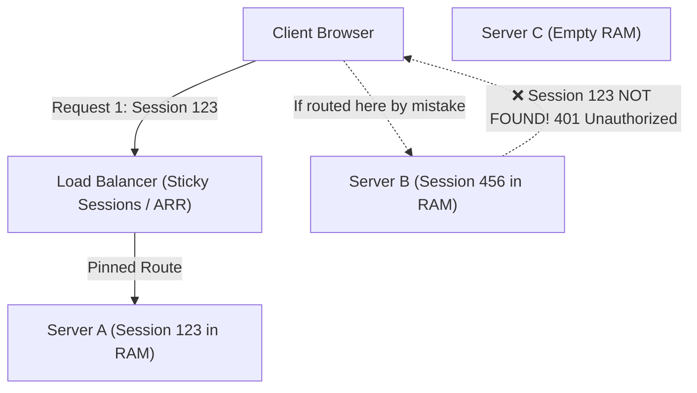
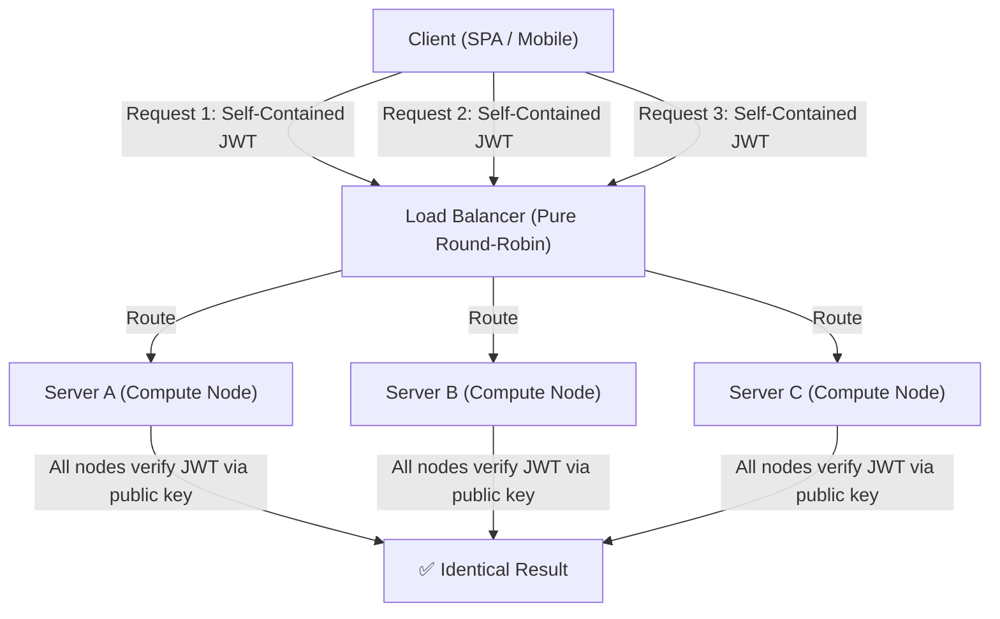
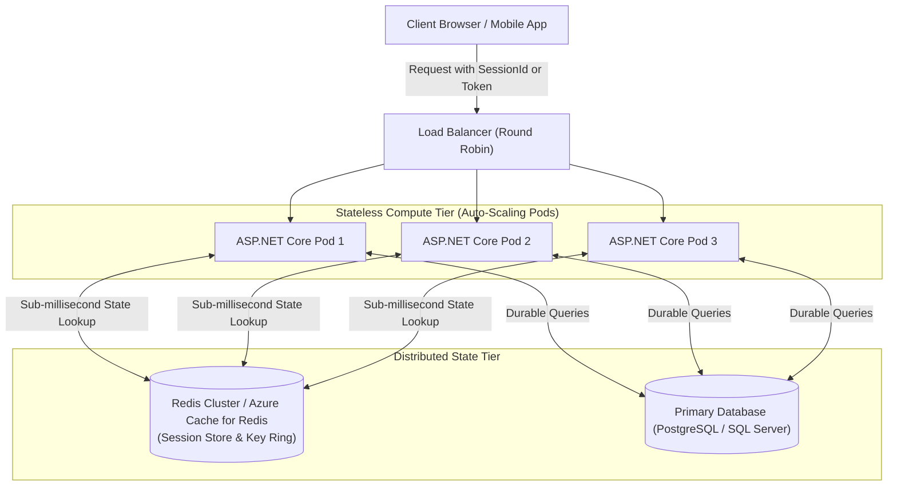
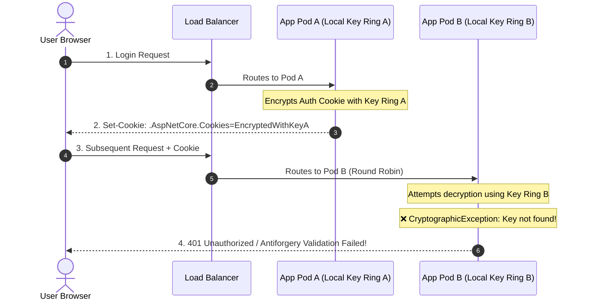
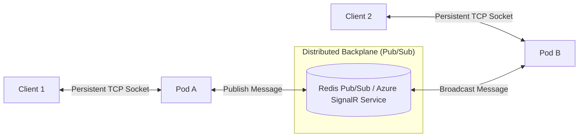

#CoreConcept #SoftwareArchitecture #Scalability #Stateless #Stateful #DistributedSystems #DotNet #AspNetCore #SystemDesign #InterviewPreparation

> [!abstract] Executive Summary
> Every distributed web system must make a fundamental architectural choice: **Where does user session state live between requests?**
> - **Stateful Architecture:** The application server retains user state directly in its local memory (process RAM). Requests from the same client *must* return to the exact same server instance, or state must be actively synchronized between instances.
> - **Stateless Architecture:** The application server retains **zero** client session state between requests. Every HTTP request contains all context needed for processing, or references state stored in an external shared distributed store. Any server instance in the cluster can process any request from any client at any time.
>
> In modern cloud-native systems, the paradigm is **"Stateless Compute, Stateful Data."** Application nodes must be disposable, horizontally scalable, and load-balancer agnostic. This guide breaks down the mechanics, trade-offs, multi-server scaling bottlenecks, ASP.NET Core implementation patterns, and the critical **Data Protection API Key Ring** requirement for containerized .NET deployments.

---

## 1. The Core Architectural Premise: What is "State"?

In web applications, **state** refers to any data that persists across multiple sequential requests within a user's workflow:
- User identity & claims (authenticated user ID, tenant ID, permissions).
- Ephemeral workflow state (multi-step wizard data, shopping cart items, temporary upload tokens).
- Transport & connection context (WebSocket TCP handles, active SignalR hub connections).

```
┌─────────────────────────────────────────────────────────────────────────────────────────────────┐
│                                   WHERE DOES THE STATE RESIDE?                                  │
├───────────────────────────────┬─────────────────────────────────┬───────────────────────────────┤
│ 1. In-Process RAM (Stateful)  │ 2. Client-Held Token (Stateless)│ 3. External Shared Store      │
├───────────────────────────────┼─────────────────────────────────┼───────────────────────────────┤
│ Server holds session object   │ Client transmits signed payload │ Server looks up session ID    │
│ Example: In-Memory Session    │ Example: Cryptographic JWT      │ Example: Redis Cluster Cache  │
│ Server Crash = Lost Session   │ Server Crash = Zero Impact      │ Server Crash = Zero Impact    │
│ Horizontal Scaling = Broken   │ Horizontal Scaling = Infinite   │ Horizontal Scaling = Linear   │
└───────────────────────────────┴─────────────────────────────────┴───────────────────────────────┘
```

---

## 2. Stateful Architecture: The Dedicated Bank Teller

In a stateful design, the server maintains a continuous session context for each client in its own memory.



### The Analogy: The Dedicated Bank Teller
You walk into a branch and speak with teller **Bob**. Bob takes your physical paper documents and spreads them across his desk. As long as you speak only with Bob, your transactions are immediate because Bob has all your context right in front of him.
However, if Bob goes on lunch break, crashes, or you get assigned to **Jane**, Jane has zero context. Your session is broken, and you must start over from scratch.

### Architectural Mechanics
1. Client logs in with credentials.
2. Server creates an in-memory session object (e.g., hash table in heap memory) and assigns a random `SessionId` (e.g., `ASP.NET_SessionId`).
3. Server returns the `SessionId` via an HTTP cookie.
4. Subsequent requests include the `SessionId` cookie; the server retrieves the session object from its local RAM.

### Pros
- **Blazing Fast Read/Write:** Direct CPU access to local process memory; zero network latency or database serialization overhead.
- **Trivial Implementation for Single-Instance Monoliths:** No external infrastructure (Redis, database tables) required.

### Critical Cons & Bottlenecks in Production
- ❌ **Breaks Horizontal Scaling:** Standard round-robin load balancing fails. If Request 1 hits Server A, Request 2 *must* hit Server A.
- ❌ **Requires "Sticky Sessions" (Session Affinity):** The load balancer must inspect cookies (e.g., AWS ALB target group stickiness, Azure ARR Affinity) to pin clients to specific instances.
  - **Uneven Load Distribution:** A few power users or crawler bots pinned to Server A can overload it while Servers B and C sit idle.
  - **Auto-Scaling Impediment:** You cannot easily scale in (terminate instances) during traffic lulls without abruptly severing active user sessions.
- ❌ **Single Point of Failure (SPOF):** If Server A crashes or restarts during a deployment, all sessions in its RAM are destroyed. Users are kicked out and must log in again.
- ❌ **Memory Leaks & Out-Of-Memory (OOM):** If session timeouts are poorly configured or traffic spikes, millions of abandoned sessions consume RAM, triggering garbage collection thrashing or process crashes.

---

## 3. Stateless Architecture: The Modern Call Center

In a stateless architecture, servers act as pure **computation engines**. No server instance stores any client session information between requests.



### The Analogy: The Modern Call Center
You call enterprise tech support. You are never assigned a dedicated agent. When an agent answers, they ask for your **Ticket Number** (the self-contained token).
The ticket number contains all needed context, or lets any agent immediately query the shared database. It does not matter whether Agent Alice, Bob, or Carlos answers your call; every agent delivers the exact same response.

### Architectural Mechanics (Client-Side Statelessness)
1. Client logs in with credentials.
2. Server verifies credentials, generates a cryptographically signed token (e.g., JSON Web Token - JWT) containing user claims (`sub`, `roles`, `tenant_id`, `exp`).
3. Server transmits the token to the client. The server does **not** store the token in RAM or database.
4. Subsequent requests pass the token in the `Authorization: Bearer <token>` header.
5. Any server in the cluster validates the cryptographic signature using the shared secret key or asymmetric public key (RS256/ECDSA). If the signature and expiry are valid, the request proceeds.

### Pros
- ✅ **Infinite Horizontal Scalability:** Instances can be spawned (scale out) or destroyed (scale in) dynamically based on CPU/traffic without disrupting a single user.
- ✅ **Fault Tolerant & Zero Downtime Deployments:** If an instance crashes or undergoes a rolling update, the load balancer reroutes the next request to a healthy instance without the user ever noticing.
- ✅ **No Session Affinity / Sticky Sessions Required:** Pure round-robin, least-connections, or random load balancing delivers optimal server utilization.
- ✅ **Multi-Region & CDN Friendly:** Requests can be routed to the nearest regional data center without requiring cross-region session synchronization.

### The "Stateless Fallacy" & Practical Trade-Offs
Pure client-side statelessness introduces distinct engineering challenges:
- ⚠️ **Token Bloat & Network Overhead:** Every claim added to a JWT inflates request header size. Large tokens sent on hundreds of API requests consume bandwidth and can exceed web server header limits (HTTP 431 Request Header Fields Too Large).
- ⚠️ **The Revocation Problem:** Because the server does not track tokens, **a signed JWT cannot be invalidated before its expiration date** without re-introducing server-side state (e.g., a Redis token revocation blacklist).
- ⚠️ **Stale Permissions:** If a user's role is demoted or their account is suspended, their active JWT remains valid until the `exp` timestamp arrives unless active token revocation or refresh token checks are enforced.

---

## 4. The Industry Standard: Stateless Compute with Distributed State

Modern enterprise applications rarely choose pure in-memory state or pure unrevocable statelessness. Instead, they implement **Stateless Compute backed by Distributed Shared State**:



In this model:
1. Application compute pods are completely stateless and disposable.
2. Ephemeral session state, cached data, and rate-limiting counters live in an ultra-low latency, distributed in-memory store (**Redis**).
3. Any compute pod can access or update any session state in sub-millisecond time.

---

## 5. ASP.NET Core Implementation: Distributed Sessions & Caching

In .NET 8/9, session state can be configured to use a distributed Redis store instead of local process memory with minimal configuration.

### Production Configuration (`Program.cs`)
```csharp
using Microsoft.Extensions.Caching.StackExchangeRedis;

var builder = WebApplication.CreateBuilder(args);

// 1. Configure Redis as the Distributed Cache provider
builder.Services.AddStackExchangeRedisCache(options =>
{
    options.Configuration = builder.Configuration.GetConnectionString("RedisConnection")
        ?? "localhost:6379,ssl=True,abortConnect=False";
    options.InstanceName = "EnterpriseApp_";
});

// 2. Configure Distributed Session State backed by Redis
builder.Services.AddSession(options =>
{
    options.IdleTimeout = TimeSpan.FromMinutes(30);
    options.Cookie.HttpOnly = true;
    options.Cookie.IsEssential = true; // Required for GDPR compliance
    options.Cookie.SameSite = SameSiteMode.Strict;
    options.Cookie.SecurePolicy = CookieSecurePolicy.Always;
    options.Cookie.Name = "__Host-SessionId";
});

var app = builder.Build();

app.UseRouting();
app.UseAuthentication();
app.UseAuthorization();

// 3. Must be placed AFTER UseRouting() and BEFORE MapControllers()
app.UseSession();

app.MapGet("/api/cart/add", async (HttpContext context, string item) =>
{
    // Reading/Writing state: Serialized transparently to Redis
    var currentItems = context.Session.GetString("Cart") ?? "";
    var updated = $"{currentItems},{item}".TrimStart(',');
    context.Session.SetString("Cart", updated);

    return Results.Ok(new { Message = "Item added to session in Redis", Cart = updated });
});

app.Run();
```

---

## 6. The Multi-Server .NET Blind Spot: The Data Protection API (DPAPI)

> [!CAUTION] The Most Common Production Bug in Clustered ASP.NET Core Applications
> When you deploy multiple instances of ASP.NET Core behind a load balancer (in Docker, Kubernetes, or Azure App Service), you will suddenly encounter random **HTTP 400 Bad Request (Antiforgery validation failed)** and **HTTP 401 Unauthorized** errors on page refreshes.
>
> **Why?** ASP.NET Core uses the **Data Protection API (DPAPI)** to encrypt cookies, session IDs, and antiforgery tokens. By default, DPAPI stores its encryption keys in the local machine's file system or memory. 
> - Server A encrypts a cookie using **Key A**.
> - The user's next request routes to Server B.
> - Server B attempts to decrypt the cookie using **Key B**, throws `CryptographicException: The key {guid} was not found in the key ring`, and rejects the user as unauthenticated!



### The Production Solution: Persisted & Protected Key Ring
To make ASP.NET Core compute instances truly stateless, you must configure the Data Protection Key Ring to persist in a shared store (Redis, Azure Blob Storage, or AWS S3) and encrypt the keys at rest (Azure Key Vault or AWS KMS).

```csharp
using Microsoft.AspNetCore.DataProtection;
using StackExchange.Redis;

var builder = WebApplication.CreateBuilder(args);

// Connect to Redis multiplexer
var redisConnection = builder.Configuration.GetConnectionString("RedisConnection");
var redis = ConnectionMultiplexer.Connect(redisConnection!);

// Configure centralized Data Protection Key Ring
builder.Services.AddDataProtection()
    .SetApplicationName("SharedEnterpriseApp") // Must match across all pods!
    .PersistKeysToStackExchangeRedis(redis, "DataProtection-Keys")
    // In production, encrypt keys at rest using Azure Key Vault or AWS KMS:
    // .ProtectKeysWithAzureKeyVault(new Uri("https://myvault.vault.azure.net/keys/dp-key"), new DefaultAzureCredential());
    .SetDefaultKeyLifetime(TimeSpan.FromDays(90));

var app = builder.Build();
```

With this configuration:
1. Every pod reads and writes cryptographic keys to the shared Redis `DataProtection-Keys` entry.
2. Any pod can decrypt cookies, antiforgery tokens, and session tickets generated by any other pod.
3. Compute pods can be destroyed, restarted, or auto-scaled dynamically without logging out a single user.

---

## 7. The Stateful Exception: WebSockets & SignalR

While HTTP REST APIs should almost always be stateless, **real-time bidirectional systems (WebSockets, gRPC streaming, SignalR)** are inherently stateful at the transport layer:
- A persistent TCP connection remains open between the client and a specific server node.
- The server node holds the connection socket in memory.

### How to Scale Stateful WebSockets in a Stateless Architecture
If User 1 connects via WebSocket to Pod A, and User 2 connects to Pod B, how can User 1 send a real-time message to User 2?



### The Solution: The Redis Backplane
Instead of attempting to synchronize TCP connections across servers, applications use a **Pub/Sub Backplane**:
1. Pod A publishes the real-time event to a Redis channel.
2. Redis broadcasts the event to all connected application pods (Pod B, Pod C).
3. Pod B receives the event from Redis and writes it directly to User 2's open TCP socket.

```csharp
// Scaling SignalR horizontally across stateless pods
builder.Services.AddSignalR()
    .AddStackExchangeRedis(builder.Configuration.GetConnectionString("RedisConnection")!, options =>
    {
        options.Configuration.ChannelPrefix = "EnterpriseChat";
    });
```

---

## 8. Architectural Decision Framework

```
                          ┌──────────────────────────────────────┐
                          │ What is the nature of your workload? │
                          └──────────────────┬───────────────────┘
                                             │
             ┌───────────────────────────────┴───────────────────────────────┐
             ▼                                                               ▼
   [ HTTP REST / Web APIs ]                                        [ Real-Time Bidirectional ]
             │                                                               │
   Is state high-volume / ephemeral?                               (WebSockets / SignalR Hubs)
             │                                                               │
     ┌───────┴───────┐                                                       ▼
     ▼               ▼                                          Stateful Transport + Redis PubSub
[ YES ]            [ NO ]                                       (Scale pods with backplane)
     │               │
     ▼               ▼
Distributed State   Stateless JWT
(Redis Session/BFF) (Asymmetric Keys)
```

| Dimension | Stateful (Local RAM) | Stateless (Client Token) | Distributed State (Redis/BFF) |
| :--- | :--- | :--- | :--- |
| **State Location** | Server Process Memory | Client (`Authorization` Header) | Centralized In-Memory Cluster |
| **Horizontal Scalability** | ❌ Poor (Requires sticky sessions) | ✅ Excellent (Load-balancer agnostic) | ✅ Excellent (Linear cache scaling) |
| **Fault Resilience** | ❌ Low (Node crash loses state) | ✅ High (Node crash is invisible) | ✅ High (Redis replication/failover) |
| **Revocation Capability** | ✅ Instant (Delete RAM key) | ❌ Complex (Requires blacklist) | ✅ Instant (Delete Redis key) |
| **Payload Overhead** | ✅ Minimal (Small cookie ID) | ❌ High (Large cryptographically signed JWT) | ✅ Minimal (Small session ID) |
| **Data Protection DPAPI**| Machine-local default | Not applicable (Public/private keys) | **Mandatory centralized key ring** |
| **Ideal Scenario** | Single-node legacy apps | Public APIs, microservices, mobile apps | Enterprise Web Portals, BFF Pattern |

---

## 9. Production Anti-Patterns

### Anti-Pattern 1: The Ephemeral Data Loss Trap
* **The Mistake:** Using `HttpContext.Session` in an auto-scaling Kubernetes cluster or Azure App Service without configuring a distributed cache (leaving the default `AddDistributedMemoryCache`).
* **The Failure:** Users experience mysterious logouts, missing shopping carts, or broken checkout flows every time the platform scales out or performs a rolling deployment.
* **The Fix:** Always register `AddStackExchangeRedisCache` or `AddDistributedSqlServerCache` in multi-instance environments.

### Anti-Pattern 2: The Overloaded JWT Session Store
* **The Mistake:** Storing excessive application state inside a JWT (user preferences, full permissions list, cart items, tenant configuration) in the name of "pure statelessness."
* **The Failure:** JWT exceeds 4KB–8KB. HTTP requests trigger `431 Request Header Fields Too Large` errors across corporate proxies and firewalls. Network bandwidth bills explode.
* **The Fix:** Keep JWT claims strictly minimal (`sub`, `tenant_id`, `email`). Store rich session data in Redis via the Backend-For-Frontend (BFF) pattern.

### Anti-Pattern 3: Uncoordinated Data Protection Key Rings
* **The Mistake:** Deploying containerized ASP.NET Core APIs across multiple replicas without configuring `AddDataProtection().PersistKeysTo...`.
* **The Failure:** Random `CryptographicException: The key was not found in the key ring` in application logs, causing sporadic 400 and 401 responses on production traffic.
* **The Fix:** Explicitly persist keys to Redis, Azure Blob Storage, or a shared persistent volume, and set a common `SetApplicationName`.

---

## 10. Senior Engineer Interview Defense Script

> [!tip] The "Stateless vs. Stateful" Interview Response
> *"When designing enterprise systems, my guiding principle is **stateless compute, distributed state**.
> 
> In traditional stateful designs, session state is tied to the server's process memory. While this offers zero-latency reads, it severely penalizes horizontal scalability by forcing the use of sticky sessions (session affinity). Sticky sessions create uneven cluster load, complicate auto-scaling, and turn server crashes into user-facing outages.
> 
> Conversely, in a stateless compute architecture, our application instances are completely disposable. We decouple state from the compute tier in one of two ways depending on the client:
> 1. For public APIs and mobile clients, we use **stateless tokens (JWTs)** signed via asymmetric keys (RS256/ECDSA). Nodes validate signatures locally without hitting a database.
> 2. For browser-based web applications, to avoid XSS token theft and the JWT revocation dilemma, we use the **BFF (Backend-For-Frontend) pattern with secure HTTP-only cookies backed by a distributed Redis cache**.
> 
> Furthermore, in .NET environments running on Kubernetes, I always ensure the **ASP.NET Core Data Protection Key Ring** is explicitly configured to persist to Redis or Azure Storage and encrypted with a Key Vault key. Without this, multi-pod clusters fail with cryptographic exceptions when decrypting cookies and antiforgery tokens generated across different replicas."*

---

## 🔗 Related Notes in this Vault

- [[01. Authentication vs. Authorization_ Architecture _ Implementation|01. Authentication vs. Authorization Master Reference]]
- [[02. Secure Password Storage_ Threat Modeling _ Defensive Cryptography|02. Secure Password Storage: Threat Modeling & Defensive Cryptography]]
- [[03. Password Hashing Algorithms_ PBKDF2_ Bcrypt_ Scrypt_ Argon2id _ .NET Implementation|03. Password Hashing Algorithms: PBKDF2, Bcrypt, Argon2id & .NET Implementation]]
- [[04_JWT Architecture, Token Lifecycle & Storage (Bearer vs. BFF Cookie)|04. JWT Architecture, Token Lifecycle & Storage (BFF & CSRF)]]
- [[05_OAuth 2.0 & OpenID Connect (OIDC) Architecture & Grant Types|05. OAuth 2.0 & OpenID Connect (OIDC) Deep Dive & PKCE]]
- [[06_Common Vulnerability Prevention|06. Common Vulnerability Prevention (SQLi, XSS, CSRF, SSRF)]]
- [[07_Secrets Management , Protecting Your Master Keys|07. Secrets Management & Master Key Protection]]
- [[08_API Security Best Practices|08. API Security Best Practices (Rate Limiting, Inventory & Gateway)]]
- [[09_Infrastructure Security_Defense in Depth|09. Infrastructure Security: Defense in Depth (VPC & Zero Trust)]]