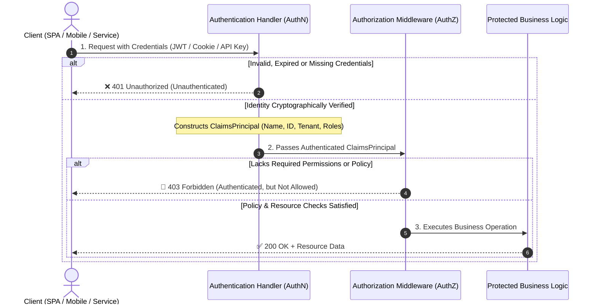
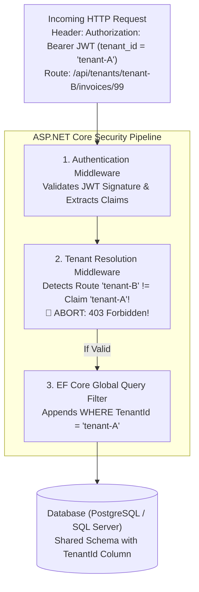

#Security #Authentication #Authorization #Identity #DotNet #AspNetCore #SystemDesign #OWASP #InterviewPreparation

> [!abstract] Executive Summary
> Application security rests upon two distinct, non-interchangeable pillars:
> - **Authentication (AuthN):** *"Who are you?"* The process of verifying that an entity (user, service, or hardware device) is who they claim to be.
> - **Authorization (AuthZ):** *"What are you allowed to do?"* The process of determining whether an authenticated identity has permission to perform a specific action on a specific resource.
> 
> Confusing or conflating these two concerns is the root cause of the most pervasive API vulnerabilities in modern software, including **BOLA (Broken Object Level Authorization - OWASP API1:2023)** and **Privilege Escalation**. This guide breaks down the full architectural taxonomy of both disciplines, their security trade-offs, **OWASP API Top 10 alignment**, and production-hardened implementations in **.NET 8/9 & ASP.NET Core**.

> [!info] Chapter 04 Architecture & Scope Navigation
> To maintain the Single Responsibility Principle, security concerns in this vault are modularized across 10 dedicated reference files. This note focuses strictly on **AuthN vs. AuthZ Mechanics, Policy Engines, and Pipeline Architecture**:
> - **Distributed State & Session Architecture:** [[00. Stateless vs. Stateful Application Design_ Architecture  Distributed Systems]]
> - **Password Defense & Modern KDFs (Argon2id, PBKDF2):** [[02. Secure Password Storage_ Threat Modeling _ Defensive Cryptography]] & [[03. Password Hashing Algorithms_ PBKDF2_ Bcrypt_ Scrypt_ Argon2id _ .NET Implementation]]
> - **JWT Architecture, Token Lifecycle & Storage (BFF):** [[04_JWT Architecture, Token Lifecycle & Storage (Bearer vs. BFF Cookie)]]
> - **Federation, SSO & Delegation (OIDC, OAuth2, PKCE):** [[05_OAuth 2.0 & OpenID Connect (OIDC) Architecture & Grant Types]]
> - **Vulnerability Defenses (XSS, CSRF, SSRF, SQLi):** [[06_Common Vulnerability Prevention]]
> - **Secrets & Master Key Security (DPAPI Key Ring, Key Vault, HSM):** [[07_Secrets Management , Protecting Your Master Keys]]
> - **API Gateway & Business Flow Protections (Rate Limiting, DTOs):** [[08_API Security Best Practices]]
> - **Infrastructure & Zero Trust (VPC, WAF, Network Defense):** [[09_Infrastructure Security_Defense in Depth]]

---

## 1. The Foundational Divide: AuthN vs. AuthZ

```
┌────────────────────────────────────────────────────────────────────────────────────────┐
│                               THE CORPORATE HEADQUARTERS ANALOGY                       │
├────────────────────────────────┬───────────────────────────────────────────────────────┤
│ Authentication (AuthN)         │ Authorization (AuthZ)                                 │
├────────────────────────────────┼───────────────────────────────────────────────────────┤
│ The Security Guard at the Lobby│ The Electronic Keycard for Internal Doors             │
│ Checks government ID / Face    │ Checks door access permissions                        │
│ Proves: "You are Jane Doe"     │ Evaluates: "Can Jane Doe enter Server Room B?"        │
│ HTTP Status on Failure: **401**│ HTTP Status on Failure: **403** (or **404** for BOLA) │
└────────────────────────────────┴───────────────────────────────────────────────────────┘
```



> [!CAUTION] The HTTP Spec Naming Blunder: 401 vs. 403
> The HTTP standard famously misused terminology in RFC 1945:
> - **`401 Unauthorized`** actually means **Unauthenticated**: The server does not know who you are. Credentials are missing or invalid.
> - **`403 Forbidden`** means **Unauthorized**: The server knows *exactly* who you are, but you do not possess permission to access the resource.

---

## 2. Types of Authentication Implementations (AuthN)

In modern enterprise architectures, proving identity takes one of seven distinct forms:

```
┌────────────────────────────────────────────────────────────────────────────────────────────────────────┐
│                                      THE 7 AUTHENTICATION PARADIGMS                                    │
├──────────────────┬──────────────────────┬──────────────────────────────┬───────────────────────────────┤
│ Paradigm         │ Primary Mechanism    │ State Location               │ Typical Use Case              │
├──────────────────┼──────────────────────┼──────────────────────────────┼───────────────────────────────┤
│ 1. Password-Based│ Hashed Credentials   │ Database (Hash + Salt)       │ Consumer sign-in portals      │
│ 2. Cookie/Session│ Stateful Session ID  │ Server RAM or Redis Cluster  │ Traditional MVC / BFF Web Apps│
│ 3. Token-Based   │ Stateless Signed JWT │ Client-held (Cryptographic)  │ Public APIs, SPAs, Mobile Apps│
│ 4. API Keys      │ Pre-Shared Secret    │ Database / Hash Cache        │ Machine-to-Machine, Webhooks  │
│ 5. Federated OIDC│ Delegated OpenID/SAML│ Identity Provider (IdP)      │ Enterprise SSO (Entra ID, Okta│
│ 6. Mutual TLS    │ X.509 Certificates   │ Layer 4/Layer 7 Handshake    │ High-security microservices   │
│ 7. Passwordless  │ FIDO2 / Passkeys     │ Hardware Secure Enclave      │ Biometrics (FaceID, Windows)  │
└──────────────────┴──────────────────────┴──────────────────────────────┴───────────────────────────────┘
```

---

### 1. Password-Based Authentication
* **How It Works:** User submits credentials over HTTPS. The server fetches the stored cryptographic hash and salt, executes a slow key-derivation function (Argon2id, PBKDF2), and compares the result.
* **.NET Implementation:** Managed via **ASP.NET Core Identity**:
  ```csharp
  // Uses PBKDF2 with HMAC-SHA256 by default under the hood
  var result = await _signInManager.PasswordSignInAsync(
      email, password, isPersistent: false, lockoutOnFailure: true);
  ```

---

### 2. Cookie & Session-Based Authentication (Stateful Web Apps & BFF)
* **How It Works:** Upon login, the server generates a cryptographically random session ID, stores the session data on the server, and sets an encrypted `Set-Cookie` header.
* **Hardened Production Setup in .NET:**
  ```csharp
  builder.Services.AddAuthentication(CookieAuthenticationDefaults.AuthenticationScheme)
      .AddCookie(CookieAuthenticationDefaults.AuthenticationScheme, options =>
      {
          // "__Host-" prefix strictly enforces HTTPS and top-level domain path
          options.Cookie.Name = "__Host-AppSession";
          options.Cookie.HttpOnly = true;            // Mitigates XSS token theft
          options.Cookie.SecurePolicy = CookieSecurePolicy.Always; // HTTPS only
          options.Cookie.SameSite = SameSiteMode.Strict;           // Mitigates CSRF
          options.ExpireTimeSpan = TimeSpan.FromMinutes(30);
          options.SlidingExpiration = true;

          // CRITICAL: Prevent Cookie Bloat (>4KB) and enable instant revocation via Redis
          options.SessionStore = builder.Services.BuildServiceProvider().GetRequiredService<ITicketStore>();

          options.Events = new CookieAuthenticationEvents
          {
              OnValidatePrincipal = async context =>
              {
                  // Validate security stamp on each request to invalidate sessions on password/role change
                  var userManager = context.HttpContext.RequestServices.GetRequiredService<UserManager<ApplicationUser>>();
                  var user = await userManager.GetUserAsync(context.Principal!);
                  if (user is null || user.SecurityStamp != context.Principal!.FindFirstValue("AspNet.Identity.SecurityStamp"))
                  {
                      context.RejectPrincipal();
                      await context.HttpContext.SignOutAsync(CookieAuthenticationDefaults.AuthenticationScheme);
                  }
              }
          };
      });
  ```
> [!WARNING] The Cookie Bloat & Data Protection Trap
> 1. **Cookie Bloat (> 4096 bytes):** Storing large claims in cookies causes browsers to drop chunks or trigger `HTTP 431 Request Header Fields Too Large`. Always implement `ITicketStore` backed by Redis or MemoryCache.
> 2. **Data Protection Ephemeral Keys:** Without distributed key persistence (`builder.Services.AddDataProtection().PersistKeysToAzureBlobStorage(...)`), cookies become invalid whenever cloud containers restart or scale horizontally.

---

### 3. Token-Based Authentication (JWT Bearer)
* **How It Works:** Stateless, self-contained JSON Web Tokens signed with a private key (RSA/ECDSA) or symmetric secret (HMAC-SHA256). The client sends the token in the `Authorization: Bearer <token>` header. The server validates the signature mathematically without hitting a database.
* **.NET 8/9 Architectural Shift:** In .NET 8+, ASP.NET Core switched default token handling from `JwtSecurityTokenHandler` to `JsonWebTokenHandler` (`UseSecurityTokenValidators = false`), resulting in a **~30% throughput increase** and lower memory allocations.

#### Hardened Production Setup:
```csharp
builder.Services.AddAuthentication(options =>
{
    options.DefaultAuthenticateScheme = JwtBearerDefaults.AuthenticationScheme;
    options.DefaultChallengeScheme = JwtBearerDefaults.AuthenticationScheme;
})
.AddJwtBearer(JwtBearerDefaults.AuthenticationScheme, options =>
{
    options.Authority = "https://identity.yourdomain.com"; // OIDC discovery document URL
    options.Audience = "api://your-api";
    options.RequireHttpsMetadata = true;
    options.SaveToken = false; // Never keep raw token in memory unless strictly required

    options.TokenValidationParameters = new TokenValidationParameters
    {
        ValidateIssuer = true,
        ValidIssuer = "https://identity.yourdomain.com",
        ValidateAudience = true,
        ValidAudience = "api://your-api",
        ValidateIssuerSigningKey = true,
        ValidateLifetime = true,
        RequireSignedTokens = true,
        RequireExpirationTime = true,
        
        // CRITICAL PITFALL: Default ClockSkew is 5 minutes! Set to zero or 15-30s max:
        ClockSkew = TimeSpan.Zero,
        
        // Prevent Algorithm Confusion & "alg: none" attacks:
        ValidAlgorithms = [SecurityAlgorithms.RsaSha256, SecurityAlgorithms.EcdsaSha256]
    };

    options.Events = new JwtBearerEvents
    {
        OnAuthenticationFailed = context =>
        {
            if (context.Exception is SecurityTokenExpiredException)
            {
                context.Response.Headers.Append("Token-Expired", "true");
            }
            return Task.CompletedTask;
        },
        OnMessageReceived = context =>
        {
            // Support SignalR WebSockets where token is sent via query string
            var accessToken = context.Request.Query["access_token"];
            var path = context.HttpContext.Request.Path;
            if (!string.IsNullOrEmpty(accessToken) && path.StartsWithSegments("/hubs"))
            {
                context.Token = accessToken;
            }
            return Task.CompletedTask;
        }
    };
});
```

> [!IMPORTANT] Inbound Claims Mapping Fix
> Historically, .NET remapped standard JWT claims (e.g., `sub` became `http://schemas.xmlsoap.org/ws/2005/05/identity/claims/nameidentifier`). Clear these legacy mappings in `Program.cs`:
> ```csharp
> JsonWebTokenHandler.DefaultInboundClaimTypeMap.Clear();
> ```

---

### 4. API Key Authentication (Machine-to-Machine)
* **How It Works:** An opaque, high-entropy pre-shared secret string passed in an HTTP header (e.g., `X-API-Key`). Used primarily for server-to-server communication, developer APIs (e.g., Stripe, SendGrid), and webhooks.
* **Security Rule:** Always use **constant-time comparisons** (`CryptographicOperations.FixedTimeEquals`) to prevent side-channel timing attacks!

```csharp
public class ApiKeyAuthenticationOptions : AuthenticationSchemeOptions
{
    public const string DefaultScheme = "ApiKey";
    public string HeaderName { get; set; } = "X-Api-Key";
}

public class ApiKeyAuthenticationHandler : AuthenticationHandler<ApiKeyAuthenticationOptions>
{
    private readonly IApiKeyValidator _apiKeyValidator;

    public ApiKeyAuthenticationHandler(
        IOptionsMonitor<ApiKeyAuthenticationOptions> options,
        ILoggerFactory logger,
        UrlEncoder encoder,
        IApiKeyValidator apiKeyValidator)
        : base(options, logger, encoder)
    {
        _apiKeyValidator = apiKeyValidator;
    }

    protected override async Task<AuthenticateResult> HandleAuthenticateAsync()
    {
        if (!Request.Headers.TryGetValue(Options.HeaderName, out var extractedApiKeyValues))
        {
            return AuthenticateResult.NoResult();
        }

        var providedKey = extractedApiKeyValues.FirstOrDefault();
        if (string.IsNullOrWhiteSpace(providedKey))
        {
            return AuthenticateResult.NoResult();
        }

        var validationResult = await _apiKeyValidator.ValidateAsync(providedKey);
        if (!validationResult.IsValid)
        {
            return AuthenticateResult.Fail("Invalid API Key.");
        }

        var identity = new ClaimsIdentity(validationResult.Claims, Scheme.Name);
        var principal = new ClaimsPrincipal(identity);
        var ticket = new AuthenticationTicket(principal, Scheme.Name);

        return AuthenticateResult.Success(ticket);
    }
}
```

---

### 5. Federated / Delegated Identity (OAuth 2.0 / OpenID Connect)
* **How It Works:** The application does not handle credentials directly. The user is redirected to a centralized Identity Provider (IdP) such as Microsoft Entra ID (Azure AD), Okta, Auth0, or Google. The IdP issues a signed identity token (`id_token`) confirming user verification.
* **The Modern SPA Standard: Backend-For-Frontend (BFF) Pattern:**
  - **The Anti-Pattern:** Storing JWT access tokens in browser `localStorage` exposes tokens directly to Cross-Site Scripting (XSS).
  - **The BFF Solution (OWASP & IETF BCP):** The backend server acts as the confidential OAuth client (using Authorization Code Flow with PKCE). Tokens are held strictly server-side in encrypted sessions. The browser only communicates with the backend via `__Host-` Secure, HttpOnly, SameSite cookies with Anti-Forgery protection.

---

### 6. Mutual TLS (mTLS / Client Certificates)
* **How It Works:** Authentication occurs at Layer 4/Layer 7 before any HTTP application code executes. The client must present an X.509 certificate signed by a trusted Certificate Authority (CA).
* **.NET Implementation:**
  ```csharp
  builder.Services.AddAuthentication(CertificateAuthenticationDefaults.AuthenticationScheme)
      .AddCertificate(options =>
      {
          options.AllowedCertificateTypes = CertificateTypes.Chained;
          options.RevocationMode = X509RevocationMode.Online; // Real-time CRL/OCSP check

          options.Events = new CertificateAuthenticationEvents
          {
              OnCertificateValidated = context =>
              {
                  var cert = context.ClientCertificate;
                  // Pin specific thumbprint or verify Subject Alternative Name (SAN)
                  if (!string.Equals(cert.Thumbprint, "B1A54E...", StringComparison.OrdinalIgnoreCase))
                  {
                      context.Fail("Certificate thumbprint rejected.");
                      return Task.CompletedTask;
                  }

                  context.Principal = new ClaimsPrincipal(new ClaimsIdentity(
                      [new Claim(ClaimTypes.NameIdentifier, cert.Subject)], context.Scheme.Name));
                  context.Success();
                  return Task.CompletedTask;
              }
          };
      });
  ```

---

### 7. Passwordless & Biometrics (FIDO2 / WebAuthn / Passkeys)
* **How It Works:** Eliminates shared secrets entirely. The client device (iPhone FaceID, Android Fingerprint, YubiKey) generates an asymmetric key pair inside hardware secure enclaves. The public key is stored on the server. Login requests are authenticated via cryptographic challenge-response signing. Integrated in .NET 8/9 via ASP.NET Core Identity Passkey APIs (`SignInManager.PasskeySignInAsync`) or `Fido2NetLib`.

---

## 3. Types of Authorization Implementations (AuthZ)

Once an identity is authenticated into a `ClaimsPrincipal`, the server must enforce permissions. In production architecture, authorization evolves through six distinct models:

```
┌────────────────────────────────────────────────────────────────────────────────────────┐
│                              THE 6 AUTHORIZATION PARADIGMS                             │
├──────────────────┬──────────────────────┬──────────────────────────────────────────────┤
│ Model            │ Decision Basis       │ Production Trade-off                         │
├──────────────────┼──────────────────────┼──────────────────────────────────────────────┤
│ 1. RBAC          │ User's Role string   │ Simple, but causes severe "Role Explosion"   │
│ 2. Claims-Based  │ User's Key-Value data│ Flexible identity attributes                 │
│ 3. Policy-Based  │ Encapsulated rules   │ .NET standard; highly testable & decoupled   │
│ 4. Resource-Based│ Specific data record │ Prevents IDOR / BOLA (Imperative check)      │
│ 5. ABAC          │ User + Resource + Env│ Contextual (e.g., location, time of day)     │
│ 6. Scope-Based   │ OAuth token scopes   │ Standard for Microservices & Public Web APIs │
└──────────────────┴──────────────────────┴──────────────────────────────────────────────┘
```

---

### 1. Role-Based Access Control (RBAC)
* **Concept:** Assign permissions to roles (`Admin`, `Manager`, `Viewer`), and assign users to roles.
* **.NET Implementation:**
  ```csharp
  [Authorize(Roles = "Admin,Manager")]
  [HttpDelete("api/orders/{id}")]
  public IActionResult DeleteOrder(int id) => Ok();
  ```
* **The Fatal Flaw (Role Explosion):** As business requirements grow, roles fracture into unmanageable permutations (`RegionalFinanceManagerUS`, `BillingEditorTier2`), cluttering user records.

---

### 2. Claims-Based Authorization
* **Concept:** Instead of coarse roles, users carry discrete **claims**—statements of fact asserted by the issuer (e.g., `Department = "Finance"`, `ClearanceLevel = 3`, `TenantId = "tenant-42"`).
* **.NET Implementation:**
  ```csharp
  builder.Services.AddAuthorization(options =>
  {
      options.AddPolicy("FinanceDepartmentOnly", policy =>
          policy.RequireClaim("Department", "Finance"));
  });

  [Authorize(Policy = "FinanceDepartmentOnly")]
  [HttpGet("api/payroll")]
  public IActionResult GetPayroll() => Ok();
  ```

---

### 3. Policy-Based Authorization (The Modern .NET Standard)
* **Concept:** Encapsulates complex, multi-factor business logic into a named **Policy** using `IAuthorizationRequirement` and `AuthorizationHandler<T>`. Decouples business rules completely from controllers.
* **.NET Implementation:**
  ```csharp
  // Step 1: Define the Requirement
  public class MinimumAgeRequirement : IAuthorizationRequirement
  {
      public int MinimumAge { get; }
      public MinimumAgeRequirement(int minimumAge) => MinimumAge = minimumAge;
  }

  // Step 2: Implement the Handler
  public class MinimumAgeHandler : AuthorizationHandler<MinimumAgeRequirement>
  {
      protected override Task HandleRequirementAsync(
          AuthorizationHandlerContext context, 
          MinimumAgeRequirement requirement)
      {
          var dateOfBirthClaim = context.User.FindFirst(ClaimTypes.DateOfBirth);
          if (dateOfBirthClaim is null) return Task.CompletedTask;

          var dateOfBirth = DateTime.Parse(dateOfBirthClaim.Value);
          var age = DateTime.Today.Year - dateOfBirth.Year;

          if (age >= requirement.MinimumAge)
          {
              context.Succeed(requirement); // Marks requirement as satisfied
          }

          return Task.CompletedTask;
      }
  }

  // Step 3: Register in Program.cs
  builder.Services.AddAuthorization(options =>
  {
      options.AddPolicy("AtLeast21", policy =>
          policy.Requirements.Add(new MinimumAgeRequirement(21)));
  });
  builder.Services.AddSingleton<IAuthorizationHandler, MinimumAgeHandler>();
  ```

---

### 4. Resource-Based Authorization (The BOLA / IDOR Shield)

> [!CRITICAL] Why `[Authorize(Policy = "...")]` Fails Against BOLA (OWASP API1:2023)
> Endpoint attributes evaluate **before** model binding and database loading.
> An attribute has access only to `ClaimsPrincipal` and route parameters; it **does not have the actual data record from the database**.
> An attacker exploits this by requesting another user's GUID (`GET /api/documents/user-b-guid`) while presenting a valid JWT. The attribute passes because the user is authenticated!
> **The Fix:** **Resource-Based Authorization** using `IAuthorizationService.AuthorizeAsync(User, resource, requirement)`.

#### 1. Define Operations & Resource:
```csharp
public static class DocumentOperations
{
    public static readonly OperationAuthorizationRequirement Create = new() { Name = nameof(Create) };
    public static readonly OperationAuthorizationRequirement Read   = new() { Name = nameof(Read) };
    public static readonly OperationAuthorizationRequirement Update = new() { Name = nameof(Update) };
    public static readonly OperationAuthorizationRequirement Delete = new() { Name = nameof(Delete) };
}

public record Document(Guid Id, Guid TenantId, string OwnerId, string Title, bool IsPublic);
```

#### 2. Implement the Custom Resource Handler:
```csharp
public class DocumentAuthorizationHandler : AuthorizationHandler<OperationAuthorizationRequirement, Document>
{
    protected override Task HandleRequirementAsync(
        AuthorizationHandlerContext context,
        OperationAuthorizationRequirement requirement,
        Document resource)
    {
        var userId = context.User.FindFirstValue(ClaimTypes.NameIdentifier);
        var tenantId = context.User.FindFirstValue("tenant_id");

        // Rule 1: Tenant Isolation Enforced
        if (resource.TenantId.ToString() != tenantId)
        {
            return Task.CompletedTask; // Not authorized
        }

        // Rule 2: Admins can perform any operation within their tenant
        if (context.User.IsInRole("TenantAdmin"))
        {
            context.Succeed(requirement);
            return Task.CompletedTask;
        }

        // Rule 3: Read permissions for public documents or owner
        if (requirement.Name == nameof(DocumentOperations.Read))
        {
            if (resource.IsPublic || resource.OwnerId == userId)
            {
                context.Succeed(requirement);
            }
            return Task.CompletedTask;
        }

        // Rule 4: Update/Delete strictly restricted to document owner
        if (requirement.Name == nameof(DocumentOperations.Update) || 
            requirement.Name == nameof(DocumentOperations.Delete))
        {
            if (resource.OwnerId == userId)
            {
                context.Succeed(requirement);
            }
            return Task.CompletedTask;
        }

        return Task.CompletedTask;
    }
}
```

#### 3. Controller / Minimal API Usage (The Anti-Enumeration Rule):
```csharp
app.MapGet("/api/documents/{id:guid}", async (
    Guid id, 
    IDocumentRepository repo, 
    IAuthorizationService authService, 
    ClaimsPrincipal user) =>
{
    var document = await repo.GetByIdAsync(id);
    if (document is null)
    {
        return Results.NotFound();
    }

    var authorizationResult = await authService.AuthorizeAsync(user, document, DocumentOperations.Read);
    if (!authorizationResult.Succeeded)
    {
        // OWASP Recommendation: Return 404 (NotFound) instead of 403 (Forbidden)
        // to prevent ID enumeration attacks for unauthorized resources.
        return Results.NotFound();
    }

    return Results.Ok(document);
})
.RequireAuthorization();
```

---

### 5. Attribute-Based Access Control (ABAC)
* **Concept:** Evaluates dynamic attributes from **four vectors**:
  1. **Subject:** User's clearance, department, tenant.
  2. **Resource:** Document classification, owner, creation date.
  3. **Action:** Read, Write, Delete, Approve.
  4. **Environment:** Time of day (e.g., banking hours only), IP subnet (office network only), device health score.
* **.NET Implementation:** Handled inside an `AuthorizationHandler` by inspecting `IHttpContextAccessor` for ambient HTTP request metadata (client IP, request time).

---

### 6. Scope-Based Authorization (OAuth 2.0 Scopes)
* **Concept:** Common in public APIs and microservices. The token defines not who the user is, but **what capabilities the client application was granted** on the user's behalf.
* **Example Scopes:** `read:orders`, `write:orders`, `delete:orders`.
* **.NET Implementation:**
  ```csharp
  builder.Services.AddAuthorization(options =>
  {
      options.AddPolicy("WriteOrdersScope", policy =>
          policy.RequireAssertion(ctx =>
              ctx.User.HasClaim(c => c.Type == "scope" && c.Value.Split(' ').Contains("write:orders"))));
  });
  ```

---

## 4. Web API Security Architecture & Pipeline Internals

### 1. Zero Trust by Default: `FallbackPolicy` vs `DefaultPolicy`
- **`DefaultPolicy`**: Triggered when `[Authorize]` is placed on an endpoint without specifying a policy name.
- **`FallbackPolicy`**: Evaluated on **every single endpoint** that does not have an explicit `[Authorize]` or `[AllowAnonymous]`.

```csharp
builder.Services.AddAuthorization(options =>
{
    // 1. Default policy when [Authorize] is specified
    options.DefaultPolicy = new AuthorizationPolicyBuilder()
        .RequireAuthenticatedUser()
        .Build();

    // 2. ZERO TRUST FALLBACK: Everything is locked down unless explicitly marked [AllowAnonymous]
    options.FallbackPolicy = new AuthorizationPolicyBuilder()
        .RequireAuthenticatedUser()
        .RequireClaim("tenant_id")
        .Build();

    // 3. Named Custom Policy
    options.AddPolicy("RequireElevatedMfa", policy =>
    {
        policy.RequireAuthenticatedUser();
        policy.RequireClaim("amr", "mfa");
        policy.RequireRole("SecurityAuditor", "GlobalAdmin");
    });
});
```

---

### 2. Claims Enrichment via `IClaimsTransformation`
* **Use Case:** Post-authentication claims enrichment (e.g., loading database permissions, tenant contexts, or feature flags) without re-issuing tokens.
* **Critical Pitfall:** `IClaimsTransformation.TransformAsync` runs on **every** call to `AuthenticateAsync()`. It must be **idempotent**, or claims will duplicate on every authorization check!

```csharp
public class TenantClaimsTransformation : IClaimsTransformation
{
    private readonly IUserTenantStore _userTenantStore;

    public TenantClaimsTransformation(IUserTenantStore userTenantStore) => _userTenantStore = userTenantStore;

    public async Task<ClaimsPrincipal> TransformAsync(ClaimsPrincipal principal)
    {
        // Sentinel check: Ensure idempotency
        if (principal.HasClaim(c => c.Type == "claims_transformed"))
        {
            return principal;
        }

        var identity = principal.Identity as ClaimsIdentity;
        if (identity is null || !identity.IsAuthenticated) return principal;

        var userId = principal.FindFirstValue(ClaimTypes.NameIdentifier);
        if (string.IsNullOrEmpty(userId)) return principal;

        var tenantInfo = await _userTenantStore.GetTenantForUserAsync(userId);
        if (tenantInfo != null)
        {
            var enrichedIdentity = new ClaimsIdentity(identity.AuthenticationType);
            enrichedIdentity.AddClaim(new Claim("tenant_id", tenantInfo.TenantId.ToString()));
            
            foreach (var permission in tenantInfo.Permissions)
            {
                enrichedIdentity.AddClaim(new Claim("permission", permission));
            }

            enrichedIdentity.AddClaim(new Claim("claims_transformed", "true"));
            principal.AddIdentity(enrichedIdentity);
        }

        return principal;
    }
}
```

---

### 3. Combining Multiple Authentication Schemes
When supporting both JWT Bearer (for external API clients) and Cookie/BFF (for Web clients), use scheme forwarding or composite policy declarations:

```csharp
builder.Services.AddAuthorization(options =>
{
    options.AddPolicy("ApiOrCookiePolicy", policy =>
    {
        policy.AddAuthenticationSchemes(
            JwtBearerDefaults.AuthenticationScheme,
            CookieAuthenticationDefaults.AuthenticationScheme);
        policy.RequireAuthenticatedUser();
    });
});
```

---

## 5. Multi-Tenant Authorization Architecture in .NET 8/9

In modern B2B SaaS applications, systems typically operate on a **Shared Database, Shared Schema** model for operational efficiency. This introduces the catastrophic threat of **Cross-Tenant Data Leakage (Cross-Tenant BOLA/IDOR)**.



### 1. Scoped `ITenantContext` & Anti-Spoofing Middleware
Tenant identity must be determined by the cryptographically validated token—**never by unvalidated client headers or path parameters alone**.

```csharp
public interface ITenantContext
{
    Guid? TenantId { get; set; }
}

public class TenantContext : ITenantContext
{
    public Guid? TenantId { get; set; }
}

public class TenantResolutionMiddleware
{
    private readonly RequestDelegate _next;

    public TenantResolutionMiddleware(RequestDelegate next) => _next = next;

    public async Task InvokeAsync(HttpContext context, ITenantContext tenantContext)
    {
        // 1. Extract tenant claim from validated ClaimsPrincipal
        var tenantClaim = context.User.FindFirst("tenant_id")?.Value;

        if (Guid.TryParse(tenantClaim, out var tokenTenantId))
        {
            tenantContext.TenantId = tokenTenantId;

            // 2. Anti-Spoofing Check: If the URL route contains a tenantId, verify it matches the token claim!
            if (context.Request.RouteValues.TryGetValue("tenantId", out var routeTenantVal) &&
                Guid.TryParse(routeTenantVal?.ToString(), out var routeTenantId))
            {
                if (tokenTenantId != routeTenantId)
                {
                    // Attempted cross-tenant route tampering
                    context.Response.StatusCode = StatusCodes.Status403Forbidden;
                    await context.Response.WriteAsJsonAsync(new { Error = "Cross-tenant route access forbidden." });
                    return;
                }
            }
        }

        await _next(context);
    }
}
```

### 2. Defense-in-Depth at the Data Tier: EF Core Global Query Filters
Even if an engineer writes `_dbContext.Invoices.FindAsync(id)` and forgets to check the tenant ID, **EF Core Global Query Filters** intercept the query and automatically inject `WHERE TenantId = @currentTenantId`:

```csharp
public interface ITenantEntity
{
    Guid TenantId { get; set; }
}

public class ApplicationDbContext : DbContext
{
    private readonly ITenantContext _tenantContext;

    public ApplicationDbContext(DbContextOptions<ApplicationDbContext> options, ITenantContext tenantContext)
        : base(options)
    {
        _tenantContext = tenantContext;
    }

    public DbSet<Invoice> Invoices => Set<Invoice>();

    protected override void OnModelCreating(ModelBuilder modelBuilder)
    {
        base.OnModelCreating(modelBuilder);

        // Automatically apply query filter to all entities implementing ITenantEntity
        foreach (var entityType in modelBuilder.Model.GetEntityTypes())
        {
            if (typeof(ITenantEntity).IsAssignableFrom(entityType.ClrType))
            {
                var parameter = Expression.Parameter(entityType.ClrType, "e");
                var property = Expression.Property(parameter, nameof(ITenantEntity.TenantId));
                var tenantIdVal = Expression.Property(Expression.Constant(_tenantContext), nameof(ITenantContext.TenantId));
                
                var filter = Expression.Lambda(
                    Expression.Equal(property, Expression.Convert(tenantIdVal, typeof(Guid))),
                    parameter);

                entityType.SetQueryFilter(filter);
            }
        }
    }

    public override Task<int> SaveChangesAsync(CancellationToken cancellationToken = default)
    {
        // Write-Side Enforcement: Prevent tampering with TenantId on inserts and updates
        foreach (var entry in ChangeTracker.Entries<ITenantEntity>())
        {
            if (entry.State == EntityState.Added)
            {
                entry.Entity.TenantId = _tenantContext.TenantId 
                    ?? throw new InvalidOperationException("Cannot insert tenant entity without resolved TenantContext.");
            }
            else if (entry.State == EntityState.Modified)
            {
                // Prevent modifying TenantId on existing records
                entry.Property(e => e.TenantId).IsModified = false;
            }
        }

        return base.SaveChangesAsync(cancellationToken);
    }
}
```

---

## 6. Automated Security Testing & Verification Story

> [!IMPORTANT] The Golden Rule of Security Engineering: "Untested Authorization is Broken Authorization"
> A suite of passing unit tests for the "happy path" (User accesses own data $\to$ 200 OK) proves nothing about your security posture. You must explicitly write **negative assertion tests** proving that unauthorized requests, cross-tenant requests, and unauthenticated requests are categorically rejected.

### 1. Unit Testing `AuthorizationHandler` in Isolation
You can test complex policy and resource handlers without spinning up a web server or database by mocking `AuthorizationHandlerContext`:

```csharp
using System.Security.Claims;
using Microsoft.AspNetCore.Authorization;
using Xunit;

public class DocumentAuthorizationHandlerTests
{
    private readonly DocumentAuthorizationHandler _handler = new();

    [Fact]
    public async Task HandleRequirementAsync_WhenUserIsOwner_Succeeds()
    {
        // Arrange
        var user = new ClaimsPrincipal(new ClaimsIdentity([
            new Claim(ClaimTypes.NameIdentifier, "user-alice"),
            new Claim("tenant_id", "tenant-1")
        ], "TestAuth"));

        var document = new Document { OwnerId = "user-alice", TenantId = "tenant-1" };
        var requirement = new MustBeDocumentOwnerRequirement();
        var context = new AuthorizationHandlerContext([requirement], user, document);

        // Act
        await _handler.HandleAsync(context);

        // Assert
        Assert.True(context.HasSucceeded);
    }

    [Fact]
    public async Task HandleRequirementAsync_WhenUserIsDifferentTenant_Fails()
    {
        // Arrange: Attacker in Tenant 2 attempts access to Tenant 1's document
        var user = new ClaimsPrincipal(new ClaimsIdentity([
            new Claim(ClaimTypes.NameIdentifier, "user-bob"),
            new Claim("tenant_id", "tenant-2")
        ], "TestAuth"));

        var document = new Document { OwnerId = "user-alice", TenantId = "tenant-1" };
        var requirement = new MustBeDocumentOwnerRequirement();
        var context = new AuthorizationHandlerContext([requirement], user, document);

        // Act
        await _handler.HandleAsync(context);

        // Assert: Requirement must NOT succeed!
        Assert.False(context.HasSucceeded);
    }
}
```

### 2. Integration Testing with `WebApplicationFactory` & TestAuthHandler
In ASP.NET Core, real-world integration tests should exercise the **entire HTTP pipeline**—including routing, authentication middleware, authorization middleware, and resource handlers:

```csharp
using System.Net;
using System.Net.Http.Headers;
using System.Security.Claims;
using System.Text.Encodings.Web;
using Microsoft.AspNetCore.Authentication;
using Microsoft.AspNetCore.Mvc.Testing;
using Microsoft.AspNetCore.TestHost;
using Microsoft.Extensions.DependencyInjection;
using Microsoft.Extensions.Logging;
using Microsoft.Extensions.Options;
using Xunit;

// 1. Dynamic Test Authentication Handler driven by request headers
public class DynamicTestAuthHandler : AuthenticationHandler<AuthenticationSchemeOptions>
{
    public DynamicTestAuthHandler(IOptionsMonitor<AuthenticationSchemeOptions> options, 
        ILoggerFactory logger, UrlEncoder encoder) : base(options, logger, encoder) { }

    protected override Task<AuthenticateResult> HandleAuthenticateAsync()
    {
        // Check if test client passed simulated user headers
        if (!Request.Headers.TryGetValue("X-Test-UserId", out var userId))
        {
            return Task.FromResult(AuthenticateResult.NoResult());
        }

        var tenantId = Request.Headers.TryGetValue("X-Test-TenantId", out var tId) ? tId.ToString() : "tenant-1";
        var role = Request.Headers.TryGetValue("X-Test-Role", out var r) ? r.ToString() : "User";

        var claims = new[]
        {
            new Claim(ClaimTypes.NameIdentifier, userId.ToString()),
            new Claim("tenant_id", tenantId),
            new Claim(ClaimTypes.Role, role)
        };

        var identity = new ClaimsIdentity(claims, "TestScheme");
        var principal = new ClaimsPrincipal(identity);
        var ticket = new AuthenticationTicket(principal, "TestScheme");

        return Task.FromResult(AuthenticateResult.Success(ticket));
    }
}

// 2. Integration Tests Proving BOLA (OWASP API1) Defense
public class DocumentSecurityIntegrationTests : IClassFixture<WebApplicationFactory<Program>>
{
    private readonly WebApplicationFactory<Program> _factory;

    public DocumentSecurityIntegrationTests(WebApplicationFactory<Program> factory)
    {
        _factory = factory.WithWebHostBuilder(builder =>
        {
            builder.ConfigureTestServices(services =>
            {
                // Register our test authentication scheme as the default for tests
                services.AddAuthentication("TestScheme")
                    .AddScheme<AuthenticationSchemeOptions, DynamicTestAuthHandler>("TestScheme", _ => { });
            });
        });
    }

    [Fact]
    public async Task GetDocument_WhenUserOwnsDocument_Returns200Ok()
    {
        var client = _factory.CreateClient();
        client.DefaultRequestHeaders.Add("X-Test-UserId", "user-alice");
        client.DefaultRequestHeaders.Add("X-Test-TenantId", "tenant-1");

        // Alice requests Alice's document (ID: 101)
        var response = await client.GetAsync("/api/documents/101");

        Assert.Equal(HttpStatusCode.OK, response.StatusCode);
    }

    [Fact]
    public async Task GetDocument_WhenAttackerRequestsAnotherUsersDocument_Returns404NotFound()
    {
        var client = _factory.CreateClient();
        client.DefaultRequestHeaders.Add("X-Test-UserId", "user-bob"); // Attacker Bob
        client.DefaultRequestHeaders.Add("X-Test-TenantId", "tenant-1");

        // Bob attempts BOLA attack on Alice's document (ID: 101)
        var response = await client.GetAsync("/api/documents/101");

        // Anti-Enumeration Defense: Must return 404 Not Found, NEVER 200 and NOT 403!
        Assert.Equal(HttpStatusCode.NotFound, response.StatusCode);
    }

    [Fact]
    public async Task GetDocument_WhenUnauthenticated_Returns401Unauthorized()
    {
        var client = _factory.CreateClient();
        // Zero authentication headers attached

        var response = await client.GetAsync("/api/documents/101");

        // Zero-Trust FallbackPolicy Defense
        Assert.Equal(HttpStatusCode.Unauthorized, response.StatusCode);
    }
}
```

---

## 7. The AuthN & AuthZ Subset of OWASP API Security Top 10 (2023)

> [!NOTE] Scope Notice
> The table below details the OWASP vulnerabilities directly mitigated by **Authentication and Authorization Architecture**. For API Design & Gateway vulnerabilities—including **API6 (Unrestricted Business Flows)**, **API9 (Improper Inventory Management)**, and **API10 (Unsafe Consumption of Third-Party APIs)**—see [[11_API Security Best Practices]].

| OWASP Vulnerability | ASP.NET Core 8/9 Mitigation Architecture | Key Classes / Settings |
| :--- | :--- | :--- |
| **API1:2023 Broken Object Level Authorization (BOLA)** | Resource-Based Authorization via `IAuthorizationService` validating resource ownership/tenant boundary before action execution. | `IAuthorizationService`, `AuthorizationHandler<TReq, TRes>`, returning 404 instead of 403. |
| **API2:2023 Broken Authentication** | Mandatory TLS, PKCE on OIDC, `ClockSkew = TimeSpan.Zero`, strict signature algorithm validation, rate limiting on auth endpoints. | `TokenValidationParameters.ValidAlgorithms`, `AddRateLimiter`, `CookieSecurePolicy.Always`. |
| **API3:2023 Broken Object Property Level Authorization** | Explicit DTO projection (`record` request/response types) rather than binding domain EF entities directly. | `record UserUpdateDto`, AutoMapper / Mapperly, `[JsonIgnore]`. |
| **API4:2023 Unrestricted Resource Consumption** | Native ASP.NET Core Rate Limiting Middleware (`app.UseRateLimiter()`) partitioned by user/tenant/IP. | `builder.Services.AddRateLimiter()`, `TokenBucketLimiter`, `ConcurrencyLimiter`. |
| **API5:2023 Broken Function Level Authorization (BFLA)** | Policy-based authorization with `FallbackPolicy` enforcing zero trust, role/permission requirements. | `AuthorizationPolicyBuilder`, `options.FallbackPolicy`, `RequireClaim("permission", ...)`. |
| **API7:2023 Server-Side Request Forgery (SSRF)** | Typed `HttpClient` with strict URL scheme/host validation and DNS resolution validation. | `IHttpClientFactory`, IP address filtering middleware. |
| **API8:2023 Security Misconfiguration** | Disabling debug endpoints in production, enforcing HSTS, removing server identification headers. | `app.UseHsts()`, `app.UseHttpsRedirection()`, `options.SuppressXAddServerHeader = true`. |

---

## 8. Security Anti-Patterns to Avoid

| Anti-Pattern | Why It Breaks Systems in Production | The Correct Solution |
| :--- | :--- | :--- |
| **"Authentication-Only Checking" (BOLA/IDOR)** | Developer verifies the user is logged in, but never checks if they own the resource ID passed in the URL (`/api/invoices/1042`). | Use **Resource-Based Authorization** (`authService.AuthorizeAsync(User, invoice)`). |
| **"Hardcoding Roles in Controllers"** | Scattering `[Authorize(Roles = "Admin,Executive")]` across 100 endpoints makes modifying permissions a massive code refactoring nightmare. | Encapsulate rules in named **Policies** (`[Authorize(Policy = "CanManageBilling")]`). |
| **"Ignoring ClockSkew Default (5 mins)"** | Tokens remain valid 5 minutes after expiration, allowing attackers to reuse stolen expired tokens. | Explicitly configure `ClockSkew = TimeSpan.Zero`. |
| **"Storing JWTs in Browser LocalStorage"** | Any injected script (XSS) can immediately steal the user's raw access token. | Use the **Backend-For-Frontend (BFF)** pattern with `__Host-` Secure, HttpOnly cookies. |
| **"Returning 403 on Unauthorized Entity Fetch"** | Confirms to an attacker that entity ID 1042 exists in the database, enabling ID enumeration. | Return **404 Not Found** when resource authorization fails on read endpoints. |
| **"Trusting Route Tenant IDs Blindly"** | An attacker in Tenant A sends requests to `/api/tenants/{TenantB_Id}/data`. | Enforce **Anti-Spoofing Middleware** matching route tenant with token claim. |
| **"Only Testing the Happy Path"** | Suite has 100% green tests for authorized users, but zero tests asserting that unauthorized users are rejected. | Write **automated negative assertion integration tests** with `WebApplicationFactory`. |

---

## 9. The 60-Second "Senior Staff Interview" Defense Script

> [!TIP] Senior Staff Interview Pitch: Enterprise AuthN & AuthZ in .NET
> *"In enterprise architectures, Authentication establishes identity—'Who are you?'—while Authorization enforces access control—'What are you permitted to do?' In HTTP semantics, failing authentication returns a 401, while failing authorization returns a 403 (or 404 for unowned resources).
> 
> In ASP.NET Core, the Authentication middleware inspects incoming tokens or cookies to construct a `ClaimsPrincipal`. Authorization middleware then evaluates policy requirements against that identity. While junior developers rely on simple role attributes like `[Authorize(Roles = "Admin")]`, our enterprise architecture implements defense-in-depth across three tiers:
> 
> 1. **Zero-Trust FallbackPolicy:** By default, every endpoint requires an authenticated identity unless explicitly decorated with `[AllowAnonymous]`.
> 2. **Resource-Based Authorization:** To eliminate OWASP's #1 API vulnerability—BOLA/IDOR—controllers invoke `IAuthorizationService.AuthorizeAsync(User, resource, requirement)` directly on fetched entities. If ownership fails, we return a `404 Not Found` rather than `403 Forbidden` to prevent object ID enumeration.
> 3. **Multi-Tenant Data Isolation:** We combine Anti-Spoofing Middleware (verifying that route parameters strictly match validated token claims) with **EF Core Global Query Filters**, ensuring every SQL query automatically appends `WHERE TenantId = @currentTenantId` at the data tier.
> 
> Finally, we verify our security posture using automated integration tests via `WebApplicationFactory` and custom test authentication schemes, asserting negative security outcomes so regressions in our authorization pipeline are caught in CI/CD before deployment."*

---

## 🔗 Related Notes in this Vault

- [[00. Stateless vs. Stateful Application Design_ Architecture  Distributed Systems|00. Stateless vs. Stateful Architecture & Distributed State]]
- [[02. Secure Password Storage_ Threat Modeling _ Defensive Cryptography|02. Secure Password Storage: Threat Modeling & Defensive Cryptography]]
- [[03. Password Hashing Algorithms_ PBKDF2_ Bcrypt_ Scrypt_ Argon2id _ .NET Implementation|03. Password Hashing Algorithms: PBKDF2, Bcrypt, Argon2id & .NET Implementation]]
- [[04_JWT Architecture, Token Lifecycle & Storage (Bearer vs. BFF Cookie)|04. JWT Architecture, Token Lifecycle & Storage (BFF & CSRF)]]
- [[05_OAuth 2.0 & OpenID Connect (OIDC) Architecture & Grant Types|05. OAuth 2.0 & OpenID Connect (OIDC) Deep Dive & PKCE]]
- [[06_Common Vulnerability Prevention|06. Common Vulnerability Prevention (SQLi, XSS, CSRF, SSRF)]]
- [[07_Secrets Management , Protecting Your Master Keys|07. Secrets Management & Master Key Protection]]
- [[08_API Security Best Practices|08. API Security Best Practices (Rate Limiting, Inventory & Gateway)]]
- [[09_Infrastructure Security_Defense in Depth|09. Infrastructure Security: Defense in Depth (VPC & Zero Trust)]]