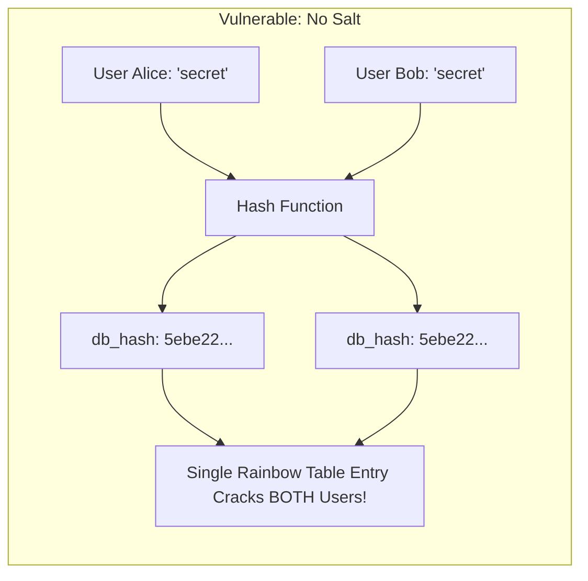
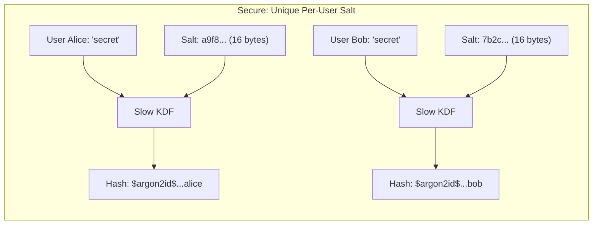
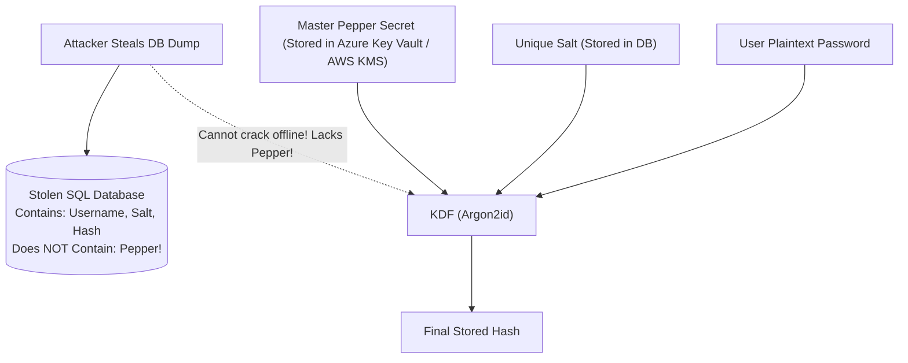
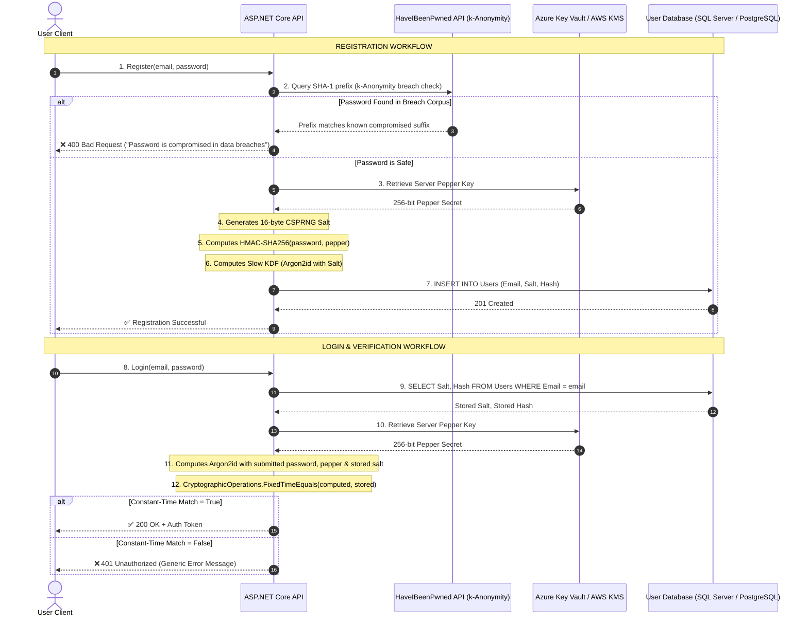

#Security #Cryptography #PasswordStorage #Salting #Peppers #TimingAttacks #OWASP #ThreatModeling #DotNet #SystemDesign #InterviewPreparation

> [!abstract] Executive Summary
> In software engineering, your security posture must operate under the principle of **"Assume Breach."** System administrators make mistakes, SQL injection vulnerabilities occur, database backups are accidentally exposed on public cloud buckets, and replica databases get compromised.
> 
> Password storage is the **last line of defense**. When an attacker inevitably dumps your `Users` table, the cryptographic representations stored in that table dictate whether they obtain the keys to your users' digital lives or a useless block of computationally intractable ciphertext.
> 
> This guide covers the mathematical reality of offline cracking, why general-purpose cryptographic hashes (MD5, SHA-256) are fatal for password storage, the mechanics of cryptographically secure salts, enterprise pepper architectures via Cloud HSM / Key Vault, side-channel timing attack defenses, and modern **NIST SP 800-63B** authentication guidelines.

---

## 1. The Threat Landscape: Assume Breach

```
┌──────────────────────────────────────────────────────────────────────────────────────────────────┐
│                                       THE ATTACK PIPELINE                                        │
├────────────────────────────────┬────────────────────────────────┬────────────────────────────────┤
│ 1. Exfiltration                │ 2. Offline Attack Environment  │ 3. Credential Stuffing         │
├────────────────────────────────┼────────────────────────────────┼────────────────────────────────┤
│ Attacker dumps database via    │ Zero network latency.          │ Recovered passwords tested     │
│ SQLi, backup leak, or insider. │ Zero rate limiting.            │ against banking, email, cloud  │
│ Stolen: 10,000,000 user rows.  │ Massive GPU/ASIC cracking rig. │ accounts across the internet.  │
└────────────────────────────────┴────────────────────────────────┴────────────────────────────────┘
```

When an attacker acquires an offline dump of your database:
1. **Network defenses are bypassed:** Firewalls, WAFs, CAPTCHAs, and IP rate-limiting no longer exist.
2. **Infinite offline attempts:** The attacker can compute quadrillions of password guesses at full hardware speed without alerting your monitoring systems.
3. **The User Reuse Problem:** 65%+ of users reuse passwords across personal, corporate, and financial accounts. Compromising your database exposes your users to catastrophic cascading account takeovers (Credential Stuffing).

---

## 2. The Mathematics of Brute-Force: Why Fast Hashes are Fatal

A dangerous misconception among junior developers is: *"SHA-256 is strong encryption, so hashing passwords with SHA-256 is secure."*

> [!CAUTION] Fast Hashes are Engineered for Speed, Not Secrets
> General-purpose cryptographic hash functions (MD5, SHA-1, SHA-256, SHA-512) were designed for **data integrity and digital signatures**. They are mathematically optimized to be as **fast and cheap** as possible to compute on microprocessors.
> 
> When applied to passwords, this speed works entirely in the attacker's favor!

### Hardware Cracking Economics (Modern GPU Benchmarks)
On a single consumer-grade **NVIDIA RTX 4090** running Hashcat:
- **MD5:** ~ 164 Billion hashes / second (164 GH/s)
- **SHA-256:** ~ 23 Billion hashes / second (23 GH/s)
- **Argon2id (t=3, m=64MB):** ~ 30 to 50 hashes / second

```
┌───────────────────┬──────────────────────────────┬─────────────────────────────────────────────┐
│ Hash Algorithm    │ Modern GPU Speed (Hashcat)   │ Time to Crack 8-Character Password (AlphaNum)│
├───────────────────┼──────────────────────────────┼─────────────────────────────────────────────┤
│ MD5               │ 164,000,000,000 / sec        │ ~ 1.3 Seconds                               │
│ SHA-256           │  23,000,000,000 / sec        │ ~ 9.4 Seconds                               │
│ PBKDF2 (HMAC-SHA) │     1,200,000 / sec          │ ~ 5.2 Days                                  │
│ Bcrypt (Cost 12)  │        18,000 / sec          │ ~ 380 Days                                  │
│ Argon2id (64MB)   │            40 / sec          │ ~ 470 Years                                 │
└───────────────────┴──────────────────────────────┴─────────────────────────────────────────────┘
```

> [!danger] The Takeaway
> Using SHA-256 or MD5 (even with a salt!) to hash passwords is **gross professional negligence**. A high-end 8-GPU cracking cluster can crack an entire database of 8-character salted SHA-256 hashes in a single afternoon.

---

## 3. Rainbow Tables & Cryptographic Salts

### The Attack: Pre-computed Space-Time Tradeoffs
Before modern defenses, attackers did not compute hashes on the fly during an attack. Instead, they pre-computed trillions of common passwords and their corresponding hashes into massive lookup files known as **Rainbow Tables**.
- If two users chose `Password123!`, both produced the exact same hash: `ef92b778bafe771e89245b89ecbc08a44a4e166c06659911881f383d4473e94f`.
- The attacker simply searched the rainbow table: finding the hash took $O(1)$ time and yielded the plaintext password instantly.



### The Solution: Cryptographically Secure Random Salt
A **salt** is a unique, cryptographically random sequence of bytes generated independently for every single user at registration time.



### Core Cryptographic Rules for Salting
1. **Never Reuse Salts:** Every password must receive a brand new random salt generated by a Cryptographically Secure Pseudorandom Number Generator (**CSPRNG**).
2. **Minimum Length:** Salts must be at least **128 bits (16 bytes)** long. This ensures $2^{128} \approx 3.4 \times 10^{38}$ possible salt combinations, making pre-computation of tables mathematically impossible.
3. **Salts are NOT Secrets:** The salt is stored in plaintext in the database right next to the hash. Its sole mathematical purpose is to **prevent pre-computed lookup tables and force attackers to attack each user independently**.

```csharp
// Generating a cryptographically secure 16-byte salt in .NET
using System.Security.Cryptography;

byte[] salt = RandomNumberGenerator.GetBytes(16);
```

---

## 4. Peppers: The Enterprise Secret Layer

While a salt is public and unique per user, a **pepper** is a secret value that is identical across users (or partitioned by tenant) and **never stored in the database**.



### Why Use a Pepper?
If an attacker exploits a SQL injection vulnerability or steals an unencrypted database backup, they possess the hashes and the salts. They can still run offline brute-force attacks against individual high-value targets (e.g., executives or admins).
**A pepper neutralizes this:**
- The pepper is stored securely in an external Secrets Manager (**Azure Key Vault**, **AWS KMS**, or a Hardware Security Module - **HSM**).
- Without compromising *both* the database server and the cloud secrets infrastructure, the attacker cannot execute offline cracking attacks!

### Recommended Implementation Pattern: HMAC-SHA256 Pre-Hashing
A common mistake is directly concatenating the pepper string to the password (`password + pepper`). If using Bcrypt, this triggers the **72-byte truncation vulnerability** (explained in Note 03).
The industry standard pattern is to compute an **HMAC-SHA256** of the password using the pepper as the secret key, and then pass the resulting 32-byte digest into the slow KDF:

```csharp
using System.Security.Cryptography;
using System.Text;

public static class PepperedPasswordService
{
    public static byte[] PreHashWithPepper(string rawPassword, byte[] pepperKey)
    {
        using var hmac = new HMACSHA256(pepperKey);
        return hmac.ComputeHash(Encoding.UTF8.GetBytes(rawPassword));
    }
}
```

---

## 5. Side-Channel Timing Attacks & Constant-Time Verification

When a user submits their password during login, the system computes the hash and compares it against the stored hash in the database.

> [!CAUTION] The Danger of Naive String Comparison (`==` or `.Equals()`)
> Standard string comparison functions optimize for CPU performance by executing an **early exit**:
> ```csharp
> // VULNERABLE: Returns false as soon as the first non-matching byte is found!
> if (computedHash == storedHash) { ... }
> ```
> An attacker can send millions of crafted requests and measure the HTTP response latency down to the nanosecond using statistical analysis. If the first byte matches, comparison takes slightly longer. By observing timing variations, the attacker can systematically deduce the hash byte-by-byte!

### The Defense: Constant-Time Comparison
You must always compare cryptographic hashes using a constant-time comparison algorithm that executes in exactly the same number of CPU cycles regardless of where differences occur:

```csharp
using System.Security.Cryptography;

// SAFE: Constant-time byte array comparison in .NET
bool isMatch = CryptographicOperations.FixedTimeEquals(computedHashBytes, storedHashBytes);
```

---

## 6. Password Policies: The NIST SP 800-63B Paradigm Shift

For decades, organizations enforced archaic password rules that made systems *less* secure. The National Institute of Standards and Technology (**NIST SP 800-63B**) completely overhauled password guidelines.

```
┌───────────────────────────────────────────────┬───────────────────────────────────────────────┐
│ Deprecated Legacy Rules (Outdated)            │ Modern NIST SP 800-63B Guidelines (Enforce)   │
├───────────────────────────────────────────────┼───────────────────────────────────────────────┤
│ ❌ Periodic 90-day password expiration        │ ✅ No arbitrary expiration without breach     │
│ ❌ Complex character rules (1 upper, 1 symbol)│ ✅ Length over complexity (Min 12-16 chars)   │
│ ❌ Disallowing copy-paste into password fields│ ✅ Encourage password managers (Allow paste)  │
│ ❌ Security questions ("Mother's maiden name")│ ✅ Multi-Factor Authentication (FIDO2 / TOTP) │
│ ❌ Aggressive account lockout (triggers DoS)  │ ✅ Rate limiting, CAPTCHAs, IP throttling     │
│ ❌ Blind acceptance of common passwords       │ ✅ Check against compromised breach lists     │
└───────────────────────────────────────────────┴───────────────────────────────────────────────┘
```

### Checking for Compromised Passwords via k-Anonymity
NIST requires checking newly chosen passwords against lists of known breached credentials. The industry standard is Troy Hunt’s **Have I Been Pwned (HIBP)** API using **k-Anonymity**:
1. Hash the user's password with SHA-1: `Password123` $\to$ `CBFDAC6008F9CAB4083784CBD1874F76618D2A97`.
2. Send only the **first 5 characters** (`CBFDA`) to the HIBP API.
3. HIBP returns ~500 hash suffixes that share that 5-character prefix.
4. The client searches the returned list locally for the remaining 35 characters.
5. **The API never learns the user's password or their full hash!**

---

## 7. Complete Password Lifecycle Architecture



---

## 8. Summary Checklist for Senior Engineers

- [ ] **Never use general-purpose hashes:** Absolutely zero MD5, SHA-1, SHA-256, or SHA-512 for password verification.
- [ ] **Always salt:** 16+ bytes generated via a CSPRNG (`RandomNumberGenerator.GetBytes`).
- [ ] **Adopt slow KDFs:** Standardize on **Argon2id** (modern gold standard) or **PBKDF2** (FIPS-compliant enterprise default).
- [ ] **Implement pepper defense-in-depth:** Store server-side secret in Key Vault or KMS to protect against raw database dumps.
- [ ] **Enforce constant-time comparison:** Prevent microsecond side-channel timing leaks via `CryptographicOperations.FixedTimeEquals`.
- [ ] **Modernize password policies:** Comply with NIST SP 800-63B (check HaveIBeenPwned breach lists, avoid forced 90-day rotations, allow password managers).