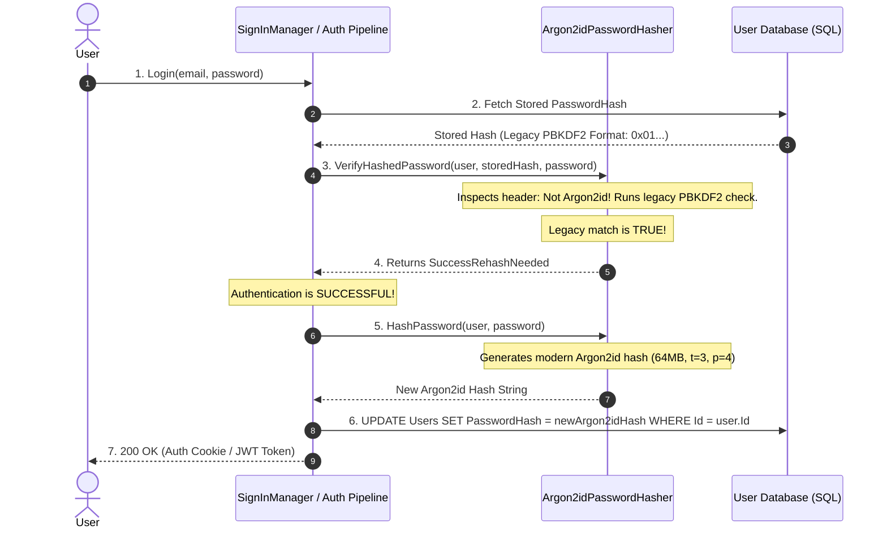

#Security #Cryptography #PasswordHashing #Bcrypt #Argon2id #PBKDF2 #Scrypt #DotNet #AspNetCore #SystemDesign #InterviewPreparation

> [!abstract] Executive Summary
> Password storage requires specialized cryptographic functions called **Key Derivation Functions (KDFs)** or **Password Hashing Functions (PHFs)**. Unlike standard cryptographic digests (SHA-256), PHFs are intentionally slow, computationally expensive, and tunable over time to defend against Moore's Law and specialized GPU/ASIC cracking hardware.
> 
> This guide provides an in-depth architectural breakdown of the four major slow hashing algorithms—**PBKDF2, Bcrypt, Scrypt, and Argon2id**—including their internal mechanics, work factor trade-offs, and hardware attack vectors. It exposes the critical **72-byte truncation trap in Bcrypt**, dissects the internal binary layout of **ASP.NET Core Identity's V3 PasswordHasher**, and demonstrates how to implement a production-grade **Argon2id Password Hasher** with **zero-downtime automatic re-hashing** in .NET 8/9.

---

## 1. The Evolution of Slow Hashing Algorithms

```
┌─────────────────────────────────────────────────────────────────────────────────────────────────┐
│                                   THE KDF EVOLUTIONARY TIMELINE                                 │
├───────────────┬──────────────┬─────────────────────────────┬────────────────────────────────────┤
│ Algorithm     │ Introduced   │ Primary Hardness Mechanism  │ Primary Vulnerability / Weakness   │
├───────────────┼──────────────┼─────────────────────────────┼────────────────────────────────────┤
│ 1. PBKDF2     │ 2000 (RFC)   │ CPU-hard (HMAC Iterations)  │ Highly vulnerable to modern GPUs   │
│ 2. Bcrypt     │ 1999 (USENIX)│ Memory-bound (4KB L1 Cache) │ 72-byte input truncation flaw      │
│ 3. Scrypt     │ 2009 (IETF)  │ Sequential Memory-Hard      │ Vulnerable to side-channel leaks   │
│ 4. Argon2id   │ 2015 (PHC)   │ Hybrid Memory & Time Hard   │ None known (Current Gold Standard) │
└───────────────┴──────────────┴─────────────────────────────┴────────────────────────────────────┘
```

---

## 2. Deep-Dive: The Four Modern Algorithms

### 1. PBKDF2 (Password-Based Key Derivation Function 2)
* **Mechanics:** Applies a pseudorandom function (PRF, typically `HMAC-SHA256` or `HMAC-SHA512`) to the input password along with a salt value, and repeats the process thousands of times in a loop.
* **Work Factor:** Iteration count (e.g., 100,000 to 600,000 iterations).
* **Enterprise Status:** Recommended by FIPS-140 compliance frameworks and is the default algorithm in ASP.NET Core Identity.
* **The Fatal Flaw:** **Memory-trivial.** PBKDF2 requires virtually zero memory (a few hundred bytes). Because GPUs, FPGAs, and ASICs contain thousands of parallel lightweight compute cores, an attacker can parallelize PBKDF2 cracking across thousands of GPU shader cores simultaneously.

---

### 2. Bcrypt (Blowfish-Based Eksblowfish)
* **Mechanics:** Designed by Niels Provos and David Mazières in 1999 based on the Blowfish block cipher. It utilizes the **Eksblowfish** (Expensive Key Schedule) algorithm, which heavily perturbs an internal 4KB array of S-boxes in RAM.
* **Work Factor:** $2^{\text{cost}}$ rounds (e.g., Cost 12 = $2^{12} = 4,096$ rounds).
* **Why it defeated early GPUs:** Each Bcrypt thread requires ~4KB of fast RAM. Because early GPUs had very limited shared L1 cache per core, parallelizing Bcrypt was bandwidth-bottlenecked.

```
┌──────────────────────────────────────────────────────────────────────────────────────────────────┐
│                                    ANATOMY OF A BCRYPT HASH STRING                               │
├─────────────┬──────────────┬──────────────────────────────────┬──────────────────────────────────┤
│ Identifier  │ Cost Factor  │ 16-Byte Radix-64 Salt (22 chars) │ 23-Byte Radix-64 Hash (31 chars) │
├─────────────┼──────────────┼──────────────────────────────────┼──────────────────────────────────┤
│    $2a$     │     12$      │     e8O1sPjGv0kKzM2vVw9a8.       │   B8jY1Wc5V8j3rT0k9P4zQ1sW2      │
└─────────────┴──────────────┴──────────────────────────────────┴──────────────────────────────────┘
```

> [!CAUTION] The 72-Byte Truncation Vulnerability in Bcrypt
> The Blowfish cipher specification limits its key schedule to **72 bytes**. Bcrypt **silently truncates** all input passwords longer than 72 bytes!
> If a user enters an 80-character passphrase:
> - `ThisIsAnExtremelyLongSecurePassphraseThatExceedsSeventyTwoBytesLong111`
> - `ThisIsAnExtremelyLongSecurePassphraseThatExceedsSeventyTwoBytesLong999`
> 
> **Both passwords will hash to the exact same value!**
> - **The Fix:** If using Bcrypt, always pre-hash the password with `SHA-256` before passing it to Bcrypt, or migrate to **Argon2id**.

---

### 3. Scrypt
* **Mechanics:** Designed in 2009 by Colin Percival specifically to defeat custom hardware (ASIC/FPGA) attacks. It generates a large array of pseudorandom bit strings in memory, and then accesses them in a pseudorandom sequence.
* **Tunable Parameters:**
  - $N$: CPU/Memory cost (must be a power of 2, e.g., $2^{15} = 32,768$).
  - $r$: Block size parameter (determines sequential memory read size, e.g., 8).
  - $p$: Parallelization parameter (number of concurrent execution threads, e.g., 1).
* **Weakness:** Scrypt uses data-dependent memory lookups, leaving it slightly vulnerable to cache-timing side-channel attacks on shared cloud virtual machines.

---

### 4. Argon2id: The Undisputed Modern Standard

In 2015, after a two-year cryptographic competition with 24 candidate algorithms, **Argon2** was unanimously selected by an international panel of cryptographers as the winner of the **Password Hashing Competition (PHC)**. It is standardized in **RFC 9106** and endorsed by OWASP.

```
┌─────────────────────────────────────────────────────────────────────────────────────────────────┐
│                                       ARGON2 VARIANT TAXONOMY                                   │
├──────────────┬─────────────────────────────────────┬────────────────────────────────────────────┤
│ Variant      │ Memory Access Pattern               │ Primary Security Property                  │
├──────────────┼─────────────────────────────────────┼────────────────────────────────────────────┤
│ Argon2d      │ Data-Dependent (based on password)  │ Maximum resistance against GPU / ASIC TMTO │
│              │                                     │ Vulnerable to side-channel cache attacks   │
├──────────────┼─────────────────────────────────────┼────────────────────────────────────────────┤
│ Argon2i      │ Data-Independent (fixed sequence)   │ Resists side-channel & cache-timing attacks│
│              │                                     │ Slightly more vulnerable to GPU TMTO       │
├──────────────┼─────────────────────────────────────┼────────────────────────────────────────────┤
│ **Argon2id** │ **Hybrid: First pass data-indep.,** │ **The Gold Standard: Immune to side-channel│
│              │ **subsequent passes data-dependent**│ **attacks AND maximizes GPU resistance!**  │
└──────────────┴─────────────────────────────────────┴────────────────────────────────────────────┘
```

### Argon2id Tunable Parameters (OWASP Recommendations)
* **Time Cost ($t$):** Number of computation iterations (Recommended: $t \ge 3$).
* **Memory Cost ($m$):** Memory allocation in KiB (Recommended: $m = 65,536$ KiB $\to$ 64 MB).
* **Parallelism ($p$):** Number of threads used (Recommended: $p = 4$).

```
┌──────────────────────────────────────────────────────────────────────────────────────────────────┐
│                                   ANATOMY OF AN ARGON2ID HASH STRING                             │
├─────────────┬──────────┬─────────────────────────────┬─────────────────────┬─────────────────────┤
│ Type        │ Version  │ Config: Memory, Time, Lanes │ 16-Byte Base64 Salt │ 32-Byte Base64 Hash │
├─────────────┼──────────┼─────────────────────────────┼─────────────────────┼─────────────────────┤
│  $argon2id  │  $v=19   │  $m=65536,t=3,p=4           │  $t7oY+P8...        │  $W5Jz9p4...        │
└─────────────┴──────────┴─────────────────────────────┴─────────────────────┴─────────────────────┘
```

---

## 3. Inside ASP.NET Core Identity: The V3 Hasher Anatomy

By default, ASP.NET Core Identity ships with `PasswordHasher<TUser>`. While robust and FIPS-compliant, it defaults to **PBKDF2 with HMAC-SHA256**.

### ASP.NET Core Identity V3 Binary Format
The string returned by `_passwordHasher.HashPassword(user, password)` is a Base64-encoded binary payload structured as follows:

```
┌─────────────────────────────────────────────────────────────────────────────────────────────────┐
│                          ASP.NET CORE IDENTITY V3 BINARY PAYLOAD                                │
├──────────────┬────────────────────┬─────────────────────┬──────────────────┬──────────┬─────────┤
│ Format Marker│ PRF Identifier     │ Iteration Count     │ Salt Length      │ Salt     │ Subkey  │
│ (1 Byte)     │ (4 Bytes, BigEndian│ (4 Bytes, BigEndian)│ (4 Bytes)        │ (16 B)   │ (32 B)  │
├──────────────┼────────────────────┼─────────────────────┼──────────────────┼──────────┼─────────┤
│ 0x01         │ 0x00000001 (SHA256)│ 0x000186A0 (100,000)│ 0x00000010 (16B) │ [bytes]  │ [bytes] │
└──────────────┴────────────────────┴─────────────────────┴──────────────────┴──────────┴─────────┘
```

1. **Byte 0 (`0x01`):** Specifies format version 3 (Identity V2 used `0x00` with HMAC-SHA1 and 1,000 iterations).
2. **Bytes 1–4:** `KeyDerivationPrf` enum (0 = HMACSHA1, 1 = HMACSHA256, 2 = HMACSHA512).
3. **Bytes 5–8:** Iteration count (defaults to 100,000 in .NET 7/8).
4. **Bytes 9–12:** Salt length (128 bits = 16 bytes).
5. **Bytes 13–28:** Cryptographically secure salt.
6. **Bytes 29–60:** Derived key (256 bits = 32 bytes).

---

## 4. Production Implementation: Custom Argon2id Hasher in .NET 8/9

To achieve enterprise-grade resilience against GPU cracking clusters, we can replace the default PBKDF2 hasher with **Argon2id** via the high-performance `Konscious.Security.Cryptography.Argon2` library.

### Step 1: The Argon2id Password Hasher Class
```csharp
using System.Security.Cryptography;
using System.Text;
using Konscious.Security.Cryptography;
using Microsoft.AspNetCore.Identity;

namespace EnterpriseSecurity.Cryptography;

public class Argon2idPasswordHasher<TUser> : IPasswordHasher<TUser> where TUser : class
{
    // OWASP Recommended Parameters
    private const int MemorySizeKiB = 65536; // 64 MB
    private const int Iterations = 3;
    private const int DegreeOfParallelism = 4;
    private const int SaltByteLength = 16;
    private const int SubkeyByteLength = 32;

    public string HashPassword(TUser user, string password)
    {
        byte[] salt = RandomNumberGenerator.GetBytes(SaltByteLength);
        byte[] hash = HashArgon2id(password, salt);

        // Format: $argon2id$v=19$m=65536,t=3,p=4$<salt>$<hash>
        return $"$argon2id$v=19$m={MemorySizeKiB},t={Iterations},p={DegreeOfParallelism}" +
               $"${Convert.ToBase64String(salt)}" +
               $"${Convert.ToBase64String(hash)}";
    }

    public PasswordVerificationResult VerifyHashedPassword(TUser user, string hashedPassword, string providedPassword)
    {
        if (string.IsNullOrWhiteSpace(hashedPassword))
            return PasswordVerificationResult.Failed;

        // Check if hash is our Argon2id format
        if (hashedPassword.StartsWith("$argon2id$"))
        {
            return VerifyArgon2id(hashedPassword, providedPassword);
        }

        // Backward compatibility: If user has a legacy ASP.NET Core Identity PBKDF2 hash,
        // verify with the legacy hasher. If valid, trigger an automatic re-hash!
        var fallbackHasher = new PasswordHasher<TUser>();
        var fallbackResult = fallbackHasher.VerifyHashedPassword(user, hashedPassword, providedPassword);

        if (fallbackResult == PasswordVerificationResult.Success)
        {
            // Signal to ASP.NET Core Identity to transparently re-hash and update the DB row!
            return PasswordVerificationResult.SuccessRehashNeeded;
        }

        return PasswordVerificationResult.Failed;
    }

    private static byte[] HashArgon2id(string password, byte[] salt)
    {
        using var argon2 = new Argon2id(Encoding.UTF8.GetBytes(password))
        {
            Salt = salt,
            DegreeOfParallelism = DegreeOfParallelism,
            MemorySize = MemorySizeKiB,
            Iterations = Iterations
        };

        return argon2.GetBytes(SubkeyByteLength);
    }

    private static PasswordVerificationResult VerifyArgon2id(string hashedPassword, string providedPassword)
    {
        string[] parts = hashedPassword.Split('$');
        if (parts.Length != 6)
            return PasswordVerificationResult.Failed;

        // Extract parameters from string
        byte[] salt = Convert.FromBase64String(parts[4]);
        byte[] expectedHash = Convert.FromBase64String(parts[5]);

        byte[] actualHash = HashArgon2id(providedPassword, salt);

        // Constant-time comparison to defeat timing attacks
        return CryptographicOperations.FixedTimeEquals(actualHash, expectedHash)
            ? PasswordVerificationResult.Success
            : PasswordVerificationResult.Failed;
    }
}
```

---

## 5. Zero-Downtime Migration: The Re-Hashing Pattern

> [!important] How to Upgrade Millions of Users from Legacy Hashes Without Password Resets
> In enterprise systems, you cannot force all 5,000,000 users to reset their passwords just because you upgraded your hashing algorithm from MD5/Bcrypt/PBKDF2 to Argon2id.
> 
> ASP.NET Core Identity provides an elegant, zero-downtime migration mechanism via `PasswordVerificationResult.SuccessRehashNeeded`:



### Registration in `Program.cs`
```csharp
builder.Services.AddIdentity<ApplicationUser, IdentityRole>()
    .AddEntityFrameworkStores<ApplicationDbContext>()
    .AddDefaultTokenProviders();

// Replace the default PasswordHasher with our custom Argon2id hasher
builder.Services.AddScoped<IPasswordHasher<ApplicationUser>, Argon2idPasswordHasher<ApplicationUser>>();
```

---

## 6. Comprehensive Algorithmic Comparison

| Feature | PBKDF2 | Bcrypt | Scrypt | Argon2id |
| :--- | :--- | :--- | :--- | :--- |
| **Standard / RFC** | RFC 2898 | OpenBSD / USENIX | RFC 7914 | **RFC 9106 (PHC Winner)** |
| **Primary Hardness**| CPU (Iterations) | Memory-bound (4KB)| Sequential Memory | **Memory-hard & Time-hard** |
| **Memory Usage** | Negligible (~0.5 KB) | Fixed 4 KB | Tunable (MBs) | **Tunable (64 MB+)** |
| **GPU/ASIC Resistance**| ❌ Very Poor | ⚠️ Moderate | ✅ Strong | ✅ **Maximum** |
| **Side-Channel Immune**| ✅ Yes | ✅ Yes | ⚠️ Minor leak risk | ✅ **Yes (Data-independent pass)** |
| **Max Password Length**| Unlimited | ❌ **72 Bytes Trap** | Unlimited | **Unlimited** |
| **FIPS Compliance** | ✅ Yes | ❌ No | ❌ No | ⚠️ Varies by profile |
| **Default in .NET** | ✅ Yes (V3 Hasher) | ❌ Third-party | ❌ Third-party | ❌ Requires custom hasher |
| **OWASP Status** | Acceptable | Acceptable | Recommended | 🏆 **Gold Standard** |

---

## 7. Senior Interview Defense Script

> [!tip] The "Password Hashing Internals" Interview Response
> *"When architecting authentication stores, my primary rule is that general-purpose cryptographic hashes like SHA-256 or MD5 must never be used for passwords, even with a salt. Modern GPUs can compute tens of billions of SHA-256 hashes per second, making offline dictionary cracking trivial.
> 
> Instead, we use Key Derivation Functions designed to be computationally slow and resource-intensive:
> 1. **PBKDF2** is standard in ASP.NET Core Identity and FIPS environments, but its low memory footprint leaves it vulnerable to GPU parallelization.
> 2. **Bcrypt** introduced 4KB memory hardness, but teams must be wary of its hard 72-byte truncation limit, which silently discards characters in long passphrases.
> 3. **Argon2id** is the current industry gold standard. It won the Password Hashing Competition by combining memory hardness with data-independent execution, making it immune to both GPU cracking rigs and cache-timing side channels.
> 
> In ASP.NET Core, I implement a custom `IPasswordHasher<TUser>` utilizing Argon2id with OWASP-recommended parameters (64MB memory, 3 iterations, 4 lanes). During migration, we leverage `PasswordVerificationResult.SuccessRehashNeeded` to seamlessly upgrade existing user hashes to Argon2id as they log in, achieving zero-downtime cryptographic upgrades without forcing user password resets."*