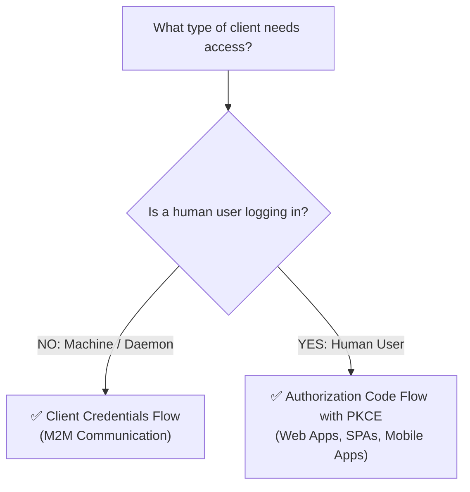
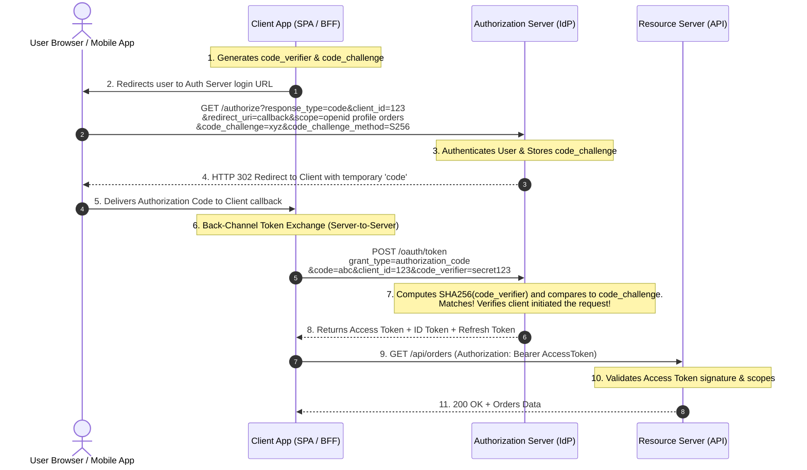
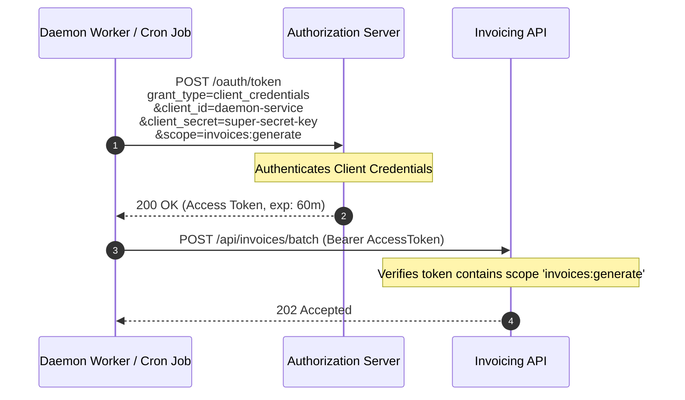

# 05. OAuth 2.0 & OpenID Connect (OIDC) Architecture & Grant Types

#Security #Authentication #Authorization #OAuth2 #OIDC #PKCE #DotNet #AspNetCore #SystemDesign #InterviewPreparation

> [!abstract] Executive Summary
> Modern application security decouples identity management and access delegation from business logic.
> - **OAuth 2.0 (RFC 6749):** The industry-standard framework for **delegated authorization**. It allows a third-party application to access resources on behalf of a user *without ever learning the user's password*.
> - **OpenID Connect (OIDC):** An identity and authentication layer built directly **on top of OAuth 2.0**. While OAuth 2.0 provides an **Access Token** for APIs, OIDC provides an **ID Token (JWT)** that proves *who the user is* and enables Single Sign-On (SSO).
> 
> This guide breaks down the four core OAuth 2.0 roles, the **Hotel Valet Key analogy**, the **Token Triad (Access, ID, Refresh)**, deep mechanics of **Authorization Code Flow with PKCE (RFC 7636)**, **Client Credentials (M2M)**, deprecated legacy flows (Implicit, ROPC), and production-grade **.NET 8/9 ASP.NET Core OpenID Connect** configuration.

---

## 1. The Core Architectural Separation: OAuth 2.0 vs. OpenID Connect

A pervasive failure in architecture discussions is conflating OAuth 2.0 and OIDC.

```
┌────────────────────────────────────────────────────────────────────────────────────────────────┐
│                                 OAUTH 2.0 vs. OPENID CONNECT (OIDC)                            │
├───────────────────────────────┬────────────────────────────────┬───────────────────────────────┤
│ Dimension                     │ OAuth 2.0 (RFC 6749)           │ OpenID Connect (OIDC)         │
├───────────────────────────────┼────────────────────────────────┼───────────────────────────────┤
│ **Core Purpose**              │ **Authorization (Delegation)** │ **Authentication (Identity)** │
│ **Question Answered**         │ *"What is this app allowed to  │ *"Who is the current user?"   │
│                               │   do on the user's behalf?"*   │                               │
│ **Primary Artifact**          │ **Access Token** (for APIs)    │ **ID Token** (for Client App) │
│ **Format of Token**           │ Opaque string OR signed JWT    │ Strictly a signed JWT (RFC)   │
│ **Audience (`aud`) of Token** │ The Resource Server (API)      │ The Client Application        │
│ **Analogy**                   │ The Hotel Valet Key            │ The Government Passport / ID  │
└───────────────────────────────┴────────────────────────────────┴───────────────────────────────┘
```

```mermaid
flowchart TD
    subgraph OIDC_Layer["OpenID Connect (Identity Layer)"]
        IdP["Identity Provider (IdP / Auth Server)\n(Entra ID / Okta / Auth0)"] -->|Issues ID Token (JWT)| Client["Client Application\n(SPA / Web App / Mobile)"]
        Client -->|Reads User Claims: sub, email, name| Client
    end

    subgraph OAuth_Layer["OAuth 2.0 (Delegation Layer)"]
        IdP -->|Issues Access Token| Client
        Client -->|Passes Access Token in Header| API["Resource Server (API)\n(Orders API / Calendar API)"]
    end
```

---

## 2. The Four OAuth 2.0 Roles & The Valet Key Analogy

OAuth 2.0 explicitly models access through four distinct entities:

1. **Resource Owner (The User):** The human being who owns the data and grants access.
2. **Client (The Application):** The web app, mobile app, or background daemon requesting permission to act on the user's behalf.
3. **Authorization Server (The Identity Provider - IdP):** The trusted authority that authenticates the user, obtains their consent, and issues tokens (e.g., Microsoft Entra ID, Okta, Keycloak).
4. **Resource Server (The API):** The protected HTTP service that holds the user's data (e.g., Google Drive API, Banking API) and validates access tokens.

```
┌────────────────────────────────────────────────────────────────────────────────────────────────┐
│                                   THE HOTEL VALET KEY ANALOGY                                  │
├───────────────────────────────┬────────────────────────────────────────────────────────────────┤
│ OAuth Entity                  │ Valet Scenario Equivalent                                      │
├───────────────────────────────┼────────────────────────────────────────────────────────────────┤
│ **Resource Owner**            │ You (Car Owner)                                                │
│ **Resource Server**           │ Your Car (Contains personal belongings; has driving capabilities)│
│ **Client**                    │ The Hotel Valet Driver (Needs to park your car)                │
│ **Authorization Server**      │ The Hotel Front Desk (Manages guest trust and vehicle keys)    │
│ **Scope**                     │ "Drive at under 15 MPH; cannot unlock trunk or glovebox"       │
│ **Access Token**              │ The physical **Valet Key** (Can start engine, cannot open trunk)│
└───────────────────────────────┴────────────────────────────────────────────────────────────────┘
```

> [!NOTE] The Fundamental Security Rule of OAuth 2.0
> You **never give your primary master key (your username and password) to the valet driver (the client application)**. You authorize the front desk to grant them a restricted, temporary, and revocable keycard.

---

## 3. The Token Triad: Access, ID, and Refresh Tokens

```
┌───────────────────┬───────────────────────────────┬───────────────────────────────┬────────────┐
│ Token Type        │ Primary Consumer / Audience   │ Primary Contents / Claims     │ Lifetime   │
├───────────────────┼───────────────────────────────┼───────────────────────────────┼────────────┤
│ **Access Token**  │ **Resource Server (API)**     │ `sub`, `scope`, `tenant_id`   │ 5–15 mins  │
│ **ID Token**      │ **Client Application**        │ `sub`, `email`, `name`, `iss` │ 15–60 mins │
│ **Refresh Token** │ **Authorization Server Only** │ Opaque cryptographically safe │ 7–30 days  │
└───────────────────┴───────────────────────────────┴───────────────────────────────┴────────────┘
```

* **Access Token:** An authorization credential used by the client to make HTTP calls to the Resource Server. The Resource Server validates scopes before executing operations.
* **ID Token:** A standardized JWT intended strictly for the client application to know who just logged in. **The Client must never pass the ID Token to an API as an authorization credential.**
* **Refresh Token:** An opaque credential used exclusively with the Authorization Server's `/token` endpoint to acquire fresh Access Tokens when previous ones expire.

---

## 4. Modern Grant Types Deep-Dive

A **Grant Type** defines the exact cryptographic dance used by a client to obtain an Access Token from the Authorization Server.



---

### 1. Authorization Code Flow with PKCE (RFC 7636) - The Universal Standard

The **Authorization Code Flow with Proof Key for Code Exchange (PKCE)** is the mandated standard (OAuth 2.1) for all interactive applications—including Single Page Applications (React/Angular), mobile apps (iOS/Android), and traditional server-rendered web apps.

#### Why PKCE is Mandatory:
In mobile apps and browser applications (public clients), the initial redirect from the browser can be intercepted by malicious apps registered to the same custom URL scheme (`myapp://oauth-callback`).
PKCE mathematically binds the initial authorization request to the final token exchange using dynamic cryptography, preventing code-interception attacks:
1. Client generates a cryptographically random secret string: **`code_verifier`** (43–128 characters).
2. Client hashes it using SHA-256: **`code_challenge = Base64Url(SHA256(code_verifier))`**.



---

### 2. Client Credentials Flow (RFC 6749 Section 4.4) - Machine-to-Machine (M2M)

Used strictly for automated services, cron jobs, daemons, and internal microservice communication where **no human user is present**.



---

### 3. Deprecated Legacy Grant Types (Banned in OAuth 2.1)

> [!CAUTION] Legacy Flows Formally Deprecated by IETF
> 1. **Implicit Flow (`response_type=token`):**
>    - *Why it existed:* Early browsers had CORS limitations preventing direct server POSTs.
>    - *Why it is banned:* It returned access tokens directly in the URL hash fragment (`#access_token=...`), leaking tokens into browser history, web server logs, and referrer headers. **Replaced by Auth Code + PKCE.**
> 2. **Resource Owner Password Credentials (ROPC / Password Grant):**
>    - *Why it existed:* Legacy migrations where the client prompted for username/password directly.
>    - *Why it is banned:* Anti-pattern that forces users to give their primary credentials to third-party clients, completely undermining the purpose of OAuth.

---

## 5. OpenID Connect (OIDC) Protocol Infrastructure

To implement OIDC, an Identity Provider exposes standardized discovery and key distribution endpoints:

### 1. The Discovery Document (`/.well-known/openid-configuration`)
A public JSON endpoint that allows clients and APIs to auto-configure themselves without hardcoding URLs:
```json
{
  "issuer": "https://auth.enterprise.com",
  "authorization_endpoint": "https://auth.enterprise.com/oauth/authorize",
  "token_endpoint": "https://auth.enterprise.com/oauth/token",
  "userinfo_endpoint": "https://auth.enterprise.com/oauth/userinfo",
  "jwks_uri": "https://auth.enterprise.com/.well-known/jwks.json",
  "scopes_supported": ["openid", "profile", "email", "offline_access"],
  "response_types_supported": ["code"]
}
```

### 2. The JWKS Endpoint (`/.well-known/jwks.json`)
Exposes the public keys used by APIs to verify token signatures:
```json
{
  "keys": [
    {
      "kty": "RSA",
      "use": "sig",
      "kid": "auth-key-2026",
      "alg": "RS256",
      "n": "u1W3rX...[RSA Public Modulus]...",
      "e": "AQAB"
    }
  ]
}
```

---

## 6. Production ASP.NET Core 8/9 OpenID Connect Client Setup

In ASP.NET Core, the client application configures OIDC using `AddOpenIdConnect` with PKCE automatically enabled:

```csharp
using Microsoft.AspNetCore.Authentication.Cookies;
using Microsoft.AspNetCore.Authentication.OpenIdConnect;
using Microsoft.IdentityModel.Protocols.OpenIdConnect;

var builder = WebApplication.CreateBuilder(args);

// 1. Clear legacy Microsoft WS-Federation claim mapping
System.IdentityModel.Tokens.Jwt.JwtSecurityTokenHandler.DefaultInboundClaimTypeMap.Clear();

builder.Services.AddAuthentication(options =>
{
    options.DefaultScheme = CookieAuthenticationDefaults.AuthenticationScheme;
    options.DefaultChallengeScheme = OpenIdConnectDefaults.AuthenticationScheme;
})
.AddCookie(CookieAuthenticationDefaults.AuthenticationScheme, options =>
{
    options.Cookie.Name = "__Host-ClientApp";
    options.Cookie.SameSite = SameSiteMode.Strict;
    options.Cookie.SecurePolicy = CookieSecurePolicy.Always;
})
.AddOpenIdConnect(OpenIdConnectDefaults.AuthenticationScheme, options =>
{
    options.Authority = "https://auth.enterprise.com";
    options.ClientId = "enterprise-web-client";
    options.ClientSecret = builder.Configuration["Oidc:ClientSecret"]; // From Key Vault

    // Enforce modern Authorization Code Flow + PKCE
    options.ResponseType = OpenIdConnectResponseType.Code;
    options.UsePkce = true; // Enabled by default in ASP.NET Core

    // Standard OIDC Scopes
    options.Scope.Clear();
    options.Scope.Add("openid");
    options.Scope.Add("profile");
    options.Scope.Add("email");
    options.Scope.Add("offline_access"); // Requests Refresh Token

    // Save tokens inside encrypted session cookie for backend API calling
    options.SaveTokens = true;

    // Strict validation
    options.GetClaimsFromUserInfoEndpoint = true;
    options.TokenValidationParameters.NameClaimType = "name";
    options.TokenValidationParameters.RoleClaimType = "role";
});

var app = builder.Build();
app.UseAuthentication();
app.UseAuthorization();
app.Run();
```

---

## 7. Security Anti-Patterns in OAuth 2.0 & OIDC

| Anti-Pattern | Why It Breaks Systems in Production | The Correct Solution |
| :--- | :--- | :--- |
| **"Passing ID Token to APIs"** | ID Tokens are meant for the client app; APIs cannot validate scopes or authorization grants against ID tokens. | Always pass **Access Tokens** to Resource Servers (APIs). |
| **"Using Implicit Flow in SPAs"** | Exposes tokens directly in the URL address bar, browser history, and HTTP referrer headers. | Use **Authorization Code Flow with PKCE**. |
| **"Storing `client_secret` in Mobile / React Apps"** | Any user can decompile the mobile binary or inspect JS bundles to extract the secret. | SPAs and Mobile apps are **Public Clients**; use PKCE without client secrets. |
| **"Skipping `state` & `nonce` Checks"** | Leaves applications open to Login CSRF and token replay attacks. | Frameworks like ASP.NET Core automatically generate and validate `state` and `nonce`. |
| **"Ignoring JWKS Key Rollover"** | Hardcoding the public key breaks token validation when the Identity Provider rotates signing keys. | Configure `Authority`; allow the runtime to auto-fetch keys via `jwks_uri`. |

---

## 8. Senior Staff Interview Script

> [!TIP] The "OAuth 2.0 vs. OIDC Architecture" Interview Response
> *"In modern identity architecture, I decouple authentication from authorization by leveraging **OpenID Connect (OIDC)** on top of **OAuth 2.0**.
> 
> OAuth 2.0 is purely a delegated authorization framework. Through the four core roles—Resource Owner, Client, Authorization Server, and Resource Server—it allows an application to obtain a scoped, short-lived **Access Token** to call APIs without ever possessing the user's password. OpenID Connect adds an identity layer, providing the client with a standardized, cryptographically signed **ID Token (JWT)** to verify who the user is and establish their local session.
> 
> For all user-facing clients—whether SPAs, mobile applications, or server-side web apps—our mandatory standard is the **Authorization Code Flow with PKCE (RFC 7636)**. PKCE completely neutralizes authorization code interception attacks by generating a dynamic `code_verifier` and hashed `code_challenge`, ensuring that only the entity that initiated the login request can exchange the code for tokens. For background workers and microservices without a user context, we strictly use the **Client Credentials Flow**."*
