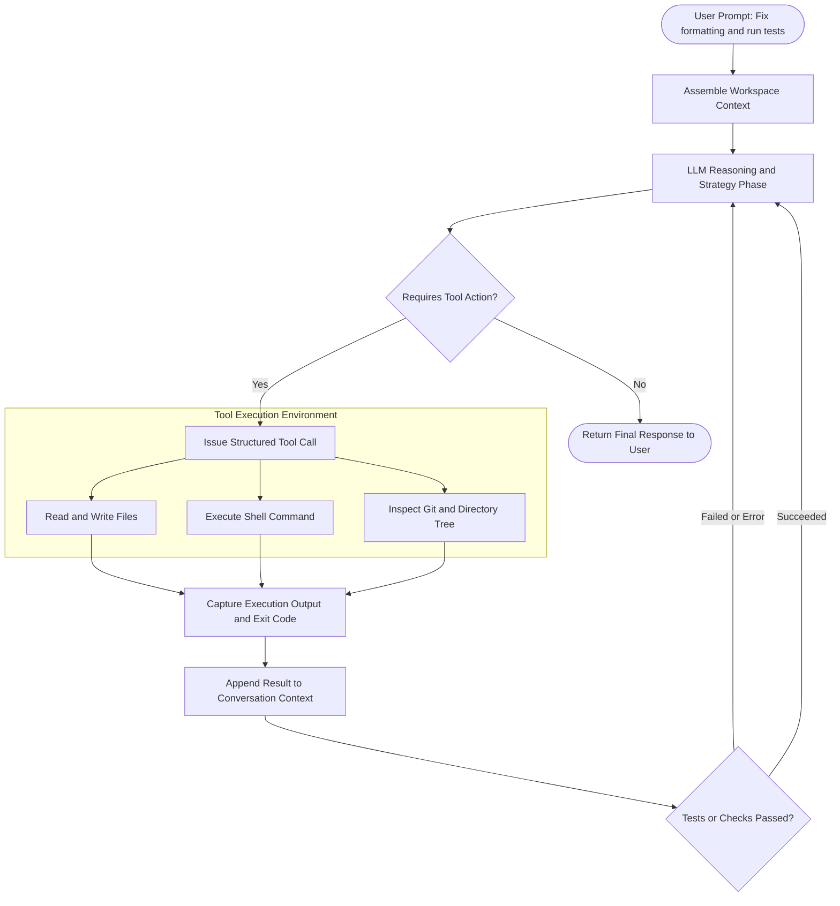

#AICoding #Agents #LLM #SoftwareEngineering #OpenCode #AutonomousSystems #DevTools #Productivity

> [!abstract] Executive Summary
> The term **"AI Agent"** has become one of the most widely abused buzzwords in modern software engineering. Non-technical marketing teams often label basic chatbot wrappers as "agents." In real-world software engineering, AI tooling cleanly divides into three distinct operational buckets: **Chat**, **Inline Autocomplete**, and **Autonomous Coding Agents**.
> 
> While Chat excels at pedagogical Q&A and Autocomplete speeds up tactile typing ergonomics, **Autonomous Agents** represent a generational paradigm shift in engineering velocity. By operating inside a closed-loop execution environment—reading files, modifying codebases, executing terminal commands, evaluating test suites, and self-correcting errors—agents take over entire multi-step software engineering workflows. This guide deconstructs the three buckets, maps the anatomy of the agentic loop, explores provider orchestration with **OpenCode**, and outlines security and automated verification practices.

---

## 1. The Three Buckets of AI-Assisted Engineering

To leverage AI effectively without falling for industry hype, engineers must classify tools by their degree of autonomy and access to execution environments.

```
┌──────────────────────────────────────────────────────────────────────────────────┐
│                            THE AI ASSISTANCE SPECTRUM                            │
└──────────────────────────────────────────────────────────────────────────────────┘

   [ Bucket 1: Chat ]           [ Bucket 2: Autocomplete ]       [ Bucket 3: Autonomous Agents ]
   ┌─────────────────┐           ┌────────────────────────┐      ┌───────────────────────────────┐
   │  "Explain this   │           │  Inline Ghost Text      │      │  "Refactor the auth service,  │
   │   concept to me" │           │  (Tab-to-Accept)       │      │   fix broken tests, and run   │
   └────────┬────────┘           └───────────┬────────────┘      │   linter checks across repo"  │
            │                                │                   └───────────────┬───────────────┘
            ▼                                ▼                                   ▼
 ┌──────────────────────┐         ┌──────────────────────┐        ┌───────────────────────────────┐
 │ • Browser / Sidecar  │         │ • Sub-word / line    │        │ • Full Tool Access (Shell/IO) │
 │ • Passive Text Q&A   │         │ • Ergonomics & UX    │        │ • Multi-turn ReAct Loop       │
 │ • Zero Tool Access   │         │ • Cursor-local context│       │ • Executes Tests & Fixes Bugs │
 └──────────────────────┘         └──────────────────────┘        └───────────────────────────────┘
```

### 1. Bucket 1: Chat (Conversational Explanations & Ideation)
- **What it is:** A direct, conversational interface with a Large Language Model (LLM). This occurs in a browser (ChatGPT, Claude web), an IDE sidecar panel, or an interactive educational assistant (e.g., Boot.dev's Boots).
- **Core Strengths:** Architectural brainstorming, explaining complex algorithms, deciphering cryptic error messages, and answering conceptual system design questions.
- **Fundamental Limitations:** Passive and disconnected from your runtime. The model cannot see your filesystem directly (unless you copy-paste snippets), cannot run your compiler, cannot execute tests, and cannot verify whether its proposed solution actually runs.

### 2. Bucket 2: Autocomplete (Inline Ghost Text & Ergonomics)
- **What it is:** Real-time code completion integrated directly into the text editor (e.g., GitHub Copilot, Supermaven, Cursor Tab).
- **Core Strengths:** Tactical ergonomics. When you begin typing a function signature or variable assignment, the model predicts the remainder of the line or code block. You press `Tab` to accept.
- **Fundamental Limitations:** Strictly localized to the immediate cursor position. It saves physical keystrokes but does not understand broad repo-wide architectural workflows, cannot run builds, and cannot refactor dependencies across multiple files.

### 3. Bucket 3: Autonomous Coding Agents (Workflow Automation)
- **What it is:** An autonomous, multi-turn AI system equipped with **tools** that grant it direct read and write access to the workspace and a shell runtime.
- **Core Strengths:** You communicate high-level intent conversationally, but on each turn the agent formulates a plan, reads file trees, edits code, runs terminal commands (builds, linters, tests), analyzes the command output, and iterates until the objective passes verification.
- **The Workflow Shift:** Senior engineers report a dramatic shift in their day-to-day work: chat and autocomplete usage drops from 90% down to under 10%, while autonomous agents handle **>90% of the active coding workflow**.

---

## 2. Comparative Matrix: Chat vs. Autocomplete vs. Agents

| Architectural Vector | Bucket 1: Chat | Bucket 2: Autocomplete | Bucket 3: Autonomous Agent |
| :--- | :--- | :--- | :--- |
| **Primary Interface** | Conversational prompt box | Inline editor buffer (Ghost text) | Conversational CLI / IDE workspace |
| **Autonomy Level** | Passive (Advisory only) | Reactive (Keystroke triggered) | Active (Goal-driven closed loop) |
| **Context Scope** | Prompt text + manual pastes | Current file & adjacent tabs | Full repository, git status, terminal output |
| **Tool Execution** | None | None | Shell execution, file I/O, web search, AST |
| **Error Handling** | Relies on user copy-pasting errors | Ignored; suggests syntax only | Runs tests/linters, detects failure, self-repairs |
| **Ideal Use Case** | Conceptual learning, documentation Q&A | Boilerplate typing, syntax completion | Multi-file refactors, bug fixing, test writing |

---

## 3. The Anatomy of an Autonomous Coding Agent

How does an agent actually function under the hood? It utilizes the **ReAct (Reasoning + Acting)** pattern in a continuous loop:



### The ReAct Execution Cycle:
1. **Observation:** The agent inspects the file tree, existing configuration files, and git diffs.
2. **Reasoning (Thought):** The agent deduces what steps are required (e.g., *"Before running the test suite, I need to check the dependencies and discover the test runner"*).
3. **Action (Tool Call):** The agent invokes a tool, such as executing `uv run ruff format --check` via the shell.
4. **Ingestion & Correction:** If the command returns an exit code of `1` with syntax errors, the agent does not panic—it reads the stderr output, edits the offending file to resolve the issue, and re-executes the check until it exits with code `0`.

---

## 4. The OpenCode Ecosystem & Model Orchestration

[OpenCode](https://opencode.ai) is an open, terminal-first coding agent designed to interact directly with codebases via CLI tools and provider APIs.

```
┌──────────────────────────────────────────────────────────────────────────────────┐
│                             OPENCODE ARCHITECTURE                                │
└──────────────────────────────────────────────────────────────────────────────────┘

   ┌────────────────────────────────────────────────────────────────────────┐
   │                          OpenCode Agent (CLI)                          │
   │   - Workspace file access          - Terminal command runner           │
   │   - Session memory & context       - Interactive REPL interface        │
   └───────────────────────────────────┬────────────────────────────────────┘
                                       │
                      ┌────────────────┴────────────────┐
                      ▼                                 ▼
         ┌─────────────────────────┐       ┌─────────────────────────┐
         │    OpenCode Console     │       │   Direct Provider APIs  │
         │  (Hosted Model Catalog) │       │  (BYO API Keys / Sub)   │
         ├─────────────────────────┤       ├─────────────────────────┤
         │ • DeepSeek V4.1 Flash   │       │ • Anthropic Claude 3.5  │
         │ • Free community tier   │       │ • OpenAI GPT-4o         │
         │ • Zero-data-retention   │       │ • Google Gemini 1.5 Pro │
         └─────────────────────────┘       └─────────────────────────┘
```

### 1. The `/connect` Command
The `/connect` command allows an engineer to link OpenCode to a model provider. This can be:
- **OpenCode Console:** A centralized gateway offering free and managed model endpoints without requiring individual vendor accounts.
- **Direct Providers:** External accounts such as OpenAI (ChatGPT), Anthropic (Claude), or Google (Gemini) using your personal API keys or subscription tokens.

```bash
# Connect to a provider within an active OpenCode session
/connect
```

### 2. The `/models` Command & Model Selection
The `/models` command opens the interactive model selector, allowing developers to switch between frontier models and lightweight reasoning engines on the fly:

```bash
# Launch the interactive model picker
/models
```

To list all configured providers and models from your terminal:
```bash
# Inspect available models across all connected providers
opencode models
```

### 3. Frontier vs. Lightweight Reasoning Models
- **DeepSeek V4.1 Flash (High Thinking Variant):** A fast, high-performance reasoning model accessible via OpenCode Console's free tier. The "High Thinking" variant allocates internal chain-of-thought tokens before returning tool actions, making it effective for planning multi-step refactoring tasks.
- **Frontier Models (Claude 3.5 Sonnet, GPT-4o):** Ideal for complex architectural tasks, large multi-file refactoring, and intricate type systems where instruction following must be exact.

---

## 5. Security, Privacy & Token Hygiene

> [!WARNING] Never Send Credentials or PII to Public Model Endpoints
> Even when using providers that enforce **Zero Data Retention** policies (where prompt payloads are not logged or used for model training), you must treat all LLM API communications as potentially external.

### Production Rules for Agent Data Security:
1. **Never commit or pass `.env` secrets:** Ensure all `.env`, `.pem`, and credential files are listed in `.gitignore` and omitted from agent prompts.
2. **Audit Provider Data Policies:** Verify whether the provider retains request data for model fine-tuning. OpenCode Console's free endpoints state that request data is not retained or used for training, but caution remains best practice.
3. **Run with Least Privilege:** Avoid running coding agents under `root` or `sudo` privileges. Agents should execute within scoped user accounts or Docker containers to prevent accidental destructive commands (`rm -rf`, unexpected database drops).

---

## 6. Automated Verification: The Bootdev CLI Pattern

In an agent-driven workflow, human engineers should not act as manual quality testers for every line of code. Instead, **deterministic test harnesses** provide the agent with a verifiable pass/fail metric.

```
┌──────────────────┐         ┌──────────────────┐         ┌──────────────────┐
│  Prompt Coding   │ ──────► │ Execute Solution │ ──────► │  Deterministic   │
│      Agent       │         │  & Tool Actions  │         │   CLI Harness    │
└──────────────────┘         └──────────────────┘         └─────────┬────────┘
                                                                    │
                             ┌──────────────────────────────────────┴───┐
                             ▼                                          ▼
                      [Exit Code: 0]                             [Exit Code != 0]
                       Status: PASS                              Agent Auto-Retries
```

### The Verification Workflow:
1. **Task Assignment:** The developer assigns an objective to the agent (e.g., configure the model provider).
2. **Verification Command:** The agent executes a standardized CLI check:
   ```bash
   # Verify that opencode correctly lists configured models
   opencode models
   ```
3. **Automated Submission via Bootdev CLI:**
   The Bootdev CLI runs isolated checks against the local workspace environment:
   ```bash
   bootdev run -s 710f43a7-c8e5-4139-8633-e760960da12c
   ```
4. **Exit Code Evaluation:** The test suite expects an exit code of `0`. If any check fails, the agent inspects the standard error stream, adjusts its configuration, and re-runs the check automatically.

---

## 7. Summary & Mental Models

1. **Chat = Passive Q&A:** Great for learning concepts; incapable of executing actions.
2. **Autocomplete = Keystroke Acceleration:** Great for typing speed; blind to global codebase context.
3. **Agents = Autonomous Execution:** Combines LLM reasoning with shell tools and file I/O to autonomously navigate, edit, and verify codebases.
4. **The Agent Tipping Point:** As tool integration and reasoning models mature, software engineering shifts from manual syntax composition to **specifying constraints, evaluating architecture, and reviewing agent-driven pull requests**.
