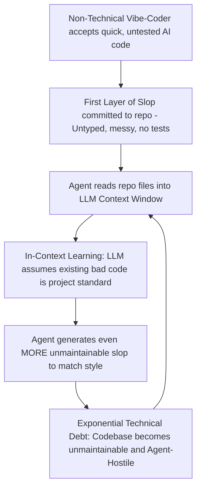

#AICoding #SoftwareArchitecture #UnixPhilosophy #VibeCoding #CodeQuality #Ruff #Python #DevOps

> [!abstract] Executive Summary
> A common misconception in modern technology is that autonomous AI coding agents make disciplined software architecture obsolete. In reality, the exact opposite is true: **AI coding agents make clean architecture, static typing, and rigorous testing more critical than ever before**.
> 
> Coding agents operate at peak performance within repositories that adhere to the 50-year-old **Unix Philosophy**: small, focused modules that do one thing well, accepting plain text input and producing plain text output. Conversely, when repositories fall victim to undisciplined **"vibe-coding"**—where code is generated without strict architectural constraints—a compounding phenomenon known as **"Slop begets slop"** takes over. This guide explains why text-in/text-out remains the gold standard interface for LLMs, contrasts agent-friendly and agent-hostile codebases, deconstructs the mechanics of modern linter automation with **Ruff**, and defines the discipline required to lead AI-driven software projects.

---

## 1. The Unix Philosophy: The Native Interface of LLMs

Popular science fiction led society to believe that artificial intelligence would communicate in raw binary streams—ones and zeros flowing at light speed. In software engineering, the reality is entirely different.

```
┌────────────────────────────────────────────────────────────────────────┐
│               THE INTERFACE PARADOX: BINARY VS. TEXT                   │
├────────────────────────────────────────────────────────────────────────┤
│ Sci-Fi Myth:     Machine ◄──[ Binary / Opcodes / Hex ]──► AI           │
│ Real Engineering: Machine ◄──[ Text Streams (stdin/stdout) ]──► LLM     │
└────────────────────────────────────────────────────────────────────────┘
```

### Why Text-In, Text-Out Dominates
Large Language Models (LLMs) are neural networks trained on hundreds of billions of tokens composed of human natural language, Markdown documentation, and UTF-8 source code. **Text is their native reasoning substrate.**

Fifty years ago, Doug McIlroy articulated the **Unix Philosophy**:
1. *Write programs that do one thing and do it well.*
2. *Write programs to work together.*
3. *Write programs to handle text streams, because that is a universal interface.*

Because coding agents interact with development environments via tool calls, CLI utilities that emit predictable, structured text streams (`stdout`, `stderr`, and exit codes) provide the ideal feedback loop for an LLM:
- An agent can execute `git status`, parse untracked files, and plan its next move.
- An agent can run a test runner (`pytest`, `go test`), parse stack traces, and isolate failing lines.
- An agent can execute a linter (`ruff check`, `eslint`), identify the exact rule violation, and apply an automated fix.

When a tool outputs binary blobs or requires clicking proprietary GUI buttons, the agent is blinded. When tools follow the Unix philosophy, the agent operates with near-human dexterity.

---

## 2. The 5 Pillars of an Agent-Friendly Codebase

Autonomous agents do not possess innate human intuition. They rely on the immediate codebase context and command output to verify their progress. High-performing engineering teams design their codebases to be deliberately **"Agent-Friendly."**

```
┌────────────────────────────────────────────────────────────────────────┐
│                   THE 5 PILLARS OF AGENT-FRIENDLY REPOS                │
├────────────────────────────────────────────────────────────────────────┤
│ 1. Deterministic Test Suites    ──► Instant pass/fail ground truth     │
│ 2. Strict Static Typing & Lint  ──► Immediate syntactic feedback loop  │
│ 3. Modular Directory Structure  ──► Minimizes token context overload   │
│ 4. Clear Naming Conventions     ──► High-accuracy semantic retrieval   │
│ 5. Unified Developer CLI Entry  ──► Predictable execution commands     │
└────────────────────────────────────────────────────────────────────────┘
```

### 1. Robust, Fast Test Suites
An agent cannot know if its refactoring broke business logic unless a test fails. A comprehensive test suite provides **deterministic ground truth**. If tests run in 500 milliseconds, an agent can iterate five times in ten seconds. If tests take 45 minutes, agent workflows grind to a halt.

### 2. Strictly Enforced Types, Linting, and Formatting
- **Static Typing (TypeScript, Python Type Hints, Go, Rust):** Compiler errors act as real-time guardrails. When an agent hallucinates a non-existent method, the compiler immediately halts execution with an unambiguous message.
- **Automated Formatters (Ruff, Prettier, Black):** Removes formatting debates entirely and prevents unnecessary git diff churn.

### 3. Modular File Structures & Sane Architecture
When a single file spans 3,000 lines of spaghetti code, an agent must consume excessive context tokens just to read it, increasing latency, financial cost, and the risk of hallucination. Modular, single-responsibility files allow agents to isolate edits to small, targeted contexts.

### 4. Clear and Consistent Naming Conventions
LLM weights are trained on semantic associations. If a variable is named `userDataStore`, the model infers its purpose immediately. If it is named `x1_temp_buf`, the model must guess its intent, drastically increasing the likelihood of bugs.

### 5. Explicit, Standardized CLI Entry Points
Repositories should document standard commands in a `Makefile`, `package.json`, or `pyproject.toml`. When commands like `test`, `lint`, `format`, and `typecheck` are standardized, an agent can discover and invoke them without trial and error.

---

## 3. The "Vibe-Coding" Anti-Pattern & The Slop Multiplier

> [!CAUTION] The Danger of Vibe-Coding: "Slop Begets Slop"
> The fastest way to destroy an agent-friendly codebase is to grant push access to a non-technical "vibe-coder" for a few hours. 
> 
> When someone accepts generated code without understanding its architectural foundation, static typing, or edge cases, poor patterns enter the repository. Because LLMs heavily condition their outputs on existing code in context, **the agent will mirror and amplify those bad patterns**, accelerating codebase rot.



### Agent-Friendly vs. Agent-Hostile Repositories

| Metric | Agent-Friendly Codebase | Agent-Hostile Codebase ("Vibe-Coded") |
| :--- | :--- | :--- |
| **Type System** | Strict static typing (`pyright`, `TypeScript`, `strict: true`) | `any` types, raw untyped dictionaries, missing type hints |
| **Testing** | Fast unit tests + deterministic assertions | Zero tests, or flaky tests that depend on network/timing |
| **Formatting** | Enforced via pre-commit / CI (`ruff`, `prettier`) | Inconsistent indentation, mixed tabs/spaces, dead imports |
| **Tool Execution** | Predictable single commands (`uv run ruff check`) | Complex multi-step undocumented manual setup steps |
| **Agent Behavior** | High precision, self-correcting, rapid delivery | Hallucinations, compounding errors, broken imports |

---

## 4. Hands-On Workflow: Command Discovery & Automated Remediation

To demonstrate how an agent interacts with a standardized repository following the Unix philosophy, consider a Python project managed with modern tooling (`uv` and `ruff`).

```
┌──────────────────────────────────────────────────────────────────────────────────┐
│                     AGENT INSPECTION & REMEDIATION PIPELINE                      │
└──────────────────────────────────────────────────────────────────────────────────┘

   [ 1. Discovery Phase ]       [ 2. Static Check Phase ]      [ 3. Remediation Phase ]
   ┌──────────────────────┐      ┌──────────────────────┐      ┌──────────────────────┐
   │ Inspect configuration│ ───► │ Execute check mode:  │ ───► │ Apply in-place fix:  │
   │ List project commands│      │ `uv run ruff format  │      │ `uv run ruff format` │
   │ (Read pyproject.toml)│      │  --check`            │      │ (Clean exit code 0)  │
   └──────────────────────┘      └──────────────────────┘      └──────────────────────┘
```

### Step 1: The Inspection Rule (Look Before You Leap)
Before running arbitrary scripts, an agent should always inspect the repository configuration (e.g., `pyproject.toml`, `Makefile`, or `package.json`) to discover the defined project commands:

```bash
# Common project command taxonomy to identify:
1. Program Execution:  uv run python -m sloperator
2. Test Runner:        uv run pytest
3. Code Formatting:    uv run ruff format
4. Code Linting:       uv run ruff check
5. Type Checking:      uv run mypy .
```

> [!TIP] Guardrail: Do Not Execute Blindly
> Instructing the agent to **list commands without immediately running them** prevents unintended side effects, such as accidental database drops, migration triggers, or destructive cache wipes.

### Step 2: Checking Formatting with Ruff
[Ruff](https://astral.sh/ruff) is an extremely fast Python linter and code formatter written in Rust. It embodies the Unix philosophy: fast, focused, text-in, text-out.

To check formatting without modifying files:
```bash
uv run ruff format --check
```
- If all files conform to the style guide, the command exits silently with **exit code 0**.
- If a file violates formatting (e.g., irregular indentation, unformatted multiline strings), Ruff prints the violating file path to `stdout` and exits with **code 1**:
  ```text
  Would reformat: src/sloperator/parser.py
  1 file would be reformatted, 12 files already formatted
  ```

### Step 3: Automated Formatting Remediation
Once the agent identifies the unformatted file, it invokes the formatter directly:
```bash
uv run ruff format
```
Ruff modifies the file in place. The agent re-runs `uv run ruff format --check`, confirms that the exit code is now `0`, and proceeds to testing.

### Step 4: Verification via the Test Harness
Finally, the agent submits the verified codebase to the deterministic test harness (e.g., Bootdev CLI):
```bash
bootdev run -s 6be39ae6-99e1-4acd-b233-905902b8daf4
```
The CLI executes the isolated checks:
```text
Running test checks:
[CHECK] uv run ruff format --check ... PASSED (exit code: 0)
All checks passed successfully!
```

---

## 5. The Senior Engineer's Role in the Age of Agents

As coding agents assume responsibility for generating syntax, the primary responsibilities of software engineers evolve:

1. **Architecture Over Typing:** The engineer’s value shifts from typing lines of boilerplate to defining clean interfaces, domain models, and system boundaries.
2. **Establishing Feedback Loops:** Engineers must equip repositories with strict CI/CD pipelines, pre-commit hooks, static analysis, and fast test suites so agents have the necessary sensory feedback to self-correct.
3. **Guardrails Against Slop:** Engineers act as gatekeepers, reviewing PRs to ensure agent-generated contributions maintain high architectural standards rather than introducing compounding technical debt.
