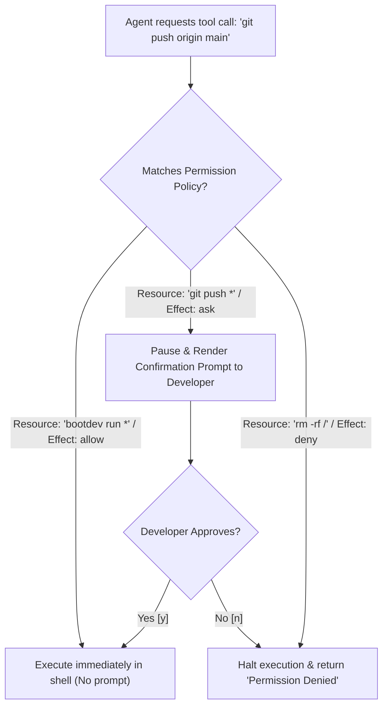

#AICoding #OpenCode #AgentArchitecture #Security #DevOps #Permissions #ConfigurationManagement

> [!abstract] Executive Summary
> Granting an autonomous coding agent unrestricted execution access to a development workstation introduces severe operational and security risks. Without explicit guardrails, an agent might prematurely force-push unfinished code to remote repositories, run destructive shell commands (`rm -rf`, `DROP DATABASE`), or leak proprietary API tokens.
> 
> Professional agent workflows solve this through a **declarative configuration and permission hierarchy**. OpenCode implements a two-tier configuration model: personal global settings (`~/.config/opencode/opencode.jsonc`) merged seamlessly with repository-scoped project settings (`./opencode.jsonc`). By combining **JSONC schema validation**, **least-privilege permission rules** (`allow`, `ask`, `deny`), **credential interpolation** (`{env:VAR}`, `{file:path}`), and separate **TUI preference layers** (`cli.json`), teams can standardize agent behavior across repositories without exposing sensitive secrets or compromising safety.

---

## 1. The Configuration Architecture: Global vs. Project Hierarchy

To balance personal developer preferences with team-wide repository standards, OpenCode uses a **cascading deep-merge configuration model**.

```
┌──────────────────────────────────────────────────────────────────────────────────┐
│                      OPENCODE CONFIGURATION INHERITANCE                          │
└──────────────────────────────────────────────────────────────────────────────────┘

   [ Global Configuration ]                            [ Project Configuration ]
   ~/.config/opencode/opencode.jsonc                   ./opencode.jsonc (Repository Root)
   ┌────────────────────────────────┐                  ┌────────────────────────────────┐
   │ • Personal default model       │                  │ • Team-wide model requirements │
   │ • Global API key substitutions │                  │ • Repo-specific shell commands │
   │ • Fallback permission policies │                  │ • Checked into version control │
   └───────────────┬────────────────┘                  └───────────────┬────────────────┘
                   │                                                   │
                   ▼                                                   ▼
   ┌────────────────────────────────────────────────────────────────────────────────────┐
   │                                Deep Merge Engine                                   │
   │  - Project settings override matching Global keys                                  │
   │  - Non-conflicting Global settings remain active                                   │
   │  - Arrays (e.g., permissions) merge or append according to evaluation precedence    │
   └─────────────────────────────────────────┬──────────────────────────────────────────┘
                                             │
                                             ▼
                              ┌─────────────────────────────┐
                              │    Active Agent Runtime     │
                              └─────────────────────────────┘
```

### 1. Global Configuration (`~/.config/opencode/opencode.jsonc`)
- **Location:** The user's home configuration directory (`%USERPROFILE%\.config\opencode\opencode.jsonc` on Windows, `~/.config/opencode/opencode.jsonc` on Linux/macOS).
- **Purpose:** Stores developer-specific settings that apply across every project on the machine: default model choices, private credential pointers, personal keybindings, and global security policies.
- **Git Status:** **Never checked into version control.**

### 2. Project-Level Configuration (`./opencode.jsonc`)
- **Location:** The root directory of a specific code repository.
- **Purpose:** Standardizes agent behavior for everyone working on that codebase: required models, custom test runners, repository-specific permission policies, and MCP (Model Context Protocol) servers.
- **Git Status:** **Designed to be committed into Git.** Because team members share this configuration, it must never contain raw credentials or personal directory paths.

---

## 2. Anatomy of `opencode.jsonc`: Schema & Extensibility

OpenCode configuration files use **JSONC (JSON with Comments)**. Unlike standard JSON, JSONC allows single-line comments (`//`), block comments (`/* */`), and trailing commas, making it far more maintainable for engineering teams.

```jsonc
{
  "$schema": "https://opencode.ai/config.json",
  "model": "opencode/deepseek-v4.1-flash-free",
  "permissions": [
    {
      "action": "shell",
      "resource": "git push *",
      "effect": "ask"
    }
  ]
}
```

### Core Configuration Properties:
1. **`$schema`:** Points to the official OpenCode JSON schema definition. When opened in compatible editors (VS Code, Cursor, Neovim via LSP), it enables **instant autocomplete, hover documentation, and real-time schema validation**.
2. **`model`:** Specifies the active model identifier in `<provider>/<model>` format.
3. **`permissions`:** An array of security rules governing what the agent can execute autonomously versus what requires human confirmation.
4. **`providers`:** Configures API endpoints and authentication keys for external LLM vendors.
5. **`mcp`:** Configures integrations with external Model Context Protocol servers.

---

## 3. The Permissions Engine: Least-Privilege Guardrails

Autonomous agents execute shell commands to build code, run linters, and inspect files. However, unchecked shell access presents severe risks:
- Prematurely pushing broken code or dirty commits to remote branches (`git push`).
- Accidentally executing destructive file deletions (`rm -rf`, `git clean -fdx`).
- Running resource-heavy cloud provisioning scripts.

To prevent unintended side effects, OpenCode implements a **declarative permission engine**:

```
┌────────────────────────────────────────────────────────────────────────┐
│                        PERMISSION RULE ANATOMY                         │
├────────────────────────────────────────────────────────────────────────┤
│ {                                                                      │
│   "action":   "shell",        // The category of tool action           │
│   "resource": "git push *",   // Wildcard glob pattern matching command│
│   "effect":   "ask"           // "allow" | "ask" | "deny"              │
│ }                                                                      │
└────────────────────────────────────────────────────────────────────────┘
```

### The Three Permission Effects:
- **`allow`:** The agent executes the matching action immediately in the background without prompting the user. Use this for deterministic, safe, read-only or local test operations (e.g., `bootdev run *`, `pytest`, `ruff check`).
- **`ask`:** The agent pauses its execution loop, renders a confirmation prompt in the CLI with the exact command to be executed, and waits for explicit human approval (`y/n`). Use this for actions with remote or permanent side effects (e.g., `git push *`, database migrations).
- **`deny`:** The action is strictly prohibited. The agent is immediately informed that the tool execution was rejected by policy.



---

## 4. Secrets Management: Zero-Commit Credential Hygiene

> [!CAUTION] Hardcoded API Keys in Repository Configs
> Because `./opencode.jsonc` is checked into version control, **you must never hardcode raw API keys or tokens into this file**. Leaking OpenAI or Anthropic keys in public or private Git repositories leads to immediate account compromise and massive unauthorized billing.

OpenCode provides two dynamic interpolation patterns to inject credentials securely at runtime:

```jsonc
{
  "$schema": "https://opencode.ai/config.json",
  "providers": {
    "anthropic": {
      "settings": {
        // Option 1: Interpolate from environment variable
        "apiKey": "{env:ANTHROPIC_API_KEY}"
      }
    },
    "openai": {
      "settings": {
        // Option 2: Interpolate from secure local file pointer
        "apiKey": "{file:~/.secrets/openai-key}"
      }
    }
  }
}
```

### How Interpolation Works:
1. **`{env:VARIABLE_NAME}`:** Reads the key from the developer's local shell environment (e.g., set via `.bashrc`, `.zshrc`, or CI/CD secret runners). If the variable is unset, the agent raises a clear configuration error.
2. **`{file:path}`:** Reads the key from a secure, uncommitted text file stored outside the repository (e.g., `~/.secrets/`). This avoids storing long-lived credentials in shell history or environment variables.

---

## 5. Agent Logic vs. User Interface: The `cli.json` Preference File

While `opencode.jsonc` defines **what the agent can do**, OpenCode isolates **how the terminal looks and feels** into a separate preferences file:

```
~/.config/opencode/cli.json
```

```
┌────────────────────────────────────────────────────────────────────────┐
│               OPENCODE CONFIGURATION SEPARATION OF CONCERNS             │
├──────────────────────────────────────────────────┬─────────────────────┤
│ opencode.jsonc (Agent Runtime)                   │ cli.json (TUI / UX) │
├──────────────────────────────────────────────────┼─────────────────────┤
│ • Model providers & endpoints                    │ • Terminal theme    │
│ • Permission policies (allow / ask / deny)       │ • Scroll speed      │
│ • MCP servers & tool configurations              │ • Diff view modes   │
│ • Project-level shared team settings             │ • Keybindings       │
└──────────────────────────────────────────────────┴─────────────────────┘
```

### Sample `cli.json`:
```json
{
  "theme": {
    "name": "tokyonight",
    "mode": "system"
  },
  "scroll": {
    "speed": 2,
    "acceleration": true
  },
  "diffs": {
    "view": "auto",
    "wrap": "word"
  }
}
```

### Management via `/settings`:
Developers rarely need to edit `cli.json` by hand. Typing `/settings` inside an interactive OpenCode session launches a terminal user interface (TUI) menu that allows updating themes, keybindings, and display preferences, automatically saving them to `~/.config/opencode/cli.json`.

---

## 6. Hands-On Implementation: Setting Up Granular Permissions

Consider a scenario where an engineering team uses the **Bootdev CLI** to verify code exercises locally. Prompting the user for approval on every automated test run creates friction. We want to configure OpenCode to **allow** `bootdev run *` automatically, while preserving existing rules.

### 1. Creating the Project-Level `opencode.jsonc`
In the project root, create or update `opencode.jsonc`:

```jsonc
{
  "$schema": "https://opencode.ai/config.json",
  "model": "opencode/deepseek-v4.1-flash-free",
  "permissions": [
    {
      "action": "shell",
      "resource": "git push *",
      "effect": "ask"
    },
    {
      "action": "shell",
      "resource": "bootdev run *",
      "effect": "allow"
    }
  ]
}
```

### 2. Validating the Configuration with `jq`
Before executing automated commands, verify that the permissions array is valid JSON and ends with the new `allow` rule:

```bash
# Verify the configuration using jq
cat opencode.jsonc | jq '.permissions | if type == "array" then .[-1] == {"action": "shell", "resource": "bootdev run *", "effect": "allow"} else false end'
```
*Expected Output:* `true`

### 3. Executing Deterministic Verification
Once configured, the agent runs the test submission directly without halting for confirmation:

```bash
bootdev run -s 3f823c2f-234f-46be-9130-e98df5e5338d
```

The test runner verifies:
1. `cat opencode.jsonc` exits with code `0`.
2. The jq query validates that the final element of `.permissions` matches the required permission object.

---

## 7. Summary & Configuration Best Practices

| Best Practice | Implementation | Architectural Reason |
| :--- | :--- | :--- |
| **Commit Project Configs** | Check in `./opencode.jsonc` | Aligns models and tool permissions across the entire development team. |
| **Isolate Secrets** | Use `{env:VAR}` or `{file:path}` | Prevents catastrophic credential leaks into Git commit history. |
| **Gate Destructive Operations** | Set `git push *` and `rm *` to `"ask"` | Keeps human engineers in the loop for operations that have remote or permanent effects. |
| **Whitelist Fast Checkers** | Set test runners and linters to `"allow"` | Eliminates confirmation friction, allowing the agent to self-correct in seconds. |
| **Keep TUI Settings Local** | Store display preferences in `cli.json` | Ensures individual aesthetic choices do not pollute team repository configs. |
