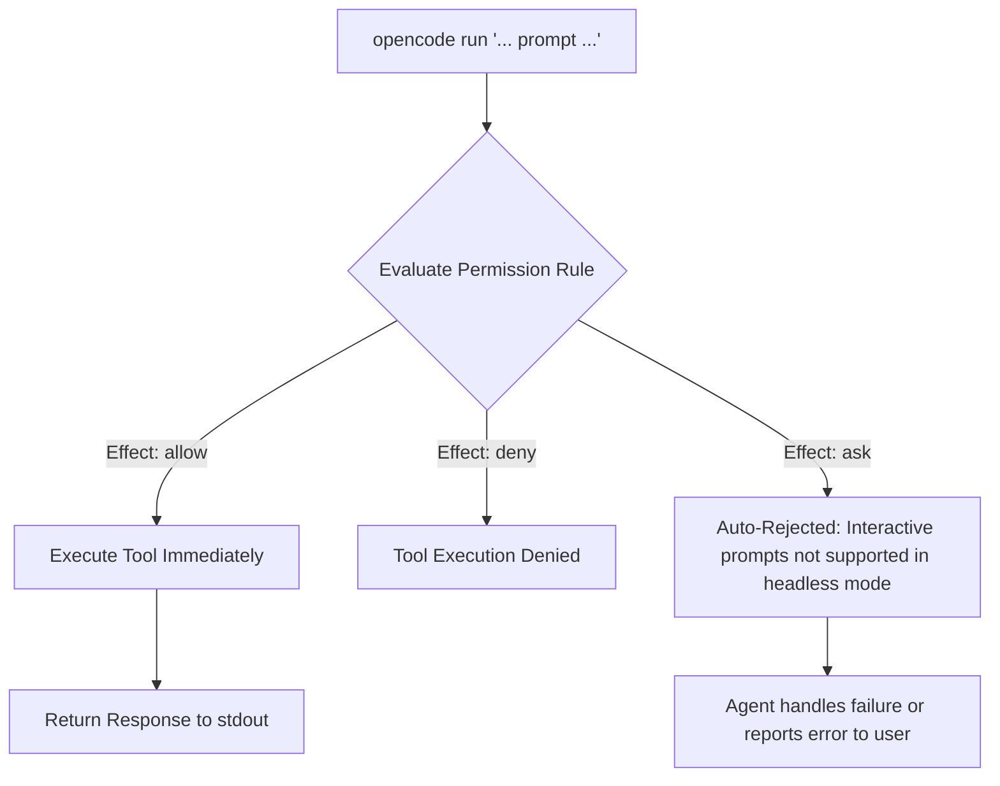
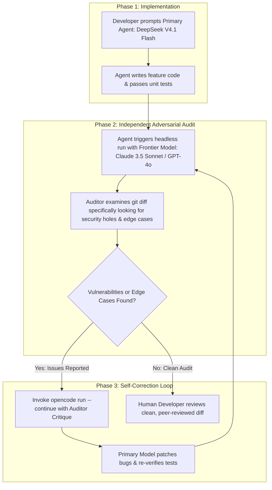

#AICoding #Automation #HeadlessAgents #OpenCode #Bash #UnixStreams #AdversarialReview #CI_CD

> [!abstract] Executive Summary
> While interactive Terminal User Interfaces (TUIs) are the preferred environment for human-in-the-loop development, modern software engineering requires AI to function inside **headless scripts, CI/CD pipelines, and automated Git hooks**. In these environments, an interactive interface that halts for user keystrokes is an anti-pattern.
> 
> The `opencode run` command enables **non-interactive, headless agent execution**. It processes prompts, executes tool calls, reads workspace configurations, and terminates cleanly upon completion. Crucially, it adheres to the Unix standard streams philosophy by separating assistant responses (`stdout`) from tool telemetry (`stderr`). Furthermore, headless mode enables advanced engineering paradigms such as **Adversarial Multi-Model Reviews**—orchestrating one LLM to audit, critique, and red-team another model's code modifications before human inspection.

---

## 1. The Headless Paradigm: Interactive TUI vs. `opencode run`

Software engineers interact with coding agents across two fundamental operating modes:

```
┌──────────────────────────────────────────────────────────────────────────────────┐
│                           INTERACTIVE VS. HEADLESS AGENT                         │
└──────────────────────────────────────────────────────────────────────────────────┘

   [ Interactive TUI Mode: `opencode` ]         [ Headless Automation Mode: `opencode run` ]
   ┌───────────────────────────────────┐        ┌──────────────────────────────────────────┐
   │ • Full-screen terminal dashboard  │        │ • Single command-line invocation         │
   │ • Human-in-the-loop keystrokes    │        │ • Non-blocking, scriptable execution     │
   │ • Interactive permission modals   │        │ • Auto-rejects unapproved prompt prompts │
   │ • Conversational back-and-forth   │        │ • Emits clean text/JSON to stdout        │
   └───────────────────────────────────┘        └──────────────────────────────────────────┘
```

### When to Use Headless Execution:
1. **Shell Scripting & One-Off Tasks:** When you need a quick answer or single refactoring task without opening an interactive dashboard:
   ```bash
   opencode run "Explain how our auth middleware handles expired refresh tokens"
   ```
2. **CI/CD Automated Code Reviews:** Running automated security audits and lint fixes as part of a GitHub Actions workflow.
3. **Pre-Commit Git Hooks:** Summarizing changes, checking for uncommitted secrets, or generating commit messages directly from `git diff`.
4. **Automated Documentation Pipelines:** Generating Markdown architectural summaries directly from code trees.

---

## 2. Unix Standard Streams & Pipeline Redirection

A core design strength of `opencode run` is its strict separation of **Standard Output (`stdout`)** and **Standard Error (`stderr`)**:

```
                              ┌──────────────────────────────┐
                              │  opencode run "<prompt>"     │
                              └──────────────┬───────────────┘
                                             │
                      ┌──────────────────────┴──────────────────────┐
                      ▼                                             ▼
          ┌────────────────────────┐                   ┌────────────────────────┐
          │  stdout (Standard Out) │                   │  stderr (Standard Err) │
          ├────────────────────────┤                   ├────────────────────────┤
          │ • Final assistant text │                   │ • Tool activity logs   │
          │ • Generated code / doc │                   │ • Progress spinners    │
          │ • Clean markdown output│                   │ • Command exit status  │
          └───────────┬────────────┘                   └───────────┬────────────┘
                      │                                             │
                      ▼                                             ▼
             project-summary.md                              Terminal Console
           (Unpolluted by logs)                            (Real-time telemetry)
```

### 1. Clean File Redirection
When you redirect the output of an agent run to a file, you want only the generated document—not the progress spinners, tool execution notices, or intermediate thinking tokens:
```bash
# Telemetry appears in the terminal; only the clean output is saved to the file
opencode run "Summarize this project architecture" > project-summary.md
```

### 2. Structured JSON Output for External Program Parsing
When another program or automated script needs to parse the agent's output programmatically, the `--format json` flag streams structured JSON events instead of plain text:
```bash
opencode run --format json "List all deprecated API endpoints in src/" | jq '.events[]'
```

---

## 3. Headless Permission Gating & Safe Execution

In interactive mode, when an agent attempts a sensitive shell command, it renders a confirmation prompt:

```text
The agent wants to run: git push origin main. Allow? (y/n)
```

> [!WARNING] The Headless Permission Trap
> In headless mode (`opencode run`), there is no human sitting at a TTY terminal to press `y`. Therefore, **any permission rule configured with `"effect": "ask"` is automatically rejected by policy**.



### Designing Configurations for Headless Automation:
To enable headless pipelines without compromising workstation security:
1. Whitelist safe, non-destructive tools in `opencode.jsonc` by setting `"effect": "allow"` (e.g., test runners `pytest`, `bootdev run *`, linters `ruff format`).
2. Keep destructive commands (`git push *`, `rm *`, `DROP TABLE`) set to `"ask"` or `"deny"` so headless scripts can never execute them accidentally.

---

## 4. The Adversarial Multi-Model Review Pattern

A recognized failure mode of LLMs is **confirmation bias**: when a model generates code containing subtle edge-case bugs, asking that *same model* to review its own work often results in false confidence.

The **Adversarial Multi-Model Review** pattern solves this by orchestrating a second, independent model to critically audit the primary model's pull request or code changes.



### Executing Multi-Model Workflows via CLI:
```bash
# 1. Primary Model creates the implementation
opencode run --model "opencode/deepseek-v4.1-flash-free" \
  "Implement the rate limiter in src/limiter.py and run pytest"

# 2. Secondary Adversarial Model reviews the implementation
opencode run --model "anthropic/claude-3-5-sonnet" \
  "Review the git diff in src/limiter.py. Perform an adversarial security audit focusing on race conditions and memory leaks."

# 3. Continuation prompt to address issues found by the reviewer
opencode run --continue \
  "Address the race condition identified by the reviewer in src/limiter.py and ensure all tests pass."
```

---

## 5. Multi-Turn Session Continuation (`--continue`)

Headless execution is not limited to isolated one-off prompts. When an automated task requires adjustments or fails verification, the `--continue` flag resumes the context of the previous session without re-sending the entire conversation history:

```bash
# Initial prompt
opencode run --model "opencode/deepseek-v4.1-flash-free" \
  "Read docs/spec.md and create examples/arithmetic.slop printing 1 + 2 * 3"

# Reviewing the output reveals a formatting or logic bug; continue the session:
opencode run --continue \
  "The operator precedence is correct, but make sure to terminate the statement with the ✨ emoji."
```

---

## 6. Hands-On Implementation: Automated Code Generation & Testing

Consider an automated pipeline where an agent must generate an arithmetic example file according to a domain specification, verify its output, and pass regression tests.

### Step 1: Headless Invocation with Precise Instructions
```bash
opencode run --model "opencode/deepseek-v4.1-flash-free" \
  "Read docs/spec.md and examples/hello.slop. Create a new examples/arithmetic.slop file that prints the result of 1 + 2 * 3. Change only that example. Run it, confirm it prints 7, and run uv run pytest tests/test_examples.py -q."
```

### Step 2: Verification of Generated Code
In SlopLang, `hallucinate` functions like Python's `print`, and `✨` is the statement terminator. The agent generates `examples/arithmetic.slop`:
```text
hallucinate 1 + 2 * 3 ✨
```

### Step 3: Verification Checks
The automated harness evaluates the output:
```bash
# 1. Verify program execution evaluates 1 + 2 * 3 = 7 (multiplication precedence over addition)
example_output=$(uv run sloperator.py examples/arithmetic.slop)
test "$example_output" = '7'

# 2. Run automated test suite
uv run pytest tests/test_examples.py -q
```

### Step 4: Deterministic Submission via Bootdev CLI
```bash
bootdev run -s 3786602e-7461-4a01-993e-e6585b4c0c6b
```
*Expected Result:* Both checks pass with exit code `0`.

---

## 7. Summary & Automation Guidelines

| Feature | Best Practice | Operational Benefit |
| :--- | :--- | :--- |
| **`opencode run`** | Use for scripts, CI/CD, and Git hooks | Eliminates manual TUI overhead and enables headless automation. |
| **`stdout` vs `stderr`** | Redirect `stdout` for clean artifacts (`> doc.md`) | Keeps build telemetry and progress logs out of generated assets. |
| **`--format json`** | Use when piping into `jq` or downstream tools | Enables programmatic event ingestion and automated parsing. |
| **Permission Gating** | Whitelist safe actions as `"allow"`, sensitive as `"ask"` | Prevents headless execution from hanging or executing destructive commands. |
| **Adversarial Review** | Cross-examine code with `--model <reviewer>` | Eliminates single-model confirmation bias before human code review. |
