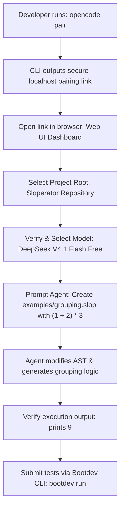

#AICoding #OpenCode #ClientServer #DevOps #WebUI #DesktopApp #TUI #SystemArchitecture

> [!abstract] Executive Summary
> A common misconception among engineers is that OpenCode is simply a standalone terminal utility. In reality, OpenCode is architected as a **distributed client-server system**. The core agent engine runs as an independent, lightweight background daemon (`opencode service`) that orchestrates workspace indexing, tool execution, session persistence, and LLM communication.
> 
> The user interfaces developers interact with are **decoupled client frontends** that attach to this shared background daemon. OpenCode provides three distinct client modalities: the **Terminal UI (TUI)** for speed, scriptability, and remote SSH environments; the **Web UI (`opencode pair`)** for browser and mobile phone accessibility; and the **Native Desktop App** for rich operating system integrations such as clipboard image pasting, native file pickers, and seamless handoff to modern editors (VS Code, Cursor, Zed, Ghostty). Understanding this client-server topology allows engineers to select the optimal interface for any engineering context.

---

## 1. The Distributed Client-Server Topology

By decoupling the agent execution runtime from the presentation layer, OpenCode ensures that sessions remain persistent, lightweight, and accessible across multiple interfaces simultaneously.

```
┌─────────────────────────────────────────────────────────────────────────────────────────┐
│                           OPENCODE CLIENT-SERVER ARCHITECTURE                           │
└─────────────────────────────────────────────────────────────────────────────────────────┘

     [ Client 1: Terminal TUI ]       [ Client 2: Web UI (Browser) ]       [ Client 3: Desktop App ]
     - opencode command               - opencode pair pairing link        - Native macOS / Win / Linux
     - Terminal-native & SSH          - Mobile & LAN accessible           - OS file drag & IDE handoff
     └───────────────┬────────┘       └──────────────┬─────────────┘       └──────────────┬──────────┘
                     │                               │                                    │
                     │                 WebSocket / Local RPC Streams                      │
                     └───────────────────────────────┼────────────────────────────────────┘
                                                     ▼
     ┌────────────────────────────────────────────────────────────────────────────────────┐
     │                      OpenCode Background Service Daemon                            │
     │                           (`opencode service`)                                     │
     ├────────────────────────────────────────────────────────────────────────────────────┤
     │ • Session State & History Cache             • Tool Execution & Process Runner      │
     │ • Workspace File Watcher & AST Index        • Provider Authentication & API Client │
     │ • JSONC Configuration & Permission Engine   • Model Context Protocol (MCP) Router  │
     └────────────────────────────────────────────────────────────────────────────────────┘
```

### Key Architectural Advantages:
1. **Persistent Session State:** If you close your terminal or disconnect your browser, the background service continues executing long-running builds, tests, or multi-step refactoring workflows uninterrupted.
2. **Instant Reconnections:** Subsequent sessions connect to an already warm, initialized service, eliminating cold-start latency.
3. **Cross-Device Interoperability:** An engineer can initiate a long-running refactoring task from a workstation terminal and monitor progress or approve permissions from a mobile browser via Web Pairing.

---

## 2. Deep Dive: The Three Client Frontends

```
┌──────────────────────────────────────────────────────────────────────────────────────┐
│                              THE THREE FRONTEND MODES                                │
├──────────────────────────┬─────────────────────────────┬─────────────────────────────┤
│ 1. Terminal UI (TUI)     │ 2. Web UI (`opencode pair`) │ 3. Native Desktop App       │
├──────────────────────────┼─────────────────────────────┼─────────────────────────────┤
│ Command: `opencode`      │ Command: `opencode pair`    │ Application: Standalone GUI │
│ Speed & Shell workflows  │ Browser & Mobile reviews    │ OS integration & IDE handoff│
└──────────────────────────┴─────────────────────────────┴─────────────────────────────┘
```

### 1. The Terminal UI (TUI: `opencode`)
The default terminal client running inside your shell (Alacritty, iTerm2, WezTerm, Ghostty, Windows Terminal).
- **Primary Strengths:** Blazing speed, minimal resource footprint, seamless integration with command-line tools, and native operation over remote SSH sessions on headless cloud servers.
- **Trade-Offs:** Less ergonomic for viewing large, multi-file side-by-side git diffs; cannot render images or receive clipboard screenshot pastes directly without terminal graphics protocols.

### 2. The Web UI (`opencode pair`)
Running `opencode pair` starts the background daemon (if not already running) and generates an ephemeral, authenticated local pairing URL.
- **Primary Strengths:** Opens in any modern web browser without requiring software installation on the client device. Ideal for reviewing agent diffs on a secondary monitor or monitoring development progress directly from a mobile phone on the same local network.
- **Trade-Offs:** The browser sandbox prevents native interaction with your local operating system—it cannot trigger native system file pickers, open file managers directly, or invoke desktop editors.

### 3. The Native Desktop Application
A standalone, native desktop application built for macOS, Linux, and Windows.
- **Primary Strengths:** Bridges the gap between the agent engine and the host operating system:
  - **Clipboard Screenshot Paste:** Paste UI bugs, mockups, or architectural diagrams directly from the clipboard (`Ctrl+V` / `Cmd+V`) into the chat context.
  - **Native Drag-and-Drop:** Drag files or folders into the chat window to immediately provide absolute paths and context.
  - **IDE Handoff:** One-click integration with buttons like *"Open in VS Code"*, *"Open in Cursor"*, *"Open in Zed"*, or *"Open in Ghostty"*.
  - **System Reveal:** Native *"Reveal in Finder / File Explorer"* support.
  - **Automatic Updates:** Background self-updating without re-running terminal installation scripts.
- **Trade-Offs:** Higher memory and CPU footprint than the raw TUI; cannot be operated over remote headless SSH sessions.

---

## 3. Client Selection Decision Matrix

| Architectural Vector | Terminal UI (TUI) | Web UI (`opencode pair`) | Native Desktop App |
| :--- | :--- | :--- | :--- |
| **Primary Command** | `opencode` | `opencode pair` | Launch via Desktop OS |
| **Startup Latency** | Instant (< 50ms) | Low (< 200ms) | Moderate (~1s) |
| **Remote SSH / Headless** | 🟢 Native Support | 🟡 Requires Port Forwarding | 🔴 Unsupported |
| **Mobile Accessibility** | 🔴 Unusable | 🟢 Accessible via Phone/LAN | 🔴 Unsupported |
| **Visual Diff Review** | 🟡 Inline terminal diffs | 🟢 Side-by-side graphical diff | 🟢 Side-by-side graphical diff |
| **Image & Screenshot Paste** | 🔴 Terminal limitations | 🟡 Browser file upload | 🟢 Native OS clipboard paste |
| **IDE Handoff Buttons** | 🔴 Manual navigation | 🔴 Sandbox restricted | 🟢 One-click (Cursor/VSCode/Zed) |
| **Resource Overhead** | Minimal (< 30 MB) | Dependent on browser tab | Moderate (~150–250 MB) |

> [!TIP] The Senior Engineer's Multi-Client Pattern
> - Use the **TUI** for fast code-heavy development, quick terminal fixes, and remote server sessions.
> - Use the **Web UI** for reviewing large pull requests or following agent progress from a mobile device away from your desk.
> - Use the **Desktop App** for tasks involving UI bug fixes, mockups, visual assets, or when frequent handoffs to IDEs are needed.

---

## 4. Managing the Background Daemon Lifecycle

The background service operates silently behind the scenes. Developers can inspect, start, and terminate the daemon using standard CLI commands:

```bash
# 1. Start the service and generate a browser pairing session
opencode pair

# 2. Inspect active background processes (Linux/macOS)
ps aux | grep opencode

# 3. Stop the background service daemon
opencode service stop
```

> [!NOTE] Daemon Best Practice: Leave It Running
> Unless your workstation is severely memory-constrained, leave the background daemon running even when you are not actively interacting with an agent. The service consumes negligible idle resources and ensures your next session starts instantaneously with fully pre-indexed workspace context.

---

## 5. Hands-On Workflow: Web Pairing & AST Operator Precedence

Consider a practical development workflow where an engineer uses the **Web UI** to implement complex operator precedence logic in SlopLang.



### Step 1: Generating the Pairing Link
In your terminal, execute:
```bash
opencode pair
```
The terminal starts the daemon and outputs a secure pairing URL:
```text
✔ Background service running
🔗 Pairing URL: http://localhost:4040/session?token=8a3f...
```

### Step 2: Model Synchronization Across Clients
> [!IMPORTANT] Independent Model Selection in Web UI
> When opening the Web UI for the first time, it may initialize with a default model that differs from your active TUI session. Always verify the **Model Selector dropdown** in the Web UI before submitting your prompt. Ensure `DeepSeek V4.1 Flash Free` (or your preferred frontier model) is active.

### Step 3: Implementing Grouping & Operator Precedence
In SlopLang, parentheses alter standard arithmetic evaluation order. To test grouping, we prompt the agent via the Web UI to create `examples/grouping.slop`:

```text
hallucinate (1 + 2) * 3 ✨
```

Without parentheses, `1 + 2 * 3` evaluates to `7` (multiplication first). With explicit grouping `(1 + 2) * 3`, addition evaluates first:
$$\text{Result} = (1 + 2) \times 3 = 3 \times 3 = 9$$

### Step 4: Verification & Test Execution
Through the Web UI, prompt the agent to run the program and execute the test suite:
```bash
# 1. Verify program prints 9
example_output=$(uv run sloperator.py examples/grouping.slop)
test "$example_output" = '9'

# 2. Run example test suite
uv run pytest tests/test_examples.py -q
```

### Step 5: Deterministic Submission via Bootdev CLI
```bash
bootdev run -s 71b247ed-2283-470b-a0d9-eb9ac2eba59f
```
*Expected Result:* Program prints `9`, all regression tests pass, and the CLI returns exit code `0`.

---

## 6. Summary & Mental Models

1. **Client-Server Architecture:** OpenCode separates the background agent brain (`opencode service`) from the presentation frontends.
2. **TUI = Speed & SSH:** The ultimate tool for keyboard-driven local and remote development.
3. **Web UI = Portability:** Zero-install browser access, perfect for dual-screen diff reviews and mobile monitoring.
4. **Desktop App = OS Power:** Unlocks native operating system capabilities—clipboard image pasting, drag-and-drop file paths, and IDE handoffs.
5. **Session Continuity:** Because the agent lives in a background daemon, UI clients can connect, disconnect, and switch seamlessly without interrupting in-flight operations.
