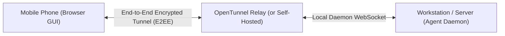

#AICoding #RemoteDevelopment #OpenCode #OpenTunnel #SSH #Tailscale #ACP #OpenClaw #DevOps #Security

> [!abstract] Executive Summary
> Modern software development is increasingly decoupling the developer's physical workstation from the execution environment. High-performance development often occurs on **remote cloud instances, containerized dev boxes, or dedicated internal servers** equipped with massive compute, gigabit network backbones, and direct access to staging databases.
> 
> OpenCode natively supports **remote server execution**, allowing a lightweight local client (TUI, Web UI, or mobile device) to drive an agent executing on a remote machine via `opencode serve`. However, exposing remote agent endpoints introduces critical security concerns: commands execute under the remote host user's permissions, and unencrypted HTTP traffic exposes credentials to network sniffing. By layering **SSH port forwarding**, **WireGuard mesh VPNs (Tailscale)**, **encrypted tunnels (OpenTunnel)**, and the **Agent Client Protocol (ACP)** via team chat harnesses (OpenClaw), engineering teams can build secure, asynchronous, and mobile-enabled agentic workflows.

---

## 1. Remote Server Architecture (`opencode serve`)

Instead of running the agent engine locally on a laptop, OpenCode can be deployed as a headless server on any remote machine (an AWS EC2 instance, GCP Compute Engine VM, private cloud server, or Raspberry Pi).

```
┌────────────────────────────────────────────────────────────────────────────────────────┐
│                              REMOTE AGENT ARCHITECTURE                                 │
└────────────────────────────────────────────────────────────────────────────────────────┘

    [ Local Workstation / Laptop ]                             [ Remote Cloud Server ]
    - Thin TUI Client (`opencode`)                            - Repository checkout (`git clone`)
    - Zero local code or tools needed                         - Full development toolchain (`uv`, `go`)
    - Sends prompts & renders diffs                           - Executes shell commands & file I/O
    └───────────────┬────────────┘                            └───────────────┬───────────────────┘
                    │                                                         │
                    │   Encrypted Tunnel (SSH / Tailscale WireGuard)          │
                    └─────────────────────────┬───────────────────────────────┘
                                              ▼
                             ┌──────────────────────────────────┐
                             │   opencode serve daemon          │
                             │   Listening: 0.0.0.0:4096        │
                             │   Execution Context: Remote User │
                             └──────────────────────────────────┘
```

### 1. Starting the Remote Agent Daemon
On the remote host, start the OpenCode server with a secure authentication password:

```bash
# SSH into the remote machine and launch the server
OPENCODE_PASSWORD="super-secure-secret-password" opencode serve --hostname 0.0.0.0 --port 4096
```
OpenCode starts its background service, binds to the designated port, and outputs its listening address. You can terminate the server at any time with `Ctrl+C`.

### 2. Connecting from the Local Client
On your local laptop or workstation, connect your local OpenCode TUI directly to the remote instance:

```bash
# Connect local TUI to the remote agent daemon
OPENCODE_PASSWORD="super-secure-secret-password" opencode --server http://remote-server-ip:4096
```

---

## 2. Execution Context & Permission Scoping

> [!IMPORTANT] Whose Machine and Permissions Does the Agent Use?
> When connected to a remote OpenCode server:
> 1. **Filesystem Location:** All file reads, writes, edits, and Git operations occur exclusively on the **remote server's disk**. No repository files are synced to your local laptop.
> 2. **Process Execution:** All shell commands (`pytest`, `uv run`, `docker compose`) execute directly on the **remote machine's CPU and memory**.
> 3. **Security Permissions:** The agent inherits the **exact OS user permissions of the user who started `opencode serve`** on the remote machine. If `opencode serve` is launched by `ubuntu`, the agent has standard `ubuntu` user privileges. If started by `root`, the agent possesses unrestricted root access to the entire remote OS.

```
┌────────────────────────────────────────────────────────────────────────┐
│                    REMOTE EXECUTION CONTEXT RULES                      │
├────────────────────────────────────────────────────────────────────────┤
│ • Filesystem:      Remote host disk (no local file sync needed)       │
│ • Tool Execution:  Remote OS kernel & remote system libraries          │
│ • User Identity:   Remote host OS user (e.g., `appuser` or `ubuntu`)   │
│ • Local Machine:   Acts strictly as a display & input terminal         │
└────────────────────────────────────────────────────────────────────────┘
```

---

## 3. Transport Security: Hardening the Network Layer

> [!CAUTION] The Plaintext HTTP Vulnerability
> Setting an `OPENCODE_PASSWORD` protects against unauthorized logins, but **`opencode serve` communicates over unencrypted HTTP by default**. Passing traffic over public IP addresses exposes your authentication password, proprietary source code, and API tokens to network sniffers and man-in-the-middle (MITM) attacks.

To ensure zero-trust security when accessing remote agents, use one of the two standard engineering patterns:

### Pattern A: SSH Local Port Forwarding (Recommended for Single Servers)
Instead of binding `opencode serve` to public `0.0.0.0`, bind it to localhost (`127.0.0.1`), and tunnel the connection through an encrypted SSH channel:

```bash
# Step 1: On remote machine, bind strictly to localhost
OPENCODE_PASSWORD="secret" opencode serve --hostname 127.0.0.1 --port 4096

# Step 2: On local laptop, establish an encrypted SSH tunnel
ssh -L 4096:localhost:4096 user@remote-server-ip

# Step 3: On local laptop, connect to the tunnel locally
OPENCODE_PASSWORD="secret" opencode --server http://localhost:4096
```
*Result:* All traffic is wrapped inside SSH's AES-encrypted cryptographic envelope.

### Pattern B: WireGuard / Tailscale Private Mesh VPN (Recommended for Teams)
Install [Tailscale](https://tailscale.com) or a WireGuard mesh on both the remote server and your client devices. This places both machines on a private, encrypted overlay network (e.g., `100.x.y.z`):

```bash
# Connect securely over Tailscale private IP
OPENCODE_PASSWORD="secret" opencode --server http://remote-node.tailnet-xxxx.ts.net:4096
```

---

## 4. Mobile Agent Workflows & OpenTunnel

Prior to coding agents, attempting to write software on a mobile phone was impractical due to awkward virtual keyboards, tiny screens, and missing terminal tools. Coding agents fundamentally alter this dynamic:

```
┌────────────────────────────────────────────────────────────────────────┐
│                   THE MOBILE ASYNCHRONOUS CYCLE                        │
├────────────────────────────────────────────────────────────────────────┤
│ 1. Developer dispatches large refactoring task from workstation       │
│ 2. Developer steps away from desk (AFK - Away From Keyboard)           │
│ 3. Agent completes task, runs tests, and pauses for instructions      │
│ 4. Developer checks output on mobile phone & dispatches next prompt    │
│ 5. Engineering momentum is maintained without sitting at a desk        │
└────────────────────────────────────────────────────────────────────────┘
```



### The Mobile Architecture:
- **Execution Engine:** The agent daemon runs on your primary workstation or cloud VM, retaining full access to local files and compilers.
- **Client GUI:** A clean web interface runs inside your mobile browser or PWA.
- **Encrypted Bridge ([OpenTunnel](https://opentunnel.xyz/)):** Connects your phone to your workstation via an **End-to-End Encrypted (E2EE)** connection.
- **Self-Hosting:** For maximum enterprise privacy, engineering teams can self-host the OpenTunnel relay service on internal infrastructure to ensure traffic never touches third-party relay servers.

---

## 5. Enterprise Collaboration: Agent Client Protocol (ACP) & OpenClaw

While direct CLI and TUI sessions cater to individual developers, enterprise engineering teams require **shared, asynchronous agent interaction inside team communication channels**.

```
┌────────────────────────────────────────────────────────────────────────────────────────┐
│                            OPENCLAW & ACP INTEGRATION                                  │
└────────────────────────────────────────────────────────────────────────────────────────┘

   [ Team Chat Platform ]               [ OpenClaw Harness ]           [ OpenCode Engine ]
   Slack / Discord Channel              Running on Private Cloud VM    Background Daemon
   ┌──────────────────────┐             ┌─────────────────────┐        ┌─────────────────┐
   │ Developer:           │             │ Dispatches prompts, │  ACP   │ Executes queries│
   │ "@BootsAgent how     │ ──────────► │ manages channels,   │ ─────► │ against read    │
   │ many users signed up │             │ enforces rate limits│        │ replicas & logs │
   │ yesterday?"          │             │ & role permissions  │        └─────────────────┘
   └──────────────────────┘             └─────────────────────┘
```

### 1. What is the Agent Client Protocol (ACP)?
The [Agent Client Protocol (ACP)](https://agentclientprotocol.com) is an open standard that decouples coding agent engines from proprietary UI implementations. Similar to how the Language Server Protocol (LSP) standardized compiler-to-editor communication, ACP standardizes how chat platforms, IDEs, and automation bots communicate with underlying coding agents.

### 2. OpenClaw: Shared Team Agent Harness
[OpenClaw](https://openclaw.ai) is an orchestration harness that connects messaging platforms (Slack, Discord) to OpenCode agents via ACP.

#### Production Architecture at Boot.dev:
- A dedicated OpenClaw agent runs **24/7 on a private cloud VM**.
- Configured with strictly **read-only database replicas** and read-only repository access.
- Team members mention `@BootsAgent` directly in Discord/Slack channels:
  - *"@BootsAgent What was the failure rate for lesson 5.4 in the Python curriculum over the last 24 hours?"*
  - *"@BootsAgent Summarize the recent commits merged into staging."*
- The agent queries the database or git tree, formats the response, and posts the answer directly into the shared channel, eliminating context switching for the engineering team.

---

## 6. Interview Case Study: Secure Remote Connection Walkthrough

To synthesize these concepts, consider the standard engineering challenge:

> **Scenario:** *The `Sloperator` repository is checked out on a remote cloud server. How would you securely connect your local laptop's OpenCode TUI to the agent running on that server? Explain where you start the server, whose machine and permissions the agent uses, and how transport encryption is guaranteed.*

```
┌─────────────────────────────────────────────────────────────────────────────────────────┐
│                           COMPREHENSIVE ARCHITECTURAL ANSWER                            │
├─────────────────────────────────────────────────────────────────────────────────────────┤
│ 1. Starting the Server:                                                                 │
│    SSH into the remote machine and launch the OpenCode daemon bound to localhost:       │
│    $ OPENCODE_PASSWORD="<token>" opencode serve --hostname 127.0.0.1 --port 4096        │
│                                                                                         │
│ 2. Securing the Transport Layer:                                                        │
│    Because `opencode serve` uses unencrypted HTTP, never expose port 4096 to the public │
│    internet. Establish an encrypted SSH tunnel from your local laptop:                  │
│    $ ssh -L 4096:localhost:4096 user@remote-server-ip                                   │
│    (Alternatively, connect over a private WireGuard / Tailscale mesh VPN).              │
│                                                                                         │
│ 3. Connecting the Local Client:                                                         │
│    In a local laptop terminal, launch the OpenCode TUI pointing to the local tunnel:    │
│    $ OPENCODE_PASSWORD="<token>" opencode --server http://localhost:4096                │
│                                                                                         │
│ 4. Execution Context & Permissions:                                                     │
│    - The agent reads, edits, and creates files on the REMOTE SERVER'S filesystem.       │
│    - Shell commands and tests run on the REMOTE SERVER'S hardware.                      │
│    - The agent operates strictly with the REMOTE USER'S OS privileges (e.g., `user`).   │
│    - The local laptop acts purely as a terminal display and input client.               │
└─────────────────────────────────────────────────────────────────────────────────────────┘
```

---

## 7. Summary & Architectural Cheat Sheet

| Vector | Local Agent (`opencode`) | Remote Agent (`opencode serve`) | Team Agent (`OpenClaw` / ACP) |
| :--- | :--- | :--- | :--- |
| **Execution Host** | Local developer laptop | Remote Cloud VM / Server | Dedicated Private Cloud VM |
| **Primary Interface** | Local TUI / Desktop App | Local TUI pointing to remote IP | Slack / Discord team channels |
| **Network Requirement** | None (Local socket) | SSH Tunnel / Tailscale VPN | Internal network / Webhook bridge |
| **Permissions Scope** | Local OS user account | Remote server user account | Strictly scoped read-only service account |
| **Ideal Use Case** | Day-to-day feature work | Heavy builds, cloud dev boxes, mobile AFK | 24/7 team analytics, triage, shared Q&A |
