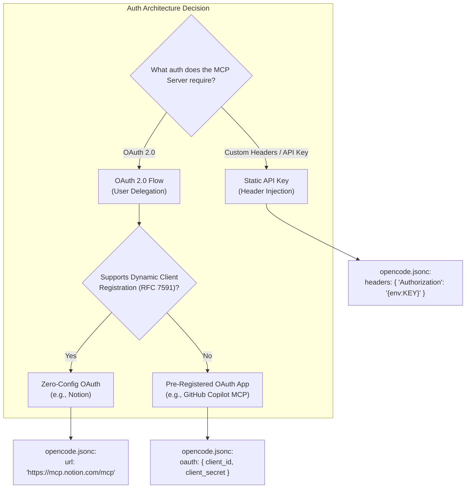
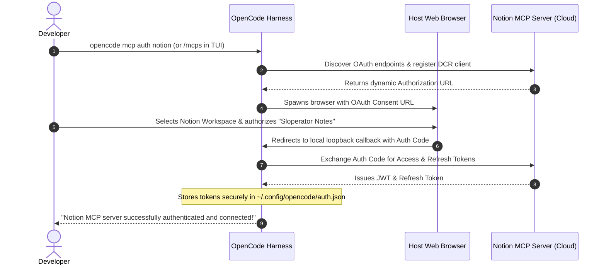

#AICoding #MCP #OAuth #Authentication #Security #DynamicClientRegistration #SystemDesign #OpenCode

> [!abstract] Executive Summary
> Connecting an AI agent to external SaaS ecosystems (Notion, GitHub, Slack, Jira) requires robust, programmatic authentication. While local `stdio` MCP servers run with the ambient permissions of the local user process, remote Streamable HTTP MCP servers mandate standardized authentication schemes.
> 
> OpenCode and the Model Context Protocol support two primary authentication paradigms:
> 1. **Static API Key Authentication:** Injected via custom headers in `opencode.jsonc` using environment variable interpolation (`{env:API_KEY}`). Simple for internal tooling, but lacks token refresh automation and granular user delegation.
> 2. **OAuth 2.0 Flows:** The industry standard for user-delegated authorization. For modern servers implementing **Dynamic Client Registration (RFC 7591)** (such as Notion), OpenCode negotiates client credentials dynamically with zero developer overhead. For legacy providers (such as GitHub), the harness supports pre-registered Client ID/Secret pairs.
> 
> Crucially, authentication tokens and refresh lifecycles are completely decoupled from project repositories: tokens are stored securely in developer-level keyring storage (`~/.config/opencode/auth.json`), preventing accidental credential leakage in version control.

---

## 1. Authentication Topology: API Keys vs. OAuth 2.0

Remote MCP servers act as gateways to high-value enterprise data. Selecting the appropriate authentication model balances configuration complexity against long-term operational security:

```
┌─────────────────────────────────────────────────────────────────────────────────────────┐
│                        REMOTE MCP AUTHENTICATION SPECTRUM                               │
└─────────────────────────────────────────────────────────────────────────────────────────┘

     [ API-Key Authentication ]                           [ OAuth 2.0 Flows ]
     • Transport: Custom HTTP Headers                     • Transport: Bearer Tokens via Auth Handshake
     • Setup: Manual generation & env config              • Setup: Browser redirect / interactive consent
     • Secret Storage: Developer environment              • Secret Storage: Isolated harness keyring
     • Refresh: Manual rotation on expiry                 • Refresh: Automatic background token renewal
     • Scope: System/Service account                      • Scope: Fine-grained user delegation (per-page)
     • Ideal For: Context7, private microservices         • Ideal For: Notion, GitHub, Google Drive, Jira
```



---

## 2. Zero-Config OAuth with Dynamic Client Registration (RFC 7591)

In early MCP implementations, every developer had to navigate cloud provider developer consoles, register an OAuth application, configure redirect URIs (`http://localhost:port/callback`), and paste secrets into local files.

Modern MCP servers solve this through **Dynamic Client Registration (DCR)**:

### 2.1 The DCR Handshake
When OpenCode establishes an initial connection to a DCR-compliant server (e.g., `https://mcp.notion.com/mcp`):
1. The harness sends an unauthenticated `tools/list` or handshake probe.
2. The server responds with `401 Unauthorized` and an OAuth metadata URL (`/.well-known/oauth-authorization-server`).
3. OpenCode dynamically POSTs to the server's registration endpoint, registering an ephemeral OAuth client and receiving a unique `client_id` automatically.
4. The user completes authentication via standard browser consent.

### 2.2 Declarative Zero-Config Notion Example
Because Notion supports automated client negotiation, the project configuration requires only the remote endpoint:

```jsonc
// opencode.jsonc
{
  "$schema": "https://opencode.ai/config.json",
  "mcp": {
    "servers": {
      "notion": {
        "type": "remote",
        "url": "https://mcp.notion.com/mcp"
      }
    }
  }
}
```



---

## 3. Complex OAuth: Pre-Registered Clients (The GitHub Pattern)

When an enterprise or legacy provider does not implement RFC 7591 Dynamic Client Registration, the developer must pre-register an OAuth Application in the vendor's developer settings (e.g., GitHub Developer Settings $\to$ OAuth Apps).

### 3.1 Declarative Configuration with Secret Interpolation
In this scenario, the `client_id` and `client_secret` must be supplied explicitly within the server's `oauth` block. To prevent committing these secrets to git, use the `{env:...}` interpolation pattern:

```jsonc
// opencode.jsonc
{
  "$schema": "https://opencode.ai/config.json",
  "mcp": {
    "servers": {
      "github": {
        "type": "remote",
        "url": "https://api.githubcopilot.com/mcp/",
        "oauth": {
          "client_id": "{env:GITHUB_MCP_CLIENT_ID}",
          "client_secret": "{env:GITHUB_MCP_CLIENT_SECRET}"
        }
      }
    }
  }
}
```

### 3.2 Dynamic Callback Resolution
OpenCode automatically spins up a transient local HTTP listener (e.g., `http://127.0.0.1:41235/callback`) to intercept the OAuth redirection code, exchanges it for the user token, and terminates the temporary listener immediately upon completion.

---

## 4. Credential Storage Lifecycle & Isolation

A critical system design invariant of agent harnesses is the **separation of configuration from credentials**:

```
┌─────────────────────────────────────────────────────────────────────────────────────────┐
│                      CREDENTIAL STORAGE ISOLATION ARCHITECTURE                          │
└─────────────────────────────────────────────────────────────────────────────────────────┘

   [ Repository Root: Version Controlled ]
   ./opencode.jsonc ──────────────▶ Declarative server targets, endpoints, and schemas.
   ./.gitignore     ──────────────▶ Safe to commit; zero plaintext credentials!

   [ User Home Directory: OS-Isolated Keyring ]
   ~/.config/opencode/auth.json ──▶ Holds raw OAuth access tokens, refresh tokens, and
                                    expiry timestamps per server.
```

### 4.1 CLI Lifecycle Management Commands

The OpenCode CLI provides dedicated primitives to manage credentials without touching configuration files:

```bash
# 1. Inspect all configured MCP servers and their active authorization status
opencode mcp list

# Sample output:
# NAME       TYPE     STATUS        TOOLS  AUTH
# context7   remote   connected     3      none
# notion     remote   connected     8      authorized
# github     remote   needs_auth    0      unauthorized

# 2. Trigger the interactive browser OAuth flow for a specific server
opencode mcp auth notion

# 3. Revoke active tokens and purge cached credentials from the local machine
opencode mcp logout notion
```

---

## 5. Practical Walkthrough: Notion Workspace Integration

### 5.1 Step-by-Step Assignment Workflow:
1. **Prepare Cloud Resource:** In Notion, create a workspace test page titled `Sloperator Notes` with content:
   > *"The slop must flow."*
2. **Configure OpenCode:** Add the `notion` server to `opencode.jsonc`:
   ```jsonc
   {
     "$schema": "https://opencode.ai/config.json",
     "mcp": {
       "servers": {
         "context7": {
           "type": "remote",
           "url": "https://mcp.context7.com/mcp"
         },
         "notion": {
           "type": "remote",
           "url": "https://mcp.notion.com/mcp"
         }
       }
     }
   }
   ```
3. **Execute OAuth Authorization:**
   Run `opencode mcp auth notion` (or invoke `/mcps` in the interactive chat prompt) and grant access to the workspace.
4. **Agent Retrieval:**
   Instruct the agent: *"Find and read the Sloperator Notes page through Notion's tools."*
   The agent calls `notion_search` and `notion_get_page_content`, returning the verified content.

### 5.2 Automated Boot.dev CLI Assertions

The automated grader verifies that Notion is configured as an active remote server with OAuth enabled and an active connected daemon:

```bash
# Verify configuration AST
cat opencode.jsonc | jq '.mcp.servers.notion | .type == "remote" and .url == "https://mcp.notion.com/mcp" and .disabled != true and .oauth != false'
# Asserts: true

# Verify transport connection
opencode mcp list | awk '$2 == "notion" { print $3 }'
# Asserts: connected
```

---

## 6. Authentication Troubleshooting Matrix

| Symptom | Root Cause | Remediation |
| :--- | :--- | :--- |
| `opencode mcp list` shows `needs_auth` | OAuth flow was never initiated or token expired. | Run `opencode mcp auth <server-name>` in terminal. |
| `401 Unauthorized` during DCR | Server does not support RFC 7591 dynamic registration. | Add explicit `client_id` and `client_secret` to `opencode.jsonc`. |
| Browser shows `Redirect URI Mismatch` | OAuth app registered with fixed port instead of loopback. | In provider app settings, register `http://127.0.0.1` as valid redirect. |
| Tokens lost after system reboot | OS keyring permission failure or corrupted auth cache. | Check write permissions on `~/.config/opencode/auth.json`. |
| Token expired during long agent loop | Server lacks refresh token or harness failed background renewal. | Execute `opencode mcp logout <name>` and re-authenticate. |
