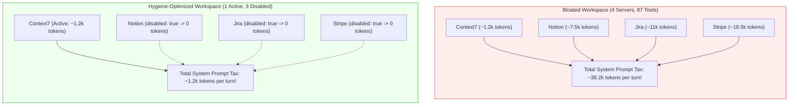
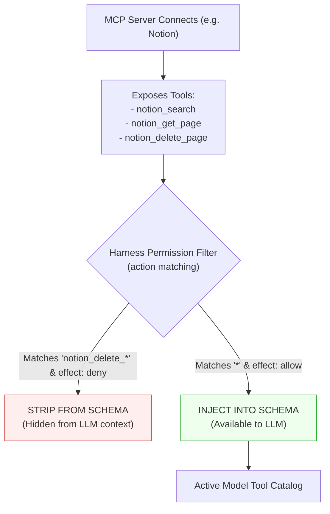

#AICoding #MCP #ContextBloat #ToolHygiene #Permissions #Security #SystemDesign #OpenCode

> [!abstract] Executive Summary
> While the Model Context Protocol (MCP) makes integrating third-party tools seamless, unconstrained MCP adoption introduces a severe architectural hazard: **MCP Context Bloat**.
> 
> When an MCP server is connected, the harness must advertise its complete catalog of tool schemas, argument definitions, and descriptions to the model on **every inference turn**—regardless of whether any tool is ever invoked. A developer connecting five enterprise MCP servers can easily squander $20,000\text{--}40,000$ tokens per turn on unused tool definitions, simultaneously degrading the model's reasoning capacity through attention dilution.
> 
> Production agent engineering demands disciplined **Tool Hygiene**:
> 1. **Server-Level Deactivation (`disabled: true`):** Suspends network connectivity and excludes the server's tools from the prompt catalog while preserving its URL and authentication credentials in `opencode.jsonc`.
> 2. **Granular Tool-Level Permissions (`action: "<mcp-name>_<tool-name>"`):** Surgical permission rules (`effect: "deny"`) to filter out redundant, noisy, or destructive tools while retaining essential read capabilities.

---

## 1. The Context Tax of Inactive MCP Servers

Every active MCP server carries a recurring **Context Tax**. In traditional function calling, models do not possess an innate awareness of external tools; the harness must append the JSON Schema for each tool to the API payload.

$$\text{Total Turn Overhead} = \sum_{i=1}^{S} \sum_{j=1}^{T_i} \text{Tokens}(\text{Schema}_{i,j})$$

Where $S$ is the number of active servers and $T_i$ is the number of tools exposed by server $i$.

```
┌─────────────────────────────────────────────────────────────────────────────────────────┐
│                           THE INACTIVE MCP CONTEXT TAX                                  │
└─────────────────────────────────────────────────────────────────────────────────────────┘

  Developer Workspace Configuration:
  ├── Context7 Docs       ──▶   3 tools   (  ~1,200 tokens )  [Frequently Used]
  ├── Notion Workspace    ──▶  18 tools   (  ~7,500 tokens )  [Used once a week]
  ├── Jira Issue Tracker  ──▶  24 tools   ( ~11,000 tokens )  [Never used in this repo]
  └── Stripe Billing      ──▶  42 tools   ( ~18,500 tokens )  [Used only for billing fixes]

  TOTAL OVERHEAD: ~38,200 tokens injected on TURN 1, TURN 2, TURN 3...
  
  [ Consequences ]
  1. Financial Waste: Hundreds of thousands of prompt-processing tokens billed per day.
  2. Attention Dilution: The model gets distracted by irrelevant parameters and tools.
  3. Increased Latency: Processing massive system prompt payloads increases Time-to-First-Token (TTFT).
```



### The 2-to-3 Active MCP Rule:
Experienced engineering teams maintain a strict rule of thumb: **keep no more than 2 or 3 MCP servers active in any given repository**. If a tool is not needed for the active development sprint, disable it.

---

## 2. Server-Level Deactivation: `disabled: true`

Removing an MCP server from `opencode.jsonc` deletes its endpoint URL, OAuth configuration, and header mappings, forcing the developer to re-configure and re-authenticate when the integration is needed again.

To avoid this friction, OpenCode supports **declarative deactivation** via `"disabled": true`:

```jsonc
{
  "$schema": "https://opencode.ai/config.json",
  "mcp": {
    "servers": {
      // Server 1: Active documentation provider
      "context7": {
        "type": "remote",
        "url": "https://mcp.context7.com/mcp"
      },

      // Server 2: Preserved configuration, but dormant
      "notion": {
        "type": "remote",
        "url": "https://mcp.notion.com/mcp",
        "disabled": true
      }
    }
  }
}
```

### Operational Impact of `disabled: true`:
1. **Zero Context Footprint:** OpenCode does not initiate an MCP client for `notion`. Zero tools from Notion are transmitted to the model.
2. **Preserved Configuration & Auth:** The URL, headers, and OAuth refresh tokens stored in `~/.config/opencode/auth.json` remain untouched.
3. **Instant Reactivation:** Changing `"disabled": true` to `"disabled": false` (or deleting the line) instantly brings the server and its tools back online without requiring a browser re-login.

---

## 3. Granular Tool-Level Permissions: Surgical Tool Denials

Often, an MCP server provides useful read operations but also exposes high-blast-radius mutation tools (e.g., dropping database tables, deleting customer records, or closing pull requests).

Rather than disabling the entire server, OpenCode allows developers to deny individual tools using the universal **Permissions Engine**:

```jsonc
{
  "$schema": "https://opencode.ai/config.json",
  "permissions": [
    // 1. Allow standard read-only tool access by default
    {
      "action": "*",
      "resource": "*",
      "effect": "allow"
    },

    // 2. Deny specific expensive or noisy MCP tool
    {
      "action": "context7_query-docs",
      "resource": "*",
      "effect": "deny"
    },

    // 3. Deny destructive mutation tools from Notion MCP
    {
      "action": "notion_delete_*",
      "resource": "*",
      "effect": "deny"
    }
  ]
}
```



### 3.1 Tool Action Naming Conventions & Normalization
When OpenCode ingests tools from an MCP server, it constructs the internal permission action name using the following standard template:

$$\text{Action Name} = \langle\text{mcp-server-name}\rangle \text{\textunderscore} \langle\text{tool-name}\rangle$$

- Characters that are invalid in action identifiers (such as hyphens `-`, slashes `/`, and spaces) are normalized to underscores `_`.
- Example: Server `context7` with tool `query-docs` $\implies$ Action `context7_query-docs`.
- Example: Server `github` with tool `delete/issue` $\implies$ Action `github_delete_issue`.

### 3.2 Tool Introspection Technique
If you are unsure of the exact normalized tool names exposed by your active servers, you can instruct your agent directly in the chat prompt:

> *"List all tool names currently available to you, one per line."*

Because the tool catalog is part of the agent's system prompt payload, the agent will output the exact list of registered tool strings, making permission rule authoring effortless.

---

## 4. Practical Walkthrough: Notion Deactivation Case Study

### 4.1 The Objective
Configure a project where `context7` remains fully active for library documentation lookups, while `notion` is deactivated to eliminate context bloat, preserving its configuration for future sprints.

### 4.2 Configuration File (`opencode.jsonc`)
```jsonc
{
  "$schema": "https://opencode.ai/config.json",
  "mcp": {
    "servers": {
      "context7": {
        "type": "remote",
        "url": "https://mcp.context7.com/mcp"
      },
      "notion": {
        "type": "remote",
        "url": "https://mcp.notion.com/mcp",
        "disabled": true
      }
    }
  }
}
```

### 4.3 Verification via Session Introspection & Automated Checks

1. **Verify Tool Removal:**
   - In Session 1 (before deactivation): Prompt *"List all tool names"*. Tools include `context7_*` and `notion_*`.
   - In Session 2 (after setting `disabled: true`): Prompt *"List all tool names"*. Only `context7_*` tools appear; all `notion_*` tools have vanished.

2. **Automated Boot.dev Grader Assertion:**
   ```bash
   cat opencode.jsonc | jq '.mcp.servers | .notion.disabled == true and .context7.type == "remote" and .context7.disabled != true'
   # Asserts: true
   ```

3. **CLI Submission:**
   ```bash
   # Run verification
   bootdev run 1ab03468-1bf2-4ba4-895e-dd1ae9b088ea

   # Submit solution
   bootdev run -s 1ab03468-1bf2-4ba4-895e-dd1ae9b088ea
   ```

---

## 5. Architectural Comparison: Deactivation vs. Tool Denial vs. Removal

| Strategy | Syntax in `opencode.jsonc` | Network Connection | Context Impact | Re-enable Friction | Best Used When |
| :--- | :--- | :--- | :--- | :--- | :--- |
| **Server Deactivation** | `"disabled": true` | **Disconnected** | 100% of server's tools removed | **Zero** (toggle boolean to `false`) | Entire service not needed for current development sprint |
| **Granular Tool Denial** | `permissions: [{ action: "...", effect: "deny" }]` | **Connected** | Only denied tools stripped from context | **Low** (adjust permission rule) | Service is needed (read), but specific mutation tools are dangerous/noisy |
| **Complete Removal** | Delete server key from config | **Disconnected** | 100% of server's tools removed | **High** (must re-enter URL, headers, and re-run OAuth) | Decommissioning an abandoned or deprecated service permanently |
