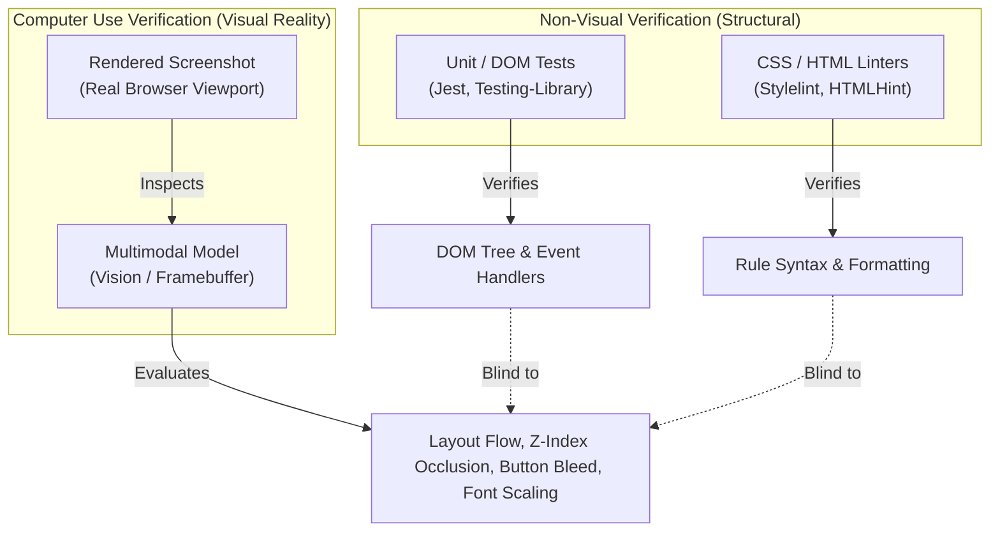
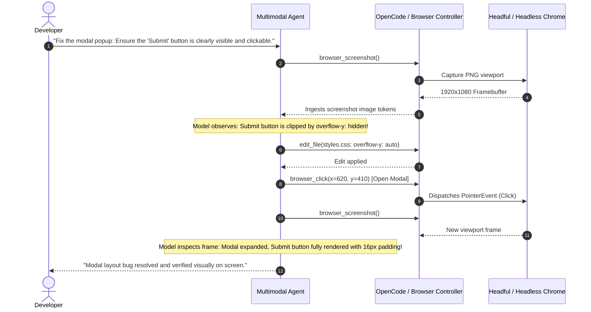
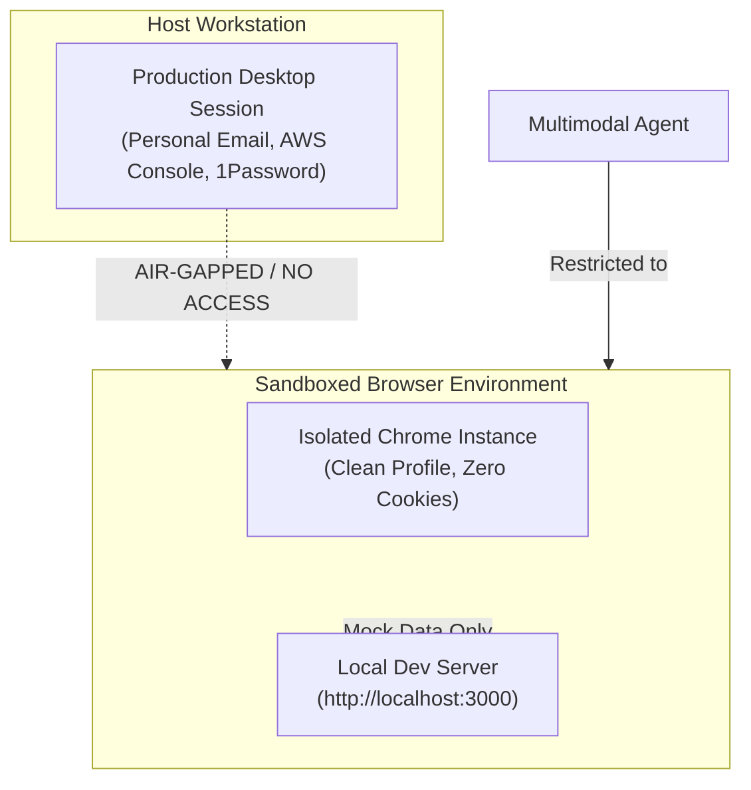

#AICoding #ComputerUse #MultimodalAgents #GUIAutomation #Playwright #VisualFeedbackLoop #Security #SystemDesign

> [!abstract] Executive Summary
> While coding agents operate with maximum speed and determinism when interacting through structured text interfaces (file editors, AST parsers, language servers, and command-line execution), software engineering ultimately delivers applications intended for human visual perception.
> 
> **Computer Use** extends agent capability into the graphical realm, allowing multimodal models to inspect visual displays (via framebuffer screenshots or accessibility trees) and dispatch physical user actions: mouse clicking at coordinates $(x, y)$, keyboard typing, wheel scrolling, and window management.
> 
> Rather than relying on OS-level pixel hunting across desktop applications, modern coding harnesses (such as OpenCode) channel Computer Use primarily through **programmable browser automation interfaces** (Playwright, Puppeteer, Chrome DevTools Protocol, and Browser MCP servers). This establishes a **Visual Feedback Loop** that bridges the critical gap between syntactic DOM correctness and real-world visual rendering bugs (e.g., CSS overflow, z-index collisions, and responsive layout breakage) while enforcing strict **Blast Radius Containment** against accidental session hijacking.

---

## 1. The Need for Visual Evidence: Syntactic Validity vs. Visual Reality

In earlier feedback loops (`7_FeedBack_Loop/`), agents verified code via compilers, typecheckers, formatters, and unit tests. While indispensable, these checks are blind to the visual and spatial reality of graphical user interfaces.

```
┌─────────────────────────────────────────────────────────────────────────────────────────┐
│                    THE BLIND SPOT OF STRUCTURAL & DOM TESTING                           │
└─────────────────────────────────────────────────────────────────────────────────────────┘

  [ DOM / Unit Test Perspective ]
  <div class="card">
    <button id="checkout-btn">Complete Purchase</button>
  </div>

  Unit Test Assertion:
  ✔ expect(screen.getByRole('button')).toBeInTheDocument(); // PASS!
  ✔ expect(screen.getByRole('button')).toHaveTextContent('Complete Purchase'); // PASS!

  [ Rendered Visual Reality on Screen ]
  ┌────────────────────────┐
  │ Card Container         │
  │                        │
  └────────────────────────┘
          ┌────────────────────────┐
          │ Complete Purchase      │  <-- CSS overflow: hidden or z-index: -1!
          └────────────────────────┘      Button is visually truncated, unclickable,
                                          and partially offscreen!
```



A DOM tree can be $100\%$ valid, yet render an application that is completely broken for human users. Computer Use equips the agent with eyes to detect spatial and visual anomalies directly.

---

## 2. The Multimodal Visual Feedback Loop

Computer Use maps the classic **ReAct (Reason $\to$ Act)** feedback loop onto graphical user interfaces:

```
┌─────────────────────────────────────────────────────────────────────────────────────────┐
│                          THE MULTIMODAL VISUAL REACTION CYCLE                           │
└─────────────────────────────────────────────────────────────────────────────────────────┘

                     ┌────────────────────────────────────────┐
                     │              1. OBSERVE                │
                     │  Capture viewport screenshot, evaluate │
                     │  bounding boxes & accessibility tree.  │
                     └───────────────────┬────────────────────┘
                                         │
                                         ▼
                     ┌────────────────────────────────────────┐
                     │                2. ACT                  │
                     │  Dispatch mouse movement, click(x, y), │
                     │  keypress, drag-and-drop, or scroll.   │
                     └───────────────────┬────────────────────┘
                                         │
                                         ▼
                     ┌────────────────────────────────────────┐
                     │              3. INSPECT                │
                     │  Capture subsequent frame; compare     │
                     │  visual delta and DOM mutation state.  │
                     └───────────────────┬────────────────────┘
                                         │
                                         ▼
                     ┌────────────────────────────────────────┐
                     │               4. REPEAT                │
                     │  Iterate until visual invariant and    │
                     │  interaction flow match the target.    │
                     └────────────────────────────────────────┘
```



---

## 3. The Hierarchy of Agent Verification Tools

While Computer Use is visually authoritative, it is also the most expensive, slowest, and least deterministic mechanism in an agent's arsenal.

```
┌─────────────────────────────────────────────────────────────────────────────────────────┐
│                      THE VERIFICATION HIERARCHY & COST PYRAMID                          │
└─────────────────────────────────────────────────────────────────────────────────────────┘

        /▲\
       /   \        Tier 4: Pixel / Desktop Computer Use
      /  4  \       • Cost: Extremely High ($ vision tokens + rendering latency)
     /───────\      • Determinism: Low (Coordinate drifting, font rendering deltas)
    /    3    \     Tier 3: Browser DOM & Accessibility Trees (Playwright / CDP)
   /───────────\    • Cost: Moderate (Structured DOM nodes, locator selectors)
  /      2      \   Tier 2: Unit, Integration, & E2E Test Runners (CLI)
 /───────────────\  • Cost: Low (Fast sub-second assertions, zero vision tokens)
/        1        \ Tier 1: Static Typecheckers, Compilers, & Linters
─────────────────── • Cost: Negligible (Pure static AST validation, millisecond speeds)
```

### The Architectural Fallback Principle:
> [!IMPORTANT] The Golden Rule of Agent Tools
> Always prefer structured, deterministic tools first. If an API, CLI test suite, or database query exists to verify behavior, use it.
> 
> Fall back to Computer Use and browser pixel clicking **only** when visual rendering, layout geometry, or interactive canvas/GUI state is the subject of verification.

---

## 4. Architectural Implementation: Desktop vs. Browser-Scoped Controllers

Two contrasting architectures dominate Computer Use implementations in the industry:

```
┌─────────────────────────────────────────────────────────────────────────────────────────┐
│                         COMPUTER USE ARCHITECTURAL SPECTRUM                             │
└─────────────────────────────────────────────────────────────────────────────────────────┘

     [ Desktop-Level Computer Use ]                     [ Browser-Scoped Automation ]
     (e.g., Claude Computer Use, ChatGPT Desktop)       (e.g., OpenCode, Playwright, Browser MCP)
     • Control Scope: Entire Operating System           • Control Scope: Sandboxed Web Viewport
     • Mechanism: OS Accessibility APIs + Mouse hooks   • Mechanism: Chrome DevTools Protocol (CDP)
     • Input: Coordinate clicks on raw desktop bitmap   • Input: CSS/XPath Locators + Viewport Actions
     • Blast Radius: System-wide (All apps, secrets)    • Blast Radius: Isolated browser session
     • Portability: High OS friction (X11/Wayland/Mac)  • Portability: Universal across local/CI runners
```

### 4.1 The Desktop OS Controller Pattern
Desktop agents (such as Anthropic's Claude 3.5 Computer Use API) interact with the workstation through a synthetic display server (e.g., `Xvfb` on Linux or OS mouse injection APIs).

The model emits low-level coordinates:
```json
{
  "action": "mouse_move",
  "coordinate": [1024, 768]
}
```
$$\text{Scaled Coordinate } X = \text{Image Coordinate } X \times \frac{\text{Display Width}}{\text{Image Width}}$$

**Drawbacks in Software Engineering:**
- Coordinate drift caused by resolution scaling, DPI differences, and dynamic window resizing.
- Slow execution cycle ($\sim 2\text{--}5\text{ seconds}$ per action roundtrip).
- Inability to inspect internal application state, console error logs, or network traffic directly.

### 4.2 The Browser Automation Pattern (OpenCode Paradigm)
In coding-specific environments, over $90\%$ of visual software engineering occurs within a web browser. Modern harnesses integrate directly with browser automation drivers:

1. **Structured Locators over Raw Pixels:** Instead of guessing coordinate `[450, 890]`, the agent targets deterministic semantic locators:
   ```javascript
   await page.locator('button[data-testid="checkout"]').click();
   ```
2. **Synchronous Network & Console Introspection:** The agent captures unhandled runtime JavaScript exceptions (`window.onerror`), 404/500 network failures, and CSS layout metrics simultaneously.
3. **Hybrid Visual Verification:** The agent takes high-resolution viewport screenshots for multimodal visual inspection only after triggering the deterministic locator action.

---

## 5. Security & Blast Radius Containment

Granting an autonomous agent mouse and keyboard capabilities introduces severe security and operational hazards.

```
┌─────────────────────────────────────────────────────────────────────────────────────────┐
│                         COMPUTER USE THREAT VECTORS & HAZARDS                           │
└─────────────────────────────────────────────────────────────────────────────────────────┘

  1. Active Session Hijacking:
     Agent clicks through active browser windows containing logged-in AWS consoles,
     GitHub production repositories, or corporate email accounts.
  
  2. Data Exfiltration via Screen Scraping:
     Background notifications, open password managers, or sensitive code in adjacent
     editor windows get captured in screenshots sent to third-party inference APIs.
  
  3. Irreversible UI Mutations:
     Agent clicks destructive buttons ("Delete Database", "Empty Trash", "Cancel Plan")
     due to misinterpreting an interface modal or confusing confirmation prompts.
```

### 5.1 Hardening Best Practices



1. **Isolated Browser Profiles:** Never run agent browser automation against the developer's default browser profile. Always use ephemeral user data directories (`--user-data-dir=/tmp/agent-profile`) with zero stored passwords or active SSO tokens.
2. **Explicit Permission Gates:** High-impact UI actions (form submission, payment gateways, deletion dialogues) must declare `effect: "ask"` in `opencode.jsonc`, requiring human confirmation in the terminal.
3. **Headless Sandbox Containers:** For unattended or autonomous background execution, run the browser controller inside disposable Docker containers or lightweight virtual machines without access to host display servers.

---

## 6. Architectural Decision Matrix: When to Deploy Computer Use

| Scenario | Recommended Verification Primitive | Rationale |
| :--- | :--- | :--- |
| **REST / GraphQL Endpoint Testing** | CLI (`curl`), Unit / Integration Tests (`pytest`, `vitest`) | 100x faster, zero vision tokens, deterministic status codes. |
| **Component Logic & State Flow** | Component Tests (`Testing-Library`, `Playwright Component`) | Tests state transitions and event emission without pixel rendering. |
| **CSS Layout, Alignment, & Truncation** | **Multimodal Computer Use (Browser Screenshots)** | Only visual rendering catches overlapping elements, flex/grid breakage. |
| **Cross-Device Responsive Breakpoints** | **Multimodal Computer Use (Viewport Emulation)** | Inspects responsive reflow across mobile, tablet, and desktop viewports. |
| **Third-Party Desktop Software Testing** | **OS-Level Computer Use (VM Sandboxed)** | Required when no CLI or web automation interface exists. |
