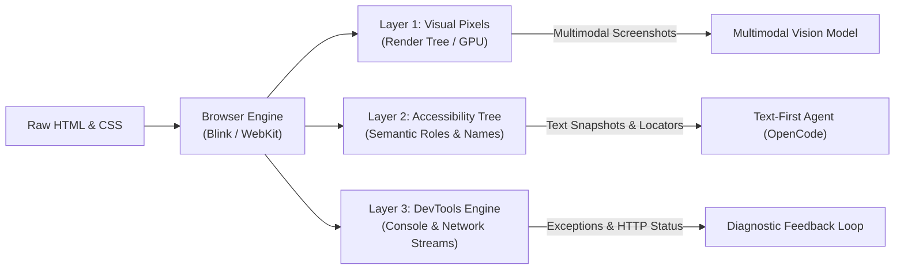
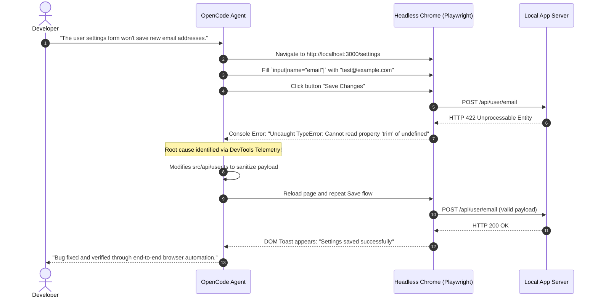

#AICoding #BrowserAutomation #AccessibilityTree #ComputerUse #Playwright #SemanticHTML #SystemDesign #OpenCode

> [!abstract] Executive Summary
> While desktop applications often require pixel-based computer vision and $(x, y)$ coordinate clicking, modern web applications present a unique advantage: **they are constructed entirely from structured text**.
> 
> A web browser is not merely a graphical renderer; it maintains structured runtime representations accessible via automation protocols (Playwright, Puppeteer, Chrome DevTools Protocol):
> 1. **The Document Object Model (DOM):** The structural HTML element hierarchy.
> 2. **The Accessibility Tree (AOM):** A distilled, semantic projection of the DOM containing control **Names**, **Roles**, **States**, and **Descriptions**.
> 3. **The Developer Telemetry Layer:** Live console logs, network request/response streams, and computed CSS layout metrics.
> 
> By targeting the **Accessibility Tree** rather than raw pixel coordinates, text-first coding agents (like OpenCode) can navigate forms, click buttons, and verify reactive UI updates with sub-millisecond precision and zero vision token overhead. However, because accessibility trees are blind to visual layout geometry (overlapping elements, text truncation, and responsive CSS overflows), robust engineering requires pairing headless semantic feedback loops with targeted human aesthetic verification.

---

## 1. Structured Text in Graphical Browsers: The 3 Automation Layers

A web browser sits at the intersection of graphical rendering and structured data. Behind the graphical viewport, the browser engine exposes three distinct layers to automation harnesses:

```
┌─────────────────────────────────────────────────────────────────────────────────────────┐
│                      THE THREE LAYERS OF BROWSER INTROSPECTION                          │
└─────────────────────────────────────────────────────────────────────────────────────────┘

     [ Layer 1: Visual Framebuffer ]
     • Bitmaps, rendered pixels, GPU textures.
     • Consumed by: Human eyes, Multimodal Vision LLMs.
     • Strengths: Catches visual clipping, overlapping CSS, color contrast.
     • Weaknesses: Slow to process, expensive image tokens, fragile coordinate drifting.

     [ Layer 2: The Accessibility Tree (AOM) ]
     • Semantic projection: Names, Roles, States, Descriptions.
     • Consumed by: Screen readers, Automation Agents (Playwright).
     • Strengths: High density, semantic intent, immune to CSS theme changes.
     • Weaknesses: Blind to spatial layout, visual overlap, and canvas/WebGL graphics.

     [ Layer 3: Runtime Telemetry (DevTools Protocol) ]
     • Console logs, unhandled JS exceptions, XHR/Fetch network traffic, DOM mutations.
     • Consumed by: Agent error triaging engines.
     • Strengths: Captures root-cause stack traces and network 4xx/5xx failures instantly.
```



---

## 2. The Browser-Driven Feedback Loop

When a user reports a UI defect, an agent equipped with browser automation does not "guess" code fixes in isolation. It executes a rigorous **reproduction and validation loop**:

```
┌─────────────────────────────────────────────────────────────────────────────────────────┐
│                       THE BROWSER-DRIVEN DEBUGGING LIFECYCLE                            │
└─────────────────────────────────────────────────────────────────────────────────────────┘

  Step 1: Start Application
  └── Boots local development server (`npm run dev` or `uv run server.py`).

  Step 2: Launch Headless Browser
  └── Spawns isolated Chromium instance via Playwright/Puppeteer.

  Step 3: Reproduce Defect
  └── Simulates exact user interactions (typing, clicking, submitting).

  Step 4: Inspect Telemetry
  └── Evaluates DOM state, console error logs (`console.error`), and network calls.

  Step 5: Apply Code Mutation
  └── Edits source files to fix the underlying state management or CSS bug.

  Step 6: Re-run Validation
  └── Replays the interaction flow to confirm the bug is resolved and no regressions occurred.
```



---

## 3. Accessibility Trees: The Semantic Operating Map

Large Language Models reason far more effectively about **semantic meaning** than raw, noisy HTML markup. A standard modern web page contains thousands of lines of nested `<div>`s, SVG paths, and CSS utility classes (e.g. Tailwind).

The browser's **Accessibility Tree** discards this visual noise, condensing the page into an operating map structured by:
- **Role:** What the element is (`button`, `heading`, `textbox`, `combobox`, `dialog`, `checkbox`).
- **Name:** The human-accessible label (e.g., `"Add application"`, `"Submit"`).
- **State:** Runtime interaction status (`enabled`, `focused`, `expanded`, `checked`, `busy`).
- **Description:** Secondary contextual metadata (e.g., tooltip or `aria-describedby` text).

### 3.1 Raw HTML vs. Accessibility Tree Snapshot

#### Raw DOM Markup ($\approx 400\text{ tokens}$):
```html
<div class="flex items-center justify-between p-4 border-b border-gray-200">
  <h1 class="text-xl font-bold text-gray-900 leading-tight">Job Applications</h1>
  <div class="relative inline-block text-left">
    <button type="button" class="inline-flex items-center px-4 py-2 bg-blue-600 text-white rounded-md shadow-sm hover:bg-blue-700 focus:outline-none" aria-haspopup="true" aria-expanded="false">
      <span>Add application</span>
      <svg class="ml-2 -mr-1 h-5 w-5" fill="currentColor" viewBox="0 0 20 20"><path d="M10 5a1 1 0 011 1v3h3a1 1 0 110 2h-3v3a1 1 0 11-2 0v-3H6a1 1 0 110-2h3V6a1 1 0 011-1z"/></svg>
    </button>
  </div>
</div>
```

#### Compact Accessibility Tree Snapshot ($\approx 25\text{ tokens}$):
```text
- heading "Job Applications" [level=1]
- button "Add application" [expanded=false]
```

### 3.2 Token Efficiency & Locator Resilience
- **Token Compression:** The accessibility tree reduces prompt token overhead by **$85\text{--}95\%$** compared to dumping raw HTML into context.
- **Resilience to CSS/DOM Refactoring:** If the front-end team switches from Tailwind to CSS Modules, or changes class names from `bg-blue-600` to `btn-primary`, CSS locators break. Semantic locators (`getByRole('button', { name: 'Add application' })`) continue working without interruption.

---

## 4. Visual Blindspots: What the Accessibility Tree Cannot See

While the accessibility tree provides flawless semantic structure, it is completely divorced from pixel geometry and layout rendering.

```
┌─────────────────────────────────────────────────────────────────────────────────────────┐
│                       WHAT THE ACCESSIBILITY TREE CANNOT SEE                            │
└─────────────────────────────────────────────────────────────────────────────────────────┘

  1. Visual Element Occlusion:
     Two buttons overlap each other due to faulty absolute positioning.
     A11y Tree: Both buttons report `enabled: true`.
     Reality: Top button renders on top of the bottom button, making it unclickable.

  2. Content Clipping & Text Truncation:
     A container with `overflow: hidden` and a fixed height clips the bottom half of a paragraph.
     A11y Tree: Complete text string is present in node value.
     Reality: Human user sees only the first sentence.

  3. Responsive Viewport Breakage:
     On a mobile viewport (375px), a data table overflows the screen horizontally,
     causing horizontal scrollbars and breaking the layout.
     A11y Tree: All table cells and headers report normal structure.
     Reality: Layout is severely broken for mobile users.

  4. Canvas, WebGL, & SVG Charts:
     A dashboard renders financial charts on a `<canvas>` element.
     A11y Tree: Reports `- canvas ""` (completely opaque).
     Reality: Graph lines, labels, and legends are invisible to the tree.
```

### 4.1 The "Div Soup" Anti-Pattern
The accuracy of the accessibility tree depends directly on **Semantic HTML5**. When front-end developers write non-semantic code (the "Div Soup" anti-pattern), the accessibility tree is crippled:

```html
<!-- ❌ ANTI-PATTERN: Div Soup (Invisible to Accessibility Tree) -->
<div class="custom-btn" onclick="saveData()">Submit Form</div>
<!-- A11y Tree Output: - generic "" (The agent cannot identify this as a button!) -->

<!-- ✅ SEMANTIC HTML5: Self-describing & Agent-friendly -->
<button type="button" onclick="saveData()">Submit Form</button>
<!-- A11y Tree Output: - button "Submit Form" [enabled=true] -->
```

> [!TIP] The Agent-Friendly Front-End Mandate
> Instructing coding agents in `AGENTS.md` to strictly write semantic HTML5 (`<button>`, `<main>`, `<nav>`, `<dialog>`, `<form>`, `<input type="...">`) ensures that browser automation tools and screen readers can interact with the codebase with near-zero failure rates.

---

## 5. Architectural Case Study: The Sloperator Playground Stale Output Bug

### 5.1 The Scenario
In the Sloperator web playground, users edit console code and click **"Run"**. A bug was reported:
> *"The playground continues displaying old output after editing the code in the console editor and clicking Run a second time."*

An autonomous agent modified Sloperator's server-side code and claimed: *"The bug is fixed."*

### 5.2 Verification Strategy: What to Delegate to Browser Automation vs. What to Check Manually

```
┌─────────────────────────────────────────────────────────────────────────────────────────┐
│                    SLOPERATOR VERIFICATION: AUTOMATION vs. HUMAN EYE                    │
└─────────────────────────────────────────────────────────────────────────────────────────┘

  [ What to Ask the Agent to Verify via Browser Automation ]
  1. Multi-Step Execution Simulation:
     - Launch browser, navigate to playground.
     - Input Code Snippet A (`print("Alpha")`), click "Run", assert output === "Alpha".
     - Edit console to Snippet B (`print("Beta")`), click "Run" again.
     - Assert output DOM node updates strictly to "Beta" without requiring a full page refresh.
  2. Network & DevTools Telemetry:
     - Verify the second Run dispatches a new network request (HTTP 200).
     - Inspect request/response headers to ensure browser caching (`304 Not Modified` or ETag
       misconfiguration) is not causing stale data delivery.
     - Verify zero unhandled exceptions appear in `console.error`.
  3. Failure State Recovery:
     - Edit code to an invalid syntax error $\to$ verify error toast displays.
     - Revert to valid code $\to$ verify output recovers cleanly.

  [ What You (The Human Engineer) Must Still Check Personally ]
  1. Visual Taste & Layout Stability:
     - Does the output pane flash violently, jump, or cause cumulative layout shift (CLS)?
     - Is there an intuitive loading indicator/spinner during long-running code execution?
  2. Human Input Edge Cases:
     - Rapid double-clicking on the "Run" button (are clicks debounced/throttled?).
     - Copy-pasting massive chunks of text or special Unicode characters into the editor.
  3. Code Diff Integrity & Anti-Patterns:
     - Did the agent fix the root state bug (e.g. state synchronization / cache invalidation),
       or did it introduce an architectural hack (e.g., `location.reload()`, polling every 50ms,
       or disabling HTTP caching globally across the entire domain)?
```

---

## 6. Synthesis: Comparing Browser Inspection Modalities

| Dimension | Raw Pixels (Computer Vision) | Full DOM Tree (HTML) | Accessibility Tree (AOM) |
| :--- | :--- | :--- | :--- |
| **Data Format** | PNG / JPEG Bitmap | Raw HTML string / AST | Concise hierarchical text tree |
| **Token Cost** | **High** ($\sim 800\text{--}2,000$ vision tokens per frame) | **High** ($\sim 2,000\text{--}15,000$ tokens of markup) | **Low** ($\sim 100\text{--}500$ tokens per snapshot) |
| **Execution Latency** | Slow ($2\text{--}6\text{ s}$ image encoding/inference) | Fast ($< 50\text{ ms}$) | Ultra-Fast ($< 20\text{ ms}$) |
| **Locator Resilience** | Fragile (Breaks on resolution/scaling shifts) | Moderate (Breaks on CSS class renaming) | **Extremely Resilient** (Keyed by semantic Role & Name) |
| **Detects Visual Overlap?** | **Yes** | No | No |
| **Detects State Changes?** | Yes (visually) | Yes (attribute inspection) | **Yes** (`[expanded=true]`, `[disabled]`) |
| **Best Suited For** | Aesthetic design reviews, canvas graphics | Deep structural AST analysis | **Interactive agent driving & functional UI testing** |
