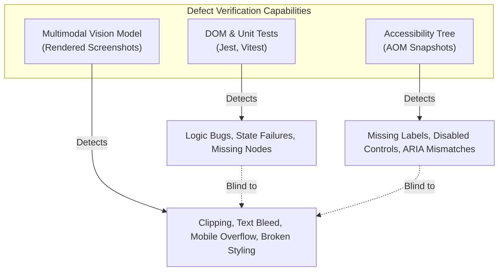
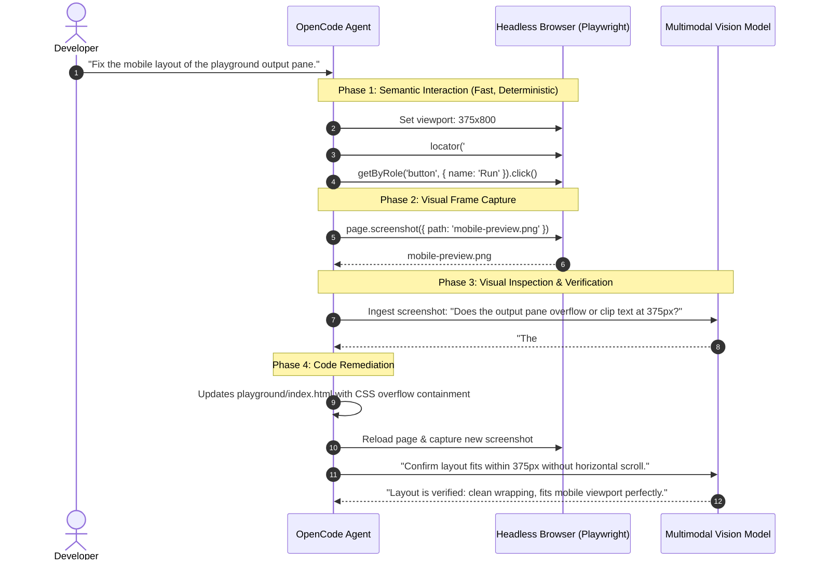

#AICoding #VisionModels #MultimodalAI #ComputerUse #ResponsiveDesign #CSSLayout #Playwright #SystemDesign

> [!abstract] Executive Summary
> Multimodal Vision Models extend an agent's sensory perception from purely abstract text and AST representations to the actual **rendered pixel framebuffer**. By ingesting viewport screenshots alongside instructions, vision-capable models detect non-structural UI failures that escape unit tests and accessibility trees—including margin collapse, font clipping, broken CSS grid/flex wrapping, and responsive overflow.
> 
> However, using computer vision to *interact* with a user interface introduces severe fragility. Modern agent engineering enforces **The Hybrid Interaction Pattern**:
> 1. **Interaction Layer (Semantic Driving):** The agent operates controls, fills forms, and triggers events through deterministic **Accessibility Trees and DOM locators**.
> 2. **Judgment Layer (Visual Inspection):** The agent captures screenshots and invokes **Multimodal Vision Models** solely to judge the rendered result (*"Does this interface render correctly across responsive breakpoints?"*).
> 
> This eliminates coordinate drift while providing automated visual regression guarantees across both mobile ($375\text{px}$) and desktop ($1280\text{px}$) viewports.

---

## 1. Why Pixels Matter: The Visual Failure Domain

In software development, there exists a broad category of defects that produce **zero console errors**, **zero failed unit tests**, and a **syntactically flawless accessibility tree**, yet result in an unreadable or unusable product.

```
┌─────────────────────────────────────────────────────────────────────────────────────────┐
│                     THE NON-STRUCTURAL VISUAL FAILURE DOMAIN                            │
└─────────────────────────────────────────────────────────────────────────────────────────┘

  [ 1. Responsive Viewport Overflow ]
  Long text strings without word-break cause containers to expand horizontally beyond the
  mobile viewport (375px), forcing horizontal scrollbars and breaking mobile navigation.

  [ 2. Clipped Content & Margin Collapse ]
  Containers with fixed heights and `overflow: hidden` visually truncate multi-line text,
  leaving only half a line of text visible to the human eye.

  [ 3. Z-Index Occlusion & Floating Layer Collisions ]
  Sticky navigation bars or floating modals render with opaque backgrounds over interactive
  content, visually blocking form inputs without modifying their DOM hierarchy.

  [ 4. Dynamic Canvas & Chart Rendering ]
  `<canvas>` or WebGL data visualizers render blank frames, malformed SVG lines, or
  overlapping axis labels while reporting an empty, valid `<canvas>` node in the DOM.
```



---

## 2. The Architectural Invariant: "Pixels Are Bad Selectors"

When multimodal agents were first demonstrated, systems attempted to use vision models for both **observation** and **action**: the model predicted $(x, y)$ coordinates from an image and dispatched mouse clicks to those pixels.

In production engineering, this approach fails due to four fundamental bottlenecks:

```
┌─────────────────────────────────────────────────────────────────────────────────────────┐
│                         WHY COORDINATE CLICKING FAILS                                   │
└─────────────────────────────────────────────────────────────────────────────────────────┘

  1. Coordinate Drifting & Scaling Discrepancies:
     High-DPI displays (Apple Retina 2x/3x scaling), browser zoom levels, and CSS pixel
     vs. physical device pixel mappings cause coordinate estimations to miss targets.

  2. High Inference Latency:
     Encoding a 1920x1080 screenshot, transmitting image tokens over an API, and running
     multimodal spatial inference requires 2,000–5,000ms per click.

  3. Enormous Token Costs:
     Each high-resolution screenshot consumes ~800 to 2,000 vision tokens. Driving a
     10-step form purely through vision consumes ~20,000 tokens before writing any code.

  4. Zero Dynamic State Awareness:
     A pixel screenshot cannot reveal whether a button is disabled, awaiting an async
     fetch request, or bound to an active event listener.
```

### The Hybrid Interaction Pattern:

$$\text{Accessibility Tree} \xrightarrow{\quad\text{Drives Actions (Clicks/Typing)}\quad} \text{Browser Engine} \xrightarrow{\quad\text{Renders Output}\quad} \text{Vision Model} \xrightarrow{\quad\text{Judges Visual Correctness}\quad}$$



---

## 3. Responsive Geometry Case Study: The 375px Mobile Overflow Defect

### 3.1 The Defect Specification
In `playground/index.html`, when long strings or continuous streams of output are generated (e.g. `the slop must flow `.repeat(100)), the `#output` container expands horizontally beyond the mobile viewport ($375\text{px}$ width):

```
┌────────────────────────────────────────────────────────┐
│ Browser Viewport: 375px Wide                           │
├────────────────────────────┬───────────────────────────┤
│ #output Pane               │ Overflows Screen! ────────┼──▶ [Horizontal Scrollbar]
│ the slop must flow the slo │ p must flow the slop must │
└────────────────────────────┴───────────────────────────┘
```

The page fails because the container width exceeds `innerWidth`, violating the core responsive invariant:
$$\text{document.documentElement.scrollWidth} \le \text{window.innerWidth}$$

---

### 3.2 CSS Remediation: Enforcing Responsive Containment

To ensure that preformatted terminal/console text remains readable and wrapped across both mobile ($375\text{px}$) and desktop ($1280\text{px}$) screens, apply CSS containment rules:

```css
/* playground/index.html */
#output {
  /* 1. Prevent the container from ever exceeding its parent/viewport */
  max-width: 100%;
  box-sizing: border-box;

  /* 2. Enable horizontal scrolling within the element if unbroken strings occur */
  overflow-x: auto;
  overflow-y: auto;

  /* 3. Force long words and unbroken identifiers to wrap cleanly */
  overflow-wrap: anywhere;
  word-break: break-word;
  white-space: pre-wrap;

  /* 4. Ensure visual visibility & layout presence */
  display: block;
  opacity: 1;
}
```

---

### 3.3 Automated Playwright Verification Pipeline

To verify layout compliance programmatically without human visual babysitting, Playwright executes automated bounding box and computed style assertions:

```javascript
// Verification harness executed via Playwright
import { readFile } from 'node:fs/promises';
import { chromium } from './.opencode/node_modules/playwright/index.mjs';

const browser = await chromium.launch();
try {
  const page = await browser.newPage();
  await page.setContent(await readFile('playground/index.html', 'utf8'));
  const measurements = [];

  // Evaluate across both mobile (375px) and desktop (1280px) viewports
  for (const width of [375, 1280]) {
    await page.setViewportSize({ width, height: 800 });
    
    // Inject extreme long text string into the output pane
    await page.locator('#output').evaluate((element) => {
      element.textContent = 'the slop must flow '.repeat(100);
    });

    measurements.push(await page.locator('#output').evaluate((element) => {
      const bounds = element.getBoundingClientRect();
      const style = getComputedStyle(element);
      return {
        // Assert 1: Element fits within the viewport boundary
        fits: bounds.left >= 0 && bounds.right <= innerWidth && bounds.width > 100,

        // Assert 2: Element is visible and content is readable (not overflowing unhandled)
        readable: style.display !== 'none' && 
                  style.visibility !== 'hidden' && 
                  Number(style.opacity) > 0 && 
                  bounds.height > 0 && 
                  (element.scrollWidth <= element.clientWidth + 1 || ['auto', 'scroll'].includes(style.overflowX)),

        // Assert 3: The entire document does not trigger horizontal page scrolling
        pageFits: document.documentElement.scrollWidth <= innerWidth,
      };
    }));
  }

  console.log(JSON.stringify(measurements));
} finally {
  await browser.close();
}
```

```bash
# Automated evaluation query
# Expecting both viewports (375px and 1280px) to satisfy all three conditions
jq 'length == 2 and all(.[]; .fits and .readable and .pageFits)'
# Output: true
```

---

## 4. Synthesis: Modality Selection Matrix

| Engineering Task | Recommended Primary Modality | Secondary Verification |
| :--- | :--- | :--- |
| **Clicking buttons, filling inputs, navigating tabs** | **Accessibility Tree / Semantic Locators** | Console Telemetry |
| **Verifying API status codes, data persistence** | **Headless CLI / Network Protocol** | DB Query |
| **Detecting CSS overflow, text truncation, clipping** | **Multimodal Vision Model (Screenshots)** | Playwright Bounding Box |
| **Responsive design validation (Mobile vs Desktop)** | **Multimodal Vision Model (Dual Viewport)** | `document.scrollWidth` check |
| **Canvas / WebGL / Chart visual accuracy** | **Multimodal Vision Model (Pixel Diffing)** | Golden Master Baseline |
