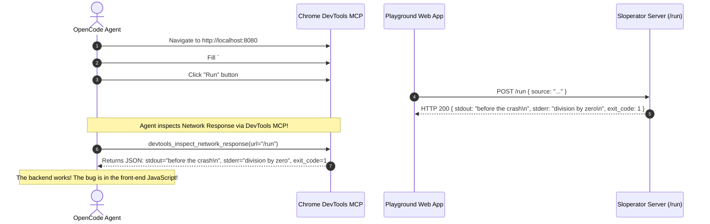

#AICoding #BrowserMCP #PlaywrightMCP #ChromeDevToolsMCP #ComputerUse #RuntimeTelemetry #DevOps #SystemDesign #OpenCode

> [!abstract] Executive Summary
> Connecting an AI agent to browser automation via the Model Context Protocol (MCP) elevates browser control into a first-class, standardized tool primitive. Two dominant local MCP servers power production browser engineering:
> 
> 1. **Playwright MCP (`@playwright/mcp`):** Engineered for **user flow simulation and accessibility-driven testing**. It excels at resilient locator-based interaction, cross-browser compatibility, and form automation.
> 2. **Chrome DevTools MCP (`chrome-devtools-mcp`):** Engineered by the Google Chrome DevTools team for **deep runtime introspection**. Beyond basic clicking and navigation, it provides direct access to network payload traces, source-mapped console errors, Lighthouse performance metrics, and JavaScript heap memory profiling.
> 
> By running both servers with the `--isolated` ephemeral flag, coding agents operate in clean, sandboxed browser profiles that prevent state contamination across test runs while safeguarding personal cookies from agent access.

---

## 1. Architectural Overview: Browser Automation via MCP

Instead of writing bespoke Playwright scripts for every minor UI question, an MCP server exposes browser automation primitives as callable JSON-RPC tools directly to the agent:

```
┌─────────────────────────────────────────────────────────────────────────────────────────┐
│                      BROWSER CONTROL VIA MODEL CONTEXT PROTOCOL                         │
└─────────────────────────────────────────────────────────────────────────────────────────┘

   ┌───────────────────────────────────────────────────────────────────────────────────┐
   │                                  OPENCODE HOST                                    │
   │                                                                                   │
   │   Exposes tools to model:                                                         │
   │   - `browser_navigate(url)`             - `browser_fill_form(selector, text)`     │
   │   - `browser_click(selector)`           - `browser_capture_screenshot()`          │
   │   - `devtools_inspect_network()`        - `devtools_get_console_errors()`         │
   └────────────────────────┬──────────────────────────────────┬───────────────────────┘
                            │ stdio (JSON-RPC 2.0)             │ stdio (JSON-RPC 2.0)
                            ▼                                  ▼
   ┌──────────────────────────────────┐     ┌──────────────────────────────────┐
   │          PLAYWRIGHT MCP          │     │        CHROME DEVTOOLS MCP       │
   │    (@playwright/mcp@0.0.80)      │     │    (chrome-devtools-mcp@latest)  │
   │                                  │     │                                  │
   │   • Accessibility tree snapshots │     │   • Network XHR/Fetch payloads   │
   │   • High-level semantic actions  │     │   • Source-mapped console errors │
   │   • Cross-browser testing        │     │   • Memory & Lighthouse traces   │
   └────────────────┬─────────────────┘     └────────────────┬─────────────────┘
                    │ Chrome DevTools Protocol (CDP)         │ Chrome DevTools Protocol (CDP)
                    ▼                                        ▼
   ┌───────────────────────────────────────────────────────────────────────────────────┐
   │                  ISOLATED CHROMIUM INSTANCE (--isolated flag)                     │
   │                  Ephemeral User Data Directory (`/tmp/playwright-mcp`)            │
   └───────────────────────────────────────────────────────────────────────────────────┘
```

---

## 2. Playwright MCP: High-Level User Flow Automation

Playwright MCP focuses on **driving the application from the user's perspective** using semantic accessibility trees by default.

### 2.1 Declarative Configuration in `opencode.jsonc`

```jsonc
{
  "$schema": "https://opencode.ai/config.json",
  "mcp": {
    "servers": {
      "playwright": {
        "type": "local",
        "command": [
          "bunx",
          "--bun",
          "@playwright/mcp@0.0.80",
          "--isolated",
          "--browser",
          "chromium"
        ]
      }
    }
  }
}
```

### 2.2 Key Execution Flags & Security Invariants
- **`--isolated`:** Spawns a disposable Chromium profile. LocalStorage, IndexedDB, and session cookies are stored in a temporary directory and wiped upon process exit. This guarantees **deterministic, repeatable test runs** and prevents sessions from polluting the developer's personal browser data.
- **`--browser chromium`:** Targets the Chromium rendering engine (can also target `firefox` or `webkit`).
- **`--caps=vision` (Optional):** Exposes coordinate-based vision tools if the active LLM supports multimodal image inputs.
- **Git Hygiene:** Always append `.playwright-mcp/` to `.gitignore` to prevent local browser cache directories from leaking into version control.

---

## 3. Chrome DevTools MCP: Deep Browser Internals

While Playwright MCP excels at user-level clicking, **Chrome DevTools MCP** goes directly into the Chrome DevTools Protocol (CDP) engine to diagnose network failures, asynchronous race conditions, and performance bottlenecks.

### 3.1 Declarative Configuration in `opencode.jsonc`

```jsonc
{
  "$schema": "https://opencode.ai/config.json",
  "mcp": {
    "servers": {
      "chrome-devtools": {
        "type": "local",
        "command": [
          "bunx",
          "--bun",
          "chrome-devtools-mcp@latest",
          "--isolated"
        ]
      }
    }
  }
}
```

### 3.2 Advanced Introspection Primitives
1. **Network Stream Analysis:** Inspects raw HTTP status codes, request/response headers, and JSON payloads for asynchronous background calls (`fetch`, `XHR`, `WebSockets`).
2. **Console Error Tracing:** Intercepts `console.error`, unhandled promise rejections, and applies local source maps to map minified bundle errors back to exact TypeScript source lines.
3. **Lighthouse Audits:** Automatically audits accessibility scores, Core Web Vitals (LCP, FID, CLS), and SEO compliance.
4. **Memory Profiling (`--memory-debugging`):** Captures V8 heap snapshots to detect memory leaks and detached DOM trees.

---

## 4. Playwright MCP vs. Chrome DevTools MCP: Architectural Matrix

```
┌─────────────────────────────────────────────────────────────────────────────────────────┐
│                    MCP BROWSER DRIVER COMPARISON MATRIX                                 │
└─────────────────────────────────────────────────────────────────────────────────────────┘
```

| Dimension | Playwright MCP (`@playwright/mcp`) | Chrome DevTools MCP (`chrome-devtools-mcp`) |
| :--- | :--- | :--- |
| **Primary Maintainer** | Microsoft Playwright Team | Google Chrome DevTools Team |
| **Core Philosophy** | **User-Centric Driving:** Emulate real human interaction flows. | **Diagnostic Introspection:** Deep telemetry and protocol debugging. |
| **Locators & Driving** | **Superior:** First-class Accessibility Tree snapshots, resilient semantic locators. | **Moderate:** Standard DOM selectors and basic snapshot trees. |
| **Network Inspection** | Basic (navigation events, resource URLs). | **Comprehensive:** Inspects raw request/response payloads, timing waterfalls. |
| **Console & Stack Traces** | Captures basic console text output. | **Comprehensive:** Full source-mapped V8 stack traces and warnings. |
| **Auditing & Perf** | None (focused on interaction). | **Built-in:** Lighthouse audits, performance timelines, V8 heap snapshots. |
| **Browser Engines** | Chromium, Firefox, WebKit. | Google Chrome / Chromium only. |
| **Best Used When** | Testing user journeys, E2E flows, form filling, cross-browser UI. | Debugging failing API calls, runtime exceptions, memory leaks, performance. |

---

## 5. Case Study: Diagnosing the Sloperator Crash Output Defect

### 5.1 The Defect Specification
In the Sloperator playground, running code with both early valid output and a subsequent runtime failure:

```slop
hallucinate("before the crash")✨
hallucinate(1 / 0)✨
```

Expected behavior: The output pane `#output` should display `before the crash\n` followed by the runtime error `division by zero`.  
Actual behavior: The `#output` container renders completely blank!

### 5.2 Root-Cause Diagnosis via Chrome DevTools MCP



Upon inspecting the network payload via `chrome-devtools-mcp`, the agent confirms the backend returned:
```json
{
  "stdout": "before the crash\n",
  "stderr": "division by zero\n",
  "exit_code": 1
}
```

However, the front-end JavaScript contained an error-handling bug:
```javascript
// ❌ BUGGY FRONT-END: Discards stdout if exit_code is non-zero
fetch('/run', { method: 'POST', body: JSON.stringify({ source }) })
  .then(res => res.json())
  .then(data => {
    if (data.exit_code === 0) {
      document.querySelector('#output').textContent = data.stdout;
    } else {
      // Bug: Replaced output with nothing or threw unhandled exception!
      document.querySelector('#output').textContent = ''; 
    }
  });
```

### 5.3 Remediation: Concatenating Output Streams

```javascript
// ✅ CORRECT FRONT-END: Displays both stdout and stderr
fetch('/run', { method: 'POST', body: JSON.stringify({ source }) })
  .then(res => res.json())
  .then(data => {
    const combinedOutput = (data.stdout || '') + (data.stderr || '');
    document.querySelector('#output').textContent = combinedOutput;
  });
```

---

## 6. Verification Pipeline: Boot.dev CLI Assertions

```bash
# 1. Assert opencode.jsonc configures chrome-devtools while playwright is disabled
cat opencode.jsonc | jq '.mcp.servers | .playwright.disabled == true and (."chrome-devtools" | .type == "local" and .disabled != true and .command[0] == "bunx" and (.command | index("--bun") != null) and (.command | index("--isolated") != null) and any(.command[]; test("^chrome-devtools-mcp(@|$)")))'
# Asserts: true

# 2. Assert backend /run API returns both stdout and stderr
curl -X POST http://localhost:8080/run -H "Content-Type: application/json" -d '{"source": "hallucinate(\"before the crash\")✨ hallucinate(1 / 0)✨"}'
# Asserts: .stdout == "before the crash\n", .exit_code == 1, .stderr contains "division by zero"

# 3. Submit solution
bootdev run -s 6b542c03-bef2-4140-900d-a0300a67dcf9
```
