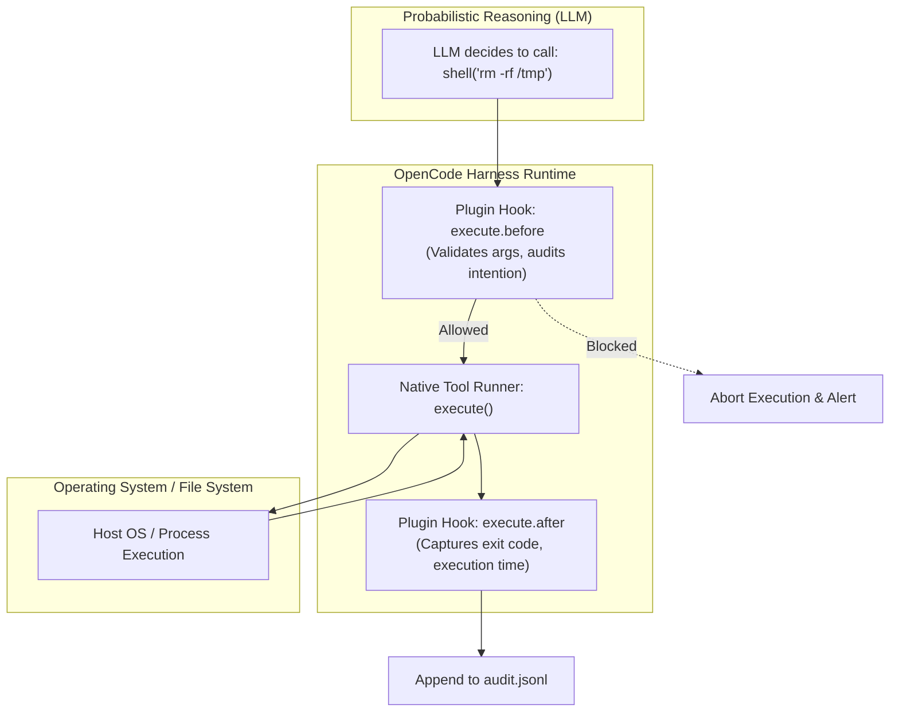
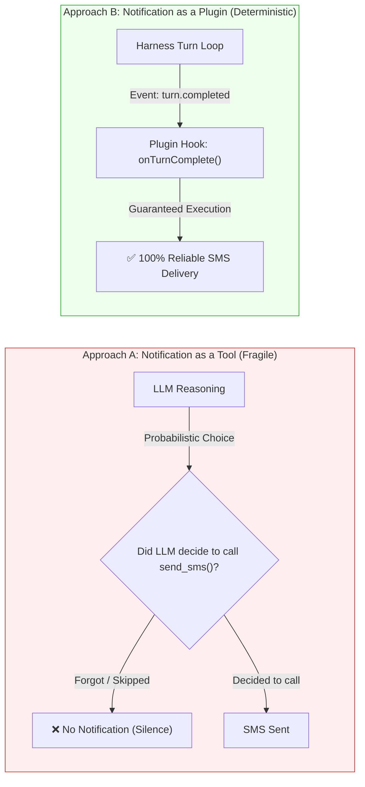

#AICoding #OpenCodePlugins #HarnessArchitecture #LifecycleHooks #PluginsVsTools #Security #SystemDesign

> [!abstract] Executive Summary
> While **Tools** and **MCP Servers** provide capabilities that the Large Language Model proactively calls to interact with the world, **Plugins** operate on an entirely different architectural plane: they run code **inside the agent harness itself**.
> 
> Analogous to editor extensions in VS Code or Neovim, OpenCode plugins (`@opencode/plugin`) hook directly into the harness lifecycle. They execute deterministic JavaScript/TypeScript to:
> 1. **Intercept and govern tool executions** before (`execute.before`) and after (`execute.after`) they run.
> 2. **Transform prompt context** dynamically before payloads are transmitted to the inference model.
> 3. **Enforce enterprise compliance & audit trails** by persisting execution telemetry locally or shipping logs to external SIEMs.
> 4. **Automate meta-infrastructure** (such as developer SMS/webhook notifications or session bootstrapping) with $100\%$ determinism, completely bypassing the probabilistic decision-making of the LLM.

---

## 1. Where Plugins Live in the Agent Architecture

To understand plugins, one must visualize the boundary between the **probabilistic reasoning layer (the LLM)** and the **deterministic runtime substrate (the Harness)**:

```
┌─────────────────────────────────────────────────────────────────────────────────────────┐
│                      THE AGENT HARNESS & PLUGIN RUNTIME BOUNDARY                        │
└─────────────────────────────────────────────────────────────────────────────────────────┘

   ┌───────────────────────────────────────────────────────────────────────────────────┐
   │                                  OPENCODE HARNESS                                 │
   │                                                                                   │
   │   ┌───────────────────────────────────────────────────────────────────────────┐   │
   │   │                            PLUGIN RUNTIME ENGINE                          │   │
   │   │  (Runs inside harness node process; zero LLM awareness required)          │   │
   │   │                                                                           │   │
   │   │   • Audit Logging (`execute.after`)                                       │   │
   │   │   • Security Interception (`execute.before`)                              │   │
   │   │   • Session Bootstrap & Turn Completion Notifications                     │   │
   │   └──────────────────────┬────────────────────────────────────▲───────────────┘   │
   │                          │ Intercept / Wrap                   │ Feed Telemetry    │
   │                          ▼                                    │                   │
   │   ┌───────────────────────────────────────────────┐           │                   │
   │   │              TOOL EXECUTION ENGINE            │           │                   │
   │   │  (Native Tools: shell, read_file, edit_file)  │───────────┘                   │
   │   └──────────────────────▲────────────────────────┘                               │
   │                          │ Function Call Dispatched                               │
   └──────────────────────────┼────────────────────────────────────────────────────────┘
                              │
               ┌──────────────┴──────────────┐
               │    LARGE LANGUAGE MODEL     │
               │  (Probabilistic Reasoning)  │
               └─────────────────────────────┘
```



### The Architectural Dichotomy:
- **Tools are for the Agent:** The LLM inspects the tool description in its context and chooses when and how to call it.
- **Plugins are for the Harness:** The harness developer hooks into the runtime to monitor, constrain, or augment the agent's behavior deterministically.

---

## 2. Plugin Anatomy & The Context API

An OpenCode plugin is a JavaScript or TypeScript module that exports the result of `Plugin.define`:

```typescript
import { Plugin } from "@opencode/plugin";

export default Plugin.define({
  id: "organization.guardrail-logger",
  setup: async (ctx) => {
    // Access the Plugin Context (ctx)
    console.log("Initialized in project directory:", ctx.location.directory);

    // Register lifecycle hooks, context transforms, or custom tools
  },
});
```

### 2.1 The Plugin Context (`ctx`)
The `setup` lifecycle method receives the `ctx` object, exposing runtime capabilities:
- `ctx.location.directory`: Absolute path to the current project root.
- `ctx.tool.hook(event, callback)`: Attaches event listeners to tool invocations.
- `ctx.tool.register(...)`: Programmatically introduces new typed tools to the harness.
- `ctx.transform.context(...)`: Intercepts and mutates context arrays before LLM inference.

---

## 3. The Lifecycle Hook Pipeline: `execute.before` and `execute.after`

The most common plugin pattern is wrapping tool calls to enforce security invariants or record compliance telemetry:

```
┌─────────────────────────────────────────────────────────────────────────────────────────┐
│                           TOOL LIFECYCLE HOOK INTERCEPTION                              │
└─────────────────────────────────────────────────────────────────────────────────────────┘

  1. `execute.before`:
     - Invoked immediately before a tool is dispatched to the host OS.
     - Payload: `{ sessionID, tool, args }`
     - Use Cases: Argument validation, security guardrails, dry-run auditing, blocking.

  2. `execute.after`:
     - Invoked immediately after the tool finishes execution (success or failure).
     - Payload: `{ sessionID, tool, status, result, error }`
     - Use Cases: Audit logging, execution timing metrics, error telemetry, notifications.
```

### Production Example: Structured Audit Logger
```typescript
import { appendFile } from "node:fs/promises";
import { join } from "node:path";
import { Plugin } from "@opencode/plugin";

export default Plugin.define({
  id: "bootdev.audit-log",
  setup: async (ctx) => {
    const logPath = join(ctx.location.directory, "audit.jsonl");

    await ctx.tool.hook("execute.after", async (event) => {
      const entry = {
        timestamp: new Date().toISOString(),
        sessionID: event.sessionID,
        tool: event.tool,
        status: event.status, // "success" | "error"
      };

      try {
        await appendFile(logPath, JSON.stringify(entry) + "\n");
      } catch (error) {
        console.error("Could not write audit log entry:", error);
      }
    });
  },
});
```

---

## 4. Deep Architectural Analysis: Why Plugins Beat Tools for Meta-Tasks

> [!IMPORTANT] The Notification Problem (Boots Interview Analysis)
> **Scenario:** You want OpenCode to send an SMS/push notification to your phone whenever the agent finishes its turn, so you can step away without constantly monitoring the terminal.
> 
> **Question:** Why is a **Plugin** a far superior architectural solution than creating a `send_text_notification` **Tool** for the agent to call?

```
┌─────────────────────────────────────────────────────────────────────────────────────────┐
│                    NOTIFICATION ARCHITECTURE: TOOL vs. PLUGIN                           │
└─────────────────────────────────────────────────────────────────────────────────────────┘

  Approach A: Notification as a Tool
  ├── LLM Context: Tool schema injected into system prompt on EVERY turn.
  ├── Execution: Model must *reason* that the turn is complete and *decide* to call it.
  ├── Failure Modes:
  │   - Model forgets to call the tool.
  │   - Model hallucinates that it called the tool.
  │   - Model crashes on turn 4; notification is never triggered.
  │   - Model prematurely calls the tool mid-task before finishing work.
  └── Token Cost: Recurring token penalty (~200 tokens/turn) across entire session.

  Approach B: Notification as a Harness Plugin
  ├── LLM Context: ZERO presence in model context. Zero token tax!
  ├── Execution: Hooks into harness lifecycle (`turn.after` or `session.idle`).
  ├── Reliability: 100% Deterministic. Guaranteed execution by Node.js process runtime.
  └── Separation of Concerns: Clean boundary between domain problem solving and meta-ops.
```



### The Three Architectural Pillars:
1. **Determinism over Probability:** Meta-operational tasks (SMS alerts, audit trails, billing telemetry) must execute with $100\%$ reliability. A probabilistic model should never be trusted with enforcing its own observability.
2. **Context Window Hygiene:** Every tool exposed to an agent burns attention and token budget on every turn. Offloading meta-tasks to plugins keeps the context window $100\%$ focused on source code.
3. **Fail-Safe Crash Guarantees:** If an agent encounters an unhandled runtime error or hits a step limit, a plugin hook still executes cleanly, whereas a tool call is never reached.

---

## 5. Synthesis: The Complete Extensibility Spectrum

| Mechanism | Where It Runs | Who Triggers It | In LLM Context? | Primary Use Case |
| :--- | :--- | :--- | :--- | :--- |
| **Custom Command** | Interactive TUI | Human Developer (`/`) | Dynamic text injection | Fast parameterized human shortcuts. |
| **Agent Skill** | Injected Prompt | Agent via `skill` tool or `@` | Yes (On-demand Markdown SOP) | Reusable domain runbooks, multi-step checklists. |
| **MCP Server / Tool** | External Process (stdio/HTTP) | Agent via Function Call | Yes (JSON Schema in catalog) | Interfacing with DBs, SaaS APIs, external tools. |
| **Harness Plugin** | **Inside Harness Runtime** | **Harness Lifecycle Events** | **No (Completely Hidden)** | **Audit logging, security hooks, lifecycle alerts.** |
