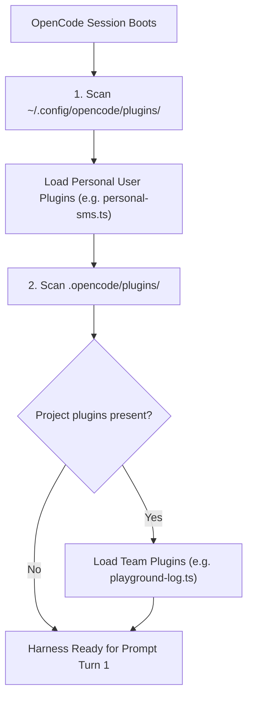
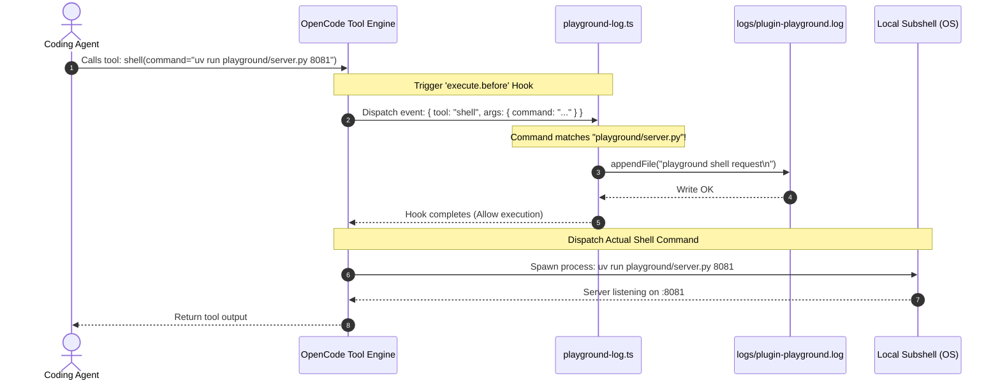

#AICoding #OpenCodePlugins #PluginRuntime #Bun #DependencyManagement #Guardrails #SystemDesign

> [!abstract] Executive Summary
> Authoring production-ready plugins for agent harnesses requires managing module resolution, runtime scoping, and asynchronous file operations. OpenCode enforces a strict **two-tier discovery hierarchy**:
> - **Project-Level Plugins (`.opencode/plugins/`):** Committed directly to version control to establish consistent, team-wide operational guardrails and audit pipelines.
> - **Global Plugins (`~/.config/opencode/plugins/`):** Scoped to the individual developer's local user account for personal telemetry and notifications.
> 
> Because plugins run as native ES modules, dependency management is centralized in `.opencode/package.json` utilizing modern runtimes (Bun/Node). This architectural pattern is demonstrated through **Pre-Execution Shell Interception**: intercepting the native `shell` tool via `execute.before` to inspect command strings and record immutable audit logs before child processes are spawned on the host OS.

---

## 1. Plugin Scoping & Resolution Hierarchy

OpenCode discovers and initializes plugins automatically at session startup by traversing two distinct directory roots:

```
┌─────────────────────────────────────────────────────────────────────────────────────────┐
│                      TWO-TIER PLUGIN RESOLUTION HIERARCHY                               │
└─────────────────────────────────────────────────────────────────────────────────────────┘

     [ Level 1: Global User Plugins ]
     Path: ~/.config/opencode/plugins/*.{ts,js}
     • Scope: System user account (cross-project).
     • Purpose: Personal developer workflows (e.g. sending SMS notifications to personal phone).
     • Lifecycle: Loaded in every OpenCode session across all repositories on the workstation.

     [ Level 2: Project-Level Plugins ]
     Path: .opencode/plugins/*.{ts,js}
     • Scope: Specific repository repository root.
     • Purpose: Team policies, repository guardrails, project-specific audit logs, custom CI tools.
     • Lifecycle: Loaded only when OpenCode is launched within that project directory.
```



---

## 2. Dependency Management & Package Isolation

Plugins often require external libraries (such as database drivers, Discord webhooks, or `@opencode/plugin` types). OpenCode structures plugin dependencies locally within the `.opencode/` directory rather than polluting the root application's `package.json`:

### 2.1 Project Layout
```text
my-repository/
├── .gitignore
├── src/
├── playground/
└── .opencode/
    ├── package.json          <-- Plugin manifest
    ├── node_modules/         <-- Installed plugin dependencies (Git ignored)
    └── plugins/
        └── playground-log.ts <-- Custom plugin module
```

### 2.2 Declaring `.opencode/package.json`
```json
{
  "name": "course-learn-ai-coding",
  "private": true,
  "type": "module",
  "dependencies": {
    "@opencode/plugin": "2.0.3"
  }
}
```

### 2.3 Installation & Git Hygiene
Dependencies are installed using **Bun** (or Node/pnpm) directly within the `.opencode/` folder:

```bash
# Navigate to plugin configuration directory
cd .opencode

# Install dependencies using Bun
bun install

# In project root .gitignore:
echo ".opencode/node_modules/" >> .gitignore
```

---

## 3. Production Case Study: The Playground Shell Logger Guardrail

### 3.1 The Engineering Requirement
To monitor agent interactions with a local test daemon, the engineering team mandates an audit trail:
> *"Before the agent's `shell` tool runs any command containing `playground/server.py`, a project-level plugin must intercept the execution and append `'playground shell request'` to `logs/plugin-playground.log`."*

---

### 3.2 Plugin Implementation: `.opencode/plugins/playground-log.ts`

```typescript
import { appendFile, mkdir } from "node:fs/promises";
import { dirname, join } from "node:path";
import { Plugin } from "@opencode/plugin";

export default Plugin.define({
  id: "bootdev.playground-log",
  setup: async (ctx) => {
    // 1. Resolve deterministic log path relative to project root
    const logPath = join(ctx.location.directory, "logs", "plugin-playground.log");

    // 2. Attach an asynchronous pre-execution hook to the tool engine
    await ctx.tool.hook("execute.before", async (event) => {
      // Check if the intercepted tool is 'shell' and inspect its command argument
      if (
        event.tool === "shell" &&
        typeof event.args?.command === "string" &&
        event.args.command.includes("playground/server.py")
      ) {
        try {
          // Ensure destination directory exists prior to writing
          await mkdir(dirname(logPath), { recursive: true });

          // Append audit record with trailing newline
          await appendFile(logPath, "playground shell request\n", "utf8");
        } catch (error) {
          console.error("[playground-log] Failed to write audit record:", error);
        }
      }
    });
  },
});
```



### 3.3 Key Architectural Patterns in This Implementation:
1. **Defensive Directory Creation (`mkdir -p`):** Calling `await mkdir(dirname(logPath), { recursive: true })` ensures that writing will not fail even if the `logs/` directory has not yet been initialized.
2. **Synchronous Interception Guarantee:** Because `execute.before` is an `await`-ed async promise, the harness halts process spawning until the plugin hook finishes writing. This guarantees the log entry is persisted **before** the shell command can execute or crash.
3. **Hot-Reloading in OpenCode:** After authoring or editing a plugin file, developers can execute the `/reload` TUI command to re-initialize all plugin modules without restarting the OpenCode daemon.

---

## 4. Automated Grader Validation Pipeline

Automated testing pipelines (e.g. Boot.dev CLI) verify both the **module interface compliance** and the **runtime side-effects** of the plugin:

```bash
# 1. Module Export Interface Verification
bun -e 'import plugin from "./.opencode/plugins/playground-log.ts"; if (typeof plugin.setup !== "function") process.exit(1);'
# Asserts: Exit code 0 (Valid Plugin.define export with a setup function)

# 2. Side-Effect Assertion
cat logs/plugin-playground.log
# Asserts: stdout contains "playground shell request"

# 3. Submission Command
bootdev run -s a8e07a91-7f90-4d51-a717-120d0c20916c
```

---

## 5. Enterprise Guardrail Patterns with Plugins

Beyond simple audit logging, production teams leverage `execute.before` for **hard security guardrails**:

```typescript
// Example: Blocking destructive git commands inside CI/CD agent runs
await ctx.tool.hook("execute.before", async (event) => {
  if (event.tool === "shell") {
    const cmd = event.args?.command || "";
    if (cmd.includes("git push --force") || cmd.includes("rm -rf /")) {
      throw new Error(`[SECURITY VIOLATION] Prohibited command pattern: ${cmd}`);
    }
  }
});
```

By intercepting tool execution at the harness layer, the agent cannot bypass security rules through prompt injection or creative phrasing—the underlying host execution is aborted at the process level.
