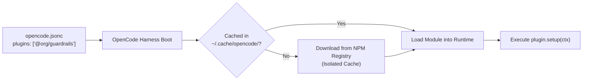
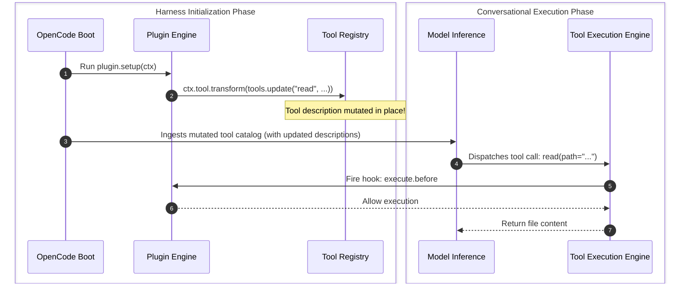

#AICoding #OpenCodePlugins #PluginTransforms #NPMDistribution #ToolSteering #SystemDesign #DevOps

> [!abstract] Executive Summary
> As agentic workflows scale across engineering teams, maintaining bespoke plugin scripts across dozens of repositories becomes an operational liability. OpenCode resolves this through two complementary primitives:
> 
> 1. **Declarative NPM Plugin Distribution:** Teams can package and distribute plugins via the public or private **npm registry**, declared in `opencode.jsonc` via the `plugins` array. OpenCode isolates each plugin and its dependencies within an out-of-tree cache, eliminating dependency conflicts with application code.
> 2. **Plugin Transform Pipelines (`ctx.tool.transform`):** While *Hooks* intercept runtime execution events, *Transforms* allow plugins to inspect and mutate the **static metadata definitions** of tools, agents, and models during the harness initialization phase.
> 
> By utilizing transforms to augment tool descriptions (e.g. instructing an agent to check templates before editing generated code, or steering single-file runners toward test suites), teams steer LLM behavior dynamically without altering the underlying tool implementations.

---

## 1. Declarative NPM Plugin Distribution

Instead of committing and manually syncing raw TypeScript files across multiple repositories, teams package plugins as standard npm packages (`@organization/opencode-guardrails`).

```
┌─────────────────────────────────────────────────────────────────────────────────────────┐
│                    DECLARATIVE NPM PLUGIN INSTALLATION TOPOLOGY                         │
└─────────────────────────────────────────────────────────────────────────────────────────┘

     Repository Config: ./opencode.jsonc
     {
       "plugins": [
         "opencode-audit-logger",
         "@my-org/security-guardrails"
       ]
     }
                           │
                           │ OpenCode Bootstrapping
                           ▼
     Isolated Global Cache: ~/.cache/opencode/plugins/
     ├── opencode-audit-logger@1.2.0/ (Isolated node_modules)
     └── @my-org/security-guardrails@2.0.1/ (Isolated node_modules)
```



### 1.1 Declarative Configuration in `opencode.jsonc`
```jsonc
{
  "$schema": "https://opencode.ai/config.json",
  "plugins": [
    "opencode-example-plugin",
    "@my-org/custom-compliance-plugin"
  ]
}
```

### 1.2 Isolation & Cache Guarantees
- **No Root Contamination:** Plugins listed in `opencode.jsonc` do **not** touch the repository's root `package.json` or `node_modules/`.
- **Version Pinning:** Packages can specify exact semver constraints (e.g., `@my-org/plugin@^2.1.0`).
- **Scoping:**
  - **Project Config (`./opencode.jsonc`):** Shared across the entire development team via Git.
  - **Global Config (`~/.config/opencode/opencode.jsonc`):** Personal developer tools active across all local repositories.

### 1.3 CLI Introspection Commands
```bash
# List all actively configured plugins (ID, version, source)
opencode plugin list

# Sample output:
# ID                              VERSION   SOURCE
# @my-org/custom-compliance       2.1.0     npm
# bootdev.playground-log          local     .opencode/plugins/playground-log.ts

# List plugins including OpenCode built-in native plugins
opencode plugin list --builtin
```

---

## 2. Hooks vs. Transforms: The Two Extensibility Primitives

Understanding the structural difference between **Lifecycle Hooks** and **Definition Transforms** is fundamental to plugin architecture:

```
┌─────────────────────────────────────────────────────────────────────────────────────────┐
│                          HOOKS vs. TRANSFORMS ARCHITECTURE                              │
└─────────────────────────────────────────────────────────────────────────────────────────┘

     [ Transforms: Initialization Phase ]
     • Trigger: Harness boot / configuration registration.
     • Target: Tool, Agent, and Model DEFINITIONS (metadata, descriptions, schemas).
     • Method: `ctx.tool.transform((tools) => { ... })`
     • Purpose: Modifying *what the model knows* about capabilities before any turn starts.

     [ Hooks: Runtime Phase ]
     • Trigger: Tool invocation during conversational turns.
     • Target: Tool EXECUTION events (`execute.before`, `execute.after`).
     • Method: `ctx.tool.hook("execute.before", async (event) => { ... })`
     • Purpose: Monitoring, auditing, or blocking *what code runs* on the operating system.
```



---

## 3. Tool Transforms: Dynamic Prompt & Schema Steering

A common challenge in large software projects is **steering model behavior without breaking tool implementations**. 

For example, when an agent works with auto-generated files (e.g., GraphQL types, Protobuf outputs, ORM migrations), it often tries to edit the generated code directly. In the next build, those manual edits are obliterated.

Instead of hacking the core `read` or `edit` tool, a plugin applies a **Tool Transform**:

### 3.1 Example: Preventing Direct Edits on Generated Code
```typescript
import { Plugin } from "@opencode/plugin";

export default Plugin.define({
  id: "organization.generated-file-guard",
  setup: async (ctx) => {
    // Intercept the tool registry during initialization
    await ctx.tool.transform((tools) => {
      // Find the existing 'read' tool definition
      tools.update("read", (tool) => {
        // Append an authoritative steering constraint to the prompt description
        tool.description += 
          "\nFor generated files (e.g., *.pb.go, *.generated.ts), locate and edit the source template or schema before proposing changes.";
      });
    });
  },
});
```

### 3.2 Architectural Benefits of Transforms:
1. **Zero Implementation Drift:** The underlying `read` execution logic remains $100\%$ untouched.
2. **Context-Accurate System Prompts:** Because tool descriptions are passed directly to the LLM's tool catalog, mutating the description directly influences the model's token attention.
3. **Composable Customization:** Multiple plugins can chain transforms on the same tool sequentially without collision.

---

## 4. Case Study: Steering the `run_slop` Tool

### 4.1 The Problem
In the Sloperator language repository, developers use a custom tool named `run_slop` to execute individual SlopLang scripts. However, coding agents often abuse `run_slop` by running it sequentially across 50 separate files to verify a change, wasting enormous amounts of time and API tokens instead of executing the project's automated regression test suite.

### 4.2 The Solution
We attach a tool transform to `.opencode/plugins/run-slop.ts` that appends clear usage guidance:
> *"Use this tool to run individual .slop examples when checking language behavior. Use the test suite for regression testing."*

---

### 4.3 Implementation: `.opencode/plugins/run-slop.ts`

```typescript
import { Plugin, Tool } from "@opencode/plugin";

export default Plugin.define({
  id: "bootdev.run-slop",
  setup: async (ctx) => {
    // 1. Initial tool registration (existing tool capability)
    await ctx.tool.register(
      Tool.define({
        name: "run_slop",
        description: "Executes a SlopLang source file and returns its output.",
        parameters: {
          type: "object",
          properties: {
            filepath: {
              type: "string",
              description: "Path to the .slop file to execute",
            },
          },
          required: ["filepath"],
        },
        execute: async (args) => {
          // Implementation: runs sloperator interpreter
          return `Executed ${args.filepath}`;
        },
      })
    );

    // 2. Transform pipeline: Mutate run_slop's description post-registration
    await ctx.tool.transform((tools) => {
      tools.update("run_slop", (tool) => {
        tool.description +=
          "\nUse this tool to run individual .slop examples when checking language behavior. Use the test suite for regression testing.";
      });
    });
  },
});
```

---

## 5. Verification & Grader Assertions

When automated verification engines (such as the Boot.dev CLI) evaluate transform plugins, they verify that the code implements the transform interface and alters the description without touching the underlying execution logic:

```bash
# 1. Structural check of transform and update calls
cat .opencode/plugins/run-slop.ts
# Checks presence of:
# - .transform(
# - .update(
# - run_slop
# - "Use this tool to run individual .slop examples when checking language behavior. Use the test suite for regression testing."

# 2. Module execution check via Bun
bun -e 'import plugin from "./.opencode/plugins/run-slop.ts"; if (typeof plugin.setup !== "function") process.exit(1);'
# Asserts: Exit code 0

# 3. Submission command
bootdev run -s 09579064-7743-40c0-bd31-69ad75c38c78
```

---

## 6. Synthesis: The Complete Plugin Capability Matrix

| Plugin Capability | API Method | Execution Time | Primary Target |
| :--- | :--- | :--- | :--- |
| **Tool Execution Interception** | `ctx.tool.hook("execute.before")` | Pre-Execution | Inspect/block shell commands, validate args. |
| **Audit & Metric Logging** | `ctx.tool.hook("execute.after")` | Post-Execution | Log exit codes, durations, write `audit.jsonl`. |
| **Tool Definition Transforms** | `ctx.tool.transform(tools.update)` | Harness Boot | Steer LLM attention via mutated descriptions. |
| **Custom Tool Registration** | `ctx.tool.register(Tool.define)` | Harness Boot | Expose new typed JavaScript/TS tools. |
| **Context Pre-Processing** | `ctx.transform.context(...)` | Pre-Inference | Strip credentials, inject repo metadata. |
