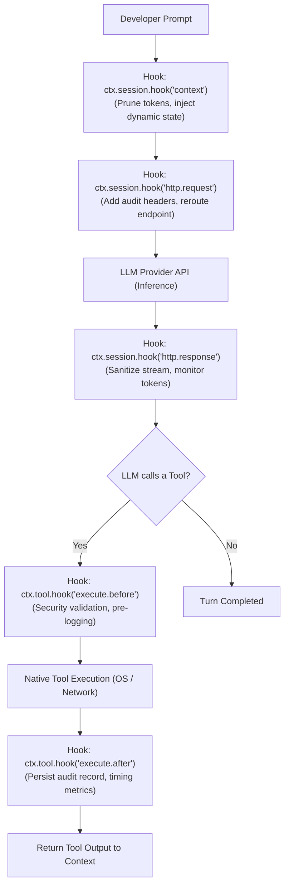
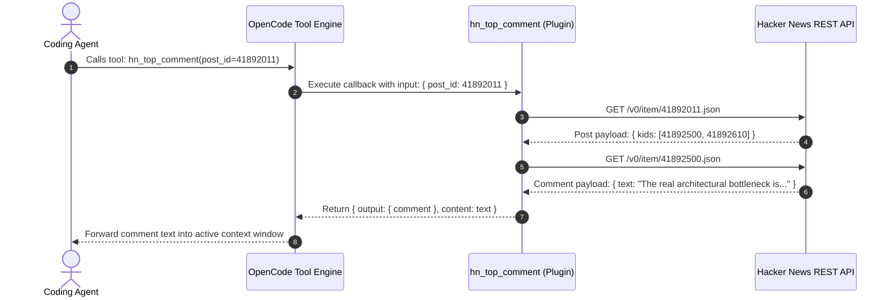

#AICoding #OpenCodePlugins #PluginHooks #PluginTools #RuntimeInterception #ProviderHooks #SystemDesign #OpenCode

> [!abstract] Executive Summary
> OpenCode's plugin architecture exposes deep, programmatic control over the entire agent lifecycle through two complementary subsystems:
> 
> 1. **Runtime Hook Pipelines (`ctx.tool.hook` & `ctx.session.hook`):** Unlike transforms that mutate static definitions during initialization, hooks intercept **live operations in flight**. Plugins can inspect or modify tool executions (`execute.before`/`after`), dynamically rewrite conversation context before inference (`context`), and intercept raw HTTP traffic to model providers (`http.request`/`response`).
> 2. **Native Custom Tools via `tools.add()`:** In OpenCode, every custom in-process tool is registered through a plugin. Plugins bundle deterministic execution code (database drivers, third-party APIs, specialized calculations) with typed JSON input/output schemas, packaging tools alongside commands, skills, and hooks into unified, distributable extensions.

---

## 1. The Runtime Hook Taxonomy

OpenCode structures runtime events into two primary hook namespaces: **Tool Hooks** (`ctx.tool.hook`) and **Session Hooks** (`ctx.session.hook`):

```
┌─────────────────────────────────────────────────────────────────────────────────────────┐
│                           OPENCODE RUNTIME HOOK TAXONOMY                                │
└─────────────────────────────────────────────────────────────────────────────────────────┘

     [ Tool Lifecycle Hooks ]
     • `execute.before`: Fires before a tool runs. Can validate args, log intention, or abort.
     • `execute.after`: Fires after tool completion. Receives status, exit code, and outputs.

     [ Session & Inference Hooks ]
     • `context`: Intercepts system prompts, chat history, and tool lists right before LLM call.
     • `http.request`: Inspects or mutates raw HTTP headers/body dispatched to model providers.
     • `http.response`: Inspects, filters, or overrides the raw completion payload from the API.
```



---

## 2. Deep Dive: The Five Critical Runtime Hooks

### 2.1 `execute.before` (Pre-Tool Interception)
Executes before the harness dispatches a command to the operating system or an internal driver.
- **Payload:** `{ sessionID: string, tool: string, args: Record<string, any> }`
- **Primary Use:** Hard security gates, parameter sanitization, and dry-run validation.

```typescript
ctx.tool.hook("execute.before", async (event) => {
  if (event.tool === "shell" && event.args?.command?.includes("sudo")) {
    throw new Error("[SECURITY VIOLATION] Elevated privileges prohibited in agent sessions.");
  }
});
```

### 2.2 `execute.after` (Post-Tool Telemetry)
Fires after a tool succeeds, throws, or exits.
- **Payload:** `{ sessionID: string, tool: string, status: "success" | "error", result?: any, error?: Error }`
- **Primary Use:** Centralized audit trails, duration tracking, alerting pipelines.

### 2.3 `context` (Pre-Inference Context Transformation)
Fires immediately before the assembled conversation history and system instructions are serialized for inference.
- **Primary Use:** Stripping plain-text secrets, dynamically injecting live repository metrics, or pruning long message threads.

```typescript
ctx.session.hook("context", async (context) => {
  // Dynamically append real-time sprint status to system prompt
  context.system += "\nActive Sprint: Q4 Performance Hardening.";
});
```

### 2.4 `http.request` and `http.response` (Provider Network Hooks)
Intercepts the low-level HTTP transport layer connecting OpenCode to LLM inference providers (Anthropic, OpenAI, local Ollama).
- **`http.request`:** Injects custom tracking headers (`X-Organization-ID`), routes traffic through corporate enterprise proxies, or implements client-side prompt caching headers.
- **`http.response`:** Intercepts provider response payloads to monitor billing tokens, detect content-filtering flags, or log raw generation streams.

---

## 3. Hook Execution Semantics & Defensive Architecture

Hooks run asynchronously inside the core agent harness loop. Because of their privileged position, poorly written hooks can destabilize the entire agent session:

```
┌─────────────────────────────────────────────────────────────────────────────────────────┐
│                      DEFENSIVE HOOK ENGINEERING INVARIANTS                              │
└─────────────────────────────────────────────────────────────────────────────────────────┘

  1. Sequential Execution Order:
     Hook callbacks execute strictly in the order they were registered. If Plugin A registers
     before Plugin B, Plugin A's hook completes before Plugin B begins.

  2. Fail-Closed Behavior (Unhandled Exceptions):
     If any hook callback throws an unhandled Error, the intercepted operation FAILS.
     - A throwing `execute.before` cancels the tool execution.
     - A throwing `http.request` aborts the LLM API call.
     RULE: Always wrap non-critical telemetry hooks in internal `try/catch` blocks!

  3. Non-Blocking Latency Budget:
     Hooks run on the harness thread. Blocking operations (e.g. slow synchronous network
     pings) directly increase agent response latency. Keep hooks sub-millisecond.
```

---

## 4. Registering Native Custom Tools via `tools.add()`

In OpenCode, **all custom in-process tools are registered through plugins**. 

While an Agent Skill (`SKILL.md`) provides natural-language procedural instructions, a **Tool** provides deterministic executable code with strictly typed input and output contracts.

### 4.1 The Registration Syntax
To register a tool, call `tools.add()` inside a `ctx.tool.transform()` callback:

```typescript
import { Plugin } from "@opencode/plugin";

export default Plugin.define({
  id: "my-org.tools",
  setup: async (ctx) => {
    await ctx.tool.transform((tools) => {
      tools.add({
        name: "my_tool",
        description: "Authoritative description steering LLM tool selection",
        input: {
          type: "object",
          properties: {
            parameter_name: { type: "string" },
          },
          required: ["parameter_name"],
          additionalProperties: false,
        },
        output: {
          type: "object",
          properties: {
            result_data: { type: "string" },
          },
          required: ["result_data"],
          additionalProperties: false,
        },
        execute: async (input) => {
          // Deterministic execution code
          return {
            output: { result_data: "Processed value" },
            content: "Markdown string returned to active context",
          };
        },
        options: {
          codemode: false, // Expose directly in native tool schema
        },
      });
    });
  },
});
```

### 4.2 Tool Naming & Collisions
- **Normalization:** Tool names are normalized into lowercase strings with underscores.
- **Collision Policy:** Duplicate tool names collide and overwrite earlier registrations. 
- **Namespace Best Practice:** Prefix custom tools with an organization or domain identifier (e.g., `hn_top_comment`, `billing_refund`, `github_issue_lookup`) rather than attempting to override built-in primitives like `shell` or `read`.

---

## 5. Production Case Study: The Hacker News Top Comment Plugin

To examine how plugins combine external HTTP fetching, JSON traversal, and typed tool contracts, consider the `bootdev.hn-top-comment` plugin:

```typescript
import { Plugin } from "@opencode/plugin";

type HNItem = {
  text?: string;
  kids?: number[];
};

// Helper: Fetch item from Hacker News Firebase REST API
async function getItem(id: number): Promise<HNItem | null> {
  const res = await fetch(`https://hacker-news.firebaseio.com/v0/item/${id}.json`);
  if (!res.ok) {
    throw new Error(`Failed to fetch Hacker News item ${id}`);
  }
  return (await res.json()) as HNItem | null;
}

export default Plugin.define({
  id: "bootdev.hn-top-comment",
  setup: async (ctx) => {
    await ctx.tool.transform((tools) => {
      tools.add({
        name: "hn_top_comment",
        description: "Get the top comment for a Hacker News post by ID",
        input: {
          type: "object",
          properties: {
            post_id: {
              type: "number",
              description: "The numeric ID of the Hacker News post",
            },
          },
          required: ["post_id"],
          additionalProperties: false,
        },
        output: {
          type: "object",
          properties: {
            comment: { type: "string" },
          },
          required: ["comment"],
          additionalProperties: false,
        },
        execute: async (input) => {
          const { post_id } = input as { post_id: number };

          // Step 1: Retrieve parent post
          const post = await getItem(post_id);
          if (!post) {
            throw new Error(`Hacker News post ${post_id} was not found`);
          }

          // Step 2: Extract top-level child comment ID from 'kids' array
          const topCommentID = post.kids?.[0];
          const item = topCommentID ? await getItem(topCommentID) : null;
          const comment = item?.text ?? "The top comment's text is unavailable.";

          // Step 3: Return structured data and markdown content
          return {
            output: { comment },
            content: comment,
          };
        },
        options: {
          codemode: false,
        },
      });
    });
  },
});
```



---

## 6. Architectural Decision Matrix: Built-in Tools vs. MCP vs. Plugin Tools

```
┌─────────────────────────────────────────────────────────────────────────────────────────┐
│                      TOOL EXTENSION ARCHITECTURAL TRADEOFFS                             │
└─────────────────────────────────────────────────────────────────────────────────────────┘
```

| Dimension | Built-in Harness Tools | Model Context Protocol (`10_MCP/`) | Custom Plugin Tools (`12_Plugins/`) |
| :--- | :--- | :--- | :--- |
| **Execution Substrate** | In-process native Node/Bun | Out-of-process daemon (`stdio` / HTTP) | **In-process native Node/Bun** |
| **Definition Method** | Hardcoded in OpenCode core | JSON-RPC 2.0 handshake (`tools/list`) | **`tools.add()` in `ctx.tool.transform`** |
| **Cross-Client Portability** | OpenCode only | Universal (OpenCode, Claude, Cursor) | OpenCode plugin ecosystem |
| **IPC Overhead** | Zero ($< 0.1\text{ ms}$) | Process pipes or HTTP ($1\text{--}50\text{ ms}$) | **Zero ($< 0.1\text{ ms}$ direct function call)** |
| **Bundling Capabilities** | Standalone tools | Standalone tools and resources | **Bundles Tools + Hooks + Skills + Commands** |
| **Best Used When** | Fundamental OS I/O (`shell`, `read`) | Vendor SaaS APIs (Stripe, Notion, GitHub) | **Project-specific utilities, API integrations** |
