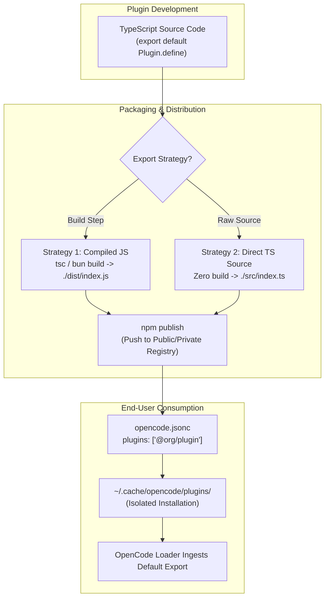

#AICoding #OpenCodePlugins #NPMDistribution #PublishingPlugins #ESM #TypeScriptDirect #PackageManifest #SystemDesign

> [!abstract] Executive Summary
> Distributing OpenCode plugins across organizations or the broader open-source ecosystem leverages the standard **Node Package Manager (npm)** ecosystem. Because OpenCode is built on native ECMAScript Modules (ESM), publishing a plugin requires zero proprietary bundling or bespoke packaging formats: a published plugin exports the exact same `Plugin.define` default export as a local `.opencode/plugins/*.ts` file.
> 
> When configuring package exports in `package.json`, authors can select between two architectural strategies:
> 1. **Compiled JavaScript (`./dist/index.js`):** TypeScript is pre-compiled via `tsc` or `bun build`. This guarantees universal runtime compatibility and eliminates runtime transpilation overhead.
> 2. **Direct TypeScript Source (`./src/index.ts`):** OpenCode's native loader transpiles TypeScript on the fly. Authors publish raw `.ts` source files directly, eliminating build pipelines and maintaining total symmetry between authoring and distribution.

---

## 1. Symmetrical Module Architecture

A key design achievement of OpenCode's extensibility engine is **architectural symmetry**: there is zero structural difference between a local scratch plugin and a published production npm package.

```
┌─────────────────────────────────────────────────────────────────────────────────────────┐
│                    LOCAL vs. PUBLISHED PLUGIN SYMMETRY                                  │
└─────────────────────────────────────────────────────────────────────────────────────────┘

     [ Local In-Repo Plugin ]                           [ Published NPM Plugin ]
     Path: .opencode/plugins/audit.ts                   Package: @org/opencode-audit
     ──────────────────────────────────                 ────────────────────────────
     import { Plugin } from "@opencode/plugin";         import { Plugin } from "@opencode/plugin";
     
     export default Plugin.define({                     export default Plugin.define({
       id: "org.audit",                                   id: "org.audit",
       setup: async (ctx) => { ... }                      setup: async (ctx) => { ... }
     });                                                });

     Installed via: Local directory discovery           Installed via: opencode.jsonc `plugins` array
```



---

## 2. The Two Package Export Strategies

The root `package.json` file dictates how OpenCode resolves the plugin entrypoint via the modern Node.js `exports` field:

```
┌─────────────────────────────────────────────────────────────────────────────────────────┐
│                      EXPORT STRATEGY COMPARISON MATRIX                                  │
└─────────────────────────────────────────────────────────────────────────────────────────┘
```

| Dimension | Strategy 1: Compiled JavaScript | Strategy 2: Direct TypeScript Source |
| :--- | :--- | :--- |
| **`exports` Target** | `"./dist/index.js"` | `"./src/index.ts"` |
| **Build Step** | Mandatory (`bun build` or `tsc`) | **None** (Zero build pipeline) |
| **Published Files** | `dist/` directory + type declarations | `src/` directory directly |
| **Startup Overhead** | **Zero** (Pure V8 JavaScript execution) | Minimal (JIT transpilation at boot) |
| **External Portability** | Runs on plain Node.js / Bun | Requires TypeScript-aware host runtime |
| **Best Suited For** | Large enterprise packages, public npm libraries | Internal team tools, rapid internal iteration |

---

## 3. Production Manifest Specification (`package.json`)

### 3.1 Strategy 1: Pre-Compiled JavaScript Distribution
```json
{
  "name": "my-slop-opencode-plugin",
  "version": "1.0.0",
  "description": "Enterprise audit logging and guardrail plugin for OpenCode",
  "type": "module",
  "exports": "./dist/index.js",
  "main": "./dist/index.js",
  "types": "./dist/index.d.ts",
  "files": [
    "dist",
    "README.md",
    "LICENSE"
  ],
  "scripts": {
    "build": "tsc -p tsconfig.build.json",
    "prepublishOnly": "npm run build"
  },
  "dependencies": {
    "@opencode/plugin": "2.0.3"
  },
  "devDependencies": {
    "typescript": "^5.4.0"
  }
}
```

### 3.2 Strategy 2: Direct TypeScript Distribution
Because OpenCode's host environment (built on Bun/Modern Node) natively parses and transpiles TypeScript files at load time, you can publish raw `.ts` files:

```json
{
  "name": "my-slop-opencode-plugin",
  "version": "0.1.0",
  "type": "module",
  "exports": "./src/index.ts",
  "files": [
    "src",
    "README.md"
  ],
  "dependencies": {
    "@opencode/plugin": "2.0.3"
  }
}
```

> [!TIP] The Simplicity of Direct TypeScript
> For internal organizational packages hosted on private npm registries (GitHub Packages, Artifactory), Strategy 2 eliminates the complexity of source maps, `tsconfig` compilation steps, and `.d.ts` generation.

---

## 4. Publishing & Consumption Lifecycle

```
┌─────────────────────────────────────────────────────────────────────────────────────────┐
│                       PUBLISH & CONSUMPTION PIPELINE                                    │
└─────────────────────────────────────────────────────────────────────────────────────────┘

  [ Step 1: Package Author ]
  $ npm login --registry=https://registry.npmjs.org
  $ npm publish --access=public
  ✔ Published my-slop-opencode-plugin@1.0.0 to registry

  [ Step 2: Consumer Configuration (Any Repository) ]
  // ./opencode.jsonc
  {
    "$schema": "https://opencode.ai/config.json",
    "plugins": [
      "my-slop-opencode-plugin@^1.0.0"
    ]
  }

  [ Step 3: Automated Resolution ]
  When OpenCode launches:
  1. Resolves package from npm registry into ~/.cache/opencode/plugins/
  2. Runs isolated `bun install` inside cache directory
  3. Imports default export and runs `plugin.setup(ctx)`
```

---

## 5. Architectural Checklist for Production Plugins

Before publishing an OpenCode plugin to npm, verify the following engineering standards:

1. **Deterministic Plugin ID:** Ensure `Plugin.define({ id: "..." })` uses a reverse-domain or namespaced identifier (e.g. `@org/plugin-name` $\implies$ `id: "org.plugin-name"`) to prevent ID collisions inside OpenCode's plugin registry.
2. **Lean Dependency Footprint:** Avoid bundling heavy dependencies. If your plugin only needs HTTP requests, use native global `fetch()` rather than importing `axios` or `got`.
3. **Graceful Failure Isolation:** Wrap all asynchronous hooks (`execute.before`, `execute.after`) in defensive `try/catch` blocks. An unhandled exception inside a hook will crash or abort the consumer's agent operations.
4. **Clean Session Teardown:** If your plugin initiates long-running timers, background watchers, or persistent TCP connections, register cleanup handlers to terminate them when the session closes.
