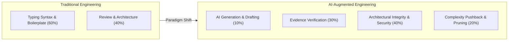
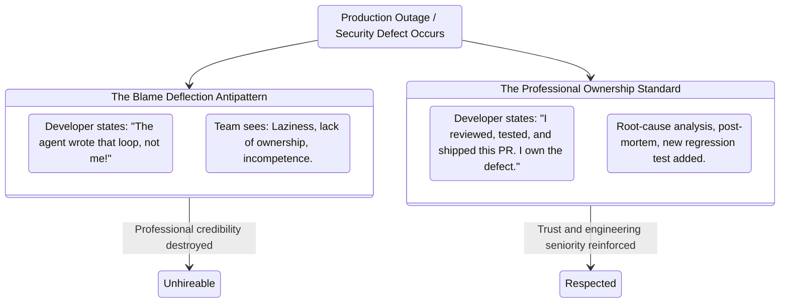

#AICoding #EngineeringBestPractices #Accountability #CodeOwnership #SoftwareArchitecture #CodeReview #SystemDesign

> [!abstract] Executive Summary
> In the era of autonomous coding agents, the primary economic and technical value of a software engineer has fundamentally decoupled from raw code generation. Lines of Code (LOC) have always been a liability rather than an asset; with AI reducing the marginal cost of code authoring to near zero, unbridled generation produces bloated, fragile "code slop."
> 
> The professional software engineer's true value now centers on five critical competencies:
> 1. **Architectural Comprehension:** Understanding not just *what* code does, but *why* a particular design pattern or system boundary is optimal.
> 2. **Security & Vulnerability Defense:** Defending the system against injection vectors, race conditions, memory leaks, and dependency bloat.
> 3. **Product & Complexity Judgment:** Knowing when to reject or simplify feature requests that introduce excessive latency, operational overhead, or cognitive complexity.
> 4. **Prompting & Verification Care:** Rigorously steering, evaluating, and testing AI output.
> 5. **Uncompromising End-to-End Accountability:** Shifting blame to an AI model (*"The agent wrote it"*) is professionally unacceptable. The engineer who authors the prompt and signs the pull request bears $100\%$ responsibility for production reliability, security, and maintainability.

---

## 1. The Value Shift: From Code Typist to System Arbiter

Before autonomous coding agents, engineers spent up to $70\%$ of their time on mechanical syntax translation: typing boilerplate, looking up language APIs, and writing straightforward CRUD handlers.

Today, coding harnesses generate boilerplate in seconds. However, this shifts the engineering bottleneck from **generation** to **evaluation and verification**:

```
┌─────────────────────────────────────────────────────────────────────────────────────────┐
│                    THE EVOLUTION OF SOFTWARE ENGINEERING VALUE                          │
└─────────────────────────────────────────────────────────────────────────────────────────┘

     [ The Legacy Value Model (Pre-AI) ]
     • Value Metric: Speed of typing, memorization of API signatures, raw LOC output.
     • Bottleneck: Keyboard speed, syntax recall, boilerplate authoring.
     • Focus: "How do I write this function?"

     [ The Modern Value Model (AI-Augmented) ]
     • Value Metric: Architectural discernment, threat modeling, operational stewardship.
     • Bottleneck: System complexity management, verification fidelity, blast-radius containment.
     • Focus: "Should this function exist, does it scale, and is it secure?"
```



---

## 2. The Five Pillars of Human Engineering Value

Corporate leadership and non-technical stakeholders frequently assume that AI tools allow anyone to build software without engineers. In reality, deploying autonomous agents without seasoned engineering oversight leads to unmaintainable, insecure architectures.

The five pillars of irreplaceable human value comprise:

### 2.1 Deep Architectural Comprehension
An agent can generate twenty different implementations of a caching layer. The human engineer must evaluate:
- Is an in-memory cache appropriate here, or does horizontal scaling demand a distributed Redis cluster?
- What are the cache invalidation semantics under high write contention?
- Will this data structure introduce garbage collection pauses under high memory pressure?

### 2.2 Security & Threat Modeling
AI models prioritize generating code that satisfies immediate user prompts, often disregarding security posture:
- Agents frequently omit input sanitization, introduce Broken Object-Level Authorization (BOLA/IDOR), or store secrets in accessible memory.
- Human engineers identify subtle attack surfaces: SSRF vulnerabilities in URL parsers, timing attacks in cryptographic comparisons, and supply-chain vulnerabilities in suggested dependencies.

### 2.3 Product Judgment & The Power of "No"
The most valuable code is the code that is never written:
- Agents never push back; if prompted to build an over-engineered microservice with three distributed queues for a simple email alert, the agent will happily generate it.
- Senior engineers evaluate ROI: *"Building this feature as requested adds $15\text{ms}$ of p99 latency and doubles infrastructure costs. We can achieve 90% of the business goal with a single database column."*

### 2.4 Prompting, Re-Prompting, and Rollout Discipline
Treating AI code generation as an iterative engineering discipline:
- Anchoring context with precise specifications and invariant constraints.
- Structuring automated verification gates (compilers, typecheckers, linters, tests).
- Designing canary releases, blue/green deployments, and rollback procedures.

### 2.5 Absolute End-to-End Accountability
Software engineering is a discipline governed by contractual and ethical responsibility. An algorithm cannot be held accountable for a production outage, a data breach, or regulatory non-compliance.

---

## 3. The Fallacy of "The Agent Wrote It"

In software development, end-users, customers, and engineering teammates evaluate a product purely by its correctness, reliability, and security:

```
┌─────────────────────────────────────────────────────────────────────────────────────────┐
│                           THE "HOW THE SAUSAGE IS MADE" PRINCIPLE                       │
└─────────────────────────────────────────────────────────────────────────────────────────┘

     Did you type the code at 160 WPM in Neovim?
     Did you copy it from Stack Overflow or official documentation?
     Did Claude or OpenCode generate it from an architectural prompt?

     ▶ NO ONE CARES.
     
     What matters:
     ✔ Does it meet the functional requirements?
     ✔ Does it maintain repository invariants and code style?
     ✔ Is it resilient against network failures and malicious input?
     ✔ Will the on-call engineer be able to debug it at 3:00 AM?
```

### The Accountability Antipattern: Blame Deflection



> [!CAUTION] The Blame Deflection Trap
> Claiming *"The agent generated that bug"* is significantly worse than admitting *"I wrote a buggy implementation."*
> 
> Admitting a personal coding mistake demonstrates effort and intention. Deflecting blame to an AI model reveals that you **neither understood the code you committed nor tested it before merging**. It signals complete abdication of professional ownership.

---

## 4. The Engineering Code of Conduct for AI-Generated Code

To maintain engineering excellence when pairing with autonomous agents, adopt this four-point operational checklist before submitting any Pull Request:

1. **The Comprehension Invariant:**
   - Never commit a single line of AI-generated code that you cannot explain line-by-line during a live architectural review.
2. **The Defense-in-Depth Invariant:**
   - Assume every external input processed by AI-generated code is adversarial until proven otherwise by explicit validation schemas.
3. **The Minimal Complexity Invariant:**
   - Reject AI solutions that introduce unnecessary abstraction layers, superfluous design patterns, or bloated external dependencies.
4. **The Signature Invariant:**
   - When your name is on the `git commit` author line, you are the sole author in the eyes of your team, your company, and your users. Own the code end-to-end.
