```mermaid
flowchart TD
    subgraph SpeculativeLoop["Speculative AI Patching (Anti-Pattern)"]
        Report1["Bug Reported"] --> Guess["Model Guesses Cause"]
        Guess --> BandAid["Applies Surface Patch"]
        BandAid --> TestPass{"Does test pass?"}
        TestPass -- No --> MoreGuesses["Add More Fallbacks & Checks"]
        MoreGuesses --> BandAid
        TestPass -- Yes --> ShipSlop["Ship Bloated Code Slop<br/>(Root Cause Unresolved)"]
    end

    subgraph EvidenceLoop["Evidence-Based Debugging (Production Standard)"]
        Report2["Bug Reported"] --> ReproScript["1. Build Minimal Reproduction Script"]
        ReproScript --> Instrument["2. Add Structured Tracing / Logs"]
        Instrument --> EmpiricalData["3. Inspect Concrete Runtime Evidence"]
        EmpiricalData --> RootCause["4. Identify Exact Flawed Invariant"]
        RootCause --> SurgicalFix["5. Apply Minimal Surgical Fix"]
        SurgicalFix --> RegressTest["6. Verify with Regression Test Suite"]
    end

    style SpeculativeLoop fill:#fee,stroke:#c33
    style EvidenceLoop fill:#efe,stroke:#2a2
```

#AICoding #EvidenceBasedDebugging #Instrumentation #LexicalScoping #RootCauseAnalysis #SystemDesign #OpenCode

> [!abstract] Executive Summary
> When confronted with a defect, Large Language Models exhibit a destructive cognitive bias: **Speculative Patching**. Rather than methodically tracing execution state, models tend to guess at superficial remedies—introducing hacky null checks, redundant fallbacks, and band-aid conditionals that bloat the codebase without resolving the underlying flaw.
> 
> Production software engineering enforces **Evidence-Based AI Debugging**:
> 1. **Zero Behavioral Changes Without Evidence:** Explicitly constrain the agent via prompting to generate testable hypotheses and reproduce the failure before mutating source code.
> 2. **Structured Runtime Instrumentation:** Inject temporary execution tracing into runtime paths to observe variable states, call stacks, and environment bindings.
> 3. **Isolated Minimal Reproductions:** Extract the failure into a minimal standalone script (`examples/repro.slop`).
> 4. **Permanent Regression Guarantees:** Institutionalize the fix by backfilling an automated unit test suite.

---

## 1. The Speculative Patching Antipattern

When a coding agent is given a bug report and simply told *"Fix this"*, it almost universally generates speculative patches:

```
┌─────────────────────────────────────────────────────────────────────────────────────────┐
│                    THE SPECULATIVE PATCHING FAILURE CASCADE                             │
└─────────────────────────────────────────────────────────────────────────────────────────┘

  [ Bug Report: Unhandled Null Pointer Exception in Auth Token Validation ]
  
  Model Guess 1: "Maybe the token is undefined?"
  └── Adds: if (!token) return false;
  └── Result: The exception moves to the next line.
  
  Model Guess 2: "Maybe the payload decoding threw an error?"
  └── Wraps entire function in: try { ... } catch (e) { return null; }
  └── Result: The test "passes", but valid expired tokens now fail silently with null!
  
  Model Guess 3: "Let's add a default fallback object."
  └── Injects 15 lines of speculative defensive boilerplate.
  
  FINAL RESULT: The root cause (a race condition in token refreshing) remains unfixed,
                while the codebase is permanently burdened with 30 lines of dead band-aid code.
```



---

## 2. The Evidence-Based Debugging Protocol

To prevent speculative patch pollution, engineers must enforce the **Anti-Speculation Steering Pattern** in agent prompts:

> [!TIP] The Universal Anti-Speculation Prompt Directive
> *"Do not modify application behavior yet. First, formulate explicit hypotheses about the failure. Create a minimal standalone reproduction script, add temporary structured instrumentation to trace variable bindings, run the script, and present the empirical evidence that proves the root cause."*

### The Five-Stage Execution Protocol:

```
┌─────────────────────────────────────────────────────────────────────────────────────────┐
│                        THE 5-STAGE EVIDENCE PROTOCOL                                    │
└─────────────────────────────────────────────────────────────────────────────────────────┘

  Stage 1: Hypothesize
  └── Formulate 2–3 distinct theoretical causes for why the failure occurs.

  Stage 2: Isolate & Reproduce
  └── Create a minimal standalone reproduction file (e.g., `examples/scope-repro.slop`).
      Run the script against the unmodified codebase to establish a baseline failure.

  Stage 3: Instrument Runtime Paths
  └── Inject structured debugging logs or AST print statements into candidate functions.
      Trace data structures through the exact execution path.

  Stage 4: Surgical Root-Cause Fix
  └── Remove temporary instrumentation and modify ONLY the flawed algorithm.

  Stage 5: Regression Test Backfilling
  └── Commit a permanent automated test asserting both the bug fix and edge cases.
```

---

## 3. Case Study: Sloperator Lexical Scope Assignment Defect

To observe evidence-based debugging in compiler engineering, consider a scope resolution defect in the Sloperator interpreter.

### 3.1 The Defect Specification
Consider this nested SlopLang block:

```slop
slop score = 1✨
{
    slop score = 2✨
    {
        score = 3✨
    }
    hallucinate(score)✨
}
hallucinate(score)✨
```

#### Lexical Invariant:
1. Outer block declares `score = 1`.
2. Middle block shadows it with a new local declaration: `slop score = 2`.
3. Innermost block performs an assignment without declaration: `score = 3✨`.
   - By lexical scoping rules, variable assignment must walk outward from the current scope and mutate the **nearest enclosing scope** where the variable exists.
   - It must mutate the middle scope's `score` from $2 \to 3$.
   - The outer scope's `score` must remain untouched at $1$.
4. **Expected Output:** `3` and `1` (on separate lines).
5. **Buggy Actual Output:** `2` and `3`.

---

### 3.2 Stage 1 & 2: Minimal Reproduction Script
Save the failing code to `examples/scope-repro.slop`:

```bash
uv run sloperator.py examples/scope-repro.slop
# Actual output: 2, 3 (Failure confirmed!)
```

---

### 3.3 Stage 3: Instrumentation & Evidence Tracing
In a lexical scope interpreter, environments are structured as an inverted tree or linked stack of scope tables:

```
┌─────────────────────────────────────────────────────────────────────────────────────────┐
│                           LEXICAL SCOPE ENVIRONMENT STACK                               │
└─────────────────────────────────────────────────────────────────────────────────────────┘

     [ Current Scope: Innermost Block ]
     • Local Variables: {} (Empty)
     • Parent Pointer ──────────────────────┐
                                            ▼
     [ Enclosing Scope: Middle Block ]  ◀── TARGET FOR MUTATION!
     • Local Variables: { "score": 2 }
     • Parent Pointer ──────────────────────┐
                                            ▼
     [ Root Scope: Global Program ]
     • Local Variables: { "score": 1 }
     • Parent Pointer: null
```

#### Instrumenting the Environment Evaluator:
```python
# sloperator/evaluator.py (Temporary instrumentation)
def assign_variable(env, name, value):
    current = env
    depth = 0
    while current is not None:
        print(f"[DEBUG-TRACE] Depth {depth}: checking scope keys: {list(current.bindings.keys())}")
        if name in current.bindings:
            print(f"[DEBUG-TRACE] Found '{name}' at depth {depth}! Mutating value.")
            current.bindings[name] = value
            return
        current = current.parent
        depth += 1
    raise RuntimeError(f"Undefined variable: {name}")
```

#### Empirical Evidence Captured:
When running the reproduction script, the debug trace revealed the flawed logic:
```text
[DEBUG-TRACE] Assignment: 'score' = 3
[DEBUG-TRACE] Buggy search bypassed Depth 1 and directly mutated Root Scope at Depth 2!
```
The interpreter was erroneously defaulting to the global environment instead of traversing the parent chain sequentially, or the parent pointer on the middle scope block was misconfigured.

---

### 3.4 Stage 4: Surgical Root-Cause Fix
Once empirical evidence pinpoints the scope traversal defect, apply the clean surgical remediation:

```python
# sloperator/evaluator.py
class Environment:
    def __init__(self, parent=None):
        self.bindings = {}
        self.parent = parent

    def define(self, name: str, value: any):
        """Declares a new variable in the immediate local scope."""
        self.bindings[name] = value

    def assign(self, name: str, value: any):
        """Walks up the scope chain and mutates the nearest enclosing binding."""
        current = self
        while current is not None:
            if name in current.bindings:
                current.bindings[name] = value
                return
            current = current.parent
        raise RuntimeError(f"Cannot assign to undeclared identifier '{name}'")
```

---

### 3.5 Stage 5: Regression Test Suite (`tests/test_scope_assignment.py`)

```python
import pytest
from sloperator.runner import run_source

def test_nearest_enclosing_scope_mutation():
    """Verify that assignment mutates the nearest shadowed scope, leaving outer scopes intact."""
    source = """
    slop score = 1✨
    {
        slop score = 2✨
        {
            score = 3✨
        }
        hallucinate(score)✨
    }
    hallucinate(score)✨
    """
    result = run_source(source)
    assert result.exit_code == 0
    assert result.stderr == ""
    assert result.stdout == "3\n1\n"

def test_deeply_nested_scope_assignment():
    """Verify scope traversal across multiple nested blocks."""
    source = """
    slop n = 10✨
    {
        slop n = 20✨
        {
            n = 30✨
        }
        hallucinate(n)✨
    }
    hallucinate(n)✨
    """
    result = run_source(source)
    assert result.exit_code == 0
    assert result.stdout == "30\n10\n"
```

```bash
# Execute local verification suite
uv run pytest tests/test_scope_assignment.py tests/test_evaluator.py -q
# Output: 5 passed in 0.04s (Exit code: 0)

# Submit solution
bootdev run -s f3dbea04-61e3-4b51-a8e4-2ec43d1cb3d8
```

---

## 4. Synthesis: Debugging Checklist for Coding Agents

| Principle | Anti-Pattern (What to Avoid) | Best Practice (What to Enforce) |
| :--- | :--- | :--- |
| **Initial Reaction** | Applying quick code edits based on intuition. | Formulating 2 explicit hypotheses and running a repro script. |
| **Instrumentation** | Adding permanent random `print` statements. | Temporary structured traces removed before committing. |
| **Scope of Fix** | Wrapping failure points in global `try/catch` handlers. | Modifying the underlying data structure or algorithm directly. |
| **Verification** | Re-running one happy-path manual check. | Automated regression tests verifying happy, error, and boundary paths. |
| **Ownership** | *"The model gave me this patch."* | *"I verified the AST trace and validated the root-cause fix."* |
