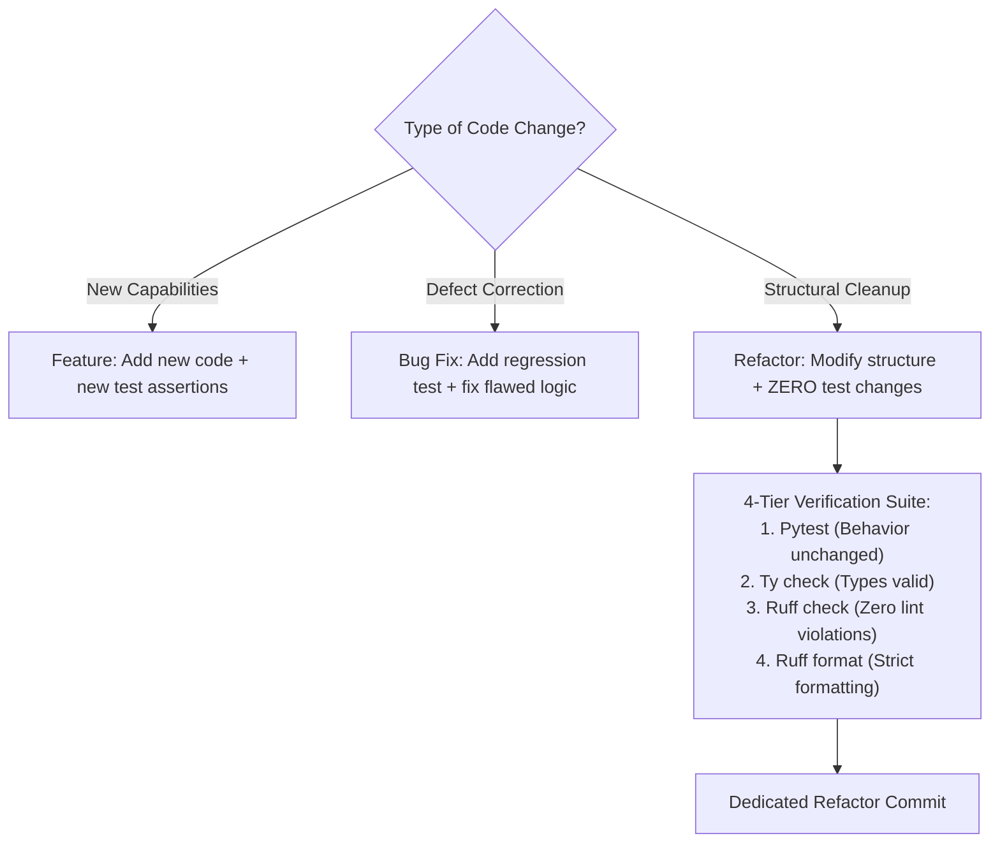
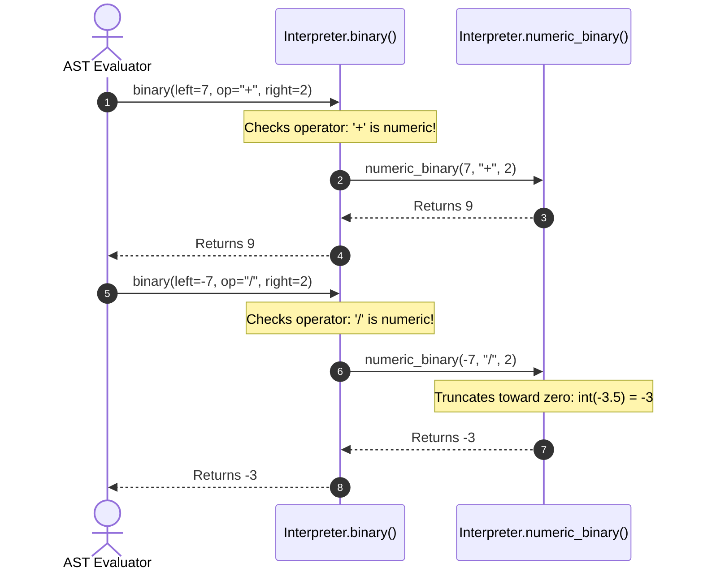

#AICoding #CodeRefactoring #BehavioralInvariance #CleanCode #AbstractionLayers #ASTValidation #SystemDesign

> [!abstract] Executive Summary
> **Refactoring** is the disciplined practice of altering the internal structure of software without modifying its observable external behavior. In the age of AI coding agents, refactoring is not an optional aesthetic exercise—it is a critical survival mechanism against **code slop accumulation**.
> 
> Because LLMs generate code with near-zero marginal effort, codebases tend toward rapid entropy: copy-pasted implementations, bloated monolithic methods, and leaky abstraction boundaries. However, autonomous agents also possess exceptional capability as **refactoring engines**: equipped with AST awareness, language server diagnostics, and file-editing tools, an agent can safely restructure code when guided by strict architectural constraints.
> 
> The foundation of sustainable agentic refactoring rests on two principles:
> 1. **The Dedicated Refactor Commit:** Never mix structural refactoring with new feature additions or bug fixes. First restructure abstractions so that the subsequent feature requires altering $40$ lines instead of $500$.
> 2. **Behavioral Invariance via 4-Tier Verification:** Refactorings must leave test suites completely untouched while passing strict compile-time types, linters, formatters, and unit tests.

---

## 1. The Three Fundamental Types of Code Changes

Every commit made to a production repository falls into one of three distinct categories:

```
┌─────────────────────────────────────────────────────────────────────────────────────────┐
│                          THE TRIAD OF CODEBASE MODIFICATIONS                           │
└─────────────────────────────────────────────────────────────────────────────────────────┘

     [ 1. New Features ]
     • Intent: Expand functional behavior.
     • Tests: Add new unit/integration tests to assert new capabilities.
     • Invariant: Extends the system contract.

     [ 2. Bug Fixes ]
     • Intent: Correct divergent, broken behavior to match intended specifications.
     • Tests: Add failing regression test first, then fix code to make it pass.
     • Invariant: Corrects the system contract.

     [ 3. Refactors ]
     • Intent: Improve readability, maintainability, and extensibility.
     • Tests: ZERO test modifications. All existing tests must pass identically.
     • Invariant: Preserves the system contract 100% identically.
```



---

## 2. Why Refactoring is More Critical in the AI Era

A pervasive myth among junior developers is that because AI models can generate code instantly, human developers no longer need to worry about clean architecture or modular abstractions.

In reality, the exact opposite is true:
- **The Code Slop Multiplier:** Because models generate code effortlessly, developers are tempted to accept repetitive, copy-pasted, and bloated functions. Without aggressive refactoring, repositories rapidly become unmaintainable "AI slop."
- **Reducing the Human Review Tax:** The bottleneck of modern engineering is not typing speed; it is the time human engineers spend reviewing and debugging PRs. Refactoring optimizes for the **percentage of AI-produced code that humans can understand and maintain without manual intervention**.
- **Collapsing Future Blast Radius:** Shifting abstraction layers through a dedicated refactor simplifies subsequent work. A refactor that decouples a data layer allows a future feature to touch $40$ lines across one module instead of spreading modifications across $500$ lines in ten disparate files.

---

## 3. The Dedicated Refactor Commit Doctrine

> [!CAUTION] The Blended PR Antipattern
> Never combine a structural refactoring with a feature addition or bug fix in the same pull request.
> 
> When PRs blend structural changes with behavioral modifications:
> 1. Code reviewers cannot distinguish intentional behavioral shifts from accidental regressions.
> 2. `git bisect` becomes useless when tracking down future production outages.
> 3. If a bug is discovered in the new feature, reverting the commit also reverts the beneficial architectural refactor.

### The Two-Phase Workflow:
```
Phase 1: Dedicated Refactor Commit
└── git commit -m "refactor(interpreter): extract numeric binary operations helper"
    - Leaves all existing tests unchanged.
    - Full 4-tier check suite passes.
    - Merged and verified independently.

Phase 2: Minimal Feature Addition
└── git commit -m "feat(interpreter): add bitwise shift operators"
    - Touches only 15 lines of code inside the newly isolated helper!
    - Clean, reviewable, zero diff noise.
```

---

## 4. Case Study: Sloperator Interpreter Arithmetic Refactoring

### 4.1 The Code Smell: Monolithic Binary Dispatcher
In `sloperator/evaluator/interpreter.py`, the `Interpreter.binary` method was responsible for evaluating all binary operations: numeric math (`+`, `-`, `*`, `/`), comparisons (`<`, `<=`, `>`, `>=`), and equality checks (`==`, `!=`).

The method was growing unwieldy and violating the Single Responsibility Principle:
```python
# ❌ BEFORE: Monolithic method handling mixed operational concerns
class Interpreter:
    def binary(self, left, op, right):
        # Numeric operations mixed directly with comparisons
        if op == "+":
            return left + right
        elif op == "-":
            return left - right
        elif op == "*":
            return left * right
        elif op == "/":
            return int(left / right) # Truncate toward zero
        elif op == "==":
            return left == right
        # ... more comparison operators
```

---

### 4.2 The Refactoring Mandate:
1. Extract numeric operator handling (`+`, `-`, `*`, `/`) into an isolated helper method: `Interpreter.numeric_binary(self, left, op, right)`.
2. Have `Interpreter.binary` delegate numeric operations directly to `self.numeric_binary`.
3. Preserve integer truncation toward zero for division (e.g. `-7 / 2` evaluates to `-3`, `7 / 2` evaluates to `3`).
4. **Strict Constraint:** Leave all existing unit tests and public interfaces completely unchanged!

---

### 4.3 The Refactored Implementation

```python
# sloperator/evaluator/interpreter.py
class Interpreter:
    def numeric_binary(self, left: int | float, op: str, right: int | float) -> int | float:
        """Helper method encapsulating arithmetic operations and truncation rules."""
        if op == "+":
            return left + right
        if op == "-":
            return left - right
        if op == "*":
            return left * right
        if op == "/":
            if right == 0:
                raise ZeroDivisionError("division by zero")
            # Python's int() truncation converts float toward zero
            return int(left / right)
        raise ValueError(f"Unknown numeric operator: {op}")

    def binary(self, left: any, op: str, right: any) -> any:
        """Evaluates binary expressions, delegating arithmetic to numeric_binary."""
        if op in ("+", "-", "*", "/"):
            return self.numeric_binary(left, op, right)
        
        if op == "==":
            return left == right
        if op == "!=":
            return left != right
        if op == "<":
            return left < right
        if op == "<=":
            return left <= right
        if op == ">":
            return left > right
        if op == ">=":
            return left >= right
            
        raise ValueError(f"Unsupported binary operator: {op}")
```



---

## 5. Automated AST Introspection & Verification Pipeline

In enterprise software engineering, refactorings are verified not only through behavioral unit tests, but through **Abstract Syntax Tree (AST) introspection**:

```python
# Programmatic AST architectural verification script
import ast
import json
from pathlib import Path

# Parse interpreter source code into an Abstract Syntax Tree
tree = ast.parse(Path('sloperator/evaluator/interpreter.py').read_text())

# Locate the Interpreter class definition
interpreter = next(
    node for node in tree.body 
    if isinstance(node, ast.ClassDef) and node.name == 'Interpreter'
)

# Extract method definitions
methods = {
    node.name: node for node in interpreter.body 
    if isinstance(node, ast.FunctionDef)
}

# Inspect all function calls made within the 'binary' method
calls = [
    node.func.attr for node in ast.walk(methods['binary']) 
    if isinstance(node, ast.Call) and isinstance(node.func, ast.Attribute)
]

# Assert architectural compliance:
# 1. 'numeric_binary' exists on the class
# 2. 'numeric_binary' is explicitly invoked from inside 'binary'
is_compliant = ('numeric_binary' in methods) and ('numeric_binary' in calls)
print(json.dumps(is_compliant)) # Yields: true
```

### The 4-Tier Validation Command
```bash
# Execute full validation pipeline: unit tests, code formatting, linting, typechecking
uv run pytest -q && uv run ruff format --check && uv run ruff check && uv run ty check
# Asserts: Exit code 0 across all 4 tiers!

# Submit verified refactor
bootdev run -s 907349eb-a174-489c-a848-0c81552aeb9a
```

---

## 6. Synthesis: The Refactoring Operational Checklist

| Phase | Action | Verification Gate |
| :--- | :--- | :--- |
| **1. Baseline Verification** | Run the complete test suite against unmodified source. | Ensure $100\%$ green baseline before editing. |
| **2. Scoped Prompting** | Instruct the agent to move code into a helper without changing behavior. | Demand that tests remain untouched. |
| **3. Diff Inspection** | Review `git diff` for accidental deletions, logic modifications, or renaming. | Confirm only structural extraction occurred. |
| **4. 4-Tier Verification** | Run tests, formatters, linters, and type checkers. | Exit code 0 across all checks. |
| **5. Atomic Commit** | Commit the refactor independently of features or bug fixes. | Commit message prefixed with `refactor:`. |
