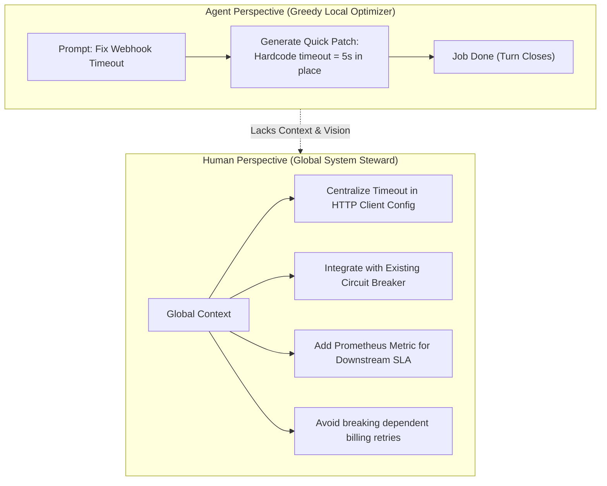
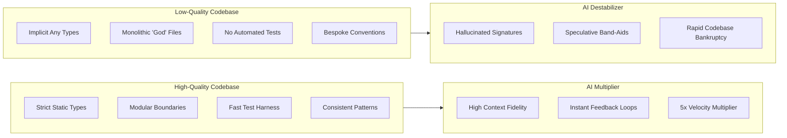
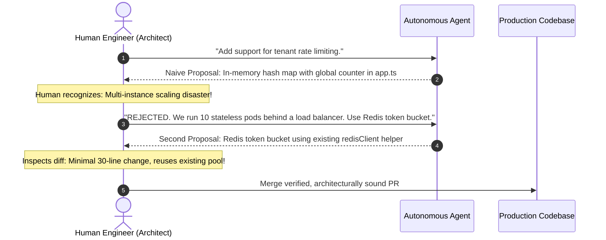

#AICoding #CodebaseQuality #TechnicalDebt #SlopCannon #Architecture #CodeReview #SoftwareStewardship #SystemDesign

> [!abstract] Executive Summary
> Non-technical commentators frequently claim that in an agent-driven world, *"the underlying code doesn't matter anymore"* because software generation costs approach zero. In reality, the exact opposite is true: **codebase quality is more decisive today than at any point in software engineering history**.
> 
> Autonomous agents are **greedy local optimizers**: their sole objective is satisfying the prompt directly in front of them. They possess zero native awareness of long-term maintainability, subsequent roadmap features, or hidden operational invariants (Chesterton's Fence).
> 
> Sustainable engineering in the AI era is governed by **The Two Truths**:
> 1. *AI agents make you exponentially more productive in a great codebase.*
> 2. *AI agents can degrade a good codebase into an unmaintainable disaster with terrifying speed.*
> 
> Mastering agent pairing requires actively **"Aiming the Slop Cannon"**—demanding minimal diffs, enforcing existing repository patterns over novelty, and exercising uncompromising human architectural authority to reject naive AI paths.

---

## 1. The Paradox of AI Coding: Why Code Quality Matters More

When business executives declare that *"code doesn't matter anymore"*, they confuse **code authoring** with **system maintenance**. While authoring code has become cheap, maintaining, understanding, and debugging systems remains expensive.

```
┌─────────────────────────────────────────────────────────────────────────────────────────┐
│                     THE LOCAL OPTIMIZATION BLIND SPOT OF LLMS                           │
└─────────────────────────────────────────────────────────────────────────────────────────┘

  [ What the Agent Sees ]
  • The immediate user prompt ("Add a timeout to the billing webhook").
  • An ephemeral window of context (a few files, a few thousand tokens).
  • Success Metric: Return a patch that terminates the turn without immediate errors.

  [ What the Agent Cannot See ]
  ✖ The human on-call engineer who must debug an outage at 3:00 AM two months from now.
  ✖ The three planned Jira epic features that will build directly upon this data model.
  ✖ "Chesterton's Fence" on line 117: A seemingly redundant check that prevents a catastrophic
    race condition in payment settlement.
```



An agent does not care about the future. It does not suffer when technical debt compounds. **Caring about the future is the exclusive responsibility of the human engineer.**

---

## 2. The Two Truths of AI-Augmented Engineering

```
┌─────────────────────────────────────────────────────────────────────────────────────────┐
│                       THE TWO TRUTHS OF AI-AUGMENTED CODING                             │
└─────────────────────────────────────────────────────────────────────────────────────────┘

  [ TRUTH 1: AI Accelerates You in a Great Codebase ]
  • High-Density Context: Clear type definitions, small modular files, and consistent
    architectural patterns provide perfect context for the model.
  • Deterministic Guardrails: Comprehensive test suites and strict linters catch agent mistakes
    instantly on token 0, allowing rapid iteration without human micro-management.
  • Result: 5x to 10x engineering velocity multiplier.

  [ TRUTH 2: AI Destroys a Codebase Faster Than Humans Ever Could ]
  • Slop Accumulation: If allowed to generate unchecked code, agents copy-paste logic,
    introduce inconsistent libraries, and create duplicate utility functions.
  • Entropy Acceleration: A single uncritical developer merging raw AI output can introduce
    more architectural chaos in two weeks than a team of humans could in two years.
  • Result: Irreversible codebase bankruptcy.
```



---

## 3. Aiming the "Slop Cannon": Concrete Prompt Directives

To extract value from an AI agent without polluting your repository, you must actively constrain its output space. When prompting coding agents, consistently enforce these three non-negotiable architectural mandates:

### 3.1 Mandate 1: Minimal Diffs
LLMs love to re-format, re-order, and cosmetically rewrite entire files when prompted for a minor change. This creates massive diff noise that makes code review impossible.

> [!TIP] The Minimal Diff Prompt Directive
> *"Produce minimal diffs. Modify only the lines strictly required to implement this feature. Do not reformat untouched code, do not reorder existing imports, and do not introduce unrelated stylistic changes."*

### 3.2 Mandate 2: Existing Patterns Over Novelty
LLMs possess a training distribution spanning millions of public GitHub repositories. If you do not constrain them, they will invent novel design patterns or import third-party libraries that conflict with existing repository standards.

> [!TIP] The Pattern Consistency Prompt Directive
> *"Adhere strictly to the existing architectural patterns in this directory. Before introducing a new abstraction or utility, locate and reuse existing project helpers. Match our naming conventions and error-handling paradigms exactly."*

### 3.3 Mandate 3: Chesterton's Fence Awareness
G. K. Chesterton articulated a classic philosophical rule: *Never tear down a fence until you know why it was put up.* In coding, agents love to delete code that appears redundant to their immediate context.

> [!TIP] The Invariant Preservation Prompt Directive
> *"Do not delete or modify existing checks, fallbacks, or method signatures unless you can explicitly explain why they are safe to change. If you encounter an unfamiliar conditional, assume it protects a production invariant and preserve it."*

---

## 4. The Human as Architectural Sovereign

Prompting the model with strict rules is necessary, but **it is never sufficient**. 

Models are sycophantic and fundamentally limited by their training loss: they optimize for plausible-sounding completions, not long-term system stability.

```
┌─────────────────────────────────────────────────────────────────────────────────────────┐
│                       THE ARCHITECTURAL SOVEREIGNTY PROTOCOL                            │
└─────────────────────────────────────────────────────────────────────────────────────────┘

  1. Review Every Line:
     Never merge a pull request by scanning summary bullet points. Inspect the raw `git diff`
     line-by-line as if reviewing the work of a junior intern.

  2. Reject Naive Paths:
     When an agent suggests a quick, naive solution (e.g. duplicating a database query
     inside a loop or using global state), reject it immediately. Force the agent down
     a principled architectural path:
     "Your proposed approach creates an N+1 query vulnerability. Refactor this to use
      a batch lookup with our existing DataLoader abstraction."

  3. Maintain Clean Abstractions:
     If an agent introduces a leaky abstraction, stop the session. Refactor the interface
     cleanly before allowing the agent to write further domain logic atop it.
```



---

## 5. Synthesis: The Stewardship Manifesto

| Dimension | The Naive "AI Will Write It" Approach | The Disciplined Engineering Approach |
| :--- | :--- | :--- |
| **Code Volume** | Optimizes for rapid LOC generation. | Optimizes for minimal diffs and maximum code reuse. |
| **Architecture** | Allows the model to invent ad-hoc structures. | Forces the model to conform strictly to repository patterns. |
| **Code Review** | Skims PR summary; assumes green tests mean good code. | Conducts rigorous line-by-line diff inspection for subtle smells. |
| **Technical Debt** | Compounds rapidly until the system collapses. | Refactors continuously to keep context high-density and clean. |
| **Accountability** | *"The model gave me this code."* | *"I am the architect. I own every line committed to production."* |
