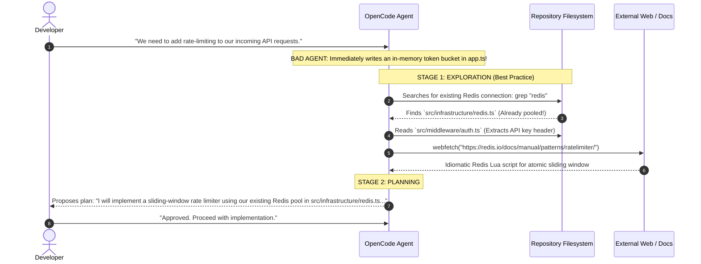

#AICoding #AIDevelopmentLifecycle #IncrementalChanges #ExplorationPhase #SoftwareArchitecture #SystemDesign #OpenCode

> [!abstract] Executive Summary
> One of the most dangerous developer habits in AI-assisted programming is **"The One-Shot Slot Machine"**—writing massive, 500-word prompts in the hope that an agent will generate a flawless, 1,000-line multi-file pull request in a single turn. While intoxicating when it succeeds, this approach yields compounding errors, impossible diff reviews, and wasted hours re-rolling prompts.
> 
> Sustainable, production-grade AI engineering enforces **Incremental Task Decomposition** governed by the **4-Stage AI Development Lifecycle**:
> 1. **Explore (The Critical Foundation):** Force the agent to investigate existing codebase conventions, constraints, and external library docs (`webfetch`) *before* committing to an architectural direction.
> 2. **Plan:** Draft an explicit step-by-step implementation blueprint and boundary definition for non-trivial tasks.
> 3. **Implement:** Write the **smallest correct version** that satisfies the immediate invariant.
> 4. **Verify:** Validate through deterministic, automated feedback loops (types, linters, tests, and runtime execution).

---

## 1. The "Slot Machine" Antipattern vs. Incrementalism

Every engineer using coding agents experiences the dopamine rush of the "one-shot": you write a detailed prompt, and the model miraculously generates $1,000$ lines of clean code that passes tests.

However, treating AI coding as a slot machine is an operational failure:

```
┌─────────────────────────────────────────────────────────────────────────────────────────┐
│                      THE "ONE-SHOT SLOT MACHINE" FAILURE SPIRAL                         │
└─────────────────────────────────────────────────────────────────────────────────────────┘

  [ Step 1: The Massive 1,000-Line Prompt ]
  Developer writes an ambitious prompt asking for a complete multi-tier feature:
  database migrations, API routes, React UI components, state management, and tests.

  [ Step 2: The Hallucination & Drift Trap ]
  The model generates 1,200 lines across 8 files.
  - 90% is brilliant.
  - 10% contains subtle bugs: a broken foreign key cascade, an unhandled async race
    condition, and a deprecated library import.

  [ Step 3: The Re-Roll Tragedy ]
  Instead of debugging the 10%, the developer re-prompts: "No, fix the bug and try again."
  The model re-generates all 1,200 lines, fixing the first bug but introducing two NEW ones!
  Result: 2 hours spent pulling the lever; zero mergeable code.
```

### The Probability of Multi-Token Failure:
In probabilistic autoregressive models, the probability of generating a completely correct sequence decays exponentially with the length of the generation:

$$P(\text{flawless generation}) = \prod_{i=1}^{N} P(\text{token}_i \mid \text{context})$$

As $N \to 10,000$ tokens, the probability of introducing at least one subtle logical flaw or hallucination approaches $100\%$.

```mermaid
graph TD
    subgraph SlotMachine["The 'Slot Machine' Antipattern (High Variance)"]
        P1["Massive Prompt (1,000 LOC Goal)"] --> G1["Model One-Shot Generation"]
        G1 --> Error["Subtle Bug in 10% of Diff"]
        Error --> ReRoll["Re-Prompt / Pull Slot Machine Lever Again"]
        ReRoll --> G2["New 1,000 LOC Generation (New Subtle Bugs)"]
        G2 --> Frustration["Wasted Time & Context Exhaustion"]
    end

    subgraph Incremental["The Incremental Lifecycle (Low Variance, High Velocity)"]
        S1["Step 1: Explore & Plan"] --> S2["Step 2: Core Domain Model (50 LOC)"]
        S2 --> V1["Verify with Unit Tests (Pass!)"]
        V1 --> S3["Step 3: Service Layer (80 LOC)"]
        S3 --> V2["Verify with Integration Tests (Pass!)"]
        V2 --> S4["Step 4: API Endpoint & UI"]
        S4 --> V3["Final End-to-End Verification"]
    end

    style SlotMachine fill:#fee,stroke:#c33
    style Incremental fill:#efe,stroke:#2a2
```



---

## 2. The 4-Stage AI Development Lifecycle

Regardless of whether a task is a 10-line bug fix or an architectural migration, top-performing engineers channel their agents through the **Explore $\to$ Plan $\to$ Implement $\to$ Verify** pipeline:

```
┌─────────────────────────────────────────────────────────────────────────────────────────┐
│                        THE 4-STAGE AI DEVELOPMENT LIFECYCLE                             │
└─────────────────────────────────────────────────────────────────────────────────────────┘

     ┌───────────────────────────────────────────────────────────────────────────────┐
     │ 1. EXPLORE (The Most Overlooked Step)                                         │
     │ Read local codebase files, architectural patterns, schemas, and dependencies. │
     │ Conduct external research via `webfetch` for library APIs and modern RFCs.   │
     └──────────────────────────────────────┬────────────────────────────────────────┘
                                            │
                                            ▼
     ┌───────────────────────────────────────────────────────────────────────────────┐
     │ 2. PLAN                                                                       │
     │ Formulate explicit hypotheses, diff boundaries, and implementation steps.     │
     │ Align on abstractions and edge cases BEFORE writing a single line of code.    │
     └──────────────────────────────────────┬────────────────────────────────────────┘
                                            │
                                            ▼
     ┌───────────────────────────────────────────────────────────────────────────────┐
     │ 3. IMPLEMENT                                                                  │
     │ Generate the smallest correct version of the change.                          │
     │ Enforce minimal diffs, local patterns, and clean naming.                      │
     └──────────────────────────────────────┬────────────────────────────────────────┘
                                            │
                                            ▼
     ┌───────────────────────────────────────────────────────────────────────────────┐
     │ 4. VERIFY                                                                     │
     │ Run the 4-tier check suite: Compilers, Typecheckers, Linters, and Unit Tests. │
     │ Reproduce with runtime scripts or browser automation.                         │
     └───────────────────────────────────────────────────────────────────────────────┘
```

---

## 3. Deep Dive: The Critical Importance of Exploration

The single most common reason agents propose flawed architectures is **insufficient exploration**.

### 3.1 The Architectural Context Gap
Consider an instruction: *"Implement a local note-taking and tagging system."*
- If the application is **Obsidian**, the optimal design is a local-first SQLite metadata cache indexing Markdown frontmatter on disk.
- If the application is **Google Docs**, the optimal design is an operational transformation / CRDT engine backed by distributed WebSockets and a multi-tenant cloud datastore.

Without deep exploration of the surrounding repository, the agent will guess—and its guess will reflect generic public web averages rather than your project's specific invariants.



### 3.2 External Research via `webfetch`
Exploration must never be constrained to the local Git repository. Modern coding agents possess native network tools (`webfetch` or MCP documentation servers like Context7). 

Instruct your agent to research:
- Up-to-date library API signatures (avoiding deprecated v1 APIs hallucinated from older training weights).
- Known security advisories and CVEs for candidate dependencies.
- Official best-practice architecture guides published by framework authors.

---

## 4. Adapting the Workflow Across Task Complexities

Not every engineering task requires a 30-minute architectural interview. Calibrate the lifecycle based on blast radius:

```
┌─────────────────────────────────────────────────────────────────────────────────────────┐
│                      WORKFLOW CALIBRATION BY TASK BLAST RADIUS                          │
└─────────────────────────────────────────────────────────────────────────────────────────┘
```

| Task Magnitude | Example | Recommended Workflow | Human Oversight Level |
| :--- | :--- | :--- | :--- |
| **Micro-Task** | Rename variable, fix typo, update CSS padding. | **Direct Implementation $\to$ Quick Test** | Low (inspect `git diff` before committing). |
| **Single-Component Feature** | Add new database query, expose REST endpoint. | **Explore Local Pattern $\to$ Implement $\to$ Run Unit Test** | Moderate (review interface contracts and types). |
| **Multi-Tier Feature** | Implement Stripe checkout with webhooks and DB reconciliation. | **Deep Exploration $\to$ Socratic Planning $\to$ Vertical Slices $\to$ E2E Tests** | **High** (validate state machine, security threat model). |
| **System Refactor** | Migrate ORM, extract microservice, rewrite lexer. | **Dedicated Refactor Plan $\to$ AST Invariance $\to$ Shadow Rollout** | **Extreme** (line-by-line verification, zero test alterations). |

---

## 5. Synthesis: The Incremental AI Engineering Checklist

Before accepting any agentic code change, verify that your pairing session adhered to the four golden rules:

1. **Did the agent explore existing code before generating new code?**
   - Confirm it read related modules, types, and existing utility functions.
2. **Was the plan reviewed before code was written?**
   - Ensure the diff boundaries were established before implementation.
3. **Is the changeset minimal and atomic?**
   - Refuse changesets exceeding $150\text{--}200$ lines of logic; force decomposition into stacked PRs.
4. **Did the change pass real, deterministic checks?**
   - Never accept *"It looks correct to me"*; require output from compilers, formatters, and automated tests.
