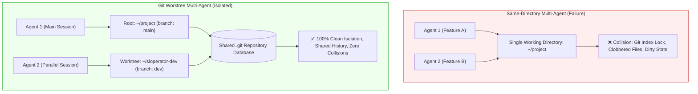
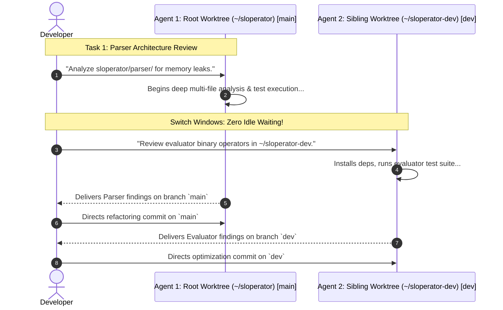

#AICoding #GitWorktrees #MultiAgent #Parallelism #ContextSwitching #DeveloperProductivity #SystemDesign #OpenCode

> [!abstract] Executive Summary
> While Large Language Models generate code with remarkable speed, autonomous agents are frequently constrained by **execution latency**. Between evaluating prompts, issuing multi-step tool calls, running compilers, and inspecting test traces, an agent often requires $30\text{--}180\text{ seconds}$ to complete a complex turn. Staring idly at the terminal during these intervals caps developer throughput.
> 
> The most potent operational multiplier in modern agentic engineering is **Multi-Agent Parallelism**. However, launching multiple agent sessions inside the same working directory triggers catastrophic race conditions: simultaneous file modifications, `git.lock` file collisions, and build artifact corruption.
> 
> The production solution is **Git Worktrees (`git worktree`)**:
> 1. **Complete Directory Isolation:** Each agent operates in its own physical directory on a dedicated Git branch, preventing file clobbering.
> 2. **Shared Git Object Storage:** All worktrees link directly to the primary `.git` repository, eliminating disk bloat and network re-cloning.
> 3. **Cognitive Load Management:** While running two agents concurrently achieves an optimal $\approx 1.5\text{x}\text{--}2.0\text{x}$ productivity boost, running three or more agents induces severe human context-switching exhaustion unless tasks are long-running and fully unattended.

---

## 1. The Bottleneck of Single-Agent Latency

A common misconception is that AI agents deliver instantaneous code. In production, an agent must execute a multi-phase verification loop:

$$\text{LLM Generation} \xrightarrow{\quad} \text{File Edit Tool} \xrightarrow{\quad} \text{Test Runner (pytest/bun)} \xrightarrow{\quad} \text{Linter/Typechecker} \xrightarrow{\quad} \text{Synthesis}$$

This iterative cycle takes time. If a developer operates only one agent session, their effective velocity is tethered to the agent's turn latency, leaving them waiting idly between prompts.

```
┌─────────────────────────────────────────────────────────────────────────────────────────┐
│                      THE RACE CONDITION OF SAME-DIRECTORY MULTI-AGENTS                  │
└─────────────────────────────────────────────────────────────────────────────────────────┘

  Directory: ~/repo (Single Working Tree)
  ├── Agent Session 1 (Feature A)  ──▶ Writes src/auth.ts (git status modified)
  └── Agent Session 2 (Feature B)  ──▶ Edits src/auth.ts & runs `git add .`
  
  [ Disasters Occur: ]
  ✖ File Clobbering: Agent 2 overwrites Agent 1's in-progress changes.
  ✖ Git Index Lock: `fatal: Unable to create '.git/index.lock': File exists.`
  ✖ Corrupted Build Artifacts: Simultaneous compiler builds overwrite `dist/` or `.pyc`.
```



---

## 2. Git Worktree Architecture: Isolated Trees, Unified Storage

A **Git Worktree** allows a developer to check out multiple branches simultaneously into separate directories on the local machine without creating redundant clones.

### 2.1 The Storage Invariant
- **Standard Clone:** Duplicates the entire `.git` history, packs, and remotes ($\sim 500\text{MB}$ per copy).
- **Git Worktree:** Shares the parent repository's `.git` database. The new directory contains only the checked-out working files and a tiny `.git` pointer file referencing the parent repository's `.git/worktrees/<name>/` state.

```
┌─────────────────────────────────────────────────────────────────────────────────────────┐
│                          GIT WORKTREE FILESYSTEM TOPOLOGY                               │
└─────────────────────────────────────────────────────────────────────────────────────────┘

  Parent Repository: /home/dev/sloperator/
  ├── .git/                      <-- Unified Object Database, Config, & Remotes
  │   └── worktrees/
  │       └── sloperator-dev/    <-- State tracking for the sibling worktree
  ├── sloperator/                <-- Agent 1 Working Files (branch: main)
  └── tests/

  Sibling Worktree: /home/dev/sloperator-dev/
  ├── .git                       <-- Text file pointing to /home/dev/sloperator/.git/worktrees/...
  ├── sloperator/                <-- Agent 2 Working Files (branch: dev)
  └── tests/
```

### 2.2 Core Worktree CLI Commands
```bash
# 1. Create a new sibling worktree on a new branch named 'dev'
git worktree add ../sloperator-dev -b dev

# 2. List all active worktrees and their checked-out branches
git worktree list

# Output:
# /home/dev/sloperator       a1b2c3d [main]
# /home/dev/sloperator-dev   e4f5g6h [dev]

# 3. Remove a worktree after merging changes
git worktree remove ../sloperator-dev
```

---

## 3. Parallel Multi-Agent Workflows: The 2-Agent Pattern

In production engineering, the recommended operational model pairs **two concurrent agent sessions** across sibling worktrees:



### Key Workflow Advantages:
1. **Zero Blocker Idling:** While Agent 1 is executing a 2-minute test suite or compiling dependencies, the developer reviews Agent 2's completed diff or issues instructions for the next task.
2. **Context Purity:** Agent 1's context window contains only files related to Task A. Agent 2's context window contains only files related to Task B. Neither agent's prompt history is polluted by unrelated code.
3. **Independent Runtime Environments:** If Task B requires installing prototype dependencies (`bun install` or `pip install`), Agent 2 does not destabilize Agent 1's build environment.

---

## 4. The Cognitive Limits of Human Attention

While running two agents delivers a genuine **$1.5\text{x}\text{--}2.0\text{x}$ throughput multiplier**, attempting to scale beyond two agents rapidly encounters diminishing returns:

```
┌─────────────────────────────────────────────────────────────────────────────────────────┐
│                    HUMAN COGNITIVE LOAD vs. NUMBER OF AGENTS                            │
└─────────────────────────────────────────────────────────────────────────────────────────┘

  [ 1 Agent ]
  • Human State: Idle waiting during long turns.
  • Bottleneck: Agent tool and test execution latency.
  • Multiplier: 1.0x baseline.

  [ 2 Agents (The Engineering Sweet Spot) ]
  • Human State: Alternating flow. While Agent A executes, human reviews Agent B's output.
  • Bottleneck: Balanced between machine execution and human review.
  • Multiplier: ~1.5x to 1.8x.

  [ 3+ Agents (The Chaos Threshold) ]
  • Human State: Cognitive overload. Human context-switching between 3 disparate codebases,
    losing architectural focus, making superficial reviews, and missing critical bugs.
  • Bottleneck: Human review capacity.
  • Multiplier: Drops to < 1.0x due to review fatigue and defect leaks!
```

> [!WARNING] The 3+ Agent Exception
> Scaling to 3 or more concurrent agents is only viable when the agents are running **long-running, fully automated, unattended tasks** (e.g., massive database migration backfills, overnight comprehensive test generators, or bulk documentation conversions) that require zero immediate human steering.

---

## 5. Case Study: Sloperator Parallel Review Verification

### 5.1 Assignment Execution Protocol
1. **Commit Current Project Root:**
   Ensure working tree is clean on `main`:
   ```bash
   git add . && git commit -m "Finish Sloperator core"
   ```
2. **Create Sibling Worktree on `dev`:**
   ```bash
   git worktree add ../sloperator-dev -b dev
   ```
3. **Launch Second Agent in Sibling Directory:**
   ```bash
   cd ../sloperator-dev
   opencode
   ```
4. **Divide Responsibilities:**
   - Root Agent (`~/sloperator` on `main`): Reviews the parser (`sloperator/parser/`).
   - Sibling Agent (`~/sloperator-dev` on `dev`): Reviews the evaluator (`sloperator/evaluator/`).

---

### 5.2 Automated Grader Assertion Pipeline

Automated evaluation harnesses inspect Git's porcelain worktree state to verify directory isolation:

```python
# Programmatic Git Worktree Assertion
import json
import subprocess
from pathlib import Path

# Resolve root repository path
root = Path(subprocess.check_output(['git', 'rev-parse', '--show-toplevel'], text=True).strip()).resolve()
expected = root.parent / 'sloperator-dev'

# Query Git worktree list in porcelain format
entries = subprocess.check_output(['git', 'worktree', 'list', '--porcelain', '-z'], text=True).split('\0\0')

# Validate that the expected worktree exists on refs/heads/dev
found = any(
    f'worktree {expected}' in entry.split('\0') and 'branch refs/heads/dev' in entry.split('\0') 
    for entry in entries
)

# Output boolean verification: Must exist, be a directory, and not equal root
is_valid = found and expected.is_dir() and expected != root
print(json.dumps(is_valid)) # Yields: true
```

```bash
# Verify assertion
bootdev run -s 9c3345bb-922b-4c90-8fa0-ce444369e8a9
```

---

## 6. Synthesis: Parallel Agent Operational Rules

1. **One Worktree Per Active Agent:** Never launch multiple agent processes in the same working directory.
2. **Dedicated Branching:** Every worktree must check out its own isolated feature branch (`feat/parser-opt`, `refactor/evaluator`).
3. **Cap Active Pairing at Two:** Keep at most two interactive agents running concurrently to protect review rigor and mental clarity.
4. **Prune Upon Merging:** Run `git worktree remove <path>` and delete merged branches immediately after PR approval to prevent disk clutter.
