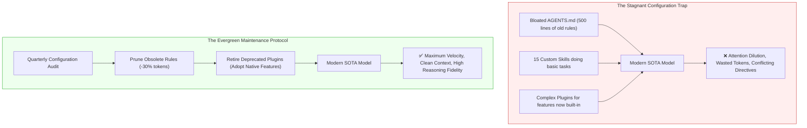

#AICoding #EvergreenAgent #SOTAEvolution #NegativePrompting #HarnessConvergence #PromptMaintenance #SystemDesign

> [!abstract] Executive Summary
> In the fast-moving frontier of artificial intelligence, coding agents undergo radical evolutionary cycles every few months. Models from six months ago appear primitive compared to modern State-of-the-Art (SOTA) releases.
> 
> As foundation models improve, they correct previous generation flaws, internalize idiomatic programming patterns, and require far less supervisory micromanagement. Consequently, the greatest operational risk in a mature AI coding workflow is **Configuration Stagnation**: accumulating obsolete rules in `AGENTS.md`, redundant custom skills, and fragile bespoke plugins.
> 
> To maintain an **Evergreen Agent Architecture**, software engineers must embrace two counterintuitive operational principles:
> 1. **"Remove More Prompting Than You Add":** Regularly prune legacy instructions that newer models execute natively to eliminate token tax and attention dilution.
> 2. **The Law of Minimal Customization:** Avoid over-engineering complex harness extensions; features that require custom plugins today rapidly converge into native built-in primitives tomorrow.

---

## 1. The Rapid Obsolescence Curve of Coding Agents

Foundation models do not just scale in parameter count; they are continuously fine-tuned on real-world engineering telemetry, RLHF alignment, and compiler feedback loops:

```
┌─────────────────────────────────────────────────────────────────────────────────────────┐
│                    THE AGENT CAPABILITY EVOLUTIONARY CURVE                              │
└─────────────────────────────────────────────────────────────────────────────────────────┘

     Model Capability
          ▲
          │                                              [ Modern SOTA Agents ]
          │                                              • Intrinsic test-driven loops
          │                                              • Multimodal layout inspection
          │                                              • Deep architectural planning
          │                                              • Precise minimal diffs
          │
          │                   [ Generation N-1 Agents ]
          │                   • Required explicit style micromanagement
          │                   • Frequent hallucination of deprecated APIs
          │                   • Needed manual step-by-step steering
          │
          │  [ Early LLMs ]
          │  • Autocomplete toys, raw syntax regurgitation
          └──────────────────────────────────────────────────────────────────────▶ Time
```



---

## 2. Negative Prompt Engineering: "Remove More Prompting Than You Add"

When an engineer starts working with an AI coding agent, they naturally append rules to `AGENTS.md` whenever the model makes a mistake:
- *"Always use async/await instead of promises."*
- *"Remember to add type annotations to function parameters."*
- *"Don't use var, use const and let."*
- *"Always verify that the output container has overflow-x auto."*

While necessary for older models, modern frontier models already consider these practices standard. Retaining these rules imposes a heavy penalty:

### 2.1 The Liabilities of Stale Rules:
1. **Context Window Tax:** Hundreds of lines of legacy rules burn recurring tokens on every turn.
2. **Attention Dilution:** The model's finite self-attention budget is consumed parsing elementary instructions rather than reasoning through your complex business logic.
3. **Instruction Conflict:** Outdated rules may contradict modern framework idioms, causing the agent to output suboptimal code to satisfy a rule written for a 2-year-old version of a library.

```
┌─────────────────────────────────────────────────────────────────────────────────────────┐
│                          THE PROMPT PRUNING PROTOCOL                                    │
└─────────────────────────────────────────────────────────────────────────────────────────┘

  Step 1: Benchmark the New SOTA Model
  └── When updating model providers (e.g. Claude 3.5 Sonnet -> Claude 3.7 / GPT-5),
      temporarily disable half of your `AGENTS.md` rules.

  Step 2: Observe Native Behavior
  └── Does the new model naturally adhere to modern async patterns and type conventions
      without explicit prompts? If YES: PERMANENTLY DELETE THE RULE.

  Step 3: Retain Only Unique Repository Invariants
  └── Keep only rules that represent proprietary domain knowledge:
      - Internal API quirks and service endpoints.
      - Non-standard security invariants (e.g. tenant data isolation).
      - Strict repository branch and commit policies.
```

---

## 3. Harness Convergence: The Lifecycle of Agent Features

A universal pattern in software infrastructure is **convergence**: capabilities that begin as fragile user scripts gradually migrate inward until they become standardized runtime primitives.

```
┌─────────────────────────────────────────────────────────────────────────────────────────┐
│                       THE AGENT FEATURE CONVERGENCE LIFECYCLE                           │
└─────────────────────────────────────────────────────────────────────────────────────────┘

     Phase 1: Ad-Hoc Shell Script
     └── Developer writes a bespoke bash script to parse git diffs for the agent.

     Phase 2: Custom Local Tool
     └── Script is formalized into a custom tool (`diff_checker.ts`).

     Phase 3: Model Context Protocol (MCP) Server
     └── Tool is exposed via JSON-RPC 2.0 daemon to allow cross-client reuse.

     Phase 4: Harness Plugin
     └── Logic is hooked into the agent runtime via `@opencode/plugin`.

     Phase 5: Native Harness Built-in Primitive
     └── OpenCode or Claude Desktop adopts the capability natively in core (e.g. native `/undo`,
         native worktree isolation, built-in browser use).
```

### The Law of Minimal Customization:
> [!IMPORTANT] The Golden Rule of Tooling Durability
> **Customize your preferred coding agent as little as possible.**
> 
> The more heavily you customize your agent with brittle local plugins, monkey-patched hooks, and complex prompt scaffolding, the more fragile your setup becomes when the underlying harness or model updates.
> 
> Prefer standard, out-of-the-box harness primitives and lean, declarative configuration.

---

## 4. The Enduring Value of Computer Science Fundamentals

As AI tooling abstracts away the mechanics of typing syntax, junior developers often ask: *"Is it still worth learning data structures, systems architecture, or operating systems?"*

The answer is an unequivocal **yes**. The value of fundamental computer science knowledge has never been higher:

```
┌─────────────────────────────────────────────────────────────────────────────────────────┐
│                       TRANSIENT MECHANICS vs. ETERNAL PRINCIPLES                        │
└─────────────────────────────────────────────────────────────────────────────────────────┘

     [ Transient Mechanics (Automated by AI) ]
     • Memorizing exact library function signatures.
     • Writing boilerplate JSON serializations.
     • Configuring complex Webpack/Babel build configs.
     • Typing standard CRUD controllers.

     [ Eternal Principles (Requiring Human Mastery) ]
     • Distributed Systems: CAP theorem, eventual consistency, network partition tolerance.
     • Security: Threat modeling, defense-in-depth, privilege separation.
     • Concurrency: Race conditions, deadlocks, lockless data structures.
     • Systems Engineering: Cache invalidation, memory layout, network latency budgets.
```

When an agent suggests an architecture that introduces an N+1 query loop across a distributed network boundary, or proposes an in-memory lock on a horizontally scaled cluster, **only an engineer with deep computer science fundamentals will recognize the disaster before it reaches production**.

---

## 5. Synthesis: The Master AI Engineering Manifesto

| Operational Rule | Rationale |
| :--- | :--- |
| **1. Treat Code as a Liability** | Maximize the percentage of problem solved per line of code written; minimize diffs. |
| **2. Enforce Evidence over Speculation** | Never accept a bug fix without a minimal reproduction script and automated test. |
| **3. Parallelize via Git Worktrees** | Run two concurrent agents across separate worktrees to eliminate idle wait time. |
| **4. Prune Prompts Aggressively** | Delete rules from `AGENTS.md` as models become more capable; fight context bloat. |
| **5. Retain 100% Accountability** | Never blame the agent. You are the architect, reviewer, and owner of what ships. |
