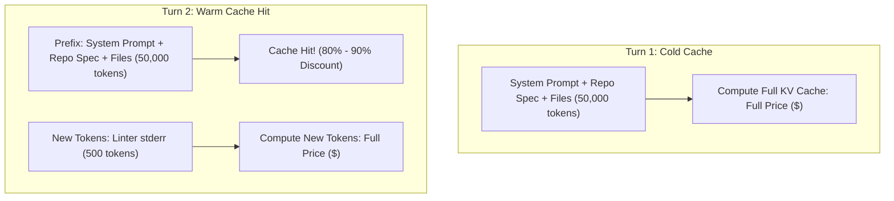

#AICoding #TokenEconomics #CostOptimization #PromptCaching #LLMPricing #OpenCode #SystemDesign

> [!abstract] Executive Summary
> Running autonomous coding agents introduces a radically different financial and computational profile compared to casual consumer chat. While consumer queries consist of short conversational exchanges, an agent operating across a real-world repository continuously ingests directory structures, source files, ASTs, build traces, and linter errors on every turn of its execution loop.
> 
> As a result, engineering teams face the **Coding Agent Cost Paradox**: although output tokens cost significantly more per token than input tokens, **input token volume is so massive that input tokens dominate the monthly cloud bill**. Understanding token economics, pricing tiers (Frontier SOTA vs. High-Speed Utility models), **Prompt Caching mechanics**, and token math is essential for scaling AI-assisted development across an engineering organization without ballooning costs.

---

## 1. The Token Economics Model

LLM cloud pricing across all major providers (OpenAI, Anthropic, Google, Moonshot AI) is measured in **US Dollars per 1 Million Tokens ($/1M tokens)**, split into two billing streams:

$$\text{Total Inference Cost} = \left(\frac{\text{Input Tokens}}{1,000,000} \times \text{Input Rate}\right) + \left(\frac{\text{Output Tokens}}{1,000,000} \times \text{Output Rate}\right)$$

```
┌──────────────────────────────────────────────────────────────────────────────────┐
│                           THE DUAL BILLING STREAMS                               │
└──────────────────────────────────────────────────────────────────────────────────┘

   [ Input Tokens (Context & Prompt) ]            [ Output Tokens (Generation) ]
   ┌───────────────────────────────────┐          ┌─────────────────────────────────┐
   │ • System prompts & guidelines     │          │ • Tool call arguments (JSON)    │
   │ • Full repository file contents   │          │ • Refactored code blocks        │
   │ • Terminal stdout & test failures │          │ • Explanatory response prose    │
   │ • Re-ingested conversation history│          │ • Reasoning / Thinking tokens   │
   ├───────────────────────────────────┤          ├─────────────────────────────────┤
   │ Nominal Cost: LOW ($0.20 - $10/1M)│          │ Nominal Cost: HIGH ($1.20 - $50)│
   │ Volume: ENORMOUS (85% - 95% total)│          │ Volume: SMALL (5% - 15% total)  │
   └───────────────────────────────────┘          └─────────────────────────────────┘
```

---

## 2. 2026 Model Pricing Landscape: SOTA vs. Utility Tiers

Foundation models divide into two major operational categories: **State-of-the-Art (SOTA) Frontier Models** and **High-Speed Utility Models**.

### 1. State-of-the-Art (SOTA) Frontier Tier
*Characteristics:* Maximum reasoning depth, state-of-the-art SWE-bench coding benchmarks, complex multi-file architectural planning. Slower latency and premium pricing.

| Provider / Developer | Model Identifier | Input Cost (Per 1M Tokens) | Output Cost (Per 1M Tokens) | Primary Use Case |
| :--- | :--- | :--- | :--- | :--- |
| **OpenAI** | `openai/gpt-6-astra` | \$10.00 | \$50.00 | Complex system refactoring, zero-shot migrations |
| **OpenAI** | `openai/gpt-5.6-sol` | \$4.00 | \$20.00 | Balanced frontier development, advanced debugging |
| **Anthropic** | `anthropic/claude-fable-5-1` | \$10.00 | \$50.00 | High-risk architectural planning, formal audits |
| **Anthropic** | `anthropic/claude-opus-5-5` | \$4.00 | \$20.00 | Complex multi-file codebase navigation |
| **Google** | `google/gemini-4-argon` | \$2.00 *(Intro)* $\rightarrow$ \$4.00 | \$10.00 *(Intro)* $\rightarrow$ \$20.00 | Massive million-token repository ingestion |

### 2. High-Speed Utility / Flash Tier
*Characteristics:* Ultra-fast Time-to-First-Token (TTFT), lower pricing (often 10x–50x cheaper), ideal for tactical tasks, linters, formatting, and high-frequency loops.

| Provider / Developer | Model Identifier | Input Cost (Per 1M Tokens) | Output Cost (Per 1M Tokens) | Primary Use Case |
| :--- | :--- | :--- | :--- | :--- |
| **OpenAI** | `openai/gpt-5.6-luna` | \$0.20 | \$1.20 | Real-time code edits, test failure analysis |
| **Anthropic** | `anthropic/claude-haiku-4-5` | \$1.00 | \$5.00 | Fast tactical refactors, commit summaries |
| **Google** | `google/gemini-3.8-flash` | \$0.75 *(Intro)* $\rightarrow$ \$1.50 | \$3.75 *(Intro)* $\rightarrow$ \$7.50 | Rapid agent tool execution, doc generation |
| **Moonshot AI** | `moonshot/kimi-k2.6` | \$0.95 | \$4.00 | Long-context fast evaluation |
| **OpenCode** | `opencode/deepseek-v4.1-flash-free` | **Free Tier** | **Free Tier** | Coursework, prototyping, CI experiment runs |

---

## 3. The Coding Agent Cost Paradox

In simple API integrations, developers are taught that output tokens are the primary cost driver because they cost **3x to 5x more per token** than input tokens. 

In autonomous agent workflows, this relationship inverts:

```
┌──────────────────────────────────────────────────────────────────────────────────┐
│                      THE AGENT CONTEXT MULTIPLIER EFFECT                         │
└──────────────────────────────────────────────────────────────────────────────────┘

   Turn 1: Ingest Repo Spec (20,000 tokens) ────────► Output: Edit file (400 tokens)
   Turn 2: Re-ingest Spec + Turn 1 + Linter Error (25,000 tokens) ──► Output: Fix (200 tokens)
   Turn 3: Re-ingest Spec + Turns 1-2 + Test Logs (35,000 tokens) ──► Output: Done (50 tokens)
   ──────────────────────────────────────────────────────────────────────────────────
   Total Input Tokens:  80,000 tokens (99.2% of total tokens processed)
   Total Output Tokens:    650 tokens ( 0.8% of total tokens processed)
```

> [!IMPORTANT] Why Input Tokens Dominate the Bill
> On every turn of a ReAct agent loop, the model must re-read:
> 1. The persistent system instructions and tool definitions.
> 2. The entire conversation history and tool execution logs.
> 3. The full text of every file read into context during previous turns.
> 
> Because an agent can execute 10 to 30 tool turns to resolve a single issue, **input token accumulation grows quadratically**, easily dominating overall expenditures.

---

## 4. Prompt Caching: The Modern Cost Mitigator

To combat the input token multiplier, modern LLM providers implement **Prompt Caching** (KV Cache re-use).



### How Prompt Caching Works:
- **Prefix Matching:** When the beginning of a prompt matches a previously evaluated prompt, the provider re-uses the pre-computed Key-Value (KV) activations in GPU VRAM instead of re-evaluating the tokens.
- **Economic Benefit:** Cached input tokens typically receive an **80% to 90% discount** compared to uncached input rates, and Time-to-First-Token (TTFT) drops from seconds to milliseconds.

---

## 5. Token Mathematics: Hands-On Calculations

Calculating token expenditure is a foundational skill for engineering leads budgeting AI infrastructure.

### Example Problem:
> *If you are paying **\$3.00 per 1 million input tokens**, how much would **100,000 input tokens** cost without caching?*

### Mathematical Proof:
$$\text{Cost} = \left(\frac{\text{Tokens}}{1,000,000}\right) \times \text{Rate}$$

$$\text{Cost} = \left(\frac{100,000}{1,000,000}\right) \times \$3.00$$

$$\text{Cost} = 0.1 \times \$3.00 = \mathbf{\$0.30}$$

### Cost Comparison Table (100,000 Uncached Input Tokens):
| Rate per 1M Input Tokens | Cost for 100,000 Tokens |
| :--- | :--- |
| **\$0.20** (e.g., `gpt-5.6-luna`) | **\$0.02** |
| **\$1.00** (e.g., `claude-haiku-4-5`) | **\$0.10** |
| **\$3.00** (Standard Mid-Tier Rate) | **\$0.30** |
| **\$10.00** (e.g., `gpt-6-astra` / `claude-fable-5-1`) | **\$1.00** |

---

## 6. Strategic Architecture: Hybrid Model Routing

To maximize engineering velocity while minimizing budget burn, high-performing teams avoid relying exclusively on a single model tier. Instead, they implement **Hybrid Model Routing**:

```
┌──────────────────────────────────────────────────────────────────────────────────┐
│                             HYBRID MODEL ROUTING                                 │
└──────────────────────────────────────────────────────────────────────────────────┘

   [ Fast / Utility Tier ($) ]                        [ Frontier SOTA Tier ($$$$) ]
   `gpt-5.6-luna` / `deepseek-flash`                  `claude-fable-5-1` / `gpt-6-astra`
   ┌────────────────────────────────┐                 ┌────────────────────────────────┐
   │ • Running code formatters      │                 │ • Complex system architecture  │
   │ • Parsing syntax errors & lint │                 │ • Cross-service refactors      │
   │ • Generating Git commit msgs   │                 │ • Adversarial security audits  │
   │ • Straightforward unit tests   │                 │ • Solving ambiguous edge cases │
   └────────────────────────────────┘                 └────────────────────────────────┘
```

By configuring routine exploration and deterministic verification under fast, economical models while routing mission-critical audits to frontier models, engineering organizations achieve production-grade quality at a fraction of the cost.
