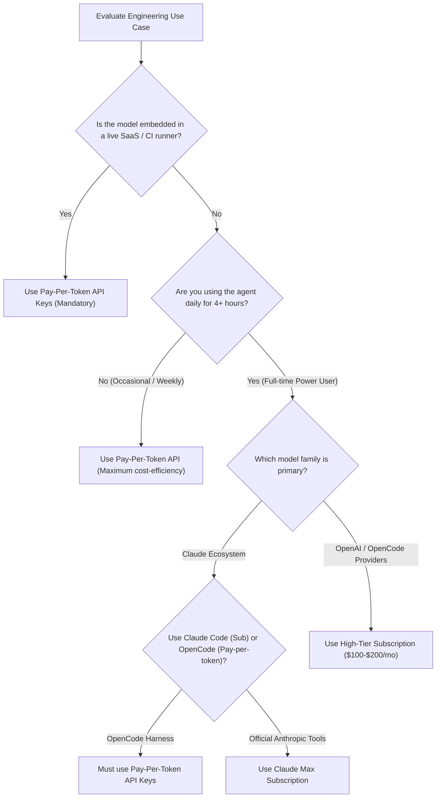

#AICoding #Billing #APIPricing #Subscriptions #PayPerToken #OpenCode #TokenEconomics #CostOptimization

> [!abstract] Executive Summary
> Outside of self-hosting on local hardware, running autonomous AI coding agents consumes external GPU compute clusters, electricity, and network bandwidth. For engineering organizations and individual developers, funding this infrastructure divides into two distinct commercial paradigms: **Pay-per-Token API Access** and **Flat-Rate Subscription Plans**.
> 
> Choosing between pay-per-token and subscription billing is not merely a financial decision; it dictates architecture, rate limits, tool compatibility, and operational safety. While pay-per-token is essential for production applications, CI/CD runners, and occasional users, high-tier subscriptions (\$100–\$200/month) offer immense financial leverage for full-time engineers consuming thousands of dollars in raw token value. However, vendor policies—such as Anthropic’s restriction barring subscription credentials from third-party agents—introduce strategic constraints that engineers must navigate.

---

## 1. The Two Commercial Payment Paradigms

```
┌──────────────────────────────────────────────────────────────────────────────────┐
│                   PAY-PER-TOKEN VS. FLAT-RATE SUBSCRIPTION                       │
└──────────────────────────────────────────────────────────────────────────────────┘

   [ Pay-Per-Token API Access ]                       [ Subscription-Based Access ]
   ┌────────────────────────────────────────┐         ┌──────────────────────────────────────┐
   │ • Provider API Keys via `/connect`     │         │ • Monthly flat fee ($20 - $200+/mo)  │
   │ • Exact metering per 1,000 tokens      │         │ • High-volume discounted utilization │
   │ • Essential for CI/CD & live apps      │         │ • Predictable budgeting (No spikes)  │
   │ • Risk of unbounded runaway spend      │         │ • Throttled by dynamic rate limits   │
   │ • Fully compatible with OpenCode       │         │ • Some vendors restrict 3rd-party CLI│
   └────────────────────────────────────────┘         └──────────────────────────────────────┘
```

---

## 2. Deep Dive: Pay-Per-Token API Billing

With pay-per-token pricing, every request executed by an agent incurs a direct, metered cost based on the exact quantity of input and output tokens evaluated.

### Representative Uncached Rates (OpenCode Console Benchmarks):
| Model Name | Full Model Identifier | Input Cost (Per 1M Tokens) | Output Cost (Per 1M Tokens) |
| :--- | :--- | :--- | :--- |
| **DeepSeek V4.1 Flash Free** | `opencode/deepseek-v4.1-flash-free` | **Free** | **Free** |
| **GPT 5.6 Sol** | `openai/gpt-5.6-sol` | \$4.00 | \$20.00 |
| **Claude Opus 5** | `anthropic/claude-opus-5` | \$5.00 | \$25.00 |
| **Claude Fable 5.1** | `anthropic/claude-fable-5-1` | \$10.00 | \$50.00 |

### Advantages:
1. **Zero Minimum Spend:** If you take two weeks off or use the agent sparingly, your bill is zero or a few cents.
2. **Production Viability:** Pay-per-token is the only pricing model permitted when embedding LLMs into automated production services, internal Slack bots, or user-facing SaaS products.
3. **Universal Compatibility:** Any agent harness (OpenCode, Cursor, Aider, custom scripts) can connect via standard API keys.

### The Operational Risk (Runaway Loops):
If an autonomous agent enters an unconstrained retry loop (e.g., repeatedly failing a test and re-reading a 100,000-token repository without human intervention), pay-per-token accounts can incur massive unexpected charges overnight. **Always configure hard spend limits in provider dashboards.**

---

## 3. Deep Dive: Subscription-Based Access

Major model providers offer flat-rate monthly subscriptions tailored for developers:
- **Base Tiers (\$20/month):** ChatGPT Plus, Claude Pro, Gemini Advanced.
- **High Tiers (\$100–\$200+/month):** ChatGPT Pro, Claude Max, Gemini AI Ultra.

### The Financial Leverage of Subscriptions:
For a software engineer using an agent 6 to 8 hours a day, the sheer volume of code ingested into context windows can easily exceed **50 million to 100 million input tokens per month**. 

```
┌────────────────────────────────────────────────────────────────────────┐
│                   THE POWER-USER SUBSCRIPTION LEVERAGE                 │
├────────────────────────────────────────────────────────────────────────┤
│ Scenario: Full-time engineer running an agent throughout the workday   │
│ • Raw API Token Cost at standard rates:    ~$1,200.00 / month          │
│ • Flat-rate Developer Subscription Cost:   ~$200.00 / month            │
│ ───────────────────────────────────────────────────────────────────────│
│ Net Monthly Savings:                       ~$1,000.00 (500% ROI!)      │
└────────────────────────────────────────────────────────────────────────┘
```

### The Trade-offs & Limitations:
1. **Subscriptions Are Not Unlimited:** Flat-rate plans are still governed by dynamic rate limits, hourly message caps, and concurrency throttles during peak cloud congestion.
2. **Financial Waste for Occasional Users:** If you only use an agent a few times a week, paying \$20 to \$200 per month is significantly more expensive than paying \$0.50–\$3.00 on metered tokens.

---

## 4. The Vendor Lock-in Walled Garden: Anthropic’s Policy

> [!WARNING] The Anthropic Subscription Restriction
> Anthropic’s terms of service **explicitly forbid using Claude Pro or Claude Max subscription credentials inside third-party coding agents like OpenCode**.

```
┌──────────────────────────────────────────────────────────────────────────────────┐
│                           THE ANTHROPIC CREDENTIAL SPLIT                         │
└──────────────────────────────────────────────────────────────────────────────────┘

   [ Claude Pro / Max Subscription ($20 - $200/mo) ] ──► ONLY Official Anthropic Tools
                                                         • Claude Web App
                                                         • Official Claude Code CLI
   
   [ Third-Party Agent Harnesses (OpenCode, etc.) ]   ──► REQUIRES Pay-Per-Token API Keys
                                                         • Must generate API key at console.anthropic.com
                                                         • Billed per token (No subscription offset)
```

If an engineer attempts to plug their Claude Max subscription session token into OpenCode, the request will be rejected or risk account suspension. To use Claude models within OpenCode, developers must configure a pay-per-token Anthropic API key via `/connect`.

---

## 5. Economic Breakeven & Decision Framework

### The Occasional User Question:
> *For occasional use of a paid model, which payment option is most cost-effective?*
> 
> **Answer: Pay-Per-Token.** 
> An engineer invoking an agent occasionally (e.g., 20 requests a month on a mid-tier model) will spend under **\$1.00 to \$3.00 in raw tokens**, making a \$20/month base subscription or a \$200/month pro subscription financially wasteful.



---

## 6. Summary Comparison Matrix

| Factor | Pay-Per-Token API | Flat-Rate Subscription |
| :--- | :--- | :--- |
| **Billing Model** | Direct unit cost per 1M tokens | Fixed monthly recurring charge (\$20–\$200/mo) |
| **Best For** | Occasional coders, CI/CD, production apps | Daily full-time power developers |
| **Runaway Risk** | High (infinite loops can spike bill) | Zero (capped by flat monthly rate) |
| **Usage Ceilings** | High (governed by account credit tier) | Throttled by rolling hourly/daily caps |
| **Third-Party Agent Support** | 100% universal support | Vendor-dependent (e.g., Anthropic restricts usage to official tools) |
| **Idle Cost** | \$0.00 when not in use | Sunk cost regardless of utilization |
