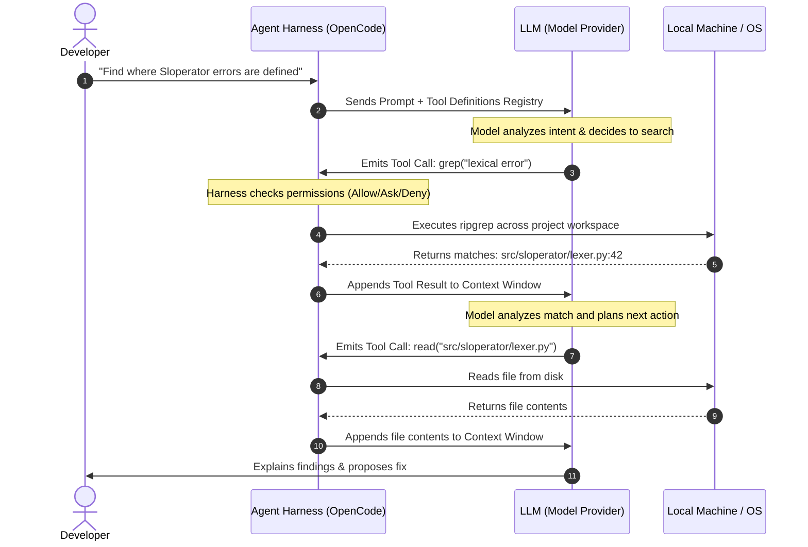

#AICoding #ToolCalling #AgentHarness #ReAct #FunctionCalling #OpenCode #SystemDesign #APIs

> [!abstract] Executive Summary
> Without tools, a Large Language Model is merely a passive conversationalist trapped in a chat window. It can suggest code snippets, describe refactoring strategies, or brainstorm algorithms, but it cannot touch a filesystem, run a compiler, or verify test suites.
> 
> **Tools transform an LLM into an autonomous agent.** A tool is fundamentally a structured function interface that the model is permitted to invoke. However, a foundational truth of AI systems engineering is that **the model never executes tools directly**. Instead, the model outputs a structured JSON text payload requesting a tool call; the **Agent Harness (OpenCode)** intercepts this request, validates permissions, executes the action on the host machine, and feeds the resulting text output back into the model's context window. This guide deconstructs tool schemas, the tool execution lifecycle, and the ReAct feedback loop.

---

## 1. From Passive Chatbot to Active Agent

The difference between a chatbot and a coding agent lies entirely in the presence of an execution harness equipped with tools:

```
┌──────────────────────────────────────────────────────────────────────────────────┐
│                          CHATBOT VS. CODING AGENT                                │
└──────────────────────────────────────────────────────────────────────────────────┘

   [ Passive Chatbot (Browser / Chat Box) ]
   Developer: "Fix the bug in handlers.go"
   Model:     "Here is what you should do: open handlers.go, find line 42, 
               replace it with X, and run 'go test' in your terminal."
   (Action Required: Human must manually copy-paste, edit, and test)

   [ Autonomous Coding Agent (OpenCode Harness + Tools) ]
   Developer: "Fix the bug in handlers.go"
   Model:     [Issues Tool Call: read("internal/api/handlers.go")]
   Harness:   [Reads file from disk and injects text into context]
   Model:     [Issues Tool Call: edit("internal/api/handlers.go", diff)]
   Harness:   [Applies edit to disk]
   Model:     [Issues Tool Call: shell("go test ./...")]
   Harness:   [Runs test runner, captures exit code: 0]
   Model:     "Fixed the nil-pointer dereference in handlers.go. All tests pass!"
```

---

## 2. What Is a Tool? The JSON Schema Contract

To an LLM, a tool is defined as a **declarative schema** describing its name, purpose, and argument types. When an agent session initializes, OpenCode provides the model with a registry of available tools in its system prompt:

```json
{
  "name": "read",
  "description": "Read the contents of a file from the workspace",
  "parameters": {
    "type": "object",
    "properties": {
      "path": {
        "type": "string",
        "description": "The relative or absolute file path to read"
      }
    },
    "required": ["path"]
  }
}
```

### The Tool Call Payload:
When the model determines it needs information from a file, it stops generating human prose and outputs a structured **Tool Call** request:

```json
{
  "tool": "read",
  "args": {
    "path": "internal/api/handlers.go"
  }
}
```

---

## 3. Who Executes the Tool Call? The Agent Harness

> [!IMPORTANT] The Separation of Reasoning and Execution
> **The LLM does NOT execute code, open files, or access the network.** 
> An LLM is purely a matrix of static weights calculating conditional probability distributions over token sequences. It has no operating system privileges, no network sockets, and no file descriptors.
> 
> **The Agent Harness executes the tool call.** The harness parses the model's JSON output, verifies security policies, calls host system APIs, and appends the result to the context window.



---

## 4. The Illusion of Direct Action: Text-In, Text-Out

A well-engineered agent harness creates the seamless illusion that the AI model is "sitting at your keyboard," directly interacting with your terminal and editor.

In technical reality:
1. Everything sent **to** the model is **plain text** (prompts, tool definitions, file contents, test stack traces).
2. Everything emitted **by** the model is **plain text** (chat responses, JSON tool call strings).
3. The harness acts as the **bridge between the text world and the physical system**, converting structured text into system calls and system call responses back into text.

---

## 5. Multi-Step ReAct Tool Chaining

Autonomous problem-solving emerges when an agent chains multiple tools together sequentially:

```
┌──────────────────────────────────────────────────────────────────────────────────┐
│                         MULTI-STEP TOOL EXECUTION CHAIN                          │
└──────────────────────────────────────────────────────────────────────────────────┘

   1. Discovery (glob / grep)   ──► Locate files containing the target pattern
              │
              ▼
   2. Ingestion (read)          ──► Load relevant source files into context
              │
              ▼
   3. Reasoning (Thinking)      ──► Analyze root cause & formulate patch
              │
              ▼
   4. Mutation (edit / patch)   ──► Apply changes cleanly to disk
              │
              ▼
   5. Verification (shell)      ──► Run test runner (pytest / go test)
              │
              ▼
   6. Completion (Response)     ──► Report success and explain modifications
```

If Step 5 fails (e.g., test runner returns exit code `1`), the agent does not quit. It ingests the test failure output, formulates a new hypothesis, issues another `edit` tool call, and re-runs Step 5 until the verification succeeds.

---

## 6. Summary & Mental Models

1. **Tools = Action:** Tools bridge the gap between talking about code and actually modifying code.
2. **Schema Contract:** Tools are defined via JSON schema; the model requests invocations using structured arguments.
3. **The Harness is the Engine:** The LLM requests actions; the agent harness evaluates permissions and executes them on the host system.
4. **Text-In, Text-Out Architecture:** Despite the appearance of direct system control, tool-calling is entirely governed by structured text exchange between the model and the harness.
