#AICoding #Sandboxing #Security #BlastRadius #Docker #VirtualMachines #DevOps #Autonomy

> [!abstract] Executive Summary
> Granting an autonomous LLM coding agent direct execution access to your primary workstation creates substantial security exposure. Because Large Language Models are stochastic systems capable of generating unpredictable code, allowing an agent unrestricted access to your personal filesystem, SSH keys, browser cookies, and network devices introduces significant risk.
> 
> **Sandboxing** solves this by containing the agent inside an isolated execution boundary—a **Docker container**, **Docker AI Sandbox**, or **disposable Virtual Machine (VM)**. By limiting the blast radius of rogue commands or malicious dependency install scripts, sandboxing protects host assets. Furthermore, sandboxing unlocks a major **Productivity Paradox**: when an environment is disposable, engineers can safely grant broad `"allow"` permissions, enabling agents to operate for hours in unattended, autonomous workflows without constant human babysitting.

---

## 1. The Blast Radius Dilemma

When an agent executes `shell` commands directly on a developer workstation, its blast radius spans everything the developer's user account can touch:

```
┌──────────────────────────────────────────────────────────────────────────────────┐
│                   UNCONSTRAINED WORKSTATION VS. SANDBOXED RUNTIME                │
└──────────────────────────────────────────────────────────────────────────────────┘

   [ Unconstrained Workstation Execution ]
   ┌────────────────────────────────────────────────────────────────────────┐
   │ Developer Machine                                                      │
   │  ├── ~/.ssh/id_rsa                 (Vulnerable to exfiltration)        │
   │  ├── ~/.aws/credentials            (Vulnerable to compromise)          │
   │  ├── /home/user/Personal_Documents (Vulnerable to accidental deletion) │
   │  └── Agent running under host user (Can execute `rm -rf`, curl | bash) │
   └────────────────────────────────────────────────────────────────────────┘

   [ Sandboxed Execution Environment ]
   ┌────────────────────────────────────────────────────────────────────────┐
   │ Host Workstation (Protected)                                           │
   │  │                                                                     │
   │  └── Isolated Boundary (Disposable VM / Docker Sandbox)               │
   │       ├── Isolated Filesystem (Project files only)                     │
   │       ├── Zero Host Credentials (No SSH keys, no cloud tokens)         │
   │       └── Scoped Network (Restricted egress)                           │
   └────────────────────────────────────────────────────────────────────────┘
```

### When Must You Sandbox?
1. **Executing Sketchy or Unfamiliar Install Scripts:** Running open-source setup routines (`curl -fsSL https://... | bash`, untrusted `npm postinstall` scripts, unverified Python wheels).
2. **Working in High-Security Environments:** Codebases touching customer PII, HIPAA-compliant healthcare records, or SOC2-audited banking infrastructure.
3. **High-Autonomy Unattended Workflows:** When running agents (like OpenCode or OpenClaw) overnight or AFK with minimal human approval prompts.

> [!IMPORTANT] The Golden Rule of Sketchy Scripts
> If an agent needs to evaluate third-party dependencies or execute unknown install scripts, **the safest execution environment is a disposable Virtual Machine with zero access to your personal files or host credentials**.

---

## 2. The Sandboxing Spectrum: Comparing Isolation Layers

Engineering teams deploy sandboxing across a spectrum of operational complexity and security isolation:

```
┌─────────────────────────────────────────────────────────────────────────────────────────┐
│                                 THE SANDBOXING SPECTRUM                                 │
├──────────────────────────┬─────────────────────────────┬────────────────────────────────┤
│ Isolation Level          │ Technology                  │ Primary Trade-Offs             │
├──────────────────────────┼─────────────────────────────┼────────────────────────────────┤
│ 1. Dedicated Hardware    │ Separate physical machine   │ Maximum physical isolation;    │
│                          │ (Air-gapped laptop / NUC)   │ high cost & hardware friction. │
├──────────────────────────┼─────────────────────────────┼────────────────────────────────┤
│ 2. Virtual Machine (VM)  │ Disposable Cloud / Local VM │ Complete OS kernel boundary;   │
│                          │ (AWS EC2, UTM, Lima, QEMU)  │ slightly higher startup time.  │
├──────────────────────────┼─────────────────────────────┼────────────────────────────────┤
│ 3. Containerized Sandbox │ Docker / Docker AI Sandboxes│ Lightweight & instant startup; │
│                          │ (Scoped namespace & cgroups)│ shares host kernel.            │
└──────────────────────────┴─────────────────────────────┴────────────────────────────────┘
```

---

## 3. Container Pitfalls: Mounts, Credentials, and Networks

While Docker containers are the most common sandboxing mechanism, improper configuration can inadvertently pierce the isolation boundary:

```
┌────────────────────────────────────────────────────────────────────────┐
│                      CONTAINER ISOLATION PITFALLS                      │
├────────────────────────────────────────────────────────────────────────┤
│ 1. Writeable Bind Mounts (`-v /home/user:/workspace`):                 │
│    Mounting the entire user home directory gives the container write   │
│    access to host files. A rogue command inside Docker can mutate host │
│    files outside the project!                                          │
│                                                                        │
│ 2. Credential Injection:                                               │
│    Forwarding SSH agent sockets (`-v /ssh-agent:/ssh-agent`) or       │
│    mounting `~/.aws` gives untrusted code access to production clouds. │
│                                                                        │
│ 3. Unconstrained Host Networking (`--net=host`):                       │
│    Allows code inside the container to port-scan the developer's local │
│    home/office network and communicate with unauthenticated local DBs. │
└────────────────────────────────────────────────────────────────────────┘
```

### The Hardened Container Rule:
- Mount **only the specific project folder** into the container.
- If the project requires read-only references to libraries, mount them with `:ro` (read-only).
- Use isolated container bridge networks with restricted outbound egress where appropriate.

---

## 4. The Productivity Paradox of Sandboxing

Most developers assume that security guardrails inherently slow down development velocity. In autonomous agent engineering, the opposite is true:

```mermaid
flowchart TD
    subgraph Host_Machine ["Unsandboxed Host Machine: Low Productivity"]
        H1["Agent executes on host workstation"] --> H2["High Risk of accidental damage"]
        H2 --> H3["Engineer configures strict 'ask' permissions on shell"]
        H3 --> H4["Agent pauses every 45 seconds for human approval"]
        H4 --> H5["Engineer suffers from confirmation fatigue & babysits agent"]
    end
    
    subgraph Sandboxed_VM ["Sandboxed Disposable Environment: High Productivity"]
        S1["Agent executes inside disposable VM / Docker Sandbox"] --> S2["Zero Risk to personal files & credentials"]
        S2 --> S3["Engineer configures broad 'allow' permissions across tools"]
        S3 --> S4["Agent executes tests, installs packages, and iterates autonomously"]
        S4 --> S5["Engineer steps away (AFK) while agent delivers complete PR"]
    end
```



### Why Sandboxing Unlocks Velocity:
1. **Elimination of Babysitting:** In an unsandboxed terminal, you must inspect every `rm`, `git checkout`, or `curl` command. In a disposable container, you can set `permissions: [{ action: "shell", resource: "*", effect: "allow" }]`.
2. **Safe Unattended Autonomy:** You can leave the agent running for hours. If it breaks the environment or corrupts files, simply discard the container (`docker rm -f`) or revert the VM snapshot in five seconds.

---

## 5. Summary & Decision Matrix

| Engineering Context | Recommended Environment | Permission Posture |
| :--- | :--- | :--- |
| **Familiar daily repo, standard tasks** | Local Workstation Terminal | Strict permissions (`ask` on shell/git push; `allow` on linters). |
| **Evaluating untrusted code / packages** | **Disposable VM (EC2 / Local VM)** | Fully isolated; zero personal credentials mounted. |
| **High-autonomy refactoring / overnight** | **Docker Sandbox / Container** | Broad `allow` permissions; only repo mounted; unattended run. |
| **Production Slack / Discord bots (OpenClaw)** | Dedicated Private Cloud VM | Read-only database replicas; strictly scoped service accounts. |
