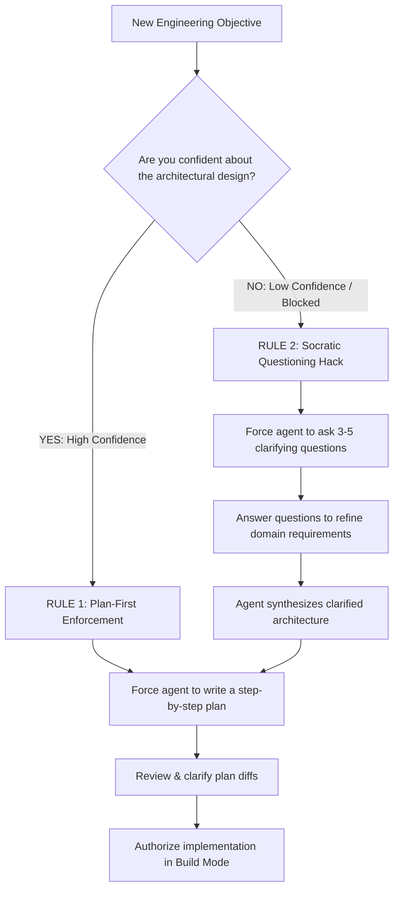

#AICoding #PlanMode #BuildMode #SocraticPrompting #Alignment #Checklists #Architecture

> [!abstract] Executive Summary
> In complex software development, immediately diving into code generation without architectural alignment is the fastest way to introduce compounding technical debt. Coding agents can modify hundreds of lines in seconds; if their foundational plan is flawed, they will produce hundreds of lines of flawed code at equal speed.
> 
> OpenCode provides two built-in operational modalities to govern this workflow: **Build Mode** (full filesystem mutation privileges) and **Plan Mode** (mutation-blocked inspection). While some developers use Plan Mode for strict enforcement, many senior engineers adopt the **"Plan-in-Build"** pattern, directing the agent to formulate structured checklists before touching source code. Crucially, aligning with an agent follows two golden rules: **when confident, demand a plan first; when unconfident, force the agent to interview you with clarifying questions (Socratic Prompting)**.

---

## 1. Build Mode vs. Plan Mode: Execution Boundaries

OpenCode enforces a strict operational separation between its two primary agent modalities:

```
┌──────────────────────────────────────────────────────────────────────────────────┐
│                           BUILD MODE VS. PLAN MODE                               │
└──────────────────────────────────────────────────────────────────────────────────┘

   [ Build Mode (Default) ]                           [ Plan Mode ]
   ┌────────────────────────────────────────┐         ┌──────────────────────────────────────┐
   │ • Full code mutation access            │         │ • Mutation tools STRICTLY BLOCKED    │
   │ • Tools: `edit`, `write`, `patch`      │         │ • Cannot touch repository code       │
   │ • Executes shell commands & tests      │         │ • Writes ONLY dedicated plan files   │
   │ • Directly delivers implementation     │         │ • Focuses on inspection & synthesis  │
   └────────────────────────────────────────┘         └──────────────────────────────────────┘
```

### Tool Access Comparison:

| Capability | Build Mode | Plan Mode |
| :--- | :--- | :--- |
| **Inspect Code (`read`, `grep`, `glob`)** | 🟢 Allowed | 🟢 Allowed |
| **Run Terminal Commands (`shell`)** | 🟢 Allowed | 🟢 Allowed |
| **Ask Clarifying Questions (`question`)** | 🟢 Allowed | 🟢 Allowed |
| **Mutate Project Source Files (`edit`, `write`, `patch`)** | 🟢 Allowed | 🔴 **Blocked by Harness** |
| **Write Dedicated Plan Files (`plan.md`)** | 🟢 Allowed | 🟢 Allowed |

In Plan Mode, if the model hallucinates an `edit` or `write` tool call targeting a source file like `src/api.py`, the OpenCode harness intercepts and rejects the call, ensuring the agent cannot mutate code prematurely during exploratory research.

---

## 2. The "Plan-in-Build" Pattern

While Plan Mode provides a hard runtime sandbox against accidental edits, many senior engineers prefer working exclusively in **Build Mode** using procedural instructions:

```
┌────────────────────────────────────────────────────────────────────────┐
│                      THE "PLAN-IN-BUILD" PATTERN                       │
├────────────────────────────────────────────────────────────────────────┤
│ Developer: "We need to refactor our authentication middleware.         │
│             DO NOT modify any source code yet.                         │
│             1. Inspect src/auth/ and identify all middleware hooks.    │
│             2. Generate a structured step-by-step checklist in         │
│                docs/refactor-plan.md.                                  │
│             3. Pause and wait for my review."                          │
└────────────────────────────────────────────────────────────────────────┘
```

### Why Senior Engineers Use This Pattern:
1. **Eliminates Mode-Switching Friction:** Avoids bouncing between separate CLI modes or restarting agent sessions.
2. **Context Continuity:** The agent that drafted the checklist retains the entire research and AST context when transitioning into the implementation phase.
3. **Model Adherence:** Modern frontier reasoning models (Claude 3.5 Sonnet, GPT-5, DeepSeek V4.1) reliably adhere to negative constraints (*"do not edit source code yet"*) without needing hard runtime blocking.

---

## 3. The Two Golden Rules of Agent Alignment

How you interact with an agent depends fundamentally on your level of clarity regarding the solution:



---

## 4. The Socratic Prompting Hack: Overcoming the Blank Page

When engineers feel stuck or face ambiguous legacy systems, they often write vague prompts:
```text
❌ Vague Prompt (Low Quality):
"I need to add caching to the application. What should I do?"
```
This forces the model to guess your infrastructure, your eviction policies, your consistency requirements, and your framework conventions, resulting in generic, unhelpful suggestions.

### The Socratic Directive:
Instead, force the agent to act as an **interactive technical interviewer**:

```text
✅ Socratic Prompt (High Quality):
"I need to introduce caching to our user profile endpoints, but I want to ensure 
we don't introduce cache staleness bugs. 

Before proposing an architecture or writing any code, inspect the repository and 
ask me 3 to 5 targeted technical questions regarding our data access patterns, 
invalidation requirements, and consistency constraints."
```

```
┌──────────────────────────────────────────────────────────────────────────────────┐
│                     THE SOCRATIC INTERACTION SEQUENCE                            │
└──────────────────────────────────────────────────────────────────────────────────┘

   Developer: "Ask me 4 questions about our caching needs before writing code."
   
   Agent Inspects Repo & Inquires:
   1. "I see you use Redis in docker-compose.yml. Should we use Redis or in-memory LRU?"
   2. "Do user profile updates require immediate Cache-Aside invalidation or write-through?"
   3. "What is the acceptable staleness TTL for public profile lookups?"
   4. "Should cache misses return 404s directly or query PostgreSQL as a fallback?"
   
   Developer Replies in 30 Seconds:
   "1. Redis. 2. Cache-aside on update. 3. 5-minute TTL. 4. Query PostgreSQL."
   
   Agent: Synthesizes a bulletproof, 100% aligned implementation plan!
```

> [!TIP] Why Socratic Prompting Works
> Large Language Models struggle with unprompted, spontaneous creativity. However, they are **world-class at recognizing missing variables and interrogating edge cases**. Forcing an agent to question you externalizes your tacit knowledge, transforming vague intentions into precise engineering specifications.

---

## 5. Summary & Workflow Guidelines

| Context | Best Practice | Operational Benefit |
| :--- | :--- | :--- |
| **Complex Refactors** | Demand a Markdown checklist before edits | Catches flawed architectural assumptions before code is broken. |
| **Ambiguous Requirements** | Instruct agent to ask clarifying questions | Prevents hallucinatory architectures and aligns on constraints. |
| **Exploratory Audits** | Use Plan Mode or "Plan-in-Build" | Protects codebase from premature writes while mapping dependencies. |
| **Execution Phase** | Review the plan, approve, and execute | Provides the agent with a verified roadmap for autonomous execution. |
