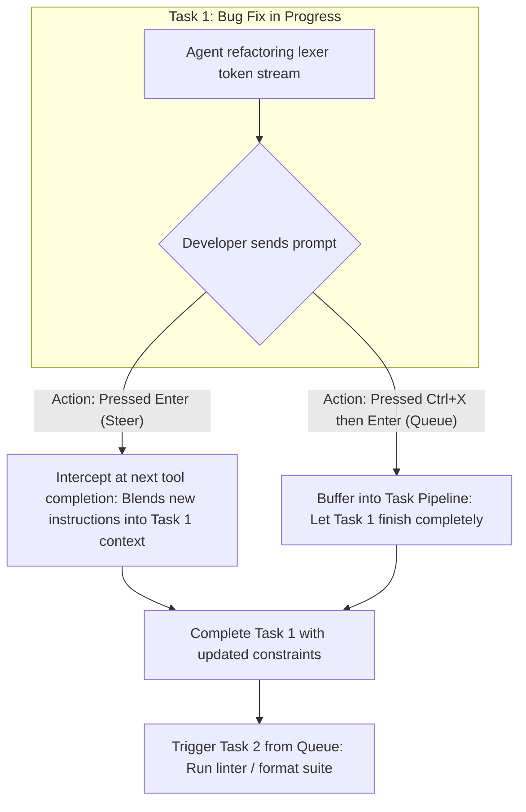

#AICoding #PromptEngineering #Queueing #Steering #SoftwareArchitecture #TaskDecomposition #DesignPatterns #OpenCode

> [!abstract] Executive Summary
> Mastering autonomous coding agents requires more than knowing how to structure a single prompt; it requires **temporal task orchestration and architectural boundary discipline**. As developers collaborate with agents on complex codebases, they must distinguish between modifying an in-flight operation (**Steering**) versus scheduling a sequential follow-up (**Queueing** via `Ctrl+X, Enter`).
> 
> Furthermore, real-world case studies prove that domain expertise and architectural judgment far outweigh generic "prompting cheatsheets." AI models suffer from predictable cognitive failure modes: they aggressively over-abstract or under-abstract, fail to notice existing repository design patterns, expand blast radiuses across unrelated files, and derail when handed monolithic multi-tier tasks. By applying **Scope Clarification**, **Abstraction Constraints**, **Pattern Anchoring**, and **Step-by-Step Task Decomposition**, engineers transform unpredictable models into reliable production teammates.

---

## 1. Temporal Orchestration: Steering vs. Queueing

When an agent is actively executing a task, an engineer frequently realizes a follow-up action is needed. Confusing a *correction* with a *follow-up* is a primary source of agent derailment:

```
┌──────────────────────────────────────────────────────────────────────────────────┐
│                            STEERING VS. QUEUEING                                 │
└──────────────────────────────────────────────────────────────────────────────────┘

   [ Steering: `Enter` while running ]                 [ Queueing: `Ctrl+X` then `Enter` ]
   ┌────────────────────────────────────────┐          ┌────────────────────────────────────────┐
   │ • Intent: A CORRECTION to current task │          │ • Intent: A SEQUENTIAL FOLLOW-UP       │
   │ • Delivery: Intercepts at step boundary│          │ • Delivery: Waits until task completes │
   │ • Blends new context into active loop  │          │ • Starts fresh turn after exit code 0  │
   │ • Example: "Make sure IDs are UUIDv7"  │          │ • Example: "Run ruff format when done" │
   └────────────────────────────────────────┘          └────────────────────────────────────────┘
```



### The Pitfall of Inadvertent Steering:
If an agent is midway through a delicate bug fix and you type:
> *"Run `uv run ruff format` on the codebase"* (and press `Enter`)

The agent will interpret this as an **in-flight steering directive**. It may halt its AST debugging, run the formatter across uncommitted, half-broken files, alter line numbers, and invalidate its own active reasoning trace. 

**The Rule:** If an instruction is a sequential next step rather than a correction to the active turn, **always queue it (`Ctrl+X, Enter`)**.

---

## 2. Production Case Studies: The 4 Core Prompting Patterns

Consider an engineer working on a large-scale e-commerce platform (e.g., Amazon-style marketplace). Below are real-world before-and-after case studies demonstrating how subtle prompt adjustments alter agent execution.

---

### Case 1: Scope Clarification & Blast Radius Containment

```
❌ Worse (Ambiguous Scope):
"Customer reviews aren't displaying large enough to be easily read; increase the font size."

Why It Fails:
The agent has no architectural boundary. It may increase font sizes across the homepage,
the product details page, the customer profile view, and mobile email templates, introducing
massive UI regressions across 15 different templates.

✅ Better (Explicit Scope Boundary):
"Customer reviews on the product checkout page are hard to read; increase the font size 
of those reviews only."
```

*Architectural Principle:* Without explicit scope constraints, an agent’s search space is the entire repository. Always define the exact page, module, or component boundary to prevent blast-radius expansion.

---

### Case 2: The Abstraction Trap (Over vs. Under-Abstraction)

LLMs notoriously oscillate between two extremes:
1. **Over-Abstraction:** Creating 4 new interfaces, factory classes, and unused generic type parameters for a 2-line styling tweak.
2. **Under-Abstraction:** Copy-pasting 50 lines of duplicate component code rather than adding a parameter to a shared component.

```
❌ Worse (Unconstrained Implementation):
"Customer reviews on the product checkout page are hard to read; increase the font size 
of those reviews only."

✅ Better (Guarded Abstraction):
"Customer reviews on the product checkout page are hard to read; increase the font size 
of those reviews only. If the component is shared across other views, add a configurable 
fontSize prop with the current size as the default."
```

*Architectural Principle:* Guide the abstraction level explicitly. Instruct the agent whether to extend an existing interface via parameters or isolate changes locally.

---

### Case 3: Pattern Anchoring (Referencing Existing Canonical Code)

The model possesses strong pattern-matching capabilities, but it will not exhaustively explore your codebase to discover the "idiomatic company way" of doing things if a simpler generic solution comes to mind.

```
❌ Worse (Unanchored Request):
"The checkout page currently always shows the price in US dollars. 
It should localize the price to the user's currency."

Why It Fails:
The model will happily invent its own currency conversion utility, install a third-party 
npm package, or format currencies using a pattern completely inconsistent with the rest 
of the application.

✅ Better (Pattern-Anchored):
"The checkout page currently always shows the price in US dollars. It should localize 
the price to the user's currency. Take a look at src/components/gift-card.tsx, which 
already implements our currency localization hook."
```

*Architectural Principle:* If a problem has already been solved elsewhere in the repository, point the agent directly to the file. This guarantees architectural consistency and prevents library duplication.

---

### Case 4: Task Decomposition vs. The Monolithic "One-Shot" Fallacy

Attempting to "one-shot" complex full-stack features is a high-risk gamble that frequently ends in broken database migrations, incompatible API schemas, and unmanageable 1,000-line git diffs.

```
❌ Worse (Monolithic Multi-Tier Request):
"Build me a new checkout experience from scratch using Stripe."

Why It Fails:
The agent must simultaneously invent database models, Stripe webhook handlers, backend 
REST controllers, frontend state machines, and payment forms. If an error occurs on Step 2, 
all subsequent code is built on a hallucinated foundation.
```

```
✅ Better (Step-by-Step Modular Milestones):

Milestone 1 (UI Scaffold):
"Build a new CheckoutReview component on the frontend using mock order data. 
Focus only on layout and component state; do not touch backend APIs yet."
[Human Review: Validate UX & Component State]

Milestone 2 (Backend Endpoints):
"Implement the POST /api/checkout/session endpoint in internal/api/checkout.go. 
Verify integration with Stripe test tokens and ensure unit tests pass."
[Human Review: Validate API Contracts & Idempotency Keys]

Milestone 3 (Integration):
"Connect the frontend CheckoutReview component to the new /api/checkout/session endpoint, 
handling loading states and payment failure error toasts."
[Human Review: End-to-End Verification]
```

*Architectural Principle:* Break full-stack tasks into deterministic milestones. Verify the frontend contract or API schema independently before wiring them together.

---

## 3. Summary & Production Prompting Matrix

| Failure Mode | Root Cause | Engineering Remediation |
| :--- | :--- | :--- |
| **Blast-Radius Creep** | Model touches unrelated files across repo | **Clarify Scope:** Explicitly name the component and target view. |
| **Over / Under Abstraction** | Model guesses architectural structure | **Constrain Design:** Instruct whether to add props or isolate components. |
| **Inconsistent Conventions**| Model invents custom helpers | **Pattern Anchoring:** Point to existing reference files (`@path`). |
| **Runaway Hallucinations** | Tasks too large to reason about zero-shot | **Decompose Tasks:** Split frontend scaffolding from backend APIs. |
| **Task Disruption** | Sending next-step instructions mid-flight | **Queueing:** Press `Ctrl+X, Enter` to run follow-ups after task completion. |
