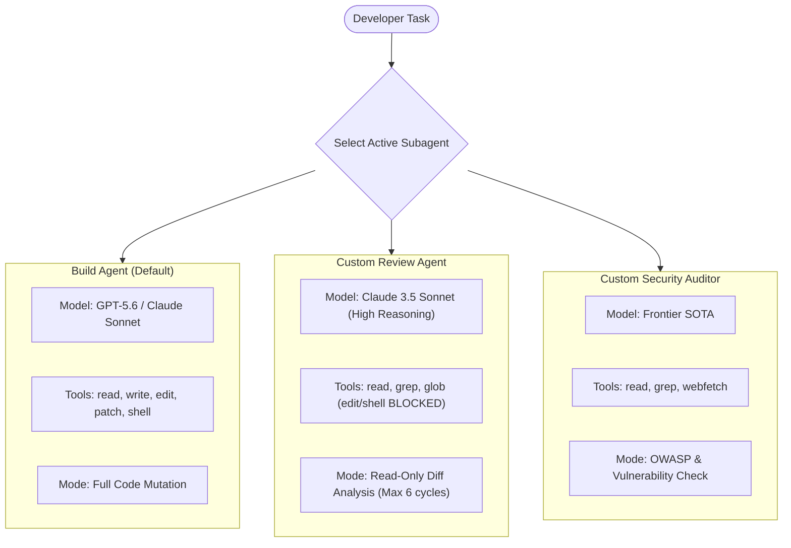

#AICoding #Subagents #AgentArchitecture #Security #CodeReview #OpenCode #SystemDesign #Permissions

> [!abstract] Executive Summary
> In modern software engineering, the term **"Agent"** is notoriously overloaded. OpenCode itself is referred to as a "coding agent"; autonomous 24/7 background bots like OpenClaw are called "agents"; and the specialized, configurable personas *within* OpenCode are also called "agents."
> 
> In OpenCode's configuration architecture, an **Agent** is an isolated, configurable AI assistant defined by its own **system prompt, model selection, tool permissions, and cycle limits**. Rather than relying on a single all-powerful agent equipped with unrestricted write and shell access, production engineering teams deploy **specialized subagent personas** (such as a read-only Code Review Agent or a Security Auditor) to enforce least privilege, constrain execution scope, and prevent runaway token consumption.

---

## 1. Disambiguating the "Agent" Taxonomy

To prevent architectural confusion, software engineers must distinguish between the three distinct layers of agency:

```
┌──────────────────────────────────────────────────────────────────────────────────┐
│                             THE THREE AGENT LAYERS                               │
└──────────────────────────────────────────────────────────────────────────────────┘

   [ Layer 1: The Autonomous Harness ]
   OpenCode CLI / Daemon
   • Manages the terminal interface, tool execution, process supervision, and Git state.
   
   [ Layer 2: The Enterprise Background Agent ]
   OpenClaw Daemon
   • Runs 24/7 on a private cloud VM, listening to team Slack/Discord channels via ACP.
   
   [ Layer 3: Configurable Subagent Personas (Session Level) ]
   Build Agent  |  Plan Agent  |  Custom Review Agent  |  Security Auditor
   • Configurable personas inside OpenCode with isolated prompts, tools, and limits.
```

---

## 2. Anatomy of a Configurable Subagent

By default, OpenCode ships with two primary built-in agent personas:
- **Build Agent (Default):** Unrestricted access to file mutations (`edit`, `write`, `patch`), shell commands, and read tools.
- **Plan Agent:** Read-only inspection persona; file mutations on project source files are blocked by the harness.

However, complex engineering workflows require custom subagents configured across **four core architectural pillars**:

```
┌────────────────────────────────────────────────────────────────────────┐
│                      SUBAGENT CONFIGURATION PILLARS                    │
├────────────────────────────────────────────────────────────────────────┤
│ 1. Dedicated System Prompt: Specialized domain rules and standards.    │
│ 2. Scoped Model & Variant:  Fast models for triage; SOTA for auditing. │
│ 3. Tool Permission Mask:    Whitelisting read-only tools; masking write│
│ 4. Cycle Limits:            Max autonomous turns before human yielding.│
└────────────────────────────────────────────────────────────────────────┘
```



---

## 3. Case Study: The Zero-Mutation Code Review Agent

When tasking an agent with performing a code review, allowing it to modify files is an anti-pattern. A reviewer should evaluate code against architectural rules, highlight potential bugs, and suggest improvements—**without touching a single line of repository code**.

### Desired Reviewer Profile:
1. **Capability:** Can inspect any file and evaluate `git diff`.
2. **Safety:** Cannot execute destructive shell commands (`rm`, `git push`, database migrations).
3. **Guardrail:** Pre-loaded with a strict architectural checklist (e.g., checking for unindexed SQL queries, missing error handling, and unformatted strings).
4. **Budget Protection:** Capped at a maximum of **6 autonomous reasoning cycles** to prevent infinite loops before reporting to the human.

### Declarative Subagent Configuration in `opencode.jsonc`:

```jsonc
{
  "$schema": "https://opencode.ai/config.json",
  "agents": {
    "code-reviewer": {
      "description": "Read-only architectural code review agent",
      "model": "anthropic/claude-sonnet-4-5",
      "prompt": "You are a Senior Staff Code Reviewer. Inspect the git diff and codebase. Analyze changes for: 1. Concurrency race conditions. 2. SQL injection / unindexed queries. 3. Missing unit tests. Provide clear, actionable feedback. DO NOT attempt to write or edit files.",
      "permissions": [
        // Allow read and search discovery tools
        { "action": "read", "resource": "*", "effect": "allow" },
        { "action": "grep", "resource": "*", "effect": "allow" },
        { "action": "glob", "resource": "*", "effect": "allow" },
        // Hard-block all code mutation tools
        { "action": "edit", "resource": "*", "effect": "deny" },
        { "action": "write", "resource": "*", "effect": "deny" },
        { "action": "patch", "resource": "*", "effect": "deny" },
        // Hard-block all shell execution
        { "action": "shell", "resource": "*", "effect": "deny" }
      ],
      "maxCycles": 6
    }
  }
}
```

---

## 4. Preventing Runaway Token Burn with Cycle Limits (`maxCycles`)

In an agentic loop, an LLM evaluates its output and decides whether another tool call is necessary. When an agent gets confused, it can enter a **circular reasoning trap**:
- Turn 1: Reads file A.
- Turn 2: Reads file B.
- Turn 3: Reads file A again to double check.
- Turn 4: Reads file B again.

Setting a `maxCycles` threshold (e.g., `6` or `10`) acts as a **circuit breaker**:

```
Turn 1 ──► Turn 2 ──► Turn 3 ──► Turn 4 ──► Turn 5 ──► Turn 6 (LIMIT REACHED)
                                                                 │
                                                                 ▼
                                                  [Agent Halts & Yields to Human]
                                                  "I have completed 6 steps. 
                                                   Here are my findings so far..."
```

This ensures that the agent cannot exhaust your token budget or API quota while running unmonitored.

---

## 5. Summary & Subagent Design Matrix

| Subagent Persona | Target Model | Permitted Tools | Max Cycles | Core Responsibility |
| :--- | :--- | :--- | :--- | :--- |
| **`build` (Default)** | Workhorse Default | All (`read`, `edit`, `shell`) | Default (Unlimited/High) | Implementing features, fixing bugs, running tests. |
| **`plan`** | Frontier SOTA | Read-only + Plan files | 8–10 | Generating implementation checklists without code changes. |
| **`reviewer`** | Frontier SOTA | `read`, `grep`, `glob` only | 6 | Auditing git diffs against security and styling rules. |
| **`triage`** | High-Speed Flash | `read`, `grep`, `question` | 4 | Answering questions, summarizing logs, rapid discovery. |
