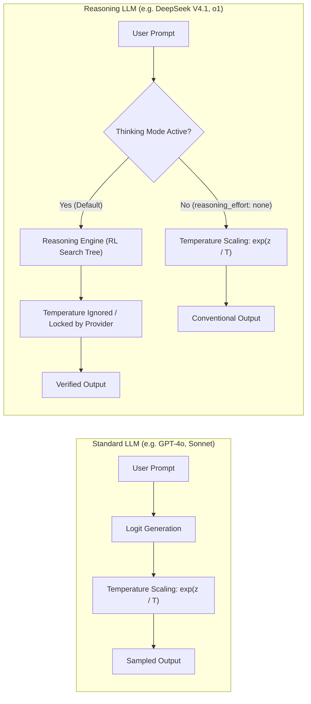

#AICoding #Hyperparameters #LLMInference #Temperature #Softmax #DeepSeek #OpenCode #SystemDesign

> [!abstract] Executive Summary
> Prompting sets the conversational context and structural guardrails for an AI agent, but **inference hyperparameters** govern the underlying statistical token sampling distribution. The most ubiquitous hyperparameter is **Temperature ($T$)**, which mathematically scales unnormalized logits prior to the softmax activation function.
> 
> While high temperature ($T \approx 0.9$) flattens probability distributions to introduce lexical divergence—ideal for naming and creative ideation—software engineering tasks overwhelmingly require low entropy and high determinism ($T \le 0.2$) to produce syntactically valid code and reliable tool calls. Furthermore, modern **reasoning models** (such as DeepSeek R1/V4.1 and OpenAI o-series) bypass temperature scaling entirely during their thinking phase, requiring explicit request payload overrides (`reasoning_effort: "none"`) to enable temperature modulation. Above all, micro-tuning hyperparameters is an engineering anti-pattern: prompt clarity, schema constraints, and deterministic test harnesses consistently outperform hours spent tweaking sampling floats.

---

## 1. The Mathematics of Temperature: Softmax Logit Scaling

When an autoregressive Large Language Model evaluates an input sequence, the final layer produces an unnormalized vector of real numbers called **logits** ($z$), where each element $z_i$ corresponds to a token in the model's vocabulary $V$:

$$\mathbf{z} = [z_1, z_2, \dots, z_V]$$

To convert these raw logits into a valid probability distribution $P$ where $\sum_{i=1}^{V} P(w_i) = 1$, the model passes them through the **Softmax function parameterized by Temperature ($T > 0$)**:

$$P(w_i) = \frac{\exp\left(\frac{z_i}{T}\right)}{\sum_{j=1}^{V} \exp\left(\frac{z_j}{T}\right)}$$

```
┌────────────────────────────────────────────────────────────────────────────────────────┐
│                        LOGIT SAMPLING UNDER DIFFERENT TEMPERATURES                     │
└────────────────────────────────────────────────────────────────────────────────────────┘

    Raw Logits (z):  [ token_A: 4.0,  token_B: 2.0,  token_C: 1.0,  token_D: 0.1 ]

    Low Temp (T = 0.1)           Default (T = 1.0)           High Temp (T = 2.0)
    Peak Sharpening (Near Greedy) Standard Softmax           Distribution Flattening
    ──────────────────────────── ──────────────────────────── ────────────────────────────
    P(A) ≈ 99.9% █▉             P(A) ≈ 84.4% ▆               P(A) ≈ 51.2% ▄
    P(B) ≈  0.1% ▏              P(B) ≈ 11.4% ▂               P(B) ≈ 23.3% ▂
    P(C) ≈  0.0%                P(C) ≈  3.8% ▏               P(C) ≈ 14.1% ▏
    P(D) ≈  0.0%                P(D) ≈  0.4%                 P(D) ≈ 11.4% ▏
    
    Result: Strict determinism   Result: Balanced sampling    Result: High chaos & entropy
```

### The Three Operational Regimes:

1. **Greedy / Deterministic Limit ($T \to 0$ or $T \le 0.2$):**
   - As $T \to 0$, the ratio $\frac{z_i}{T}$ grows dramatically. The largest logit ($z_{\text{max}}$) dominates the exponentiation, while all smaller logits decay toward zero.
   - At $T = 0$, this converges to pure **`argmax` (Greedy Search)**:
     $$P(w_{\text{max}}) \to 1.0, \quad P(w_{i \neq \text{max}}) \to 0.0$$
   - **Characteristics:** Minimal randomness, reproducible outputs, strict syntax adherence, and zero creative wandering. Essential for compiler-driven tasks, AST refactors, and JSON tool calling.

2. **Standard Native Sampling ($T = 1.0$):**
   - The logits are passed directly into the standard softmax function without scaling.
   - **Characteristics:** The model samples tokens according to the raw statistical distribution learned during pre-training and RLHF alignment.

3. **High-Entropy / Divergent Regime ($T \ge 0.8$):**
   - Scaling logits by $T > 1.0$ compresses the relative variance between high-scoring and low-scoring tokens.
   - As $T \to \infty$, the distribution approaches a **Uniform Distribution** ($P(w_i) \to \frac{1}{|V|}$), where every token in the vocabulary has an equal likelihood of being sampled.
   - **Characteristics:** Unpredictable word choices, high lexical variance, increased metaphorical associations, but drastically higher risk of syntactic corruption, hallucinations, and tool schema validation failures.

---

## 2. The Reasoning Model Exception: DeepSeek & Thinking Tokens

Modern reasoning architectures (such as **DeepSeek R1/V4.1** and **OpenAI o1/o3**) do not sample directly from standard conversational logit distributions. Instead, they leverage **Test-Time Compute** (Chain-of-Thought search trees) to evaluate, verify, and backtrack across problem spaces before emitting output tokens.



> [!WARNING] The DeepSeek Temperature Quirk
> DeepSeek's official API specifications explicitly declare that **`temperature` and `top_p` are ignored when thinking mode is active**.
> During test-time search, the engine enforces internal mathematical stability across thousands of intermediate reasoning tokens. If you supply `"temperature": 0.9` to a reasoning model while thinking tokens are enabled, the provider silently discards the parameter.
> 
> To test or enforce temperature modulation on DeepSeek models, you **must explicitly disable the thinking engine** by passing `"reasoning_effort": "none"` in the API request body.

---

## 3. Configuring Hyperparameters in OpenCode (`opencode.jsonc`)

OpenCode enables developers to inject low-level inference parameters directly into provider API payloads via the `body` dictionary within `opencode.jsonc`. This can be applied globally across a provider or scoped to a specific model or variant.

### Configuring DeepSeek V4.1 with Reasoning Disabled and Custom Temperature:

```jsonc
{
  "$schema": "https://opencode.ai/config.json",
  "model": "opencode/deepseek-v4.1-flash-free",
  "providers": {
    "opencode": {
      "models": {
        "deepseek-v4.1-flash-free": {
          "body": {
            // Disable chain-of-thought so the API honors temperature adjustments
            "reasoning_effort": "none",
            // Set inference temperature (e.g., 0.9 for creative ideation, 0.1 for deterministic output)
            "temperature": 0.9
          }
        }
      }
    }
  }
}
```

### Parameter Portability Across Providers:
Inference payload schemas are **provider-dependent**:
- **OpenAI & DeepSeek:** Use `temperature` (float $0.0 - 2.0$) and `reasoning_effort` (`"low"`, `"medium"`, `"high"`, or `"none"`).
- **Anthropic Claude:** Uses `temperature` (float $0.0 - 1.0$). If `thinking.type: "enabled"` is configured, temperature must be set to $1.0$ or omitted entirely.
- **Google Gemini:** Uses `temperature` (float $0.0 - 2.0$) and `thinkingConfig.thinkingBudget`.

---

## 4. Empirical Case Study: The "Sloperator Slogans" Experiment

To understand how temperature physically alters text generation, consider the engineering assignment of generating marketing slogans for **Sloperator** (a fictional CLI tool that detects and refactors AI-generated code slop) under two extreme temperature settings.

### Step 1: High Entropy Ideation ($T = 0.9$, `reasoning_effort: "none"`)
The model samples from the wider tail of its probability distribution, producing diverse metaphors and divergent phrasing:

```markdown
<!-- SLOGANS.md (Session 1: High Temperature T = 0.9) -->
# Sloperator Slogans (Temperature: 0.9)
1. "Mop the spaghetti, ship the lasagna: Sloperator keeps your codebase delicious."
2. "Because autonomous code shouldn't mean unmaintainable chaos."
3. "Exorcise the hallucinated demons from your git commit log."
4. "The digital scalpel for your agent's late-night caffeinated hallucinations."
5. "Sloperator: Turning stochastic vibes into hardened architecture."
```

### Step 2: Low Entropy Convergence ($T = 0.1$, `reasoning_effort: "none"`)
The model collapses to near-greedy sampling ($z_{\text{max}}$), producing standard, predictable, and repetitive corporate marketing hooks:

```markdown
<!-- SLOGANS.md (Session 2: Low Temperature T = 0.1) -->
# Sloperator Slogans (Temperature: 0.1)
1. "Clean code, faster delivery: The automated refactoring tool."
2. "Eliminate code slop with precision automated refactoring."
3. "The ultimate tool for clean, maintainable software engineering."
4. "Automated code refactoring for modern software development teams."
5. "Clean your codebase and eliminate code slop with Sloperator."
```

### Empirical Comparison:
| Metric | High Temperature ($T = 0.9$) | Low Temperature ($T = 0.1$) |
| :--- | :--- | :--- |
| **Lexical Diversity (Type-Token Ratio)** | High ($\approx 0.88$) | Low ($\approx 0.42$) |
| **Metaphorical Novelty** | High ("mop spaghetti", "digital scalpel") | Zero (literal descriptions: "clean", "maintainable") |
| **Syntactic Variance** | Asymmetrical, punchy, varied clause lengths | Symmetrical, formulaic `[Verb] [Noun] for [Target]` |
| **Reproducibility Across Runs** | Low (generates distinct slogans every run) | High (repeats near-identical slogans across runs) |
| **Failure Mode** | Can drift into nonsensical metaphors or emojis | Prone to repetitive token loops and clichés |

### Verification via Test Harness:
Once `SLOGANS.md` is populated, validation is executed non-interactively via the automated CLI test harness:
```bash
# Run local verification
bootdev run 48f9e0d1-a52b-4611-a0db-2f74d9a11850

# Submit verified solution
bootdev run -s 48f9e0d1-a52b-4611-a0db-2f74d9a11850
```

---

## 5. The "Don't Overtune" Law of Software Engineering

A pervasive pitfall among engineers transitioning into AI agent orchestration is **hyperparameter micro-optimization**: spending hours micro-tuning temperature between $0.32$ and $0.45$, adjusting Top-P from $0.90$ to $0.95$, and balancing frequency penalties.

In professional software engineering, **this is an anti-pattern**.

```
┌────────────────────────────────────────────────────────────────────────────────────────┐
│                        THE PROMPT vs. HYPERPARAMETER LEVERAGE PYRAMID                  │
└────────────────────────────────────────────────────────────────────────────────────────┘

              ▲
             / \     [ 1% Impact: Sampling Hyperparameters ]
            /   \    Temperature (0.2 vs 0.3), Top-P, Frequency Penalty.
           /─────\   Fragile across checkpoints; easily broken by model updates.
          /       \
         /─────────\   [ 20% Impact: Context & Tool Ergonomics ]
        /           \  Accurate grep outputs, AST diffs, clean file dumps (@file).
       /─────────────\
      /               \  [ 79% Impact: Explicit Constraints & Deterministic Harnesses ]
     /─────────────────\ System prompts, JSON schema validators, unit tests, linter loops.
```

### Why Overtuning Fails in Production:

1. **Model Checkpoint Drift:**
   Model providers continuously roll out quantized checkpoints, RLHF alignments, and sub-version updates (e.g., `claude-3-5-sonnet-20240620` to `20241022`). A hyperparameter calibration that worked on Tuesday will produce completely different logit distributions after next week's upstream deployment.

2. **Code Compilers Demand Determinism, Not "Creativity":**
   Programming languages are context-free grammars with deterministic Abstract Syntax Trees (ASTs). A compiler does not tolerate a "creative" semicolon or a "novel" variable name. For 98% of coding tasks, lower temperatures ($T \approx 0.0 - 0.2$) or harness defaults provide the highest syntactic correctness.

3. **Prompt Specification Strictly Dominates Sampling Knobs:**
   If an agent is generating bloated code or wandering off into extraneous dependencies, **the prompt lacks constraints**. Tweaking temperature from $0.7$ to $0.4$ will not fix an underspecified interface; specifying `"Do not import third-party libraries; use standard library http.Client only"` will fix it instantly.

---

## 6. Strategic Hyperparameter Decision Matrix

| Task Category | Optimal Temperature | Thinking / Reasoning Mode | Rationale & Failure Boundaries |
| :--- | :--- | :--- | :--- |
| **Production Refactoring & Bug Fixing** | Default / $0.0 - 0.2$ | **Enabled** (High / Medium) | Code correctness is paramount. Deterministic sampling minimizes syntax errors and preserves structural integrity. |
| **Tool Calling & JSON Extraction** | Strict $0.0$ (or low) | **Disabled / Minimal** | Tool calls require exact JSON Schema adherence. High temperature causes hallucinated keys and syntax errors. |
| **Architecture Brainstorming & Design** | $0.7 - 0.9$ | **Enabled** | Divergent ideation benefits from exploring broader probability tails, discovering alternative design patterns. |
| **Naming & Marketing Copy (Slogans)** | $0.8 - 1.0$ | **Disabled** (`reasoning_effort: "none"`) | Unlocks high lexical diversity and non-obvious metaphors; prevents repetitive corporate clichés. |
| **Adversarial Security Code Auditing** | $0.3 - 0.5$ | **Enabled** (High) | Requires structured logical exploration to spot obscure exploit vectors without drifting into fictional CVEs. |

---

## 7. Clean-Up & Production Reset Workflow

After completing specialized hyperparameter experiments (such as brainstorming exercises), software engineers must reset their configuration to avoid carrying high entropy or disabled reasoning into production development tasks:

```jsonc
// opencode.jsonc (Production Reset)
{
  "$schema": "https://opencode.ai/config.json",
  // Revert to primary production model
  "model": "anthropic/claude-sonnet-4-5",
  // Purge ad-hoc provider overrides to restore default temperature and full reasoning capabilities
  "providers": {}
}
```

> [!TIP] The Senior Engineer's Rule of Thumb
> Use the **sane defaults** provided by the harness. Only touch `temperature` when you have an empirical, reproducible problem that cannot be solved by improving prompt constraints, injecting tool schemas, or tightening validation unit tests.
