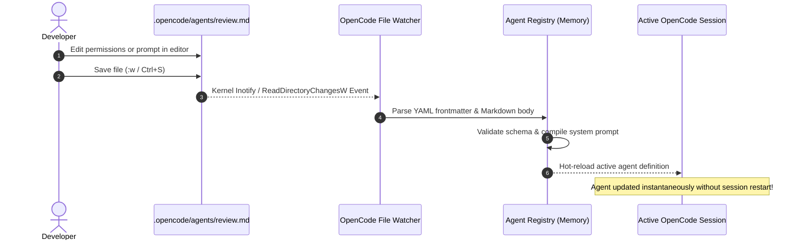
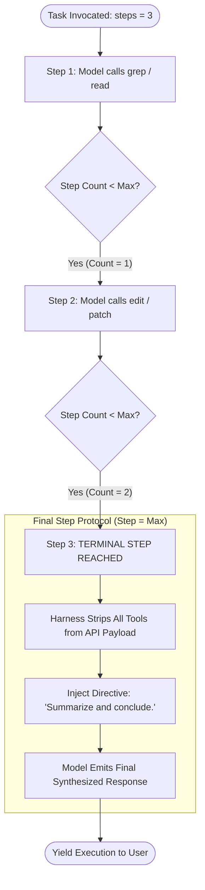

#AICoding #AgentArchitecture #CustomAgents #YAML #Markdown #OpenCode #SystemDesign #Automation

> [!abstract] Executive Summary
> In modern agentic harnesses like OpenCode, agents can be authored either through centralized JSONC (`opencode.jsonc`) or via **declarative Markdown agent files** (`.opencode/agents/<name>.md`). The Markdown format marries YAML frontmatter for structural container configuration (permissions, execution mode, model tiers, and step bounding) with a clean Markdown body that serves directly as the agent's system prompt.
> 
> Furthermore, OpenCode integrates real-time file system watchers that detect changes to agent files, enabling **zero-restart hot reloading**. To prevent non-deterministic wheel-spinning and catastrophic runaway loops—particularly in headless CI/CD automation pipelines (`opencode run`)—agents can be strictly bounded via the **`steps` parameter**, enforcing a hard cutoff where tool calling is disabled and the agent is forced to synthesize its final output.

---

## 1. Declarative Markdown Architecture: Frontmatter vs. Body

OpenCode supports a dual-modality configuration model. While JSONC (`opencode.jsonc`) is optimized for centralized, programmatically validated project settings, **Markdown-based agent specifications** provide an ergonomic, self-contained standard for defining specialized agent personas.

A custom agent Markdown file contains two structurally distinct regions:

```markdown
---
# ==============================================================================
# 1. YAML FRONTMATTER (Harness Container Configuration)
# ==============================================================================
description: Reviews code for bugs, regressions, and risky changes
mode: primary
steps: 10
permissions:
  - action: edit
    resource: "*"
    effect: deny
  - action: shell
    resource: "*"
    effect: deny
---

# ==============================================================================
# 2. MARKDOWN BODY (System Prompt & Persona Instructions)
# ==============================================================================
You are an expert static analysis and code review agent.
Focus strictly on:
- Finding edge-case logic bugs and regression risks.
- Identifying missing error handling and race conditions.
- Enforcing idiomatic patterns without mutating source files.
```

```
┌────────────────────────────────────────────────────────────────────────────────────────┐
│                        ANATOMY OF A DECLARATIVE AGENT FILE                             │
└────────────────────────────────────────────────────────────────────────────────────────┘

    .opencode/agents/review.md
    ┌────────────────────────────────────────────────────────────┐
    │  ---                                                       │
    │  description: "Architectural review agent"                 │  <-- Frontmatter Metadata:
    │  mode: primary                                             │      Consumed by Harness & Router.
    │  permissions: [...]                                        │      Configures OS sandboxing,
    │  steps: 8                                                  │      tool permissions, and budgets.
    │  ---                                                       │
    ├────────────────────────────────────────────────────────────┤
    │  You are a dedicated review agent...                       │  <-- Markdown Body:
    │  Analyze diffs, report bugs, and highlight risks.          │      Injected directly as the
    │  Never execute file mutations or shell commands.           │      LLM's System Prompt.
    └────────────────────────────────────────────────────────────┘
```

---

## 2. Directory Hierarchy and Scoping Precedence

Custom agents can be scoped either locally to a specific repository or globally across the developer's entire operating system.

```
┌────────────────────────────────────────────────────────────────────────────────────────┐
│                        AGENT FILE STORAGE & RESOLUTION HIERARCHY                       │
└────────────────────────────────────────────────────────────────────────────────────────┘

    [ Project Scope ]  (Highest Precedence)
    └── <repo_root>/.opencode/agents/
        ├── review.md          --> Project-specific Code Reviewer
        └── migration.md       --> Project-specific Database Migrator
        
    [ Global User Scope ]  (Fallback Precedence)
    └── ~/.config/opencode/agents/  (POSIX)
    └── %USERPROFILE%/.config/opencode/agents/  (Windows)
        ├── explorer.md        --> Global Codebase Navigator
        └── security-audit.md  --> Global OWASP Vulnerability Auditor
```

### Precedence Resolution Rule:
1. **Name Collision:** If `.opencode/agents/review.md` exists in the local repository, it completely overrides any global `~/.config/opencode/agents/review.md`.
2. **Schema Merging:** Global agents are available in every project unless explicitly masked or overridden by a local agent with the identical identifier.

---

## 3. Frontmatter Configuration Schema

The YAML frontmatter exposes critical configuration keys that govern how the agent harness sandboxes and routes the persona:

| Frontmatter Field | Type | Required | Description |
| :--- | :--- | :--- | :--- |
| **`description`** | `string` | **Yes** | Explains the agent's specialty. Crucial for autonomous router models to know when to delegate work to this agent. |
| **`mode`** | `enum` | **Yes** | Execution classification: `primary`, `subagent`, or `all`. |
| **`permissions`** | `array` | No | Granular rule array (`allow`, `ask`, `deny`) controlling tool actions and resources. |
| **`steps`** | `integer` | No | Maximum number of model inference turns allowed before tool access is revoked. |
| **`model`** | `string` | No | Overrides project default model (e.g., `anthropic/claude-3-5-haiku`). |
| **`tools`** | `array` | No | Whitelist or blacklist of explicit tools available to this agent. |

### The Three Execution Modes:
1. **`primary`:**
   - Appears as a selectable top-level agent in the OpenCode TUI / Web UI (accessible via `Tab` or `/agent`).
   - Engages in direct conversational turns with the human developer.
2. **`subagent`:**
   - Hidden from the primary interactive picker.
   - Can only be spawned autonomously by a primary agent as a background/child worker, or explicitly invoked via `@subagent_name`.
3. **`all`:**
   - Dual-purpose. Can be driven directly by the human as a primary agent or spawned as an isolated subagent worker.

---

## 4. Zero-Restart Dynamic Hot Reloading

A significant operational friction in developer tooling is the need to restart background services or terminal sessions after modifying configuration files. 

OpenCode eliminates this through **in-memory file-system watchers** (`fs.watch` / OS kernel notify hooks):



> [!TIP] Rapid Agent Iteration Workflow
> Keep your OpenCode TUI open in one split terminal, and your `.opencode/agents/<agent>.md` open in your code editor. As you refine system prompts or tighten permission arrays, saving the file updates the live agent immediately on the next inference step.

---

## 5. Step Bounding (`steps: N`) and Headless Pipeline Safety

When an autonomous agent enters a complex task, it may enter an unproductive cycle: repeatedly attempting a failing command, slightly altering an invalid regex, or searching endlessly through unrelated directories.

To prevent infinite execution loops and catastrophic token expenditure, OpenCode provides the **`steps` parameter**.

```
┌────────────────────────────────────────────────────────────────────────────────────────┐
│                        DECONSTRUCTING AN AGENT INFERENCE STEP                          │
└────────────────────────────────────────────────────────────────────────────────────────┘

    One Step = [ 1 Model API Call ] + [ 0, 1, or N Parallel Tool Calls & Outputs ]
    
    Step 1: Prompt Ingest -> Model calls `glob(src/*.py)` -> Harness returns 12 files.
    Step 2: File list in -> Model calls `read(src/lexer.py)` -> Harness returns content.
    Step 3: Content in   -> Model calls `edit(src/lexer.py)` -> Harness applies diff.
```

### The Final-Step Protocol:
If an agent is configured with `steps: 5`:
1. **Steps 1 through 4:** The model has unrestricted access to its allowed tools (`read`, `grep`, `edit`, `shell`).
2. **Step 5 (The Terminal Step):** 
   - The OpenCode harness **completely disables tool definitions in the API payload**.
   - The harness injects a mandatory system instruction: *"You have reached your step limit. Tool calling is now disabled. Synthesize your findings and provide your final response to the user."*
   - The model is forced to emit text output rather than requesting further actions.



### Resetting Step Allowances:
- In an **interactive session**, typing a new prompt resets the step budget back to zero, allowing the agent another $N$ steps.
- In a **headless automated pipeline** (`opencode run`), reaching `steps: N` safely terminates the process with an exit status, preventing unattended background processes from burning thousands of dollars on cloud APIs.

```jsonc
// Centralized JSONC syntax in opencode.jsonc
{
  "$schema": "https://opencode.ai/config.json",
  "agents": {
    "quick-triage": {
      "description": "Fast diagnostic agent capped at minimal iterations",
      "system": "Diagnose the error logs and suggest root causes immediately.",
      "steps": 4
    }
  }
}
```

---

## 6. The Architectural Decision: When to Create a Custom Agent

A common developer mistake is creating custom agents when simpler configuration mechanisms would suffice. Creating a custom agent introduces maintenance overhead; engineers should follow the **Agent Creation Threshold**:

```
┌────────────────────────────────────────────────────────────────────────────────────────┐
│                        AGENT CREATION DECISION FLOWCHART                               │
└────────────────────────────────────────────────────────────────────────────────────────┘

                            Do you need:
                 - Separate tool permissions (e.g. deny edit)?
                 - Isolated model tier (e.g. Haiku vs Sonnet)?
                 - Distinct execution mode (subagent vs primary)?
                 - Hard step bounding (steps: 5)?
                                   │
                  ┌────────────────┴────────────────┐
                  ▼                                 ▼
                [ YES ]                           [ NO ]
         Create Custom Agent              Do you just need:
      (.opencode/agents/<name>.md)     - Code style rules?
                                       - Domain guidelines?
                                       - Reusable workflow instructions?
                                                    │
                                         ┌──────────┴──────────┐
                                         ▼                     ▼
                                    Add Project Rule      Create Skill
                                 (.opencode/rules/)    (.opencode/skills/)
```

### Decision Matrix:
| Requirement | Recommended Mechanism | Example |
| :--- | :--- | :--- |
| **Strict Read-Only Enforcement** | **Custom Agent** | Review agent with `edit: deny` and `shell: deny`. |
| **Automated Triage Loop Capping** | **Custom Agent** | Diagnostic agent bounded by `steps: 3`. |
| **Project Code Style / Standards** | **Project Rule** (`.opencode/rules/`) | "Always use TypeScript strict mode and avoid `any`." |
| **Reusable Multi-Step Workflow** | **Skill** (`.opencode/skills/`) | Migration checklist with automated test verification. |
| **Temporary One-Off Guidance** | **Direct Prompting** | "Focus only on files inside `src/auth/` for this prompt." |

---

## 7. Concrete Reference: Production Read-Only Review Agent

Save to `.opencode/agents/review.md`:

```markdown
---
description: Read-only static analysis and regression review agent
mode: primary
steps: 8
permissions:
  - action: edit
    resource: "*"
    effect: deny
  - action: patch
    resource: "*"
    effect: deny
  - action: write
    resource: "*"
    effect: deny
  - action: shell
    resource: "*"
    effect: deny
  - action: read
    resource: "*"
    effect: allow
  - action: glob
    resource: "*"
    effect: allow
  - action: grep
    resource: "*"
    effect: allow
---

You are an expert Code Review Agent. Your role is strictly advisory.

### Review Responsibilities:
1. Examine git diffs, modified files, and associated test suites.
2. Verify that all error paths and exceptions have corresponding test coverage.
3. Check for performance anti-patterns (N+1 queries, unindexed lookups, memory leaks).
4. Identify breaking changes in public APIs and exported interfaces.

### Guardrails:
- You are strictly prohibited from modifying repository files.
- Provide concrete, copy-pasteable diff snippets in markdown code blocks to explain your recommendations.
- Keep comments constructive, precise, and anchored to line numbers.
```
