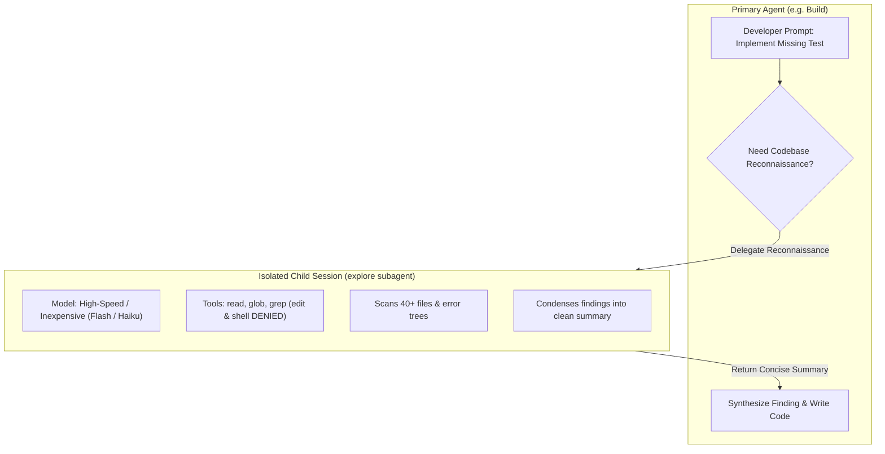

#AICoding #Subagents #ContextIsolation #MultiAgent #SystemDesign #OpenCode #Pytest #CostOptimization

> [!abstract] Executive Summary
> As software engineering tasks expand in scope, monolithic agent sessions suffer from **Context Window Pollution**: hundreds of intermediate tool outputs (raw file reads, grep matches, terminal stderr) accumulate in the parent conversation context, causing severe attention degradation ("lost-in-the-middle") and inflating per-turn input token costs.
> 
> OpenCode resolves this through **Subagents**—specialized child workers executed within **isolated child sessions**. By offloading high-volume reconnaissance to subagents like **`explore`** and complex tasks to **`general`**, the primary agent preserves a compact, high-signal context window. Furthermore, subagents unlock **Model Tier Arbitrage** (routing high-throughput searching to inexpensive Flash/Haiku models while reserving frontier reasoning models for parent synthesis) and **parallel background execution**.

---

## 1. The Context Pollution Problem in Monolithic Sessions

In a single-agent architecture, all actions, tool outputs, and diagnostic traces share one linear conversation context. When an agent searches a codebase to locate a bug, the context window expands exponentially:

```
┌────────────────────────────────────────────────────────────────────────────────────────┐
│                     MONOLITHIC CONTEXT BLOAT vs. SUBAGENT ISOLATION                    │
└────────────────────────────────────────────────────────────────────────────────────────┘

    [ Scenario A: Monolithic Session (Context Pollution) ]
    Parent Context:
    ├── User Prompt: "Fix lexer bug"
    ├── Tool: grep("LexicalError") ──────────> Returns 45 files (8,000 tokens)
    ├── Tool: read("lexer/tokens.py") ───────> Returns 1,200 lines (14,000 tokens)
    ├── Tool: read("lexer/state.py") ────────> Returns 800 lines (9,500 tokens)
    ├── Tool: glob("tests/*.py") ────────────> Returns 60 paths (1,500 tokens)
    └── Total Context: 33,000 tokens!
        └── Every subsequent edit pays for 33k input tokens on every turn!
        └── High risk of attention degradation and forgotten instructions.

    [ Scenario B: Subagent Child Session (Context Isolation) ]
    Parent Context:                                  Child Session (Isolated):
    ├── User Prompt: "Fix lexer bug"                ├── Spawns `@explore`
    ├── Invokes Subagent: explore                   ├── grep("LexicalError")
    │   (Work runs in child session)                ├── read("tokens.py")
    │                                               ├── read("state.py")
    │                                               └── Synthesizes finding
    └── Injects 150-Token Summary <─────────────────┘
        "LexicalError is raised in lexer.py:142 on invalid escape sequences,
         but tests/test_lexer_regression.py lacks a test case for it."
    
    Total Parent Context: 800 tokens! 97% token savings, zero lost context.
```

---

## 2. The Three Subagent Superpowers



### 1. Context Window Isolation
A child session operates with its own distinct session ID and context buffer. When the subagent runs 50 grep operations, reads 10 large source files, and processes regex matches, that massive token volume is completely discarded when the child finishes. **Only the final markdown summary is returned to the parent agent.**

### 2. Model Tier Arbitrage (Cost Optimization)
Searching a codebase does not require a \$15/million-token frontier reasoning model (e.g., Claude 3.5 Sonnet, GPT-4o). Codebase exploration requires fast pattern matching:
- **Child Subagent (`explore`):** Routes to high-throughput, low-cost models (e.g., `gemini-flash`, `claude-haiku`, or `deepseek-chat`).
- **Parent Agent (`build`):** Stays on a frontier coding model to write production-grade code.
- **Cost Reduction:** Up to **80% lower API bills** compared to running all file exploration through the frontier model.

### 3. Parallel Execution & Concurrency
Subagents can run in two execution modes:
- **Foreground Blocking:** The primary agent pauses its execution loop, waits for the subagent's summary, and resumes upon completion.
- **Background Parallel:** The primary agent fires off one or more background subagents (e.g., investigating multiple subsystems simultaneously) while continuing to work on independent tasks. Once the background workers complete, their summaries are pushed into the parent queue.

---

## 3. OpenCode Built-In Subagents: `explore` vs. `general`

OpenCode provides two foundational built-in subagent definitions:

| Feature / Property | `explore` Subagent | `general` Subagent |
| :--- | :--- | :--- |
| **Primary Specialty** | Fast, read-only reconnaissance across files and web docs. | Multi-step task execution and general problem solving. |
| **Permissions** | **Read-Only:** `read`, `glob`, `grep`, `webfetch` enabled. `edit`, `patch`, `write`, `shell` denied. | **Full Capabilities:** Reading, writing, editing, and shell command execution allowed. |
| **Model Profile** | High speed, cost-effective, high context window (e.g., Flash). | Capable generalist worker (e.g., Sonnet or GPT-4o). |
| **Typical Use Case** | "Find all endpoints using JWT auth", "Locate missing test cases". | "Refactor module X and run the unit test suite". |

---

## 4. Invocation Paradigms: Autonomous Delegation vs. `@` Direct Steering

Developers can leverage subagents through two distinct workflows:

### A. Autonomous Delegation (Agent-to-Agent)
The primary agent is equipped with a `subagent` tool. When given a complex or broad query (e.g., *"Find where user permissions are validated in the codebase and fix the bug"*), the parent agent autonomously decides to invoke `explore` as a tool call.

```jsonc
// OpenCode Harness Internal Tool Call
{
  "tool": "subagent",
  "args": {
    "agent": "explore",
    "prompt": "Find all definitions of LexicalError and check which ones are tested in tests/"
  }
}
```

### B. Explicit Human Steering (`@` Syntax)
The human developer can directly target a subagent from the OpenCode prompt box using the `@` prefix:

```bash
# Explicitly offload search to the read-only explore subagent
@explore find all files related to token serialization and summarize their error handling
```

```bash
# Explicitly offload a self-contained execution task to the general subagent
@general run the database migrations and verify the test fixtures
```

### UI Session Visibility:
In the OpenCode TUI and Web Interface, subagent executions appear as **collapsible child blocks**. By default, they remain collapsed to maintain a clean reading view; developers can click or hit `Enter` on the subagent block to expand its complete tool calling history, intermediate stdout, and reasoning traces.

---

## 5. Engineering Case Study: Sloperator Lexer Regression Testing

To see subagent isolation in practice, consider an engineering task in **Sloperator** (a compiler and code refactoring engine): identifying an untested error branch in the lexer and writing a regression test.

### Step 1: Delegating the Search to `explore`
The developer commands the primary Build agent to delegate the search:

> *"Delegate a search to @explore to find any LexicalError in the lexer that is currently missing a regression test in tests/test_lexer_regression.py."*

### Step 2: The Child Session at Work (Isolated)
1. The `explore` subagent inspects `sloperator/lexer/exceptions.py`:
   - Finds: `UnterminatedStringError`, `InvalidNumberLiteralError`, `UnexpectedCharacterError`, `InvalidEscapeSequenceError`.
2. The `explore` subagent inspects `tests/test_lexer_regression.py`:
   - Checks existing test functions:
     - `test_unterminated_string_raises_error()`
     - `test_invalid_number_literal_raises_error()`
     - `test_unexpected_character_raises_error()`
3. **The Finding:** `InvalidEscapeSequenceError` has zero coverage in the regression suite.
4. The subagent exits and returns a structured summary to the Build agent:

```markdown
### Explore Subagent Summary:
- **Missing Regression Target:** `InvalidEscapeSequenceError` (defined in `sloperator/lexer/exceptions.py:28`, raised in `sloperator/lexer/tokenizer.py:114`).
- **Trigger Scenario:** A string containing an invalid backslash sequence like `"\c"` or `"\xZZ"`.
- **Target File:** `tests/test_lexer_regression.py`.
```

### Step 3: Primary Agent Implementation
The Build agent receives the clean summary without having loaded the 3,000 lines of lexer code into its own context. It immediately edits `tests/test_lexer_regression.py`:

```python
# tests/test_lexer_regression.py
import pytest
from sloperator.lexer.tokenizer import Tokenizer
from sloperator.lexer.exceptions import InvalidEscapeSequenceError

def test_invalid_escape_sequence_raises_lexical_error():
    """Regression test ensuring invalid backslash sequences raise InvalidEscapeSequenceError."""
    invalid_code = r'let text = "invalid \q sequence";'
    tokenizer = Tokenizer(invalid_code)
    
    with pytest.raises(InvalidEscapeSequenceError) as exc_info:
        tokenizer.tokenize()
        
    assert "Invalid escape sequence: \\q" in str(exc_info.value)
```

### Step 4: Verification & Submission via CLI
The implementation is validated using the project's test runner and submitted via the Bootdev verification harness:

```bash
# Execute local unit test suite via uv
uv run pytest tests/test_lexer_regression.py -q

# Run local verification
bootdev run f5784f7a-7f41-4c65-acc4-7051c2d6b9fe

# Submit verified solution
bootdev run -s f5784f7a-7f41-4c65-acc4-7051c2d6b9fe
```

---

## 6. Subagent Architectural Guardrails & Best Practices

```
┌────────────────────────────────────────────────────────────────────────────────────────┐
│                        SUBAGENT BEST PRACTICES & FAILURE MODES                         │
└────────────────────────────────────────────────────────────────────────────────────────┘

    [ Recommended Patterns ]
    ✔ Use `explore` for broad, fuzzy queries across many directories.
    ✔ Keep child session outputs structured and concise (bullet points & file paths).
    ✔ Pair custom subagents with `steps: 5` to enforce fast turnaround.
    ✔ Use cheaper model tiers on custom subagents to optimize project token budgets.

    [ Anti-Patterns to Avoid ]
    ✖ Deep Recursive Delegation: Never allow subagents to spawn subagents infinitely.
    ✖ Monolithic Dump: Don't tell a subagent to "summarize the entire repository".
    ✖ Mutating Subagents for Read-Only Jobs: Never give `edit` permissions to an explorer.
```

### Production Checklist:
1. **Always Enforce Least Privilege on Subagents:** Exploratory subagents must have write/patch/shell permissions strictly set to `deny`.
2. **Combine with Step Bounding:** Assign `steps: 6` to exploratory subagents in their Markdown frontmatter to ensure they summarize quickly rather than wandering through irrelevant directories.
3. **Preserve Parent Focus:** Let subagents handle the dirty discovery work; keep the primary agent focused on architectural synthesis, code editing, and test execution.
