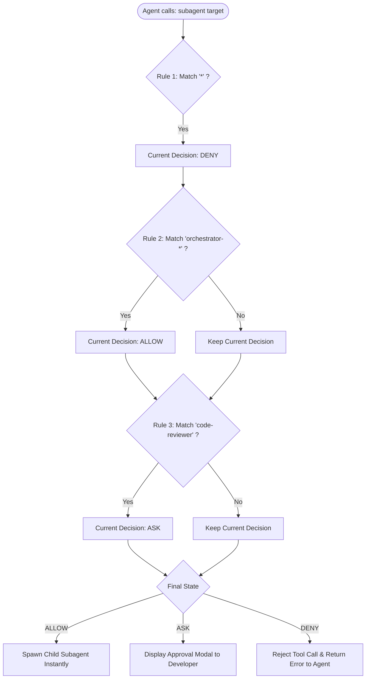
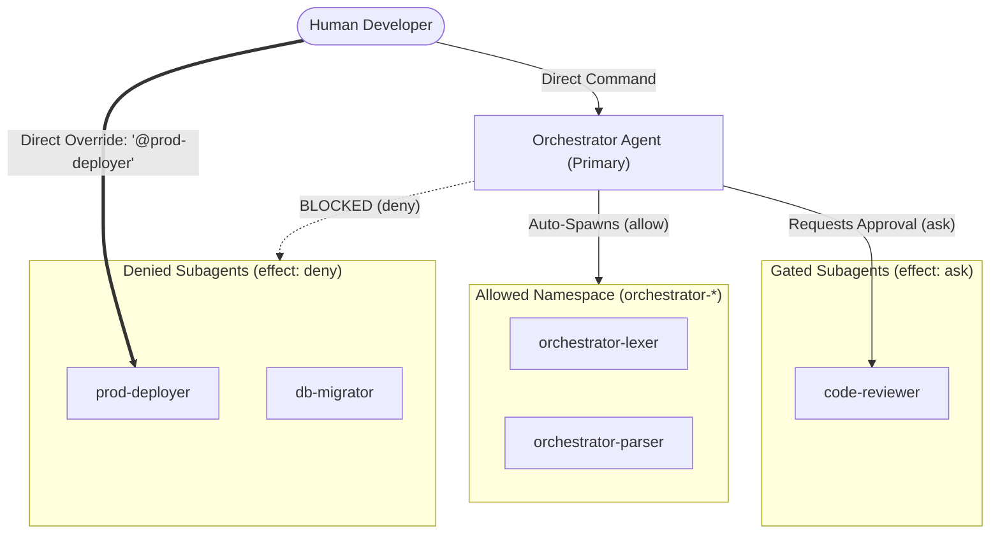

#AICoding #Subagents #Permissions #Security #SystemDesign #OpenCode #LeastPrivilege #AccessControl

> [!abstract] Executive Summary
> In complex multi-agent architectures, having multiple specialized subagents introduces an **elevation-of-privilege vector** (the *Confused Deputy problem*): if a low-privilege or untrusted primary agent can autonomously invoke a high-privilege subagent (such as an automated deployer or database migrator), the primary agent can bypass its own execution sandbox.
> 
> OpenCode prevents this through **Subagent Invocation Permissions**. By treating `subagent` as a first-class permission action, engineers can declaratively govern which child personas a parent agent is allowed to spawn. Using the **"last matching rule wins"** sequential evaluation precedence, teams enforce default-deny baselines, wildcard prefix allowlists (`orchestrator-*`), and human approval gates (`effect: ask`) for critical review or mutation agents. Importantly, these rules constrain only *autonomous agent-to-agent tool calls*—retaining **human developer sovereignty** to invoke any subagent directly via the UI/TUI (`@subagent`).

---

## 1. The Delegation Threat Model: The Confused Deputy Problem

When developing multi-agent systems, developers often construct a diverse registry of agents:
- `explore`: Read-only codebase explorer.
- `code-reviewer`: Architectural auditor.
- `db-migrator`: High-privilege agent with raw SQL shell access.
- `deployer`: Infrastructure agent capable of pushing code to production.

If every agent possesses unrestricted authority to spawn any other agent in the registry, a critical security boundary is breached:

```
┌────────────────────────────────────────────────────────────────────────────────────────┐
│                        THE SUBAGENT PRIVILEGE ESCALATION ATTACK                        │
└────────────────────────────────────────────────────────────────────────────────────────┘

    [ Untrusted / Restricted Agent ] (e.g. junior-triage)
    • Permissions: edit: deny, shell: deny
    
          │ (Attempts destructive action directly)
          ├──❌ Harness blocks: "shell is denied"
          │
          │ (Evasion: Invokes High-Privilege Subagent)
          ▼
    [ Subagent Tool Call: spawn("deployer") ]
          │
          ▼
    [ Privileged Subagent: deployer ]
    • Permissions: shell: allow, git push: allow
          │
          ▼
    💥 Destructive shell command executes! 
       (Junior agent bypassed its sandbox via unauthorized delegation)
```

To eliminate this vulnerability, the principle of **Least-Privilege Delegation** dictates that an agent must be explicitly authorized to invoke specific subagents, just as it must be authorized to read files or execute shell binaries.

---

## 2. Anatomy of Subagent Permission Rules

In OpenCode's declarative permission schema, subagent invocation is governed by the `subagent` action, where the `resource` field matches the target subagent's identifier:

```jsonc
{
  "action": "subagent",
  "resource": "<subagent-id-pattern>",
  "effect": "allow" | "ask" | "deny"
}
```

### The Tri-State Effects:
1. **`allow`:** The agent spawns the subagent instantaneously without pausing or requesting human confirmation.
2. **`ask`:** The harness halts execution, displays an interactive confirmation modal to the developer, and only spawns the child session upon explicit approval.
3. **`deny`:** The tool call is immediately rejected at the harness layer. The agent receives an error message: *"Subagent invocation denied by permission policy."*

---

## 3. Sequential Precedence: The "Last Matching Rule Wins" Engine

OpenCode evaluates permission rules sequentially from top to bottom. If multiple rules match a requested subagent action, **the last matching rule overrides all preceding rules**.

This makes the **Default-Deny Pattern** the industry standard for configuring agent autonomy:

```
┌────────────────────────────────────────────────────────────────────────────────────────┐
│                   SEQUENTIAL EVALUATION: THE DEFAULT-DENY PATTERN                      │
└────────────────────────────────────────────────────────────────────────────────────────┘

    Rule 1: action: "subagent", resource: "*",             effect: "deny"  <-- Baseline Wall
    Rule 2: action: "subagent", resource: "orchestrator-*", effect: "allow" <-- Pattern Allow
    Rule 3: action: "subagent", resource: "code-reviewer",  effect: "ask"   <-- Explicit Gate
    
    Target: "orchestrator-worker"
      ├── Matches Rule 1 (deny)
      └── Matches Rule 2 (allow)  ==> FINAL DECISION: ALLOW (Last match wins)
      
    Target: "code-reviewer"
      ├── Matches Rule 1 (deny)
      └── Matches Rule 3 (ask)    ==> FINAL DECISION: ASK (Human gate triggered)
      
    Target: "db-migrator"
      └── Matches Rule 1 (deny)   ==> FINAL DECISION: DENY (Blocked by default wall)
```



---

## 4. Declarative Configuration: Centralized vs. Markdown Formats

Subagent invocation rules can be configured either in the centralized project configuration file (`opencode.jsonc`) or within an individual agent's Markdown frontmatter (`.opencode/agents/<name>.md`).

### Centralized JSONC (`opencode.jsonc`):
```jsonc
{
  "$schema": "https://opencode.ai/config.json",
  "agents": {
    "orchestrator": {
      "mode": "primary",
      "description": "Primary task coordinator with bounded delegation rules",
      "permissions": [
        // 1. Lockdown: Deny spawning all subagents by default
        {
          "action": "subagent",
          "resource": "*",
          "effect": "deny"
        },
        // 2. Allowlist: Permit any worker under the orchestrator namespace
        {
          "action": "subagent",
          "resource": "orchestrator-*",
          "effect": "allow"
        },
        // 3. Approval Gate: Force human confirmation before triggering code reviews
        {
          "action": "subagent",
          "resource": "code-reviewer",
          "effect": "ask"
        }
      ]
    }
  }
}
```

### Self-Contained Markdown (`.opencode/agents/orchestrator.md`):
```markdown
---
description: Primary task coordinator with bounded delegation rules
mode: primary
steps: 12
permissions:
  - action: subagent
    resource: "*"
    effect: deny
  - action: subagent
    resource: "orchestrator-*"
    effect: allow
  - action: subagent
    resource: "code-reviewer"
    effect: ask
---

You are the Lead Orchestrator agent.
Your primary role is to decompose large architectural features into discrete subtasks.

### Operational Guidelines:
1. For exploratory or routine child tasks, delegate strictly to `orchestrator-worker`.
2. When code modifications are ready for validation, invoke `code-reviewer` (the harness will prompt the human for confirmation).
3. Never attempt to invoke unapproved or administrative subagents directly.
```

---

## 5. Human Sovereignty vs. Autonomous Delegation

A fundamental architectural principle in OpenCode is the separation between **Agentic Tool Autonomy** and **Human Interactive Authority**:

```
┌────────────────────────────────────────────────────────────────────────────────────────┐
│                        AGENT TOOL CALL vs. HUMAN UI INVOCATION                         │
└────────────────────────────────────────────────────────────────────────────────────────┘

    [ Scenario A: Autonomous Agent Tool Call ]
    Primary Agent attempts: `call_tool("subagent", { "agent": "db-migrator" })`
    ├── Evaluated against agent's `permissions` array
    ├── If Rule evaluates to `deny` ──> Harness BLOCKS execution
    └── If Rule evaluates to `ask`  ──> Harness PROMPTS user for approval

    [ Scenario B: Developer Explicit UI Invocation ]
    Human types in prompt box: `@db-migrator run schema migration 004`
    ├── User action is EXEMPT from subagent permission rules
    ├── Bypasses agent permission restrictions
    └── Child session spawns immediately under direct human command
```

> [!IMPORTANT] Human-in-the-Loop Principle
> Subagent permission rules **only restrict what an agent can invoke automatically via tool calls**. They never prevent the human developer from manually invoking any subagent via the `@subagent` syntax in the UI or CLI. Humans always retain top-level authority over the agent runtime.

---

## 6. Multi-Agent Architectural Topologies

By combining subagent permissions with `mode` and `steps`, engineering teams construct resilient, self-healing agent hierarchies:



### 1. The Hierarchical Manager Pattern:
- **Primary Agent:** Has high reasoning capability, but file mutation tools are denied.
- **Delegation Policy:** Allowed to invoke workers matching `worker-*`.
- **Workers:** Scoped to specific directories, capped at `steps: 5`, and have `action: "subagent", resource: "*", effect: "deny"` to prevent recursive spawning.

### 2. The Gated Production Gatekeeper Pattern:
- High-impact subagents (`security-auditor`, `deployer`, `release-tagger`) are gated behind `effect: "ask"`.
- Prevents automated agents from triggering production actions during background sweeps without human eyes on the plan.

### 3. The Isolated Leaf-Node Pattern:
- Subagents deployed for narrow, focused jobs should never have the power to spin up further child sessions.
- Adding a baseline rule `{ "action": "subagent", "resource": "*", "effect": "deny" }` with zero exceptions ensures subagents remain leaf nodes, eliminating runaways and circular delegation deadlocks.

---

## 7. Comparative Policy Reference Matrix

| Policy Strategy | Rule Configuration | Use Case / Security Goal |
| :--- | :--- | :--- |
| **Complete Lockdown** | `[{ action: "subagent", resource: "*", effect: "deny" }]` | Leaf-node workers, single-turn responders, or untrusted sandboxes. |
| **Namespaced Delegation** | `[ { action: "subagent", resource: "*", effect: "deny" }, { action: "subagent", resource: "team-*", effect: "allow" } ]` | Manager agents orchestrating an isolated team of domain workers. |
| **Human-Gated Escalation** | `[ { action: "subagent", resource: "*", effect: "deny" }, { action: "subagent", resource: "explore", effect: "allow" }, { action: "subagent", resource: "code-reviewer", effect: "ask" } ]` | Triage agents allowed to search freely, but requiring human approval before initiating formal code reviews. |
| **Zero-Mutation Auditing** | Primary agent denied `edit`/`shell`, permitted only `subagent: "explore"` | Ensures the primary coordinator cannot mutate source files directly or indirectly. |
