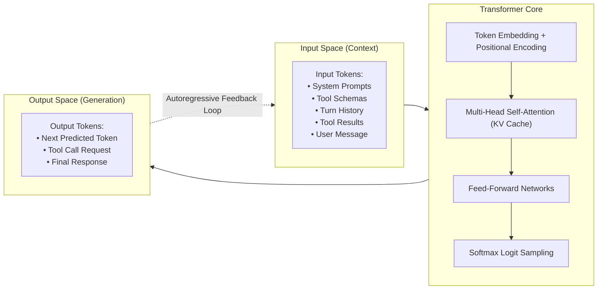

#AICoding #ContextWindow #LLMInference #TokenEconomics #SystemDesign #OpenCode #AttentionMechanism #Performance

> [!abstract] Executive Summary
> In AI coding agents, **Context** represents the totality of information visible to the model's self-attention mechanism at the moment of next-token generation. Calling context simply a "prompt" is a fundamental architectural misnomer: in a production coding session, the developer's prompt typically accounts for less than **1%** of the active context window, with the remaining **99%** consumed by system instructions, tool schemas, session turn history, hidden reasoning tokens, and voluminous tool execution results (file reads, grep sweeps, and terminal output).
> 
> The context window operates identically to **system RAM**: it is finite, volatile working memory. Just as "tab hoarding" exhausts physical memory and degrades operating system performance, bloating the context window with extraneous logs and unpruned files imposes three severe engineering penalties: **quadratic attention degradation ("Lost-in-the-Middle")**, **elevated Time-to-First-Token (TTFT) latency**, and **compounding per-turn financial costs**.

---

## 1. Deconstructing the AI Inference Pipeline

At its physical layer, an autoregressive Large Language Model is a stateless next-token predictor. Every inference pass operates as a discrete functional pipeline:

```
┌────────────────────────────────────────────────────────────────────────────────────────┐
│                              THE AI INFERENCE PIPELINE                                 │
└────────────────────────────────────────────────────────────────────────────────────────┘

        "what is 4 + 2"                                    "no problem! the answer is 6"
    ┌──────────────────────┐        ┌──────────────┐        ┌──────────────────────┐
    │     INPUT TOKENS     │───────>│   AI MODEL   │───────>│    OUTPUT TOKENS     │
    └──────────────────────┘        └──────────────┘        └──────────────────────┘
        aka "context"                                           aka "completion"
        aka "prompt"                                            aka "generation"
        aka "request"                                           aka "response"
```



### The Autoregressive Generation Loop:
1. The harness compiles the entire active context into an array of input tokens.
2. The model evaluates the attention relationships across all input tokens and samples a single output token $t_1$.
3. Token $t_1$ is appended to the input sequence, forming the new context.
4. The pipeline repeats sequentially to generate token $t_2, t_3, \dots, t_k$ until a stop sequence (`<|endoftext|>`) or a tool invocation block is emitted.

---

## 2. Prompt vs. Context: The 5 Layers of Context Anatomy

A common misconception among beginner developers is equating the text typed into the chat box (the *prompt*) with the model's *context*. In agentic workflows, the prompt is merely the final slice of a multi-layered context stack.

```
┌────────────────────────────────────────────────────────────────────────────────────────┐
│                             THE 5 ANATOMICAL LAYERS OF CONTEXT                         │
└────────────────────────────────────────────────────────────────────────────────────────┘

    ┌────────────────────────────────────────────────────────────────────────────────┐
    │ 1. SYSTEM PROMPTS & HARNESS RULES                                              │
    │    • Base persona instructions, coding style guides, output format contracts.  │
    │    • JSON Schema specifications for all enabled tools (read, write, shell).    │
    ├────────────────────────────────────────────────────────────────────────────────┤
    │ 2. REASONING & THINKING TOKENS                                                 │
    │    • Test-time compute traces generated by models like DeepSeek R1, OpenAI o1. │
    │    • Search tree evaluations and intermediate self-correction thoughts.        │
    ├────────────────────────────────────────────────────────────────────────────────┤
    │ 3. MULTI-TURN CONVERSATION HISTORY                                             │
    │    • All previous user requests and assistant explanations in the session.     │
    ├────────────────────────────────────────────────────────────────────────────────┤
    │ 4. TOOL INVOCATIONS & EXECUTION PAYLOADS (The Heavy Consumer: 80-95%)          │
    │    • Diffs returned by git diff, compiler errors, linter diagnostics.          │
    │    • Full file contents read into memory via `read`, grep search results.      │
    ├────────────────────────────────────────────────────────────────────────────────┤
    │ 5. LATEST USER PROMPT (< 1% of total tokens)                                   │
    │    • "Fix the lexer bug on line 42."                                           │
    └────────────────────────────────────────────────────────────────────────────────┘
```

### What is NOT Automatically in Context:
Giving an AI agent access to your system does **not** inject your system's data into the model. The following artifacts are completely invisible to the LLM until explicitly retrieved by an active tool call or ingested via direct prompt attachment (`@file`):
- Local files in your workspace repository.
- Your remote GitHub repositories or commit logs.
- Internal Postgres or Redis database tables.
- Third-party REST API documentation.
- OS environment variables (unless exposed via configuration).

---

## 3. Context as RAM: The Working Memory Model

Computer architecture separates **fast, volatile working memory (RAM)** from **high-capacity, non-volatile persistent storage (SSD/Disk)**. In AI software engineering, the exact same boundary applies:

```
┌────────────────────────────────────────────────────────────────────────────────────────┐
│                        COMPUTING HARDWARE vs. AI AGENT ARCHITECTURE                    │
└────────────────────────────────────────────────────────────────────────────────────────┘

    Traditional Computer Architecture              AI Coding Agent Architecture
    ──────────────────────────────────             ────────────────────────────
    CPU (Compute Engine)                     <==>  LLM Inference Core (Transformer)
    L1/L2/L3 Cache & RAM (Working Memory)    <==>  Context Window (Tokens in Flight)
    NVMe SSD / Hard Disk (Persistent Store)  <==>  Local Repository Filesystem & Git
    Network Interface / Cloud Database       <==>  External APIs & Remote Repositories
```

### The "Tab Hoarder" Anti-Pattern:
Many computer users leave 200 browser tabs open simultaneously, exhausting RAM, triggering swap thrashing, and causing OS stutter. 

In coding agents, developers frequently commit the identical mistake: **Context Hoarding**. They execute huge directory sweeps, load massive documentation dumps, and preserve dead conversation threads across hours of work. While a modern 1,000,000-token context window can physically accommodate roughly **750,000 English words** ($\approx 1.5\times$ the length of the entire *Lord of the Rings* trilogy), hoarding irrelevant context actively harms the model.

---

## 4. The Three Taxes of Context Window Bloat

Treating a massive context window as a bottomless dumping ground triggers three compounding performance penalties:

```
┌────────────────────────────────────────────────────────────────────────────────────────┐
│                          THE THREE TAXES OF CONTEXT BLOAT                              │
└────────────────────────────────────────────────────────────────────────────────────────┘

    1. Financial Tax (Token Multiplication)
       Every turn resends the entire accumulated context.
       150,000 tokens @ $3.00/1M input = $0.45 per turn. 20 turns = $9.00!

    2. Latency Tax (Time-to-First-Token / TTFT)
       Processing a 150k token prompt requires quadratic attention / KV cache prefill.
       Response latency jumps from 300ms to 8+ seconds per interaction.

    3. Cognitive Degradation ("Lost-in-the-Middle" Phenomenon)
       Attention weight distribution dilutes across irrelevant tokens.
       Critical architectural rules get drowned out by raw log dumps.
```

### 1. The Attention Degradation Tax ("Lost in the Middle"):
Transformer self-attention computes an attention matrix across all token pairs:

$$\text{Attention}(Q, K, V) = \text{softmax}\left(\frac{QK^T}{\sqrt{d_k}}\right)V$$

As the context length $N$ scales, the probability mass in the softmax denominator $\sum \exp(z_j)$ increases. Information positioned in the middle of long contexts suffers from significant retrieval degradation compared to tokens located at the extreme beginning (system prompt) or extreme end (latest user prompt). When bloated with irrelevant test logs, the agent is far more likely to hallucinate, ignore strict constraints, or introduce subtle regressions.

### 2. The Compounding Financial Tax:
Unlike interactive human chats where only new messages are processed, LLM APIs are **strictly stateless**. On turn 10 of a session with 100,000 tokens of accumulated context, the client must transmit all 100,000 tokens. The developer pays the input token fee on the entire history for *every single question asked*.

### 3. The Latency Tax (TTFT Spike):
Before an LLM can emit its first output token, it must execute the **prefill phase**, computing Key-Value (KV) cache tensors for every input token. A context containing 5,000 tokens generates an immediate response (< 500ms); a bloated context of 180,000 tokens forces the developer to wait 5 to 12 seconds for the model to begin typing.

---

## 5. Monitoring Context Telemetry in OpenCode

OpenCode provides real-time telemetry in the right sidebar of both the Terminal UI (TUI) and Web Interface:

```
┌────────────────────────────────────────────────────────────────────────────────────────┐
│                         OPENCODE CONTEXT TELEMETRY PANEL                               │
└────────────────────────────────────────────────────────────────────────────────────────┘

    Context:   147,529 tokens (37% used)
    Model:     anthropic/claude-3-5-sonnet (Max: 400,000 tokens)
    Session:   $5.56 spent (Estimated API cost)
```

### Telemetry Health Thresholds:
- **Green (0% – 25% Used):** Optimal operational zone. Maximum cognitive sharpness, instant TTFT, minimal per-turn cost.
- **Yellow (25% – 60% Used):** Approaching cognitive saturation. Recommended to complete the current unit of work or invoke `/compact`.
- **Red (60% – 100% Used):** High risk of attention degradation, missed instructions, and heavy latency. Recommended to branch into a subagent or start a clean session (`/new`).

---

## 6. Engineering Best Practices: Maximizing Context Density

To maintain high engineering velocity while minimizing token burn, software engineers treat context like precious RAM:

| Anti-Pattern (Context Hoarding) | Best Practice (High-Density Context) |
| :--- | :--- |
| Grepping the entire repository and loading 50 source files into main context. | Delegating codebase sweeps to an isolated `@explore` subagent; returning only a 10-line summary. |
| Pasting an entire 2,000-line terminal stack trace into the prompt. | Pasting only the specific exception, top 3 stack frames, and offending source lines. |
| Continuing a single session across multiple unrelated features. | Starting a fresh session (`/new` or `Ctrl+N`) for every discrete feature, refactor, or bug fix. |
| Asking the agent to "read all documentation in `docs/`". | Pointing the agent directly to the relevant markdown file via `@docs/api_spec.md`. |
